<div align="center">

# LingXiao 凌霄

**A batteries-included admin foundation: auth, permissions, files, jobs and code generation, ready on day one**

[](https://github.com/hunterlr/lingxiao/actions/workflows/ci.yml)
[](docs/11-jdk-engineering.md)
[](pom.xml)
[](lx-ui-admin/package.json)
[](deploy/sql/init-db.sql)

[中文](README.md) · [English](README.en.md)

</div>

---

LingXiao is a **modular monolith** foundation for back-office systems. It is not another scaffold that you throw away after generating a few CRUD pages. It closes the loops that actually eat weeks in every admin project — authentication and permissions, files and image pipelines, scheduled jobs, audit logs, code generation, deployment — so that application code can focus on its own domain.

**v1.0** (admin foundation), **v1.1** (CMS), **v1.2** (membership) and **v1.3** (content portal) are complete, together with the v1.4 CMS templates and database-backed language packs. Every business capability is a pluggable module; workflow and SaaS multi-tenancy will plug in the same way without touching the core.

<p align="center">
  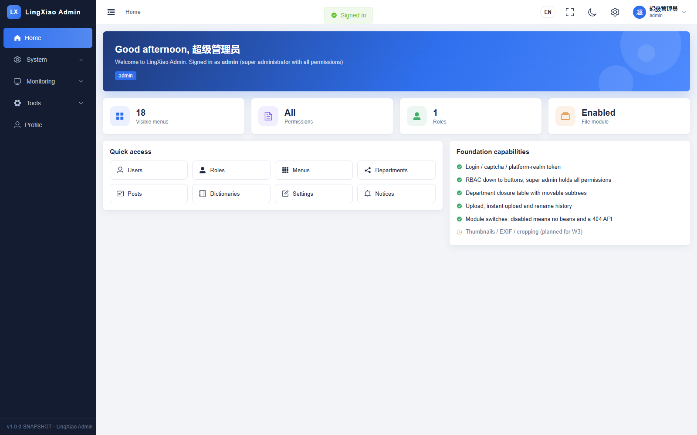
</p>

> The admin UI ships in Chinese and English (`zh-CN` / `en-US`, switchable in the top bar). Backend messages live in the database since v1.4 and can be translated, published and rolled back from the admin UI; content-level translation is a later phase, see [docs/23-i18n-plan.md](docs/23-i18n-plan.md).

## Features

**Permissions**

- Full CRUD for users, roles, menus, departments, posts, dictionaries, settings and notices
- Menu-driven dynamic routing with button-level permission codes (`platform:system:user:add`)
- Five data scopes: all, custom departments, own department, own department and below, self only
- Department tree with drag-to-move subtree support

**Authentication & security**

- Image captcha with two switches: a startup flag and a runtime setting
- Account locked for 10 minutes after 5 consecutive failures; the counter lives in the database, not in cache
- Password policy in three levels (`off` / `basic` / `strong`), enforced on create, reset and self-service change
- Changing a password invalidates every session of that account; passwords are masked in audit logs
- Single session by default: a new login kicks the old one; multi-device login can be enabled in settings
- Deleting, disabling, or resetting a password immediately invalidates all sessions of that account
- Two-sided XSS sanitization for rich text (on write and on read, verified against the raw database row)

**File center**

- Upload, instant upload (dedup), search, rename with history, download; grid and thumbnail views
- Image pipeline: strip EXIF, auto-rotate by orientation, generate `thumb` (≤160px) and `medium` (≤800px) variants
- Public access via `/api/file/{fileId}?size=thumb|medium`; `StorageService` abstraction, local disk first

**Content management (v1.1 module)**

- Standalone `lx-module-cms`; setting `lx.module.modules.cms.enabled=false` removes endpoints, migrations, menus and frontend routes together
- Site → category tree → article → tag; a closure table powers multi-level trees and subtree filtering
- Draft / publish / take-offline state machine; publishing and unpublishing have their own permission codes
- Rich-text content is sanitized against a whitelist on both write and read, so preview matches the portal
- Referential guards for sites, categories and tags; tags never cross sites
- Logos and covers use a file-center image picker; selections store a `fileId`, external URLs still work
- Public read-only portal API `/api/portal/cms/**`: sites, navigation tree, tags, article list / detail / search; published content only
- Article recycle bin, scheduled publishing, content versions with rollback; recycled articles do not hold their slug
- Content models with a field designer (article / gallery / page), single pages, navigation trees, blocks and banners; the admin issues one-time tickets to preview drafts
- Template codes and themes (`list.*` / `detail.*` / `page.*`, three built-in themes); the portal maps codes to components and falls back to the default layout

**Content portal (v1.3, `lx-ui-portal`)**

- Nuxt 3 SSR with plain CSS and no UI framework: home, category, article, search, tag, single page, preview and 404
- Page-level `title / description / canonical / OG`, article JSON-LD, `sitemap.xml` / `robots.txt` / `rss.xml`
- Member registration / sign-in / password reset / profile / favorites / likes / comments; the token lives in a cookie, never in the URL
- `/api/**` is proxied same-origin by Nitro, so the browser never talks to the backend directly and deployment only changes environment variables

**Membership (v1.2 module)**

- Standalone `lx-module-member`; member token `lx-member-token` is fully isolated from the admin `lx-platform-token`
- Registration / sign-in / password reset / profile; captcha, password policy, lockout and rate limits are runtime configurable
- Idempotent favorite and like writes; public stats are anonymous, signed-in members also get their own state
- Comments are reviewed before publishing: portal submissions stay pending until approved; the comment switch takes effect at runtime in member settings
- Clear business errors when the member or comment switch is off; the portal degrades without blank pages
- Third-party login for 27 providers, enabled per platform in the admin with write-only credentials; one-time tickets exchange for the member token
- Third-party avatars are copied into the file center; accounts sharing a phone or email are never merged silently — the member confirms the binding, or an admin merges with an audit record
- Signed-in phone / email change verifies ownership of the new value and asks for the current password when one is set

**Localization (v1.4 module)**

- Standalone `lx-module-i18n`; backend messages move from `messages*.properties` into the database: published DB value > resource bundle > default text
- Admin language management, a translation workbench (drafts / CSV import-export / coverage / missing keys), pack publish and rollback
- Drafts never reach production until published; rollback restores the snapshot; publish and rollback evict the cache immediately, other instances converge within 5 seconds
- Public `/api/portal/i18n/**` with `ETag`; disabling the module removes the `i18n_*` tables, endpoints and menus

**Operations & tooling**

- Scheduled jobs: Spring Task + database lock; create, enable/disable, run once, execution logs; no duplicate runs in a cluster
- Monitoring: online users (with force logout), server metrics (CPU / memory / JVM / disk), cache stats (Caffeine / Redis)
- Operation and login logs: paging, filtering, detail, clear
- Code generation: import table → configure columns → preview → download ZIP; 7 files plus executable menu SQL
- API docs: SpringDoc + Knife4j at `/doc.html`, with a copyable token for direct debugging

**UI**

- Light / dark / follow-system themes, 6 accent colors plus a free color picker, light or dark sidebar, stored in `localStorage`
- Element Plus theme variables fully overridden; tables, forms and dialogs follow the dark mode
- Two rich-text engines (wangEditor Next / UEditor Plus) switchable from a platform setting

**Engineering**

- Maven multi-module with auto-configuration and three-layer module switches; **disabled means not loaded** (beans, endpoints, migrations and frontend routes all go away)
- 312 unit tests in 53 test classes that need neither MySQL nor Redis; GitHub Actions covers JDK 8 / 11 / 17 plus the admin frontend build
- One jar runs on JDK 8, 11 and 17
- Production profile and packaging scripts included: `java -jar` + Nginx; prod disables the generator, API docs and SQL logging

## Screenshots

| Login | Dashboard |
|:---:|:---:|
| 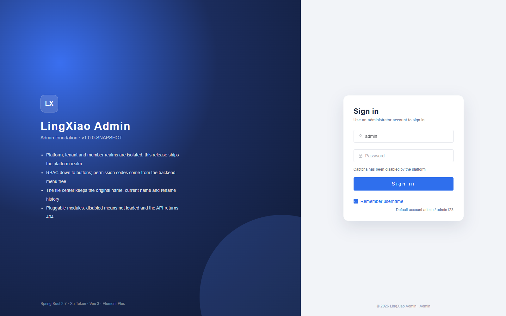 |  |
| **Users** | **Role permissions** |
| 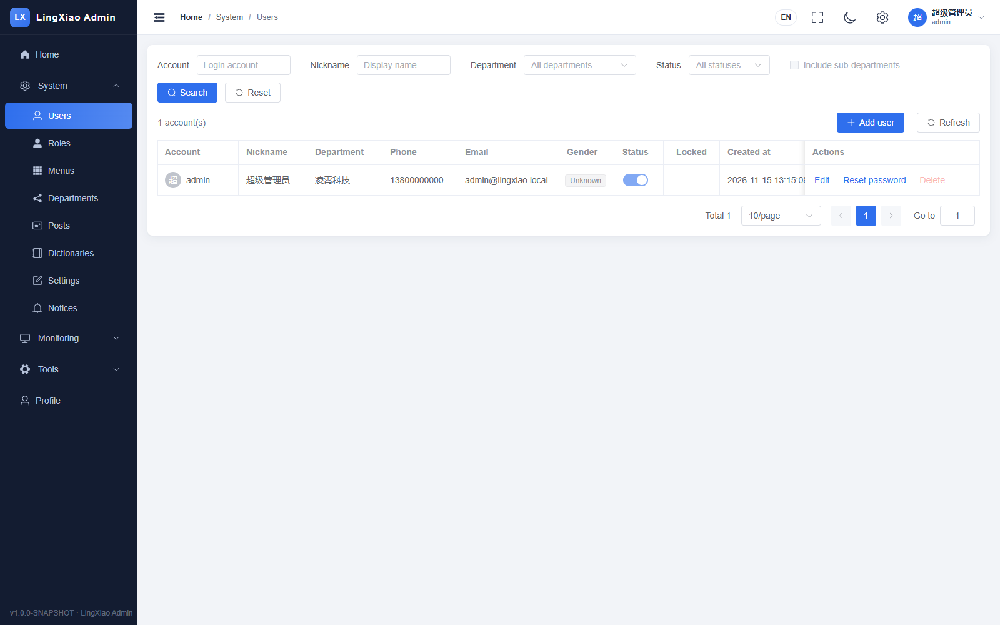 | 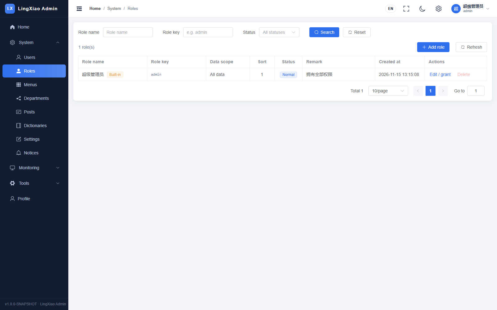 |
| **Settings (typed controls)** | **Dictionaries** |
| 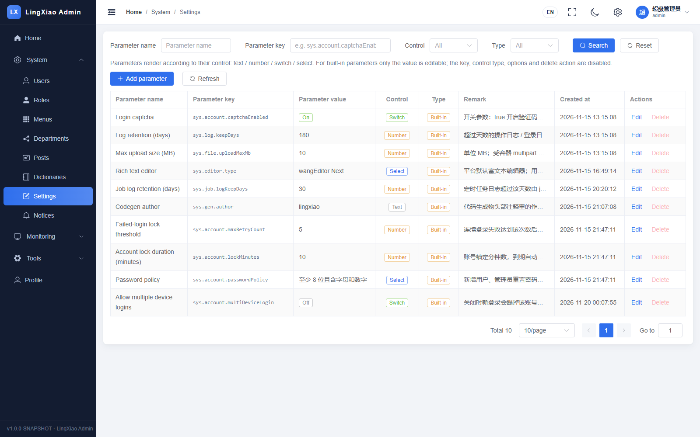 | 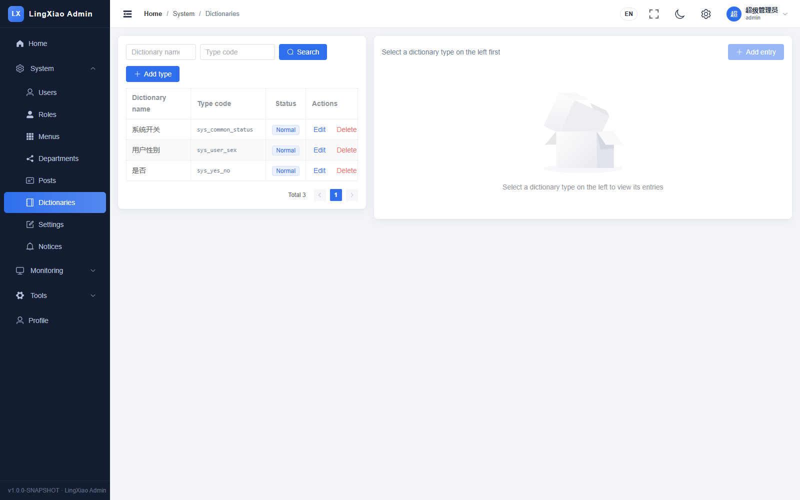 |

<details>
<summary>More screenshots (code generator / server monitor / jobs / file center / dark theme)</summary>

| Code generator | Server monitor |
|:---:|:---:|
| 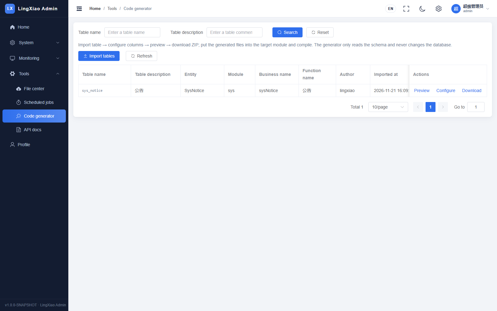 | 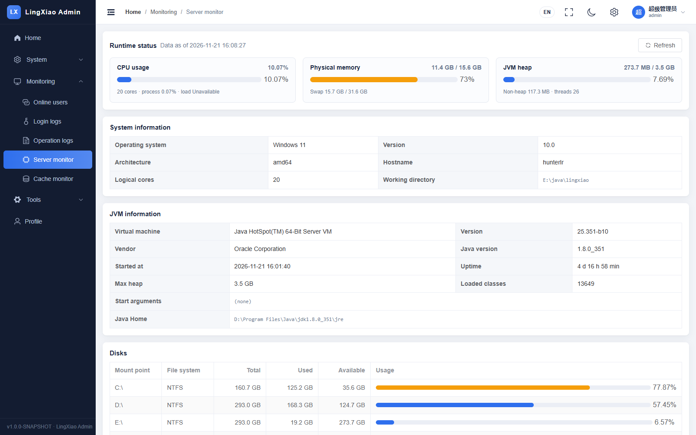 |
| **Scheduled jobs** | **File center** |
| 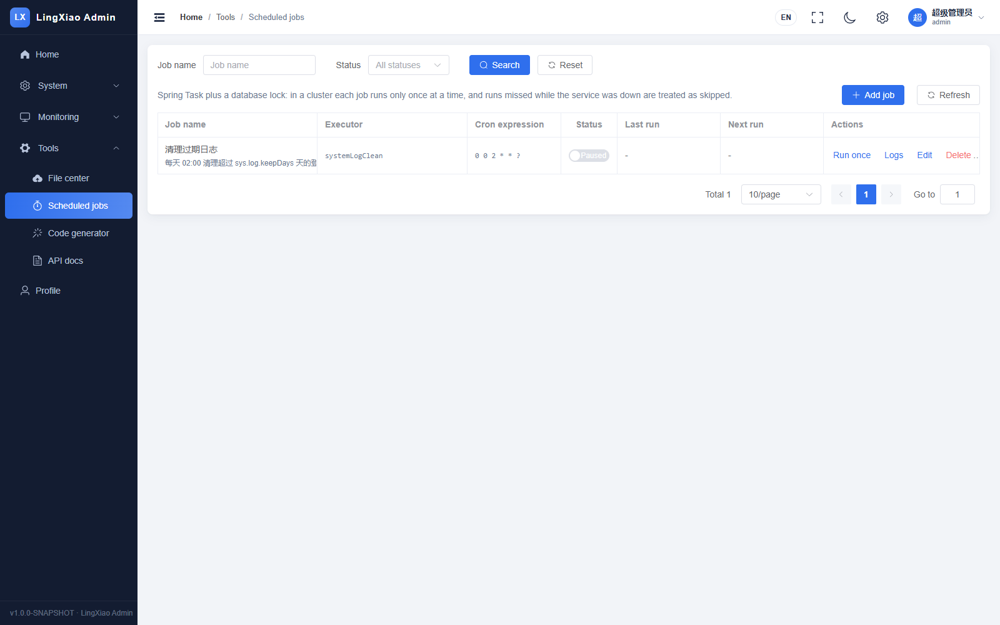 | 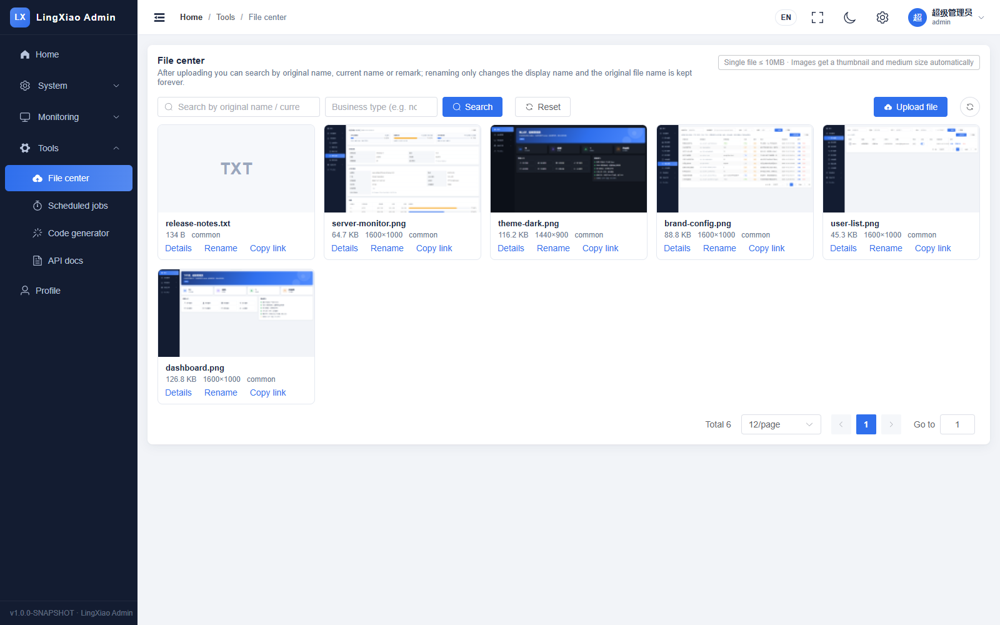 |
| **Dark theme** | **Theme drawer** |
| 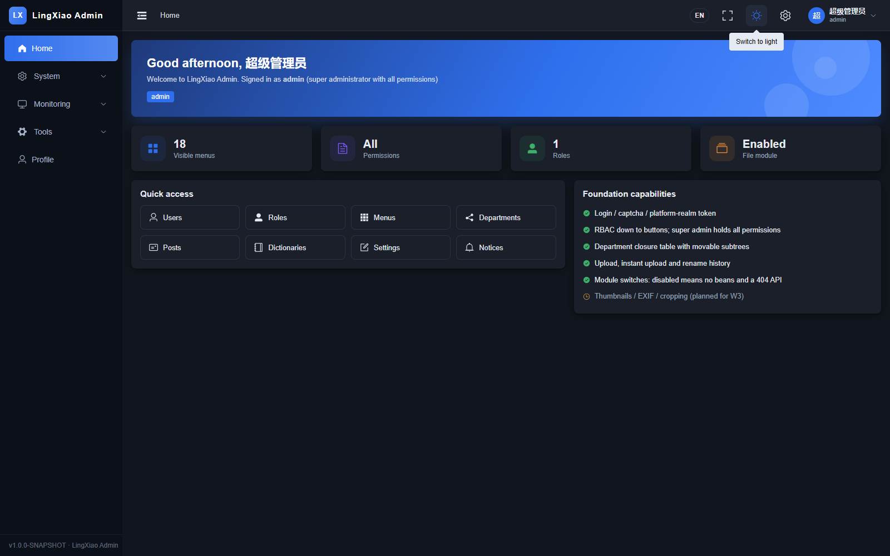 | 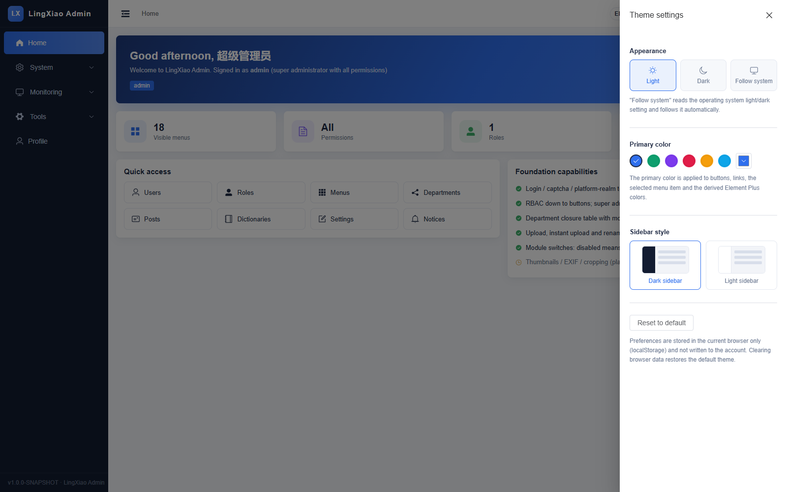 |

</details>

## Tech stack

| Layer | Choice |
|---|---|
| Runtime | JDK 8 / 11 / 17 (compiled with `release=8`, one jar for all three) |
| Backend | Spring Boot 2.7.18 · Spring MVC · Spring Validation |
| Auth | Sa-Token 1.37 (dual account realms with separate tokens) |
| Persistence | MyBatis-Plus 3.5.3.2 · HikariCP · Flyway 7.15 |
| Cache | Caffeine by default, Redis optional (`lx.redis.enabled`) |
| API docs | SpringDoc 1.7 + Knife4j 4.4 |
| Utilities | Hutool 5.8 · Lombok · Velocity 2.3 (codegen templates) · Thumbnailator 0.4.8 |
| Frontend | Vue 3.5 · Vite 5 · Element Plus 2.8 · Pinia 2 · Vue Router 4 · axios |
| Database | MySQL 5.7 / 8.0 first; PostgreSQL / DM / KingbaseES planned |

All versions are pinned in [`lx-dependencies/pom.xml`](lx-dependencies/pom.xml); the per-dependency ledger is in [docs/22-dependencies.md](docs/22-dependencies.md).

## Quick start

**Requirements**: JDK 8+, Maven 3.6+, Node 18+, MySQL 5.7 or 8.0.

```bash
# 1. Create the database and user (replace CHANGE_ME in init-db.sql first)
mysql -uroot -p < deploy/sql/init-db.sql

# 2. Build and run the backend
mvn -DskipTests package
DB_PORT=3306 DB_PASSWORD=<your-password> java -jar lx-boot/target/lingxiao.jar

# 3. Run the admin frontend (second terminal)
cd lx-ui-admin
npm ci
npm run dev

# 4. Run the content portal (optional, from the repo root in another terminal)
cd lx-ui-portal
npm ci
npm run dev
```

Open <http://127.0.0.1:5173> and sign in with `admin / admin123`. Flyway creates the business tables on first startup.

The portal runs at <http://127.0.0.1:3000> and shows published content only. The default site key is `main`;
create a site with the same `siteKey` under CMS → Sites in the admin and publish an article.
The portal's Nitro server proxies `/api/**` to `NUXT_BACKEND_BASE` (default `http://127.0.0.1:8080`).

> On Windows PowerShell, set environment variables with `$env:DB_PORT="3306"`.
> To skip incremental migrations and start with the full menu and settings data, import the
> snapshot [`deploy/sql/lingxiao-1.0.0.sql`](deploy/sql/lingxiao-1.0.0.sql).

**Configuration**

| Variable | Default | Notes |
|---|---|---|
| `DB_HOST` / `DB_PORT` | `127.0.0.1` / `3307` | Set `3306` for a standard MySQL install |
| `DB_NAME` / `DB_USER` / `DB_PASSWORD` | `lingxiao` / `lingxiao` / `lingxiao123` | Database credentials |
| `REDIS_HOST` / `REDIS_PORT` | `127.0.0.1` / `6379` | Only used when `lx.redis.enabled=true` |
| `SERVER_PORT` | `8080` | Backend port |

**Deployment**: `deploy/` contains production configuration, Linux/Windows start-stop scripts, a systemd unit, an Nginx example and packaging scripts. See [deploy/README.md](deploy/README.md).

## Project layout

```text
lingxiao/
├─ lx-dependencies/          # BOM: the single source of dependency versions
├─ lx-common/                # Contracts and utilities, no Servlet dependency
│  ├─ lx-common-core         #   R / error codes / service exception / paging
│  ├─ lx-common-mybatis      #   Base entity, field auto-fill, pagination
│  ├─ lx-common-security     #   Sa-Token realms, login context
│  ├─ lx-common-web          #   Global exception handler, Jackson, CORS
│  ├─ lx-common-redis        #   Optional Redis wiring
│  └─ lx-common-log          #   Operation log aspect
├─ lx-framework/             # Auto-configuration, interceptors, module switches
├─ lx-modules/               # Pluggable business modules
│  ├─ lx-module-system       #   Auth / users / roles / menus / dicts / settings / logs
│  ├─ lx-module-file         #   Files and image pipeline
│  ├─ lx-module-job          #   Scheduled jobs (Spring Task + database lock)
│  ├─ lx-module-cms         #   Content management (sites / categories / articles / models / pages / navigation / blocks / templates)
│  ├─ lx-module-member       #   Membership (accounts / security / interactions / comments / third-party login / channels)
│  ├─ lx-module-i18n         #   Localization (database language packs / translation workbench / publish and rollback)
│  ├─ lx-module-generator    #   Code generator (dev only, can be disabled in prod)
│  └─ lx-module-demo         #   Proves the module switch (disabled by default)
├─ lx-api/lx-admin-api/      # DTOs and contracts for /api/admin
├─ lx-boot/                  # Application entry, config, packaging
├─ lx-ui-admin/              # Vue 3 + Element Plus admin UI
├─ lx-ui-portal/             # Nuxt 3 content portal (SSR, read-only portal API + member API)
├─ deploy/                   # SQL, start-stop scripts, Nginx, release packaging
└─ docs/                     # Design documents and build log
```

> New to the codebase? Start with [`AGENTS.md`](AGENTS.md): what to read first, hard constraints, ID ranges and the pre-delivery checklist.

## API surface

```text
/api/admin/auth/**                      captcha / login / logout / current user / menu tree / change password
/api/admin/system/user|role|menu|dept|post|dict|config|notice
                                        CRUD, authorization, password reset
/api/admin/system/oper-log|login-log    operation and login logs
/api/admin/monitor/online|server|cache  online users / server metrics / cache stats
/api/admin/monitor/job/**               scheduled jobs and execution logs
/api/admin/cms/**                        sites / categories / articles / tags / models / pages / navigation / blocks / banners / templates
/api/portal/cms/**                      public read-only portal API (sites / categories / articles / tags / pages / navigation / blocks / search / preview)
/api/admin/member/**                    members / message channels / comment review / third-party login (v1.2 module)
/api/app/**                             member registration / sign-in / reset / profile / favorites / likes / comments / third-party login
/api/admin/i18n/**                      languages / translations / language packs (v1.4 module)
/api/portal/i18n/**                     public language packs for the portal
/api/admin/tool/gen/**                  code generation
/api/admin/file/**                      upload / dedup / list / rename / download
/api/file/{fileId}                      public access (?size=thumb|medium)
/doc.html                               Knife4j API documentation
```

Responses are uniform `{ code, msg, data }`: `0` success, `1xxx` general and validation, `2xxx` auth and account, `3xxx` files, `9xxx` internal errors. Tokens travel in the `lx-platform-token` header.

## Documentation

| Document | Contents |
|---|---|
| [17-v1-plan.md](docs/17-v1-plan.md) | v1.0 baseline: scope, schema, milestones |
| [01-architecture.md](docs/01-architecture.md) | Architecture and technology choices |
| [04-permission.md](docs/04-permission.md) | Dual permission realms and data scopes |
| [06-modularity.md](docs/06-modularity.md) | Three-layer module switches and SPI |
| [14-multi-database.md](docs/14-multi-database.md) | Multi-database compatibility roadmap |
| [20-cms-embed-plan.md](docs/20-cms-embed-plan.md) | CMS embedding: boundaries, contracts, implementation |
| [21-build-log.md](docs/21-build-log.md) | Build log: decisions, verification and pitfalls per round |
| [22-dependencies.md](docs/22-dependencies.md) | Dependency ledger: versions, purpose, upgrade rules |
| [26-testing-ci.md](docs/26-testing-ci.md) | Test coverage and CI matrix |
| [27-github-onboarding.md](docs/27-github-onboarding.md) | Moving to a new machine: database, startup, troubleshooting |
| [28-third-party-login.md](docs/28-third-party-login.md) | Third-party login groundwork: bindings, avatars, boundaries |
| [29-portal-api.md](docs/29-portal-api.md) | CMS portal API contract: endpoints, params, visibility, fields, caching |
| [30-member-embed-plan.md](docs/30-member-embed-plan.md) | Membership embedding: isolated accounts, registration, security, channels |
| [31-portal-frontend.md](docs/31-portal-frontend.md) | Portal frontend: pages, proxy, SEO, acceptance and pitfalls |
| [15-i18n.md](docs/15-i18n.md) / [23-i18n-plan.md](docs/23-i18n-plan.md) | Localization design and rollout: database language packs, translation workbench, content translation |
| [AGENTS.md](AGENTS.md) | Repository conventions: what to read first, hard constraints, ID ranges, pre-delivery checklist |

## Roadmap

| Version | Scope | Status |
|---|---|---|
| v1.0 | Admin foundation: permissions, files, jobs, monitoring, generator, deployment | ✅ Done |
| v1.1 | i18n L1 (bilingual UI), CMS module (admin flows, portal API, media picker) | ✅ Done |
| v1.2 | Membership (accounts, profile, security, message channels, favorites, likes, comments with review, third-party login) | ✅ Done |
| v1.3 | Nuxt 3 content portal (home / category / detail / search / member center / SEO) | ✅ Features done; deployment scripts and CI coverage pending |
| v1.4 | Internationalization and approvals: database language packs ✅, CMS templates ✅; workflow (Flowable), multi-database | 🚧 In progress |
| v2.0 | SaaS multi-tenancy | Planned |

> Current progress, open items and the next step live in [docs/13-roadmap.md](docs/13-roadmap.md) §12 (Chinese).

## Contributing

Issues and pull requests are welcome. Read [`AGENTS.md`](AGENTS.md) first, then make sure both pass:

```bash
mvn -B -ntp test                            # unit tests need no MySQL / Redis
cd lx-ui-admin && npm run build             # admin frontend build
node scripts/check-i18n-keys.mjs            # zh-CN and en-US key sets match
cd ../lx-ui-portal && npm run build         # when the portal changed
```

Style follows the existing modules: Java with 4-space indentation and Javadoc on classes and public methods; frontend with 2 spaces, Composition API and `<script setup>`; every module directory carries a `README.md` describing its boundary.

## Acknowledgements

- [RuoYi](https://gitee.com/y_project/RuoYi-Vue) — the starting point for the admin model and engineering habits
- [Spring Boot](https://spring.io/projects/spring-boot) · [MyBatis-Plus](https://baomidou.com) · [Sa-Token](https://sa-token.cc) · [Hutool](https://hutool.cn)
- [Vue](https://vuejs.org) · [Element Plus](https://element-plus.org) · [Vite](https://vitejs.dev) · [Pinia](https://pinia.vuejs.org)
- [Knife4j](https://doc.xiaominfo.com) · [wangEditor](https://www.wangeditor.com) · [UEditor Plus](https://open-doc.modstart.com/ueditor-plus/)

## License

No license has been attached yet, so all rights are reserved. Please contact the author before commercial use or redistribution.

---

<div align="center">

If this project helps you, a ⭐ star is appreciated.

</div>
