<div align="center">

# 凌霄 LingXiao

**一个开箱即用的后台基座：权限、文件、定时任务、代码生成一次到位**

[](https://github.com/hunterlr/lingxiao/actions/workflows/ci.yml)
[](docs/11-jdk-engineering.md)
[](pom.xml)
[](lx-ui-admin/package.json)
[](deploy/sql/init-db.sql)

[中文](README.md) · [English](README.en.md)

</div>

---

凌霄是一套面向中后台系统的**模块化单体**基座。它不是又一个「生成完就扔」的脚手架，而是把后台项目里最费时间的那几件事——登录与权限、文件与图片、定时任务、日志审计、代码生成、部署交付——做成可直接使用的完整闭环，业务代码只管写自己的领域逻辑。

当前版本 **v1.0** 已完成后台基座；v1.1 正在把 CMS 作为独立模块嵌入（后台站点 / 栏目 / 文章 / 标签已可用），会员、工作流、SaaS 多租户后续按同样方式接入，不需要改动基座。

<p align="center">
  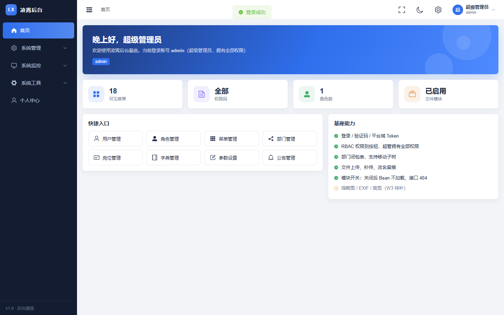
</p>

## 功能特性

**权限体系**

- 用户 / 角色 / 菜单 / 部门 / 岗位 / 字典 / 参数 / 公告 八组完整 CRUD
- 菜单驱动动态路由，按钮级权限码（`platform:system:user:add`）
- 五种数据范围：全部、自定义部门、本部门、本部门及以下、仅本人
- 部门树形结构，支持拖拽移动子树

**登录与安全**

- 图形验证码，两级开关（启动参数总闸 + 运行期参数）
- 连续失败 5 次锁定 10 分钟，失败计数落库、不依赖缓存
- 密码复杂度三档：`off` / `basic` / `strong`，新增、重置、自助改密统一校验
- 改密后该账号全部会话立即失效；操作日志密码字段脱敏
- 默认单会话，新登录踢掉旧会话；参数设置可开启多端同时在线
- 删除 / 停用 / 重置密码立即注销该账号的全部会话
- 富文本双向 XSS 清洗（写入与读取各一次，含直接查库断言）

**文件中心**

- 上传 / 秒传 / 搜索 / 改名留痕 / 下载，网格与缩略图视图
- 图片管线：剥离 EXIF、按拍摄方向转正，自动生成 thumb（≤160px）与 medium（≤800px）
- 公开访问 `/api/file/{fileId}?size=thumb|medium`，`StorageService` 抽象，本地磁盘起步

**内容管理（v1.1 模块）**

- 独立模块 `lx-module-cms`，`lx.module.modules.cms.enabled=false` 后接口、迁移、菜单、前端路由一起下线
- 站点 → 栏目树 → 文章 → 标签；栏目闭包表支持多级与子树筛选
- 文章草稿 / 发布 / 下线状态流转，发布与下线独立权限码
- 富文本正文写入与读取双侧白名单清洗，预览与门户看到的内容一致
- 站点 / 栏目 / 标签引用保护；标签不跨站点复用
- Logo / 封面接文件中心图片选择器，选中写 `fileId`，外链继续兼容
- 门户只读接口 `/api/portal/cms/**`：站点、导航树、标签、文章列表 / 详情 / 搜索，只出已发布内容

**运维与工具**

- 定时任务：Spring Task + 数据库锁，建任务 / 启停 / 执行一次 / 执行日志，集群不重复执行
- 系统监控：在线用户（可强退）、服务监控（CPU / 内存 / JVM / 磁盘）、缓存监控（Caffeine / Redis）
- 操作日志与登录日志：分页、筛选、详情、清空
- 代码生成：导入表 → 配置字段 → 预览 → 下载 ZIP，生成 7 个文件 + 可执行菜单 SQL
- 接口文档：SpringDoc + Knife4j，内嵌 `/doc.html`，可复制 Token 直接调试

**界面**

- 亮色 / 暗色 / 跟随系统，6 个主题色 + 自由取色，侧栏深浅可切，偏好存 `localStorage`
- Element Plus 全量主题变量覆盖，暗色下表格、表单、弹窗同步
- 富文本双引擎：wangEditor Next / UEditor Plus，由平台参数切换

**工程**

- Maven 多模块 + 自动装配 + 三层模块开关，**关闭 = 不加载**（Bean、接口、迁移、前端路由一起下线）
- 126 项单元测试（不依赖 MySQL / Redis），GitHub Actions 覆盖 JDK 8 / 11 / 17 与前端构建
- 一个 jar 同时跑在 JDK 8 / 11 / 17 上
- 生产配置与发布包组装脚本齐备：`java -jar` + Nginx，prod 关闭生成器 / 接口文档 / SQL 日志

## 界面预览

| 登录 | 首页 |
|:---:|:---:|
| 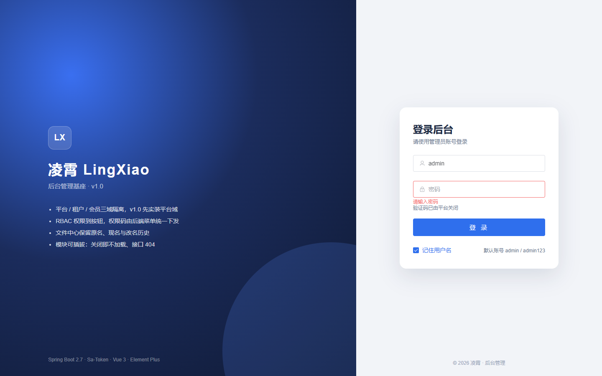 |  |
| **用户管理** | **角色授权** |
| 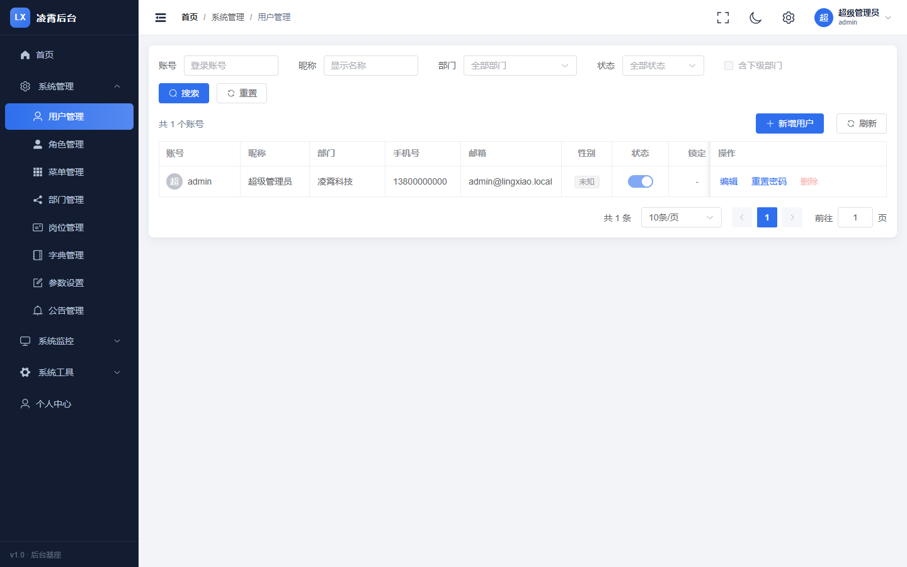 | 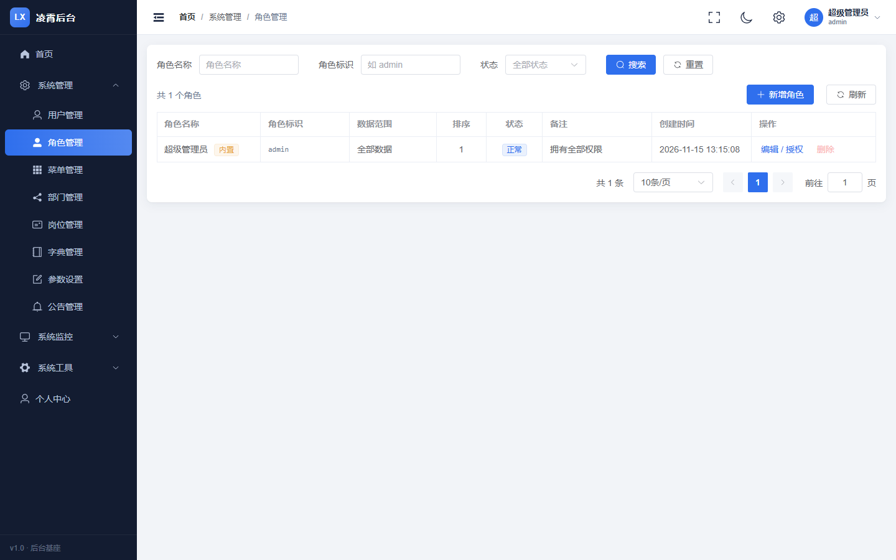 |
| **参数设置（控件化）** | **字典管理** |
| 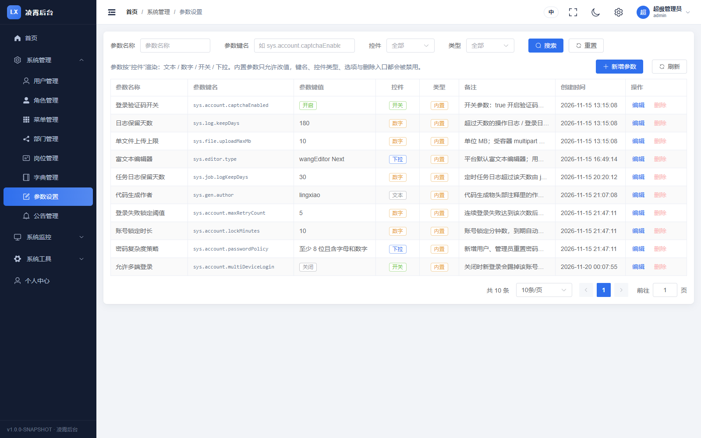 | 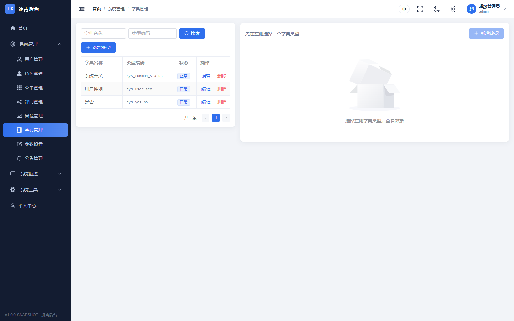 |

<details>
<summary>展开更多截图（代码生成 / 服务监控 / 定时任务 / 文件中心 / 暗色主题）</summary>

| 代码生成 | 服务监控 |
|:---:|:---:|
| 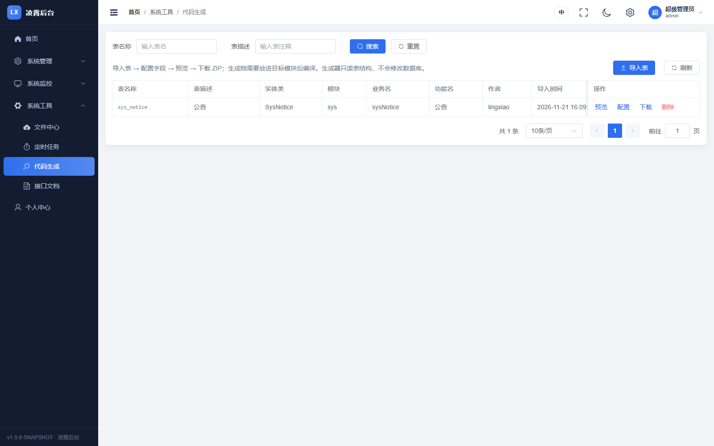 | 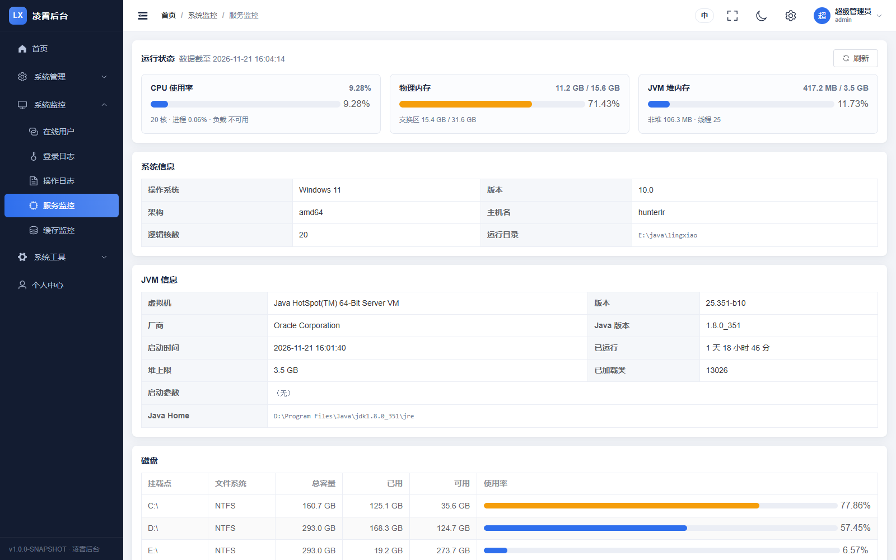 |
| **定时任务** | **文件中心** |
| 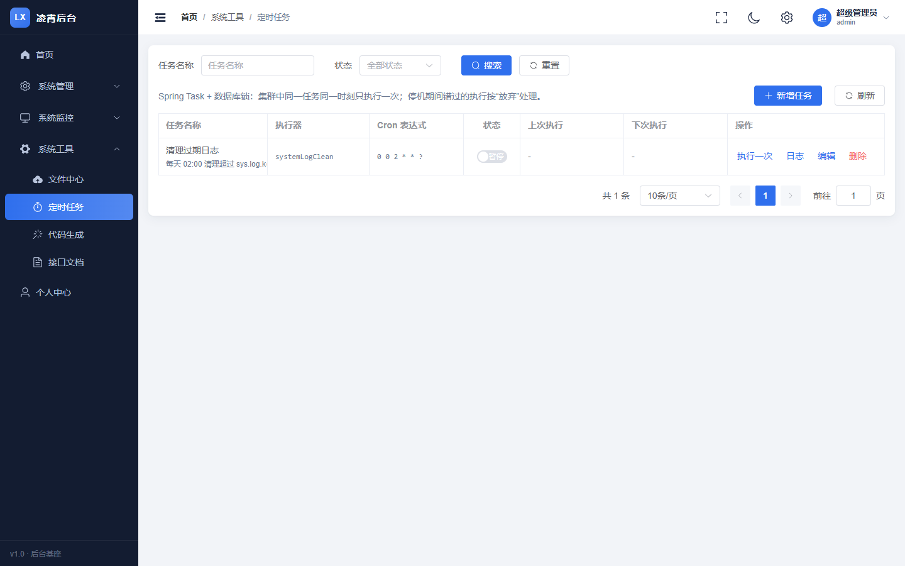 | 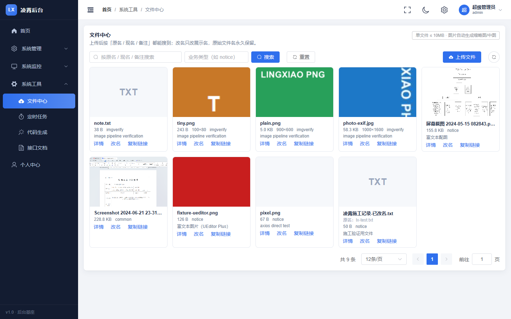 |
| **暗色主题** | **主题设置** |
| 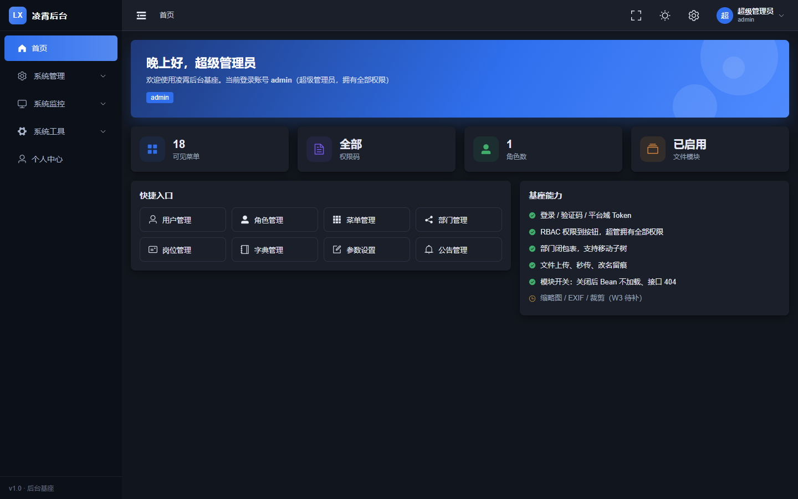 | 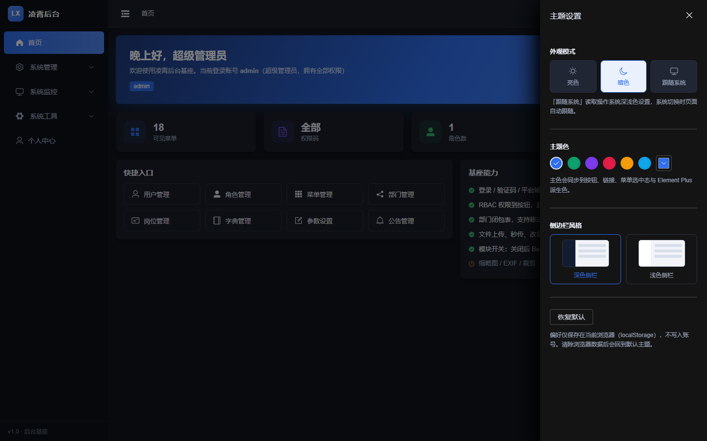 |

</details>

## 技术栈

| 层 | 选型 |
|---|---|
| 运行时 | JDK 8 / 11 / 17（编译 `release=8`，同一 jar 通用） |
| 后端 | Spring Boot 2.7.18 · Spring MVC · Spring Validation |
| 认证 | Sa-Token 1.37（后台 / 会员双账号体系，两套 Token） |
| 持久层 | MyBatis-Plus 3.5.3.2 · HikariCP · Flyway 7.15 |
| 缓存 | Caffeine（默认）/ Redis（可选，`lx.redis.enabled`） |
| 文档 | SpringDoc 1.7 + Knife4j 4.4 |
| 工具 | Hutool 5.8 · Lombok · Velocity 2.3（代码生成模板）· Thumbnailator 0.4.8 |
| 前端 | Vue 3.5 · Vite 5 · Element Plus 2.8 · Pinia 2 · Vue Router 4 · axios |
| 数据库 | MySQL 5.7 / 8.0（首发）· PostgreSQL / 达梦 / 人大金仓 规划中 |

依赖版本统一收口在 [`lx-dependencies/pom.xml`](lx-dependencies/pom.xml)，逐项用途见 [docs/22-dependencies.md](docs/22-dependencies.md)。

## 快速开始

**环境要求**：JDK 8+、Maven 3.6+、Node 18+、MySQL 5.7 或 8.0。

```bash
# 1. 建库建号（先把 init-db.sql 里的 CHANGE_ME 换成真实密码）
mysql -uroot -p < deploy/sql/init-db.sql

# 2. 构建并启动后端
mvn -DskipTests package
DB_PORT=3306 DB_PASSWORD=<你的密码> java -jar lx-boot/target/lingxiao.jar

# 3. 启动前端（另开终端）
cd lx-ui-admin
npm ci
npm run dev
```

打开 <http://127.0.0.1:5173>，用 `admin / admin123` 登录。业务表由 Flyway 在首次启动时自动创建。

> Windows PowerShell 里设置环境变量用 `$env:DB_PORT="3306"`。
> 想跳过逐条迁移、直接拿到带菜单和参数的完整数据，可以导入版本快照
> [`deploy/sql/lingxiao-1.0.0.sql`](deploy/sql/lingxiao-1.0.0.sql)。

**常用配置**

| 环境变量 | 默认值 | 说明 |
|---|---|---|
| `DB_HOST` / `DB_PORT` | `127.0.0.1` / `3307` | 数据库地址，标准 MySQL 端口请设 `3306` |
| `DB_NAME` / `DB_USER` / `DB_PASSWORD` | `lingxiao` / `lingxiao` / `lingxiao123` | 数据库账号 |
| `REDIS_HOST` / `REDIS_PORT` | `127.0.0.1` / `6379` | 仅 `lx.redis.enabled=true` 时生效 |
| `SERVER_PORT` | `8080` | 后端端口 |

**部署**：`deploy/` 提供生产配置、Linux / Windows 启停脚本、systemd 单元、Nginx 示例与发布包组装脚本，见 [deploy/README.md](deploy/README.md)。

## 目录结构

```text
lingxiao/
├─ lx-dependencies/          # BOM：所有依赖版本的唯一入口
├─ lx-common/                # 纯契约与工具，不依赖 Servlet
│  ├─ lx-common-core         #   R / 错误码 / 业务异常 / 分页
│  ├─ lx-common-mybatis      #   基础实体、字段自动填充、分页
│  ├─ lx-common-security     #   Sa-Token 双账号、登录上下文
│  ├─ lx-common-web          #   全局异常、Jackson、CORS
│  ├─ lx-common-redis        #   可选 Redis 装配
│  └─ lx-common-log          #   操作日志切面
├─ lx-framework/             # 自动装配、拦截器、模块开关
├─ lx-modules/               # 业务模块（可插拔）
│  ├─ lx-module-system       #   认证 / 用户 / 角色 / 菜单 / 字典 / 参数 / 日志
│  ├─ lx-module-file         #   文件与图片管线
│  ├─ lx-module-job          #   定时任务（Spring Task + 数据库锁）
│  ├─ lx-module-cms          #   内容管理（v1.1：站点 / 栏目 / 文章 / 标签）
│  └─ lx-module-generator    #   代码生成（开发期，生产可关）
├─ lx-api/lx-admin-api/      # /api/admin 的 DTO 与契约
├─ lx-boot/                  # 启动类、配置、打包
├─ lx-ui-admin/              # Vue3 + Element Plus 后台前端
├─ deploy/                   # SQL、启停脚本、Nginx、发布包组装
└─ docs/                     # 设计文档与施工记录
```

## 接口一览

```text
/api/admin/auth/**                      验证码 / 登录 / 登出 / 当前用户 / 菜单树 / 改密
/api/admin/system/user|role|menu|dept|post|dict|config|notice
                                        增删改查 + 授权 + 重置密码
/api/admin/system/oper-log|login-log    操作日志 / 登录日志
/api/admin/monitor/online|server|cache  在线用户 / 服务监控 / 缓存监控
/api/admin/monitor/job/**               定时任务与执行日志
/api/admin/cms/site|category|article|tag 内容管理（v1.1 模块）
/api/portal/cms/**                      门户只读接口（站点 / 栏目 / 文章 / 标签 / 搜索）
/api/admin/tool/gen/**                  代码生成
/api/admin/file/**                      上传 / 秒传 / 列表 / 改名 / 下载
/api/file/{fileId}                      公开访问（?size=thumb|medium）
/doc.html                               Knife4j 接口文档
```

统一响应体 `{ code, msg, data }`：`0` 成功，`1xxx` 通用与参数，`2xxx` 认证与账号，`3xxx` 文件，`9xxx` 系统错误。请求头 `lx-platform-token` 携带 Token。

## 文档

| 文档 | 内容 |
|---|---|
| [17-v1-plan.md](docs/17-v1-plan.md) | v1.0 执行基线：范围、表结构、里程碑 |
| [01-architecture.md](docs/01-architecture.md) | 总体架构与技术选型 |
| [04-permission.md](docs/04-permission.md) | 双权限体系与数据范围 |
| [06-modularity.md](docs/06-modularity.md) | 三层模块开关与 SPI |
| [14-multi-database.md](docs/14-multi-database.md) | 多数据库兼容与信创路线 |
| [20-cms-embed-plan.md](docs/20-cms-embed-plan.md) | CMS 模块嵌入：边界、契约、实施记录 |
| [21-build-log.md](docs/21-build-log.md) | 施工记录：每一轮的决策、验证与踩坑 |
| [22-dependencies.md](docs/22-dependencies.md) | 依赖台账：版本、用途、升级规则 |
| [26-testing-ci.md](docs/26-testing-ci.md) | 单测覆盖清单与 CI 矩阵 |
| [27-github-onboarding.md](docs/27-github-onboarding.md) | 换机器继续开发：建库、启动、排错 |
| [28-third-party-login.md](docs/28-third-party-login.md) | 第三方登录预留：绑定表、头像处理、边界 |
| [29-portal-api.md](docs/29-portal-api.md) | CMS 门户接口契约：路径、参数、可见性、字段与缓存建议 |

## 路线图

| 版本 | 内容 | 状态 |
|---|---|---|
| v1.0 | 后台基座：权限、文件、任务、监控、生成器、部署 | ✅ 已完成 |
| v1.1 | 多语言 L1（界面双语）、CMS 模块嵌入（后台链路 + 门户 API + 素材选择器已落地） | 🚧 进行中 |
| v1.2 | 会员体系、门户 Nuxt3 | 规划中 |
| v1.3 | 工作流（Flowable）、SaaS 多租户 | 规划中 |

## 参与贡献

欢迎提 Issue 和 PR。提交前请确认：

```bash
mvn -B -ntp test                 # 单测不依赖 MySQL / Redis
cd lx-ui-admin && npm run build  # 前端构建
```

代码风格沿用现有模块：Java 4 空格缩进、类与公开方法写中文 Javadoc；前端 2 空格、组合式 API + `<script setup>`；每个模块目录有 `README.md` 说明职责边界。

## 致谢

- [RuoYi](https://gitee.com/y_project/RuoYi-Vue) —— 后台模型与工程习惯的起点
- [Spring Boot](https://spring.io/projects/spring-boot) · [MyBatis-Plus](https://baomidou.com) · [Sa-Token](https://sa-token.cc) · [Hutool](https://hutool.cn)
- [Vue](https://vuejs.org) · [Element Plus](https://element-plus.org) · [Vite](https://vitejs.dev) · [Pinia](https://pinia.vuejs.org)
- [Knife4j](https://doc.xiaominfo.com) · [wangEditor](https://www.wangeditor.com) · [UEditor Plus](https://open-doc.modstart.com/ueditor-plus/)

## 许可

本项目尚未附开源协议，默认保留所有权利。如需商用或二次分发，请先联系作者。

---

<div align="center">

如果这个项目对你有帮助，欢迎点一个 ⭐ Star

</div>
