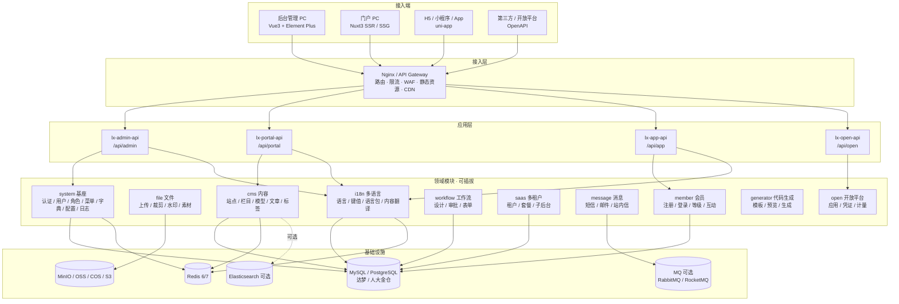
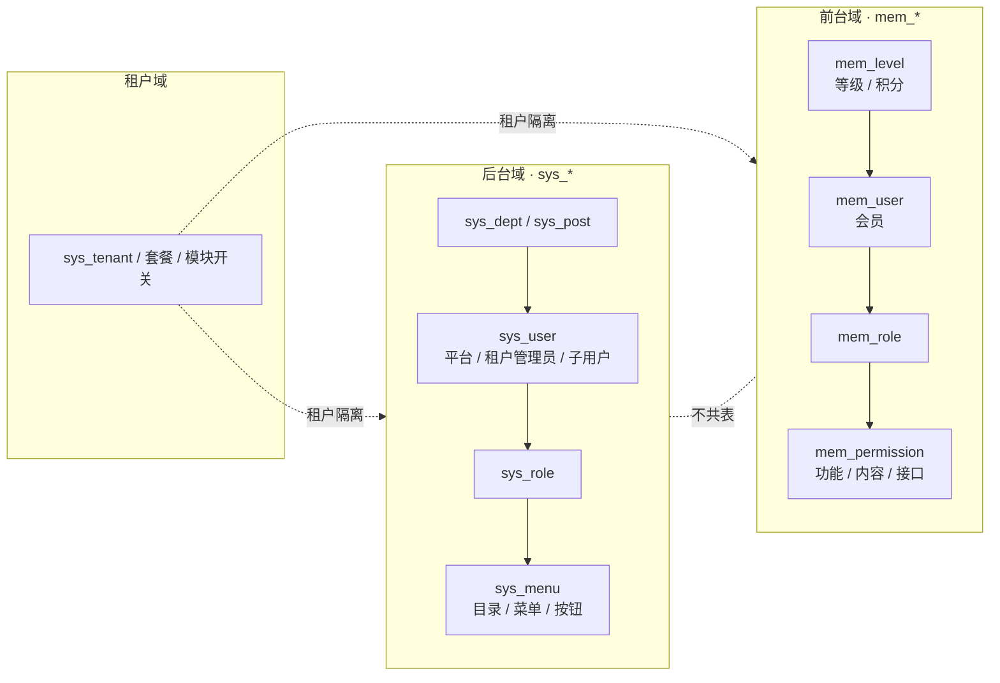

# 凌霄 LingXiao · 一体化内容与业务平台

[](https://github.com/hunterlr/lingxiao/actions/workflows/ci.yml)
[](docs/11-jdk-engineering.md)
[](#)

> 仓库：<https://github.com/hunterlr/lingxiao>（`main` 分支）
>
> 总体规划稿 v0.1 · 2026-11-10
>
> 定位：以 RuoYi 的后台基座为起点，建设一套 **后台管理 + CMS + 会员前台 + 工作流 + SaaS 多租户** 的可插拔一体化平台。后台管系统与内容，前台 PC / H5 / App 消费内容与会员服务，CMS、会员、工作流、SaaS、多语言均可用开关装卸；数据库兼容 MySQL / PostgreSQL / 达梦 / 人大金仓等。
>
> 首发策略：**单租户、jar 直部署、AI 辅助开发**；SaaS 与 Docker 作为后期可插拔能力，不改业务代码即可开启。
>
> **当前执行版本（v1.0）：只做后台基座，不做 CMS / 会员 / 门户。** CMS、会员、门户按 v1.1~v1.3 以模块嵌入，见 [20-cms-embed-plan.md](docs/20-cms-embed-plan.md)。

---

## 0. 现在就能跑（v1.0：后端基座 + 后台前端）

后端登录、菜单、**系统管理八组 CRUD**、文件中心、模块开关全部打通；
前端 `lx-ui-admin`（Vue3 + Vite + Element Plus）已完成登录、动态菜单、
18 个业务页面（系统管理 8 页 + 文件 / 个人中心 + 日志 2 页 + 监控 3 页 + 定时任务 + 代码生成 + 接口文档），
前端冒烟 **22 项全部通过、浏览器控制台无 error**；
普通角色权限闭环另行验证：**API 34 项 + UI 30 项全部通过**（菜单 / 按钮 / 深链 / 直打接口）；
日志闭环单独验证 **29 项**（写操作落库、详情、密码脱敏、清空、登录日志、匿名 401）；
验证码两级开关另有 **12 项 UI 用例**。Redis 会话 / 验证码在开启态与关闭态均已实测。
安全加固已验证：**数据范围 35 项**（本部门 / 本部门及以下 / 仅本人 / 越权 403）、
**公告 XSS 24 项**（写入与读取双侧清洗，含直接查库断言）。
参数设置已控件化（文本 / 数字 / 开关 / 下拉），后端校验 **29 项**、前端控件 UI **19 项**。
W4 系统监控三页接真实数据：在线用户可筛选 / 强退（被踢 Token 立即 401）、
服务监控采样 JDK MXBean、缓存监控按 Redis 开关分流；后端 **51 项** + 监控 UI **8 项** 全部通过。
定时任务模块接真实调度：Spring Task + 数据库锁，建任务 / 启停 / 执行一次 / 看日志可闭环，
集群不重复执行；后端 **51 项** + 模块关闭 **5 项** + 任务页 UI **9 项** 全部通过。
接口文档接入 SpringDoc + Knife4j（`/doc.html`，76 条路径），个人中心支持自助改资料 / 改密
（改密后该账号全部会话立即失效）：后端 **57 项** + UI **23 项** 全部通过。
代码生成器打通「导入表 → 配字段 → 预览 → 下载」：生成 7 个文件、Java 可编译、菜单 SQL 可执行，
后端 **105 项** + 生成器页 UI **9 项** 全部通过（回归冒烟 22 项、权限 30 项同步通过）。
图片管线补齐 W3 门禁：JPEG / PNG 上传后剥离 EXIF、按拍摄方向转正，生成 thumb（≤160px）/
medium（≤800px）两档变体；原图、缩略图、中图都可通过 `/api/file/{fileId}?size=` 访问，
后端 **27 项** + 文件中心 UI **10 项** 全部通过。
部署交付已闭环：`deploy/` 提供生产配置、建库脚本、Linux / Windows 启停、systemd、Nginx 示例与手册，
`deploy/package.ps1|sh` 组装发布包；prod profile 关闭生成器 / 接口文档 / SQL 日志，
实测 `/doc.html`、`/v3/api-docs`、`/api/admin/tool/gen/list` 均 404，登录与文件访问正常。详见 [deploy/README.md](deploy/README.md)。
登录安全已补齐：连续失败 5 次锁定 10 分钟（阈值 / 时长参数化、到期自动解锁、管理员可解锁），
失败计数落库不依赖缓存；密码复杂度支持 `off / basic / strong` 三档，
新增用户 / 重置密码 / 自助改密统一校验；后端 **59 项** + 用户页与改密 UI **8 项** 全部通过，
全新库 V1~V14 迁移一次跑通。
后台主题切换已落地：亮色 / 暗色 / 跟随系统，6 个主题色 + 自由取色，侧栏深浅可切，
偏好存 localStorage；暗色下导航、卡片、表格、输入框与 Element Plus 组件同步，
UI 用例 **12 项** + 冒烟 **22 项** 全部通过。
依赖台账见 [docs/22-dependencies.md](docs/22-dependencies.md)：后端 **102 个运行时 jar**、
前端 **12 个直接依赖**，逐项记录版本与用途。
多语言落地方案见 [docs/23-i18n-plan.md](docs/23-i18n-plan.md)，主题实现说明见
[docs/24-theme-switch.md](docs/24-theme-switch.md)，接口文档维护规范见
[docs/25-api-doc.md](docs/25-api-doc.md)。
后端单测已补齐：**66 项 / 13 个测试类**，覆盖统一响应与错误码、密码策略、富文本清洗、
菜单树、文件路径穿越、生成器命名 / 类型映射、任务 cron 校验；`mvn test` 不依赖 MySQL / Redis，
JDK 8 与 11 实测通过。最小 CI 覆盖 JDK 8/11/17 与前端构建，见
[docs/26-testing-ci.md](docs/26-testing-ci.md)。
详细施工过程见 [docs/21-build-log.md](docs/21-build-log.md)。

已可用的接口分组：

```
/api/admin/auth/**              验证码 / 登录 / 登出 / 当前用户 / 菜单树 / 个人资料 / 自助改密
/api/admin/system/user|role|menu|dept|post|dict|config|notice   增删改查 + 授权 + 重置密码
/api/admin/system/oper-log|login-log   操作日志 / 登录日志（分页 / 详情 / 清空）
/api/admin/monitor/online|server|cache   在线用户（列表 / 强退）、服务监控、缓存监控
/api/admin/monitor/job/**       定时任务（CRUD / 启停 / 执行一次 / 执行日志 / 清空日志）
/api/admin/tool/gen/**          代码生成（库表清单 / 导入 / 配置 / 预览 / 下载 ZIP / 删除配置）
/api/admin/file/**              上传 / 秒传 / 列表搜索 / 改名留痕 / 下载
/api/file/{fileId}              公开访问（?size=thumb|medium 取缩略图 / 中图）
/api/admin/modules              模块开关状态
/doc.html                       接口文档（Knife4j；OpenAPI 描述在 /v3/api-docs）
```

权限码形如 `platform:system:user:add`，按钮权限已通过 Flyway `V4` / `V8` / `V10` / `V11` / `V12` / `V13` / `V14` 落库并授予超管；普通角色需要单独授权。

```powershell
# 1) 启动项目内隔离 MySQL（端口 3307，不改动你原有的 MySQL）
& "D:\phpstudy_pro\Extensions\MySQL5.7.26\bin\mysqld.exe" `
  --defaults-file="E:\java\lingxiao\.local\mysql\my.ini" --console

# 2) 构建并启动后端
mvn -DskipTests package
java -jar lx-boot\target\lingxiao.jar

# 3) 启动前端（另开一个终端）
cd lx-ui-admin
npm ci             # 严格按 package-lock 安装
npm run dev        # http://127.0.0.1:5173
```

开发期前端把 `/api` 代理到 `http://127.0.0.1:8080`，所以浏览器只需要访问 5173；
接口文档的 `/doc.html`、`/v3/api-docs`、`/webjars` 也已一并代理（否则页面里的 iframe 会 404）。
生产由 Nginx 提供静态文件并反代 `/api` 与上述文档路径。前端说明见 [lx-ui-admin/README.md](lx-ui-admin/README.md)。

> 上面的 `.local/mysql` 是本机隔离实例，**不在仓库里**。换电脑 / 从 GitHub clone 后的
> 建库、环境变量、启动与“怎么继续任务”，见
> [docs/27-github-onboarding.md](docs/27-github-onboarding.md)。

**Redis 是可选项**：默认 `lx.redis.enabled=false`，会话走 Sa-Token 内存、验证码走 Caffeine，
不装 Redis 也能启动。多实例部署时把 `lx.redis.enabled` 改为 `true` 并填 `spring.redis.*`，
启动日志会打印当前存储模式；详见 [lx-common/lx-common-redis/README.md](lx-common/lx-common-redis/README.md)。

**登录验证码有两级开关**：`lx.captcha.enabled`（总闸，默认 true，供联调 / 自动化测试）
与参数设置里的 `sys.account.captchaEnabled`（运行期可改）。参数关掉后登录页自动隐藏验证码输入框。

**想要“clone 下来就有数据”**：建库建号之后导入版本快照
`deploy/sql/lingxiao-1.0.0.sql`（22 张业务表 + V1~V14 迁移记录 + 菜单 / 角色 / 参数 / 字典），
不用等 Flyway 逐条迁移。细节见 [deploy/README.md](deploy/README.md) 4.1 与
[docs/27-github-onboarding.md](docs/27-github-onboarding.md) 3.3。

| 项 | 值 |
|---|---|
| 后台账号 | `admin / admin123` |
| 数据库 | `127.0.0.1:3307/lingxiao`，`lingxiao / lingxiao123` |
| Token 头 | `lx-platform-token` |
| 后端 | `http://127.0.0.1:8080` |
| 前端 | `http://127.0.0.1:5173`（Vue3 + Vite + Element Plus） |

后台前端已完成的页面：

| 分组 | 页面 |
|---|---|
| 基础 | 登录（图形验证码）、首页、个人中心（自助改资料 / 改密）、403、404 |
| 系统管理 | 用户、角色（菜单树授权）、菜单、部门、岗位、字典（类型 / 数据联动）、参数（文本 / 数字 / 开关 / 下拉控件）、公告（wangEditor Next / UEditor Plus 双引擎） |
| 系统监控 | 操作日志（筛选 / 详情 / 清空）、登录日志（筛选 / 清空）、在线用户（筛选 / 强退）、服务监控（CPU / 内存 / JVM / 磁盘）、缓存监控（Caffeine / Redis） |
| 工具 | 定时任务（Spring Task + 数据库锁：建任务 / 启停 / 执行一次 / 执行日志 / 清空日志）、代码生成（导入表 / 表字段配置 / 预览 7 个文件 / 下载 ZIP / 菜单 SQL）、接口文档（Knife4j，内嵌 `/doc.html`，可复制 Token 调试） |
| 文件 | 文件中心（网格缩略图、原名 / 现名 / 备注搜索、改名留痕、详情尺寸与中图预览） |
| 占位 | 无（菜单先加、组件没跟上时仍会落到占位页） |

---

## 1. 一句话方案

**模块化单体优先、双账号权限隔离、三层模块开关、渐进式多租户。**

- 后台：Java + Spring Boot 2.7（JDK 8 字节码，兼容 8/11/17），吸收 RuoYi 的用户 / 角色 / 菜单 / 部门 / 字典 / 参数 / 日志 / 代码生成 / 定时任务 / 监控。
- 前台：PC 门户用 Nuxt 3（SSR，利于 SEO），H5 / 小程序 / App 用 uni-app，移动端独立 `/api/app` 接口与会员体系。
- 内容：CMS 采用 Headless API 为主、静态化模板为可选，栏目 / 模型 / 标签 / 文章 / 编辑器 / 审核完整闭环。
- 权限：后台 `sys_*` 与前台会员 `mem_*` **两套表、两套 Token、两套权限码**，不共用一张权限表。
- 扩展：CMS / 会员 / 工作流 / SaaS / 多语言 / 开放平台均为独立模块，构建期可裁剪、运行期可关闭、租户级可授权。
- 数据库：业务不写方言，MySQL / PostgreSQL / 达梦 / 人大金仓同一套代码，DDL 由统一模型生成。
- 多语言：数据库语言包 + 运行时热加载，后台文案、校验、菜单、CMS 内容、前端 UI 全覆盖。
- 部署：首发 `java -jar` + Nginx + 外部 MySQL / Redis，单机即可跑；后期补 Docker / compose / CI 自动化，不改造代码。
- 版本：v1.0 只做后台基座（系统管理 / 监控 / 工具 / 文件中心）；CMS、会员、门户后续以模块嵌入，不改基座。
- 演进：单租户（首发）→ 打开 SaaS 模块（不改业务表）→ 中台（统一用户、内容、文件、消息、工作流、开放平台）。
- 复用：**80% 用成熟轮子，20% 写业务与胶水**；v1.0 走“**借代码，不借架构**”——自己建骨架，搬工具层代码，不 fork 整份后台。

---

## 2. 核心决策（先看这 17 条）

| # | 决策项 | 结论 | 关键理由 |
|---|---|---|---|
| 1 | 架构风格 | **模块化单体优先**，边界清晰，后期按指标拆分 | 首发以 AI 辅助开发为主（核心 2~3 人 + AI），微服务会放大交付与运维成本 |
| 2 | JDK 策略 | 主线 Spring Boot 2.7.18，`release=8`；**同一 jar 可直接运行在 8/11/17**，17 仅 CI 冒烟；Boot 3 作为第二条构建线后置 | 一套产物同时跑 8/11/17，首发不必把 17 当验收基线，也不被它锁死 |
| 3 | 认证框架 | **Sa-Token 双账号体系**（`StpAdminUtil` / `StpMemberUtil`） | 天然支持多账号、多 Token、多权限来源，比单 Spring Security 链更好拆 |
| 4 | 权限模型 | 后台 `sys_user/sys_role/sys_menu`，前台 `mem_user/mem_role/mem_permission`，**物理隔离** | 两套主体生命周期、登录方式、权限粒度完全不同，共表必然互相污染 |
| 5 | 多租户 | **首发单租户，SaaS 后期即插即用**；业务表全部预留 `tenant_id`（默认 0），`TenantContext` 始终存在 | 关闭 SaaS 时不建租户表、不加载租户接口；后期打开只加模块，不改业务表 |
| 6 | CMS 形态 | **Headless API + Nuxt3 SSR 为主**，模板标签 + 静态化为可选模式 | 同时兼顾 SEO、多端复用与私有化低成本部署 |
| 7 | 工作流 | **Flowable 6.8 内嵌**，用 SPI 封装引擎 | 6.8 兼容 JDK 8；SPI 保证未来可换 Camunda / 自研 |
| 8 | 图片处理 | 原图不可变，裁剪 / 水印生成衍生文件；`fileId` 引用 + 引用计数 | 可回溯、可替换、可多规格，不破坏历史内容 |
| 9 | 模块开关 | **构建期 Maven Profile + 运行期 yml + 租户期套餐**，三层求交 | 关闭后不只是隐藏菜单，而是 Bean、接口、迁移、前端路由都不加载 |
| 10 | 前端选型 | 后台 Vue3 + Element Plus；门户 Nuxt3；H5 uni-app | 后台重效率，门户重 SEO，H5 重多端复用 |
| 11 | 代码生成 | 吸收 RuoYi gen，扩展多端模板、租户字段、Flyway、菜单权限 SQL | 把重复 CRUD 成本降到最低，同时不生成“半成品” |
| 12 | 中台节奏 | 先模块化单体，租户数 / 团队数 / 流量达到阈值再拆六中心 | 避免“为了中台而中台”，先把业务跑通 |
| 13 | 数据库兼容 | 业务不写方言；MyBatis-Plus `DbType` + `DatabaseDialect` SPI + 统一 schema 生成厂商 Flyway 脚本；主键用应用侧雪花 ID，时间由应用填充 | MySQL / PostgreSQL / 达梦 / 人大金仓一套代码，避免四套 DDL 漂移 |
| 14 | 多语言 | 独立 `i18n` 模块，数据库语言包 + 运行时热加载；回退链“租户语言 → 平台语言 → 默认语言 → key” | 文案不硬编码，发布即生效；CMS 内容翻译独立表，不污染主表 |
| 15 | 部署策略 | **jar 直部署先行**：`java -jar` + Nginx + 外部 MySQL / Redis；Docker / compose / CI 自动化后置 | 单机最快上线；应用无状态，后期容器化不改代码 |
| 16 | 文件存储 | `StorageService` 抽象；**本地磁盘起步**，MinIO / OSS / COS 可切换；MinIO 非首发必搭 | 单机不引入额外中间件；多实例或大图量时再上 MinIO，开发可用 Docker 一条命令起 |
| 17 | 复用优先 | **80% 用成熟轮子，20% 写业务规则与集成胶水**；v1.0 口径是“**借代码，不借架构**” | 重复造轮子 = 多写代码 + 多写测试 + 多修 bug + 多烧 AI token；架构自己定，工具层可以搬 |

---

## 3. 系统全景



---

## 4. 模块清单与开关

| 模块 | 代码 | 默认 | 运行期开关 | 依赖 | 说明 |
|---|---|---|---|---|---|
| 系统基座 | `system` | 必装 | 无 | 无 | 认证、用户、角色、菜单、部门、岗位、字典、参数、日志、公告 |
| 多语言 | `i18n` | 必装（可关） | `lx.module.i18n.enabled` | system | 语言、翻译键、语言包、热加载、内容翻译 |
| 文件中心 | `file` | 必装 | `lx.module.file.enabled` | system | 上传、存储、秒传、缩略图 / 中图、EXIF 剥离、素材库 |
| 代码生成 | `generator` | 开发期 | `lx.module.generator.enabled` | system | 生产环境建议关闭 |
| 定时任务 | `job` | 必装 | `lx.module.job.enabled` | system | Spring Task + 数据库锁，集群不重复执行 |
| 消息中心 | `message` | 必装 | `lx.module.message.enabled` | system | 短信、邮件、站内信、模板 |
| CMS | `cms` | 可选 | `lx.module.cms.enabled` | system + file | 站点、栏目、模型、内容、标签、审核 |
| 会员 | `member` | 可选 | `lx.module.member.enabled` | system + file | 注册、登录、找回、等级、积分、互动 |
| 工作流 | `workflow` | 可选 | `lx.module.workflow.enabled` | system | Flowable、表单、待办、审批 |
| SaaS | `saas` | 首发关闭 | `lx.module.saas.enabled` | system | 租户、套餐、子后台、配额；后期打开即用 |
| 开放平台 | `open` | 后期 | `lx.module.open.enabled` | system + saas | 应用、凭证、Scope、限流、计量 |
| 搜索 | `search` | 可选 | `lx.module.search.enabled` | cms | ES 索引、热词、搜索日志 |
| 支付 | `pay` | 后期 | `lx.module.pay.enabled` | member | 订单、支付、退款、对账 |

> 三层开关的含义、实现与关闭后的行为，见 [06-modularity.md](docs/06-modularity.md)。**关闭 = 不加载**，不是仅隐藏菜单。

---

## 5. 双权限体系（本项目最关键的边界）



| 维度 | 后台用户 | 前台会员 |
|---|---|---|
| 主体表 | `sys_user` | `mem_user` |
| 权限表 | `sys_role` / `sys_menu` / `sys_role_menu` | `mem_role` / `mem_permission` / `mem_role_permission` |
| Token | `lx-admin-token` | `lx-member-token` |
| 登录入口 | `/api/admin/auth/login` | `/api/app/auth/login`、`/api/portal/auth/login` |
| 权限粒度 | 菜单、按钮、接口、数据范围 | 功能、内容访问级别、接口、会员等级 |
| 数据范围 | 全部 / 自定义部门 / 本部门 / 本部门及以下 / 仅本人 | 本人 + 内容权限规则（免费 / 登录 / VIP / 等级 / 付费） |

> v1.0 平台后台已落地 `1 / 3 / 4 / 5` 四种范围；`2 自定义部门` 需要 `sys_role_dept` 关联表，
> 暂按“仅本人”降级并在保存时拒绝，见 [docs/21-build-log.md](docs/21-build-log.md) 第 26 节。
| 验证码场景 | `admin_login` | `member_login`、`member_reset` |
| 缓存命名空间 | `lx:admin:*` | `lx:member:*` |

完整设计、表结构、鉴权链路与越权防护见 [04-permission.md](docs/04-permission.md)。

---

## 6. 文档索引

| 文档 | 内容 |
|---|---|
| [01-architecture.md](docs/01-architecture.md) | 总体架构、技术选型、工程结构、缓存与部署 |
| [02-feature-list.md](docs/02-feature-list.md) | 全量功能清单（编号 / 优先级 / 阶段 / 开关 / 端） |
| [03-mindmap.md](docs/03-mindmap.md) | 20 个主题、22 张思维导图 + 架构 / ER / 流程 / 状态图 |
| [04-permission.md](docs/04-permission.md) | 双权限体系、租户权限矩阵、数据权限、前端权限 |
| [05-database.md](docs/05-database.md) | 数据库规范、分域表清单、核心 DDL、索引策略 |
| [06-modularity.md](docs/06-modularity.md) | 三层开关、SPI、自动装配、Flyway、前端模块注册 |
| [07-cms.md](docs/07-cms.md) | CMS 领域模型、存储方案、状态机、编辑器、静态化 |
| [08-workflow.md](docs/08-workflow.md) | Flowable 选型、审批模式、表单引擎、业务集成 |
| [09-media.md](docs/09-media.md) | 上传链路、裁剪、水印、引用、防盗链、性能 |
| [10-saas-middle-platform.md](docs/10-saas-middle-platform.md) | 多租户隔离、子后台、套餐、中台演进 |
| [11-jdk-engineering.md](docs/11-jdk-engineering.md) | JDK 8/11/17 兼容、依赖矩阵、CI、Boot3 迁移 |
| [12-api-codegen.md](docs/12-api-codegen.md) | 接口规范、错误码、代码生成器、接口文档 |
| [13-roadmap.md](docs/13-roadmap.md) | 阶段计划、甘特图、人力、风险、验收 |
| [14-multi-database.md](docs/14-multi-database.md) | 多数据库兼容、方言 SPI、厂商迁移、信创验收 |
| [15-i18n.md](docs/15-i18n.md) | 多语言、语言包热加载、CMS 内容翻译、SEO hreflang |
| [16-capability-tiers.md](docs/16-capability-tiers.md) | 能力分层：内核 / 可插拔模块 / 独立产品 |
| [17-v1-plan.md](docs/17-v1-plan.md) | **v1.0 执行基线**：后台基座、19 张表、6 周计划 |
| [18-day1-checklist.md](docs/18-day1-checklist.md) | Day-1 开工清单、借代码不借架构、6 条验收 |
| [19-build-vs-reuse.md](docs/19-build-vs-reuse.md) | 复用优先、自研边界、许可证红线、省 token 策略 |
| [20-cms-embed-plan.md](docs/20-cms-embed-plan.md) | **v1.1+**：CMS / 会员 / 门户模块化嵌入、契约、数据边界、验收 |
| [21-build-log.md](docs/21-build-log.md) | **施工记录**：环境、隔离 MySQL、17 个模块、Flyway 兼容、验证矩阵、前端基座、监控 / 定时任务 / 接口文档 / 代码生成 / 图片管线 / 部署交付、踩坑与修复 |
| [22-dependencies.md](docs/22-dependencies.md) | **依赖台账**：后端 102 个运行时 jar、前端直接/传递依赖、版本、用途、升级规则 |
| [23-i18n-plan.md](docs/23-i18n-plan.md) | **多语言落地方案**：v1.0 → v1.1 最小闭环、MessageSource / vue-i18n、验收清单 |
| [24-theme-switch.md](docs/24-theme-switch.md) | **后台主题切换**：CSS 变量、Element Plus 暗色、主色/侧栏、持久化与验收 |
| [25-api-doc.md](docs/25-api-doc.md) | **接口文档维护**：自动生成原理、新增接口清单、注解约定、发布核对 |
| [26-testing-ci.md](docs/26-testing-ci.md) | **单测与最小 CI**：66 项覆盖清单、测试规范、GitHub Actions 矩阵、未覆盖项 |
| [27-github-onboarding.md](docs/27-github-onboarding.md) | **上传 GitHub 与换机器继续**：依赖清单入口、会/不会入库的文件、clone 启动、继续任务流程 |
| [lx-ui-admin/README.md](lx-ui-admin/README.md) | 前端说明：启动、目录、认证与请求约定、动态路由、页面清单、已知限制 |
| [mindmap.html](docs/mindmap.html) | 可视化思维导图（浏览器打开） |

> `01`~`16` 是全量能力蓝图；`17`~`18` 是评审后的 v1.0 收缩计划，**v1.0 范围与冲突处以 17 为准**。`19` 约束“哪些必须复用、哪些必须自研”。`22`~`27` 是 v1.0 收尾补齐的依赖台账、多语言方案、主题实现、接口文档规范、单测 / CI 与换机器继续开发说明。

---

## 7. 路线图摘要

| 阶段 | 周期 | 目标 | 关键交付 |
|---|---|---|---|
| P0 立项与验证 | 2 周 | 技术风险清零 | 双账号 Demo、模块开关 Demo、单租户 Demo、jar 部署 Demo、图片管线 Demo、原型 |
| P1 基座 MVP | 6 周 | 可用的后台基座 | 登录 / 验证码 / 用户 / 角色 / 菜单 / 部门 / 字典 / 配置 / 日志 / 文件 / 代码生成 / 文档 |
| P2 CMS | 6~7 周 | 内容生产与发布闭环 | 站点 / 栏目 / 模型 / 文章 / 标签 / 编辑器 / 审核 / PC + H5 展示 |
| P2.5 多语言与多库 | 3 周 | 国际化与信创基线 | 语言包热加载 / 后台与门户翻译 / CMS 内容翻译 / PG + 达梦 + 金仓验证 |
| P3 会员前台 | 4 周 | 会员注册登录与互动 | 注册 / 登录 / 找回 / 个人中心 / 等级积分 / 评论收藏 / uni-app |
| P4 工作流 | 5 周 | 审批能力 | 设计器 / 表单 / 待办 / 审批 / 委托 / CMS 审核集成 |
| P5 图片增强 | 2~3 周 | 素材与图片运营 | 裁剪 / 水印 / 素材库 / 引用替换 / CDN |
| P6 SaaS | 6~8 周 | 多租户与子后台 | 租户 / 套餐 / 模块授权 / 隔离 / 初始化 / 配额（首发关闭，P6 开启） |
| P7 中台与容器化 | 持续 | 平台化与自动化 | 开放平台 / 统一用户 / 消息 / 搜索 / 支付 / Docker + CI 自动打包 |

> 完整排期、人力与风险见 [13-roadmap.md](docs/13-roadmap.md)。周期按 AI 辅助开发估算，实际以评审与验收效率校准。

---

## 8. 已拍板决策（12 项）

| # | 问题 | 决定 | 落地方式 |
|---|---|---|---|
| 1 | 首发是否多租户 | **首发单租户，SaaS 后期即插即用** | 业务表全部保留 `tenant_id`（默认 0），`TenantContext` 始终存在；关闭时 `lx.module.saas.enabled=false`，不建租户表、不加载租户接口；后期打开只加模块，不改业务表 |
| 2 | PC 门户形态 | **Nuxt3 SSR 为主** | 静态化作为可选模式，P6 再评估 |
| 3 | 工作流范围 | **P4 上四件套** | 串行 / 会签 / 驳回 / 转办；复杂 BPMN、子流程后置 |
| 4 | 小程序 / App | **H5 先行** | uni-app 一套代码，小程序 / App 按渠道后置 |
| 5 | 部署形态 | **jar 直部署先行，Docker 后置** | `java -jar` + Nginx + 外部 MySQL / Redis；P6 前后补 Dockerfile / compose / CI 自动打包 |
| 6 | 文件存储 | **抽象优先，本地起步，MinIO 可选** | `StorageService` 多实现；MVP 单机用本地磁盘；多实例 / 大图量再上 MinIO；开发可用 Docker 一条命令起 MinIO，不必首发搭建 |
| 7 | 内容审核 | **工作流 + 敏感词** | 机审作为插件后置 |
| 8 | 支付 / 订单 | **暂不做，字段预留** | 会员等级、内容付费字段 P3 预留；支付中心 P7 |
| 9 | JDK 17 | **不首发，但产物直接兼容** | Boot 2.7 + `release=8` 的同一 jar 可直接在 8/11/17 运行；17 仅 CI 冒烟；Boot 3 第二条线后置 |
| 10 | 团队与交付 | **AI 编程为主** | 核心 2~3 人（架构 / 全栈 + 前端）+ AI 助手；契约先行、代码生成、测试与人工评审兜底；周期见 13 |
| 11 | 首发数据库 | **MySQL 8 首发，PG 16 同步 CI** | 达梦 / 金仓按信创项目单列验收；MySQL 5.7 只兼容不压测 |
| 12 | 首发语言 | **zh-CN 默认 + en-US 预留** | `i18n` P1 接入；CMS 内容翻译 P2.5；避免后期补键成本翻倍 |

### 8.1 单租户后期加租户，为什么“好加”

前提是首发就守住三条：

1. 所有业务表带 `tenant_id bigint not null default 0`，联合索引最左放 `tenant_id`。
2. 所有请求链路有 `TenantContext`（默认 0）；MyBatis-Plus 租户插件**先接好但不加条件**（或只放行 0），后期开关一开即生效。
3. 租户相关表（`sys_tenant` / 套餐 / 模块授权）只放在 `saas` 模块的 Flyway 目录，模块关闭时不创建。

后期开启 SaaS 的改动集中在基础设施：

- 打开 `lx.module.saas.enabled`，迁移租户表；
- 打开租户解析过滤器（按域名 / 登录租户码）与租户插件；
- 打开租户管理、套餐、子后台菜单；
- 存量数据刷 `tenant_id=0` 或指定租户。

**不好加的做法（必须避免）：** 表上完全没有 `tenant_id`、SQL 手写拼条件、没有统一上下文、缓存 Key 不带租户。这些后期要全表改 + 全 SQL 改 + 全缓存改，等于重做。

### 8.2 为什么不首发 JDK 17 也能“直接兼容”

- 编译用 `maven.compiler.release=8`，产物是 JDK 8 字节码；Boot 2.7 / Spring 5.3 在 JDK 8、11、17 上都能运行。
- 所以**不需要为 17 单独打包**，同一个 `lx-boot.jar` 直接 `java -jar` 即可。
- “不首发”只是：首发验收基线定 8/11，17 放 CI 冒烟；等客户环境确实是 17 时，冒烟通过即可切换运行基线。
- 真正需要第二条构建线的是 **Spring Boot 3 + Jakarta**，那是另一个迁移项目，后置。

---

## 9. 仓库目录约定

```text
lingxiao/
├─ pom.xml
├─ lx-dependencies/            # BOM，统一版本
├─ lx-common/                  # 纯契约与工具，不依赖 Servlet
│  ├─ lx-common-core
│  ├─ lx-common-redis
│  ├─ lx-common-mybatis
│  ├─ lx-common-web
│  ├─ lx-common-security
│  └─ lx-common-log
├─ lx-framework/               # 自动装配、全局异常、拦截器、双账号配置
├─ lx-modules/
│  ├─ lx-module-system/        # 必装（v1.0 已落地）
│  ├─ lx-module-file/          # 必装（v1.0 已落地）
│  ├─ lx-module-job/           # 必装（v1.0 已落地，Spring Task + 数据库锁）
│  ├─ lx-module-generator/     # 开发期（v1.0 已落地，代码生成：预览 + ZIP）
│  ├─ lx-module-demo/          # 模块开关验证用（v1.0 已落地）
│  ├─ lx-module-i18n/          # 规划
│  ├─ lx-module-message/       # 规划
│  ├─ lx-module-cms/           # 可选（v1.1）
│  ├─ lx-module-member/        # 可选（v1.3）
│  ├─ lx-module-workflow/      # 可选
│  ├─ lx-module-saas/          # 可选
│  └─ lx-module-open/          # 后期
├─ lx-api/
│  ├─ lx-admin-api/            # /api/admin
│  ├─ lx-portal-api/           # /api/portal
│  └─ lx-app-api/              # /api/app
├─ lx-boot/                    # 启动、打包、Profile
├─ lx-ui-admin/                # Vue3 + Element Plus（v1.0 已完成，见其 README）
├─ lx-ui-portal/               # Nuxt3（规划）
├─ lx-ui-app/                  # uni-app（规划）
├─ db/                         # 统一 schema 模型 + 厂商 DDL 生成器
├─ deploy/                     # 首发 jar 启动脚本 + Nginx；后期 Dockerfile / compose / K8s
└─ docs/                       # 本规划与施工记录
```

> 上表是目标结构；**v1.0 实际存在的目录**是 `lx-dependencies`、`lx-common`（5 个子模块）、
> `lx-framework`、`lx-api`、`lx-modules`（system / file / job / generator / demo）、`lx-boot`、`lx-ui-admin`、`docs`。
> 其余目录按 v1.1+ 的模块计划逐步创建，创建时同步补各自 `README.md`。

---

## 10. 吸收 RuoYi 的精华，改掉它的天花板

**吸收：**

- 用户 / 角色 / 菜单 / 部门 / 岗位 / 字典 / 参数 / 公告的完整后台模型。
- 动态路由、按钮权限、数据范围（5 种）的实现思路。
- 操作日志、登录日志、在线用户、定时任务、服务监控。
- 代码生成器（导入表、字段配置、模板、预览、下载、菜单 SQL）。
- 统一响应、分页、全局异常、XSS 过滤、幂等 Token 等工程习惯。

**改造：**

- 单表权限 → 后台 / 前台两套权限域。
- 单体无边界 → Maven 多模块 + 自动装配 + 三层开关。
- 菜单硬编码 → 菜单带 `module_code`，按模块开关裁剪。
- 本地文件 → 存储抽象 + 图片处理管线 + 引用模型。
- 无租户 → 首发单租户，但 `tenant_id` 全链路预留 + `TenantContext` 常驻 + SaaS 模块后开。
- 手工部署 → 首发 jar + Nginx，后期 Docker / compose / CI 自动化。
- 纯人工编码 → AI 辅助开发 + 契约先行 + 代码生成 + 测试与人工评审兜底。
- Vue2 / 单端 → Vue3 后台 + Nuxt3 门户 + uni-app 多端。
- JDK 8 锁定 → 8/11/17 兼容 + Boot3 迁移线。
- MySQL 专属语法 → 方言 SPI + 统一 schema 生成多厂商 DDL。
- 中文硬编码 → i18n 模块 + 语言包热加载 + 内容翻译。
- 什么都自己写 → 复用优先：脚手架、权限、ORM、工作流、编辑器、图表、流程设计器全部用成熟组件，自研只保留业务规则与胶水（见 [19-build-vs-reuse.md](docs/19-build-vs-reuse.md)）。
