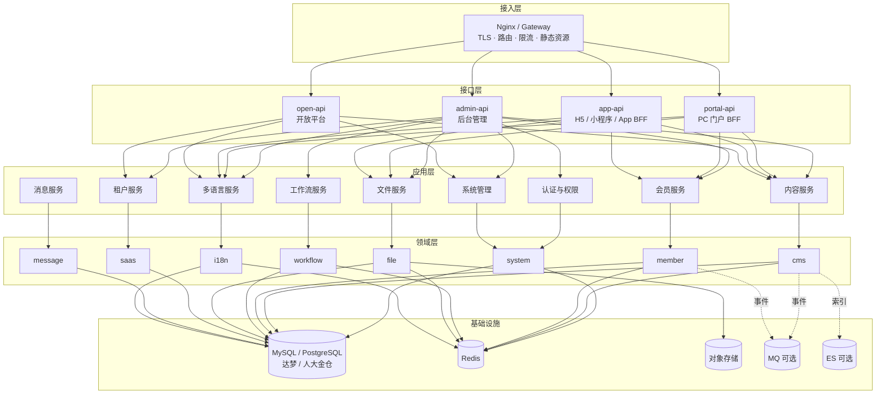
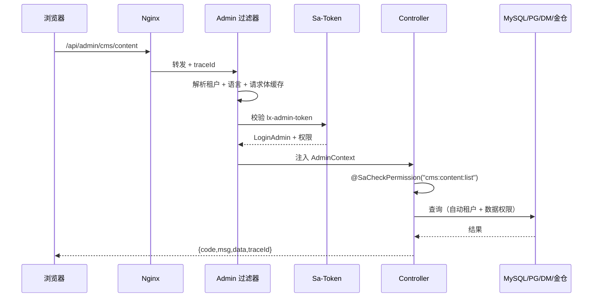
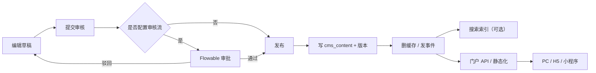
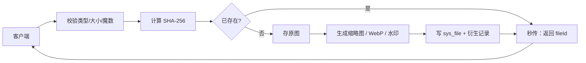
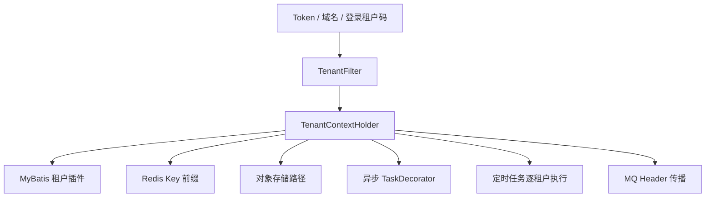
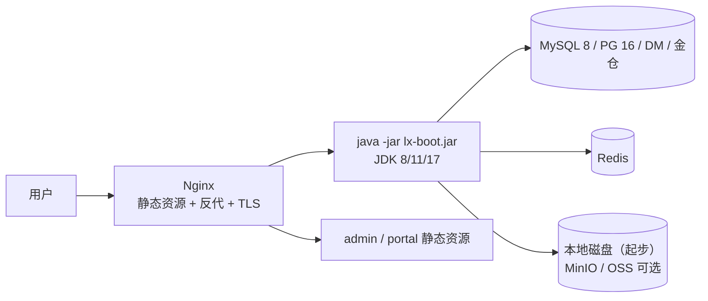
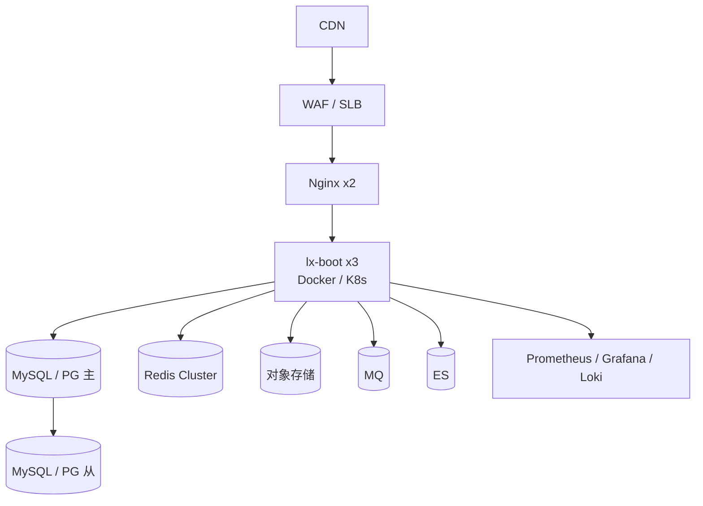

# 01 · 总体架构与技术选型

> 目标：用一套代码支撑“后台管理 + 内容门户 + 移动端 + 开放接口”，在 **AI 辅助开发（核心 2~3 人 + AI）、6~8 个月周期**内可控交付，并保留多租户与中台演进路径。

---

## 1. 架构目标与非目标

### 1.1 目标

| 目标 | 可验证标准 |
|---|---|
| 一套后端服务多端复用 | `/api/admin`、`/api/portal`、`/api/app`、`/api/open` 四组接口共享领域服务 |
| 双账号物理隔离 | 后台与会员不共表、不共 Token、不共权限缓存；渗透测试无横向越权 |
| 模块可装卸 | 关闭 CMS 后：Bean 不加载、接口 404、表不迁移、菜单不返回、前端路由不注册 |
| JDK 兼容 | 同一 jar 在 JDK 8 / 11 / 17 启动并通过冒烟测试 |
| 多租户可演进 | 单租户部署零改造；开启 SaaS 后业务代码不感知租户字段 |
| 内容发布闭环 | 编辑 → 审核 → 发布 → 前台展示 → 下线，全链路可追踪 |
| 图片可运营 | 上传后可裁剪、加水印、替换引用，原图可回溯 |
| 多数据库兼容 | 同一份代码在 MySQL / PostgreSQL / 达梦 / 人大金仓启动，核心流程通过集成测试 |
| 多语言可热插拔 | 语言包发布后 5s 内生效，无需重启；后台、门户、CMS 内容均可切换语言 |

### 1.2 非目标（首期不做）

- 不首发微服务、不首发 Service Mesh。
- 不首发 Docker / K8s 自动化，先用 jar 直部署。
- 不首发多租户，SaaS 模块后开。
- 不自研工作流引擎、不自研富文本内核。
- 不首发全量静态化集群、不首发多活。
- 不做跨租户内容共享市场（预留字段，不做产品）。
- 不做复杂计费（只做配额与用量，支付后置）。

---

## 2. 架构原则

1. **模块化单体优先**：一个进程、一个数据库，模块间用接口与领域事件解耦；达到拆分阈值再拆。
2. **契约先行**：先定 API、错误码、权限码、表结构，再写实现；前端可并行 Mock。
3. **双域隔离**：后台域（`sys_` / `admin`）与前台域（`mem_` / `member`）从表、Token、缓存到权限注解全链路分开。
4. **开关驱动**：所有可选能力必须有“构建期 / 运行期 / 租户期”三级开关，默认关闭也要能安全启动。
5. **原图不可变**：媒体处理只生成衍生文件，不覆盖原图；内容引用 `fileId` 而非裸 URL。
6. **租户上下文显式传递**：不信任前端传入的 `tenant_id`；异步、定时任务、MQ 必须显式传播。
7. **可观测优先**：每个请求有 `traceId`，每个模块有指标，每个高危操作有审计。
8. **渐进式复杂**：能用单体 + 模块解决，不引入分布式事务；能用数据库解决，不引入中间件。
9. **方言收敛**：业务不写数据库方言；差异只允许出现在 `DatabaseDialect` SPI 与厂商迁移脚本。
10. **文案外置**：代码不写死面向用户的文案；错误码只存 `messageKey`，前端只写 `$t('key')`。
11. **复用优先**：能复用成熟、可商用、维护活跃的组件，就不自研；自研只做业务规则、集成胶水、差异化体验。选型必须过许可证与供应链审查（见 [19-build-vs-reuse.md](19-build-vs-reuse.md)）。

---

## 3. 逻辑架构



**分层约束：**

- `lx-common-*` 不依赖任何业务模块，不依赖 Servlet API（为 Boot3 迁移留路）。
- `lx-modules/*` 只能依赖 `common` 与 `framework`，模块之间通过 `api` 包下的接口或领域事件交互，禁止直接注入对方 Mapper。
- `lx-api/*` 只做参数校验、权限注解、DTO 转换、聚合编排，不写核心业务。
- `lx-boot` 只做装配与启动，不写业务。

---

## 4. 技术选型

### 4.1 后端

| 领域 | 选型 | 版本 | JDK 8 | 说明 |
|---|---|---|---|---|
| 语言 | Java | 8 字节码 | ✅ | 源码级别 8，CI 覆盖 11/17 |
| 框架 | Spring Boot | 2.7.18 | ✅ | 最后一个 2.x，支持 8/11/17 |
| 认证 | Sa-Token | 1.38.x | ✅ | 双 StpLogic、注解鉴权、Token 风格 |
| ORM | MyBatis-Plus | 3.5.7 | ✅ | 租户插件、分页、逻辑删除、代码生成友好 |
| 数据库 | MySQL / PostgreSQL / 达梦 / 人大金仓 | MySQL 5.7/8.0、PG 12~16、DM8、KingbaseES V8 | — | 方言 SPI 隔离，详见 14 |
| 多语言 | Spring MessageSource + Caffeine + Redis | Boot 管理 | ✅ | 数据库语言包、版本发布、热加载，详见 15 |
| 连接池 | Druid | 1.2.23 | ✅ | 监控、SQL 防火墙、多数据源 |
| 缓存 | Redis + Redisson | 6/7 · 3.27 | ✅ | 分布式锁、限流、缓存 |
| 迁移 | Flyway | Boot 管理 8.5.x | ✅ | 按模块分目录 |
| 工作流 | Flowable | 6.8.0 | ✅ | BPMN 2.0，7.x 需 JDK17，故锁 6.8 |
| 文档 | Knife4j + SpringDoc | 4.4.0 / 1.7 | ✅ | 分组、调试、OpenAPI 3 |
| 工具 | Hutool | 5.8.32 | ✅ | 克制使用，避免大杂烩 |
| Excel | EasyExcel | 3.3.4 | ✅ | 导入导出、低内存 |
| 图片 | Thumbnailator | 0.4.20 | ✅ | 默认实现；高并发可切 libvips |
| 对象存储 | MinIO SDK | 8.5.x | ✅ | S3 协议，兼容 OSS/COS |
| 定时任务 | Spring Task + 数据库锁（v1.0）/ Quartz（复杂调度后置） | Spring 5.3 / 2.3.2 | ✅ | v1.0 只需启停 / 执行一次 / 日志、集群不重复；Quartz 多 12 张表且信创方言缺失 |
| 映射 | MapStruct | 1.5.5.Final | ✅ | 编译期生成，无反射 |
| 简化 | Lombok | 1.18.32 | ✅ | 统一版本，避免 IDE 差异 |
| 测试 | JUnit5 + Testcontainers | 5.10 / 1.19 | ✅ | 集成测试用真实 MySQL / PostgreSQL / Redis |

> 版本以 `lx-dependencies` BOM 锁定，禁止各模块自行升级。完整兼容矩阵见 [11-jdk-engineering.md](11-jdk-engineering.md)。
>
> **复用与许可证：** 上表均为成熟组件，不自研同类内核。许可证红线：不用 XXL-Job（GPL-3.0）、Halo（GPL-3.0）、Elasticsearch（Elastic/SSPL）；MinIO / Grafana / Loki（AGPL-3.0）作为独立服务使用并评估分发合规；调度优先 Quartz / PowerJob（v1.0 为了少 12 张表与信创兼容，用 Spring Task + 数据库锁，见 [21-build-log.md](21-build-log.md) 第 29 节），搜索用 OpenSearch / Meilisearch。详见 [19-build-vs-reuse.md](19-build-vs-reuse.md)。

### 4.2 前端

| 端 | 选型 | 说明 |
|---|---|---|
| 后台管理 | Vue 3.4 + Vite 5 + TypeScript + Element Plus + Pinia + Vue Router | 动态路由、按钮权限、字典、代码生成页面 |
| 门户 PC | Nuxt 3.12 + Vue 3 + Tailwind CSS | SSR / SSG，SEO、首屏、sitemap |
| H5 / 小程序 / App | uni-app（Vue3 + Vite）+ wot-design-uni | 一套代码多端，分包、自定义 TabBar |
| 富文本 | WangEditor 5（默认），适配 TinyMCE / CKEditor / Markdown | 编辑器适配器，图片接入文件中心 |
| 图片裁剪 | vue-cropper（后台）、Canvas 裁剪（H5） | 服务端裁剪兜底，参数化 |
| 流程设计 | bpmn-js 17 | BPMN 2.0 建模 |
| 表单设计 | form-create 3 或自研 | 动态表单、权限、联动 |
| 图表 | ECharts 5 | 后台统计与大屏 |
| 表格 | Element Plus Table + vxe-table（大数据量可选） | 虚拟滚动 |

### 4.3 运维与可观测

| 能力 | 选型 |
|---|---|
| 部署 | 首发 `java -jar` + Nginx（单机/双机）；后期 Docker Compose（开发/小型私有化）、K8s（生产） |
| CI/CD | GitLab CI / Jenkins，构建矩阵 JDK 8/11/17；后期自动打镜像 |
| 监控 | Actuator + Prometheus + Grafana |
| 日志 | Logback JSON + Loki / ELK，`traceId` 贯穿 |
| 链路 | SkyWalking（可选，P6 后） |
| 告警 | Alertmanager + 企业微信/钉钉 |
| 备份 | 数据库全量 + binlog / WAL，对象存储版本化 |

---

## 5. 工程结构

```text
lingxiao/
├─ pom.xml                          # 聚合 + 属性
├─ lx-dependencies/pom.xml          # BOM
├─ lx-common/
│  ├─ lx-common-core/               # 结果、异常、常量、工具、租户上下文
│  ├─ lx-common-redis/              # RedisTemplate、锁、限流、缓存 Key 规范
│  ├─ lx-common-mybatis/            # MP 配置、租户插件、数据权限拦截器
│  ├─ lx-common-web/                # 全局异常、响应包装、XSS、幂等
│  ├─ lx-common-security/           # Sa-Token 双账号、权限注解、登录用户模型
│  └─ lx-common-log/                # 操作日志、审计日志注解与切面
├─ lx-framework/                    # 自动装配、模块注册表、Flyway 编排
├─ lx-modules/
│  ├─ lx-system/
│  │  ├─ lx-system-api/             # 对外接口与 DTO（其他模块可依赖）
│  │  └─ lx-system-biz/             # 领域实现
│  ├─ lx-i18n/                      # 多语言（必装可关）
│  ├─ lx-file/
│  ├─ lx-generator/
│  ├─ lx-job/
│  ├─ lx-message/
│  ├─ lx-cms/
│  ├─ lx-member/
│  ├─ lx-workflow/
│  ├─ lx-saas/
│  └─ lx-open/
├─ lx-api/
│  ├─ lx-admin-api/
│  ├─ lx-portal-api/
│  └─ lx-app-api/
├─ lx-boot/                         # 启动、Profile、打包
├─ lx-ui-admin/
├─ lx-ui-portal/
├─ lx-ui-app/
├─ db/
│  ├─ schema/                       # 统一 schema 模型（YAML）
│  ├─ generator/                    # 厂商 DDL 生成器
│  └─ migration/                    # 生成后的 mysql / postgresql / dm / kingbase 脚本
├─ deploy/
│  ├─ docker/
│  ├─ nginx/
│  ├─ k8s/
│  └─ sql/
└─ docs/
```

**模块内部标准分层：**

```text
com.lingxiao.cms
├─ api/                # 对外契约：CmsContentApi、DTO
├─ controller/
│  ├─ admin/           # /api/admin/cms/**
│  ├─ portal/          # /api/portal/cms/**
│  └─ app/             # /api/app/cms/**
├─ service/            # 领域服务接口
├─ service/impl/
├─ mapper/
├─ domain/             # Entity / ValueObject / Enum
├─ dto/                # Request / Response
├─ convert/            # MapStruct
├─ event/              # 领域事件
├─ config/             # 模块自动装配
└─ support/            # 模块内工具
```

---

## 6. 请求链路

### 6.1 后台请求



### 6.2 前台请求

- `/api/portal/**`：PC 门户，支持 Cookie + Bearer 双读，SSR 场景由 Nuxt 服务端携带 Token。
- `/api/app/**`：H5 / 小程序 / App，强制 `lx-member-token`，支持设备号、版本号、渠道号。
- 会员未登录也可访问公开内容；内容权限在 Service 层二次校验，不能只靠前端隐藏。

### 6.3 开放平台请求

- `X-App-Key` + `X-Timestamp` + `X-Nonce` + `X-Sign`（HMAC-SHA256）。
- Scope 校验 + 租户绑定 + 限流 + 计量；回调走 `/api/callback/**`，单独验签。

---

## 7. 数据流

### 7.1 内容发布



### 7.2 图片上传



### 7.3 租户上下文

> **v1.0 不建租户上下文**：平台后台域不带 `tenant_id`、不接租户插件、不建 `TenantContext`；下图是**租户应用立项时**的蓝图，见 `17-v1-plan.md` 3.4.1 与 `16-capability-tiers.md` 5.3。



- 单租户模式：`tenantId=0`，插件不拼条件，缓存 Key 仍带 `0`。
- 多租户模式：按域名 / 登录租户码解析，插件强制拼 `tenant_id`，跨租户返回 403。
- 切换只动基础设施与 `saas` 模块，不动业务 Service。

---

## 8. 缓存设计

| 缓存 | Key 规范 | TTL | 失效策略 |
|---|---|---|---|
| 后台登录态 | `lx:admin:token:{token}` | 12h / 活跃 30m | 登出、强退、改密 |
| 会员登录态 | `lx:member:token:{token}` | 7d / 活跃 2h | 登出、改密、注销 |
| 管理员权限 | `lx:admin:perm:{userId}` | 30m | 角色 / 菜单变更主动删 |
| 会员权限 | `lx:member:perm:{memberId}` | 30m | 角色 / 等级变更主动删 |
| 系统参数 | `lx:config:{tenantId}:{key}` | 1h | 参数保存主动删 |
| 字典 | `lx:dict:{type}` | 1h | 字典变更主动删 |
| CMS 栏目树 | `lx:cms:cat:{siteId}` | 10m | 栏目变更主动删 |
| CMS 内容详情 | `lx:cms:content:{id}:{version}` | 30m | 发布 / 下线主动删 |
| 门户首页 | `lx:portal:index:{tenantId}:{siteId}` | 1~5m | 发布事件 + 短 TTL |
| 租户模块 | `lx:tenant:modules:{tenantId}` | 10m | 套餐 / 开关变更 |
| 语言包 | `lx:i18n:pack:{tenantId}:{lang}:{ns}:{version}` | 1h | 发布新版本 / 回滚 |
| 语言列表 | `lx:i18n:langs:{tenantId}` | 30m | 语言启停 / 租户默认语言变更 |
| 翻译键 | `lx:i18n:key:{namespace}` | 30m | 键新增 / 停用 |

**原则：**

- 所有 Key 带 `tenantId`（单租户时为 0），避免多租户串数据。
- 缓存只缓存“读多写少”的数据；权限变更用“主动删除 + 短 TTL”双保险。
- 禁止缓存大对象列表；列表缓存只缓存 ID，回表取详情。
- 防穿透：空值短缓存 + 布隆过滤器（可选）；防击穿：逻辑过期 / 互斥锁；防雪崩：TTL 加随机抖动。

---

## 9. 异步与事件

首期不强制引入 MQ，采用 **Spring Event + 本地事务表（Outbox）**；需要跨服务时再切 RabbitMQ / RocketMQ。

| 事件 | 生产者 | 消费者 | 用途 |
|---|---|---|---|
| `ContentPublishedEvent` | CMS | 搜索、静态化、缓存、消息 | 发布后联动 |
| `ContentOfflineEvent` | CMS | 缓存、搜索 | 下线 |
| `FileUploadedEvent` | File | 图片处理、审计 | 异步衍生 |
| `FileReferencedEvent` | CMS / Member | File | 引用计数 |
| `MemberRegisteredEvent` | Member | 消息、积分 | 欢迎信、送积分 |
| `TenantCreatedEvent` | SaaS | 初始化、缓存 | 建库建表、初始化管理员 |
| `WorkflowCompletedEvent` | Workflow | 业务模块 | 状态回写 |

**约束：**

- 事件消费必须幂等（`event_id` 去重表）。
- 事务内只写 Outbox，事务提交后异步投递，避免“业务成功、消息丢失”。
- 异步线程必须传递 `TenantContext` 与 `traceId`。

---

## 10. 部署架构

> 首发用 **jar 直部署**：`java -jar lx-boot.jar` + Nginx + 外部 MySQL / Redis，单机即可上线；Docker / compose / K8s 作为后期演进，应用本身无状态，不改代码。

### 10.1 首发：单机 / 双机（jar）



- 启动脚本放 `deploy/`：`start.sh` / `stop.sh` / `lx-boot.service`（systemd），带 JVM 参数、日志目录、优雅停机。
- Nginx 负责 HTTPS、静态资源、`/api` 反代、上传大小限制、gzip/brotli。
- 文件默认落本地目录（如 `/data/lingxiao/files`），通过 `StorageService` 抽象；需要多实例或大图量时切 MinIO / OSS，不改业务代码。
- 单机也建议 Redis 独立进程；没有 Redis 时退化为本地缓存（仅开发/演示，不用于生产）。

### 10.2 后期：Docker / 生产集群



**部署要点：**

- 应用无状态，会话全部在 Redis；可水平扩容。
- 定时任务用 Quartz 集群或 XXL-Job，避免多实例重复执行。
- Flyway 在启动时执行，生产使用 `baseline-on-migrate` + 迁移审批；多实例用分布式锁保证只跑一次。
- 首发允许本地磁盘；进入多实例前必须切对象存储（MinIO / OSS / COS / S3）。
- 后期容器化：`Dockerfile`（分层、非 root、健康检查）+ `compose.yaml` + CI 自动打镜像与推送；K8s 只在多节点客户上启用。
- 灰度：按租户 / 用户 / Header 路由；数据库变更必须向前兼容（先加列、再写、再读、后删）。

---

## 11. 非功能指标

| 指标 | 目标 |
|---|---|
| 接口 P95 | 读 < 200ms，写 < 500ms（不含图片处理） |
| 首页首屏 | PC < 1.5s（CDN + SSR），H5 < 2s（4G） |
| 并发 | 单节点 1000 QPS 读；集群可线性扩展 |
| 图片上传 | 10MB 图片 < 2s 返回原图地址，衍生图异步 < 5s |
| 可用性 | 99.9%（生产集群） |
| 恢复目标 | RPO < 5min，RTO < 30min |
| 安全 | 通过 OWASP Top 10 自查 + 等保 2.0 三级基线（如需要） |
| 兼容 | Chrome / Edge / Safari 最近两个大版本；微信 / 支付宝小程序；iOS / Android 主流版本 |
| 数据库 | MySQL 5.7/8.0、PG 12~16 全量通过；达梦 DM8、金仓 V8 核心流程通过 |
| 多语言 | 语言包命中 < 1ms，发布生效 < 5s，缺失键不导致业务失败 |

---

## 12. 技术风险与对策

| 风险 | 影响 | 对策 |
|---|---|---|
| 一套代码兼容 8/11/17 | 构建失败、运行期 `NoSuchMethod` | `release=8` + Animal Sniffer + CI 三 JDK 矩阵 + 禁用 API 清单 |
| Flowable 表膨胀 | 审批历史拖慢数据库 | 历史级别配置、定期归档、独立数据源可选 |
| CMS 动态模型 | 查询慢、索引难 | JSON + 生成列；重模型走物理扩展表；搜索交 ES |
| 多租户越权 | 数据泄露 | 上下文强制注入、跨租户拦截、自动化越权测试 |
| 模块开关不彻底 | 关闭后仍加载 | 构建期裁剪 + 条件装配 + 契约测试（关闭态启动） |
| 双端一致性 | 三端体验割裂 | OpenAPI 契约 + 代码生成 + 统一 DTO |
| 图片处理成本 | CPU / 存储上涨 | 异步、限尺寸、WebP、CDN、按租户配额 |
| 多库 DDL 漂移 | 某厂商升级失败 | 统一 schema 生成 + CI diff + 多库集成测试 |
| 业务 SQL 夹带方言 | 换库即报错 | Dialect SPI + SQL 静态检查 + 代码评审 |
| 翻译键失控 | 缺翻译 / 文案不一致 | 命名规范 + 发布前完整性检查 + 覆盖率看板 |
| 语言包缓存不一致 | 前端文案错乱 | 版本号 + Redis 广播 + 短 TTL 兜底 |
| 范围蔓延 | 延期 | 阶段门禁 + MVP 清单 + 开关后置 |

---

## 13. 关键取舍记录（ADR 摘要）

| 编号 | 决策 | 备选 | 结论 |
|---|---|---|---|
| ADR-01 | 模块化单体 | 微服务 | 选单体，P7 按指标拆 |
| ADR-02 | Sa-Token | Spring Security | 选 Sa-Token，双账号成本低 |
| ADR-03 | Flowable 6.8 | 自研 / Camunda | 选 Flowable，SPI 兜底 |
| ADR-04 | Headless CMS | 传统模板 CMS | 选 Headless 为主，静态化可选 |
| ADR-05 | 共享库多租户 | 独立库 | 默认共享库，VIP 独立库 |
| ADR-06 | JSON 扩展字段 | 全动态表 | 选 JSON + 生成列，重模型扩展表 |
| ADR-07 | Nuxt3 SSR | 纯 SPA / 模板 | 选 Nuxt3，SEO 与体验平衡 |
| ADR-08 | 原图不可变 | 覆盖原图 | 选衍生文件，引用可回溯 |
| ADR-09 | 多库方言 SPI | 各库各写一套 SQL | 选 SPI + 统一 schema 生成，业务零方言 |
| ADR-10 | 数据库语言包 | properties 文件 / 前端 JSON 硬编码 | 选 DB + 版本发布 + 热加载，支持租户覆盖 |
