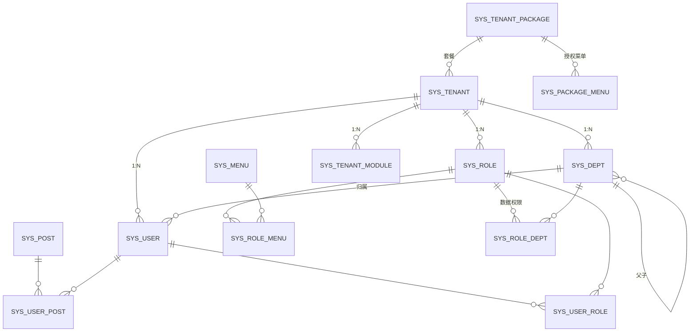
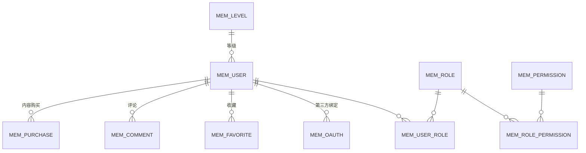
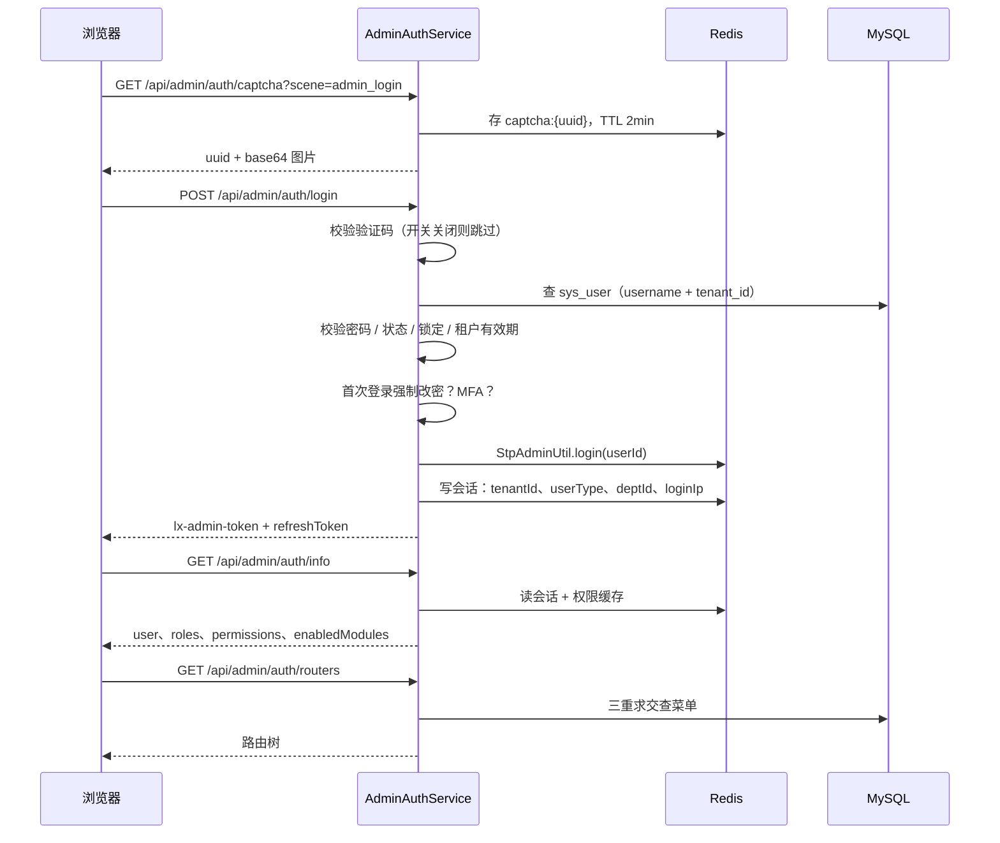
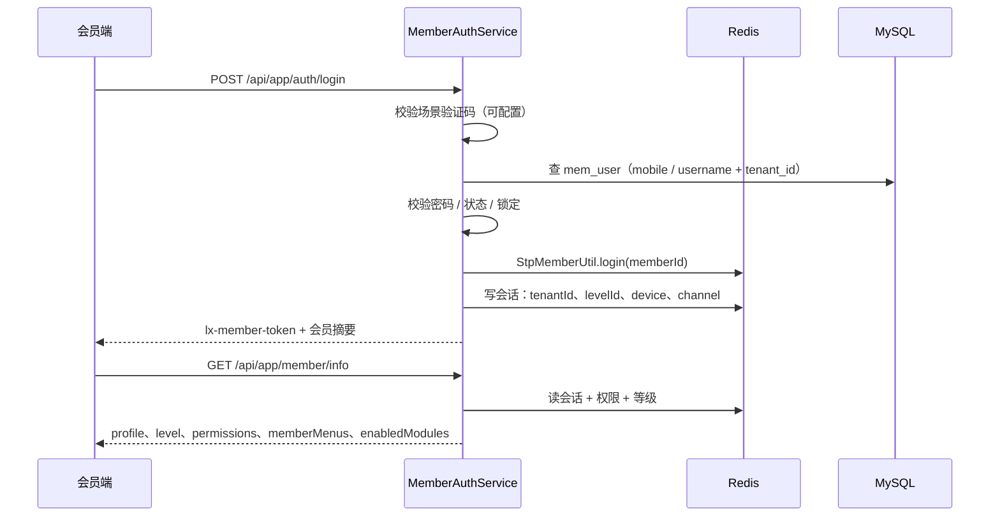

# 04 · 权限体系设计（后台 / 前台分离）

> 核心结论：**后台用户与前台会员是两套主体、两套表、两套 Token、两套权限缓存、两套权限码。** 不通过 `user_type` 字段把两类人塞进一张 `sys_user`，也不共用 `sys_role/sys_menu`。
>
> 原因：两类主体的生命周期、登录方式、权限粒度、数据范围、注销与合规要求完全不同。共表会在查询、索引、权限判断、数据迁移、审计上持续产生“补丁”，后期拆不动。

---

## 1. 三套主体，先分清

| 主体 | 归属 | 表前缀 | 登录入口 | 典型权限 |
|---|---|---|---|---|
| 平台运营 | 平台方 | `sys_`（`tenant_id=0`） | `/api/admin/auth/login` | 租户、套餐、平台配置、代登录 |
| 租户后台用户 | 某个租户 | `sys_`（`tenant_id=T`） | `/api/admin/auth/login` + 租户码 | 租户内用户、角色、内容、审批 |
| 前台会员 | 某个租户 | `mem_`（`tenant_id=T`） | `/api/app/auth/login`、`/api/portal/auth/login` | 浏览、评论、收藏、投稿、会员权益 |

> 平台运营与租户后台用户**可以共用 `sys_*` 表**，用 `tenant_id` + `user_type` 区分；前台会员**必须独立 `mem_*` 表**。这是“后台内部统一、前后台彻底分离”的边界。
>
> **首发单租户**：只有“平台运营”一种后台主体，`tenant_id` 全部为 `0`；租户表、租户后台、租户码登录暂不加载。后期打开 SaaS 模块后，按本节的三套主体启用，业务表与权限判断不改。

---

## 2. 后台权限模型（sys_*）

### 2.1 ER 图



### 2.2 表职责

| 表 | 职责 | 关键字段 |
|---|---|---|
| `sys_tenant` | 租户 | `tenant_id`、`tenant_code`、`package_id`、`isolation_mode`、`status` |
| `sys_tenant_package` | 套餐 | `module_codes`、`quota_json`；菜单授权见 `sys_package_menu` |
| `sys_tenant_module` | 租户级模块覆盖 | `tenant_id`、`module_code`、`enabled`、`expire_time` |
| `sys_user` | 后台用户 | `tenant_id`、`user_type`（00 平台 / 01 租户管理员 / 02 子用户）、`dept_id` |
| `sys_role` | 角色 | `tenant_id`、`role_key`、`data_scope` |
| `sys_menu` | 目录 / 菜单 / 按钮 | `module_code`、`menu_type`、`perms`、`component`、`i18n_key` |
| `sys_user_role` | 用户角色 | 联合唯一 |
| `sys_role_menu` | 角色菜单 | 联合唯一 |
| `sys_dept` | 部门树 | `ancestors`、`parent_id` |
| `sys_role_dept` | 自定义数据范围 | `role_id`、`dept_id` |
| `sys_post` | 岗位 | `post_code` |

### 2.3 权限码规范

```text
{module}:{entity}:{action}

system:user:list
system:user:add
system:user:edit
system:user:remove
system:user:resetPwd
system:role:assign
cms:content:publish
cms:category:edit
member:user:list
workflow:task:approve
saas:tenant:create
```

约定：

- `list / query / add / edit / remove / export / import / publish / audit / assign` 为标准动作。
- 按钮权限码与接口 `@SaCheckPermission` 使用同一个字符串。
- 菜单 `perms` 为空表示“仅路由、无接口权限”；按钮必须有 `perms`。
- 权限码一旦发布不轻易改名；改名需同步菜单、角色、前端指令、接口注解、审计记录。
- 菜单 / 按钮的展示名走 `i18n_key`（如 `menu.cms.content`）；未配置时回退 `menu_name`，避免旧数据无法展示。

### 2.4 数据范围（Data Scope）

| 值 | 范围 | SQL 逻辑 |
|---|---|---|
| 1 | 全部数据 | 不加部门条件（仍加 `tenant_id`） |
| 2 | 自定义部门 | `dept_id in (select dept_id from sys_role_dept where role_id = ?)` |
| 3 | 本部门 | `dept_id = #{deptId}` |
| 4 | 本部门及以下 | `dept_id in (select dept_id from sys_dept where dept_id = ? or find_in_set(?, ancestors))` |
| 5 | 仅本人 | `user_id = #{userId}` |
| 6 | 租户全部 | `tenant_id = #{tenantId}`（平台运营专用） |

实现方式：

- 注解 `@DataScope(deptAlias = "d", userAlias = "u")` + MyBatis 拦截器拼接。
- 多角色取**并集**（RuoYi 思路），但租户边界永远是硬条件，不能被数据范围覆盖。
- 列表、详情、修改、删除、导出**全部**要走数据范围校验，不能只在列表加。
- 导出是高风险入口，必须复用同一套 SQL 条件。

> **v1.0 实现现状**：平台后台已落地 `1 / 2 / 3 / 4 / 5` 五种范围，集中在
> `lx-module-system` 的 `DataScopeService`；自定义范围（2）的部门集合存
> `sys_role_dept`，精确匹配、不含下级。层级查询用闭包表 `sys_dept_closure`，
> 不用 `find_in_set`，保留多库兼容。用户 / 部门 / 角色列表、详情与写操作
> 统一走同一套解析；租户域与 `6 租户全部` 随 SaaS 模块后开。

### 2.5 有效菜单 = 三重求交

```text
有效菜单 = 角色菜单 ∩ 套餐菜单 ∩ 已启用模块菜单
有效按钮 = 有效菜单下的按钮 ∩ 角色按钮
```

- 平台运营（`tenant_id=0`）：不受套餐限制，只看角色 + 模块。
- 租户管理员：套餐内全部菜单（可再分配给子用户）。
- 租户子用户：角色菜单 ∩ 套餐菜单。
- 模块关闭：`sys_menu.module_code` 不在启用列表，直接不返回，前端不注册路由。
- 套餐未配置 `sys_package_menu` 时，表示“该套餐包含所有已授权模块的菜单”。

```sql
-- 租户子用户有效菜单（示意）
select distinct m.*
from sys_menu m
join sys_role_menu rm on rm.menu_id = m.menu_id
join sys_user_role ur on ur.role_id = rm.role_id
where ur.user_id = #{userId}
  and m.status = '0'
  and (
    m.module_code = 'system'
    or exists (
      select 1 from sys_tenant_module tm
      where tm.tenant_id = #{tenantId}
        and tm.module_code = m.module_code
        and tm.enabled = 1
    )
  )
  and (
    #{packageAllMenus} = 1
    or exists (
      select 1 from sys_package_menu pm
      where pm.package_id = #{packageId}
        and pm.menu_id = m.menu_id
    )
  )
order by m.parent_id, m.order_num;
```

---

## 3. 前台会员权限模型（mem_*）

### 3.1 ER 图



### 3.2 表职责

| 表 | 职责 | 关键字段 |
|---|---|---|
| `mem_user` | 会员主表 | `member_id`、`tenant_id`、`username`、`mobile`、`email`、`level_id`、`points`、`growth`、`status` |
| `mem_level` | 会员等级 | `level_code`、`min_growth`、`max_growth`、`benefits_json` |
| `mem_role` | 会员角色 | `role_key`（如 `vip`、`author`、`reviewer`） |
| `mem_permission` | 功能 / 接口 / 内容权限 | `perm_code`、`perm_type`（`api` / `feature` / `content`）、`parent_id` |
| `mem_user_role` | 会员角色 | 联合唯一 |
| `mem_role_permission` | 角色权限 | 联合唯一 |
| `mem_oauth` | 第三方账号 | `platform`、`open_id`、`union_id` |
| `mem_purchase` | 内容购买 | `member_id`、`content_id`、`order_id`、`expire_time` |
| `mem_password_reset` | 找回密码令牌 | `token_hash`、`expire_time`、`used` |

### 3.3 会员权限码

```text
member:profile:view
member:profile:edit
member:password:update
member:favorite:list
member:comment:create
member:comment:delete
member:contribute:create
cms:content:read
cms:content:download
cms:comment:create
```

会员权限与后台权限**不共享命名空间**：即使都叫 `cms:content:read`，也由不同的 `StpInterface` 提供、不同的缓存存储、不同的注解解析器校验。

### 3.4 内容访问权限（独立于 RBAC）

会员能不能看一篇内容，不只取决于“角色”，还取决于内容本身：

| `cms_content.access_type` | 规则 | 校验 |
|---|---|---|
| 0 公开 | 所有人 | 无 |
| 1 登录 | 登录会员 | `StpMemberUtil.isLogin()` |
| 2 VIP | 指定会员角色 / 等级 | `mem_role` 或 `level >= n` |
| 3 等级 | 达到等级 | `mem_user.level_id` 对应 `min_growth` |
| 4 付费 | 已购买 / 未过期 | `mem_purchase` |
| 5 密码 | 内容密码 | 服务端校验，不返回正文 |

**服务端必须截断正文**：未授权时只返回摘要 / 试读片段，不能把全文发给前端再用 CSS 遮挡。付费内容尤其如此。

### 3.5 会员等级与权益

```text
权益 = 等级权益 ∪ 角色权益
等级权益：折扣、免广告、下载次数、专属内容、评论频率
角色权益：作者（可投稿）、审核员（可评论审核）、VIP（专属内容）
```

- 等级由成长值自动计算，也可后台手动调整。
- 积分与成长值分离：积分可消耗，成长值只增不减（可配置衰减）。
- 权益变更后清 `lx:member:perm:{memberId}` 缓存。

---

## 4. 两套体系对照

| 维度 | 后台 `sys_*` | 前台 `mem_*` |
|---|---|---|
| 主体 | 员工 / 运营 / 租户子用户 | 站点会员 |
| 登录 | 账号密码 + 验证码 + MFA | 密码 / 短信 / 邮箱 / 第三方 |
| 注册 | 不开放，管理员创建 / 邀请 | 开放注册，可审核 |
| Token 名称 | `lx-admin-token` | `lx-member-token` |
| Token 有效期 | 12h，活跃 30m | 7d，活跃 2h |
| 权限来源 | 角色 → 菜单 → 按钮 / 接口 | 角色 → 权限码 + 等级 + 内容规则 |
| 数据范围 | 部门 / 本人 / 全部 | 本人 + 内容访问规则 |
| 菜单 | 完整动态路由 | 会员中心菜单（可选） |
| 缓存前缀 | `lx:admin:*` | `lx:member:*` |
| 验证码场景 | `admin_login` | `member_login` / `member_reset` |
| 注销 | 停用 / 删除 | 冷静期 + 匿名化 |
| 审计 | 操作日志 + 审计日志 | 登录日志 + 行为日志 |
| 表数量 | 12+ | 12+ |

---

## 5. 认证设计（Sa-Token 双账号）

### 5.1 双 StpLogic

```java
public final class StpAdminUtil {
    public static final String TYPE = "admin";
    public static final StpLogic LOGIC = new StpLogic(TYPE);
    // login / logout / getLoginId / checkPermission ...
}

public final class StpMemberUtil {
    public static final String TYPE = "member";
    public static final StpLogic LOGIC = new StpLogic(TYPE);
    // ...
}
```

注册到 Sa-Token 管理器，注解通过 `type` 区分：

```java
@SaCheckPermission(value = "cms:content:list", type = "admin")
@GetMapping("/api/admin/cms/content")
public TableDataInfo<ContentVO> list(...) { ... }

@SaCheckPermission(value = "cms:comment:create", type = "member")
@PostMapping("/api/app/cms/comment")
public R<Void> comment(...) { ... }
```

### 5.2 两套权限提供者

```java
@Component
public class AdminPermissionProvider implements StpInterface {
    @Override
    public List<String> getPermissionList(Object loginId, String loginType) {
        // 只查 sys_*，带租户与模块过滤
    }
    @Override
    public List<String> getRoleList(Object loginId, String loginType) {
        // 只查 sys_user_role / sys_role
    }
}

@Component
public class MemberPermissionProvider implements StpInterface {
    @Override
    public List<String> getPermissionList(Object loginId, String loginType) {
        // 只查 mem_*，合并角色权限 + 等级权益
    }
    @Override
    public List<String> getRoleList(Object loginId, String loginType) {
        // 只查 mem_user_role / mem_role
    }
}
```

**关键：`StpInterface` 内根据 `loginType` 分流，绝不能在一个实现里同时查 `sys_user` 和 `mem_user`。**

### 5.3 后台登录流程



### 5.4 会员登录流程



### 5.5 Token 与安全策略

| 策略 | 后台 | 会员 |
|---|---|---|
| Token 名称 | `lx-admin-token` | `lx-member-token` |
| 传递 | Header / Cookie | Header / Cookie / 小程序 storage |
| 有效期 | 12h | 7d |
| 活跃续期 | 30m | 2h |
| 并发登录 | 允许，可限制 | 允许，可挤下线 |
| 刷新 | refresh token，旋转 | refresh token，旋转 |
| 改密 / 重置 | 全部 Token 失效 | 全部 Token 失效 |
| 停用 / 注销 | 立即踢下线 | 立即踢下线 |
| 设备绑定 | 可选 | 可选（App） |
| 异地提醒 | 可选 | 站内信 / 邮件 |

---

## 6. 接口鉴权

### 6.1 路径隔离

| 前缀 | 认证 | 说明 |
|---|---|---|
| `/api/admin/**` | `lx-admin-token` | 后台管理，强制登录（白名单除外） |
| `/api/portal/**` | `lx-member-token`（可选） | PC 门户，公开内容可匿名 |
| `/api/app/**` | `lx-member-token` | H5 / 小程序 / App，强制签名（App） |
| `/api/open/**` | AppKey + 签名 | 开放平台 |
| `/api/callback/**` | 渠道验签 | 支付 / 短信 / 微信回调 |

### 6.2 三层校验

```text
第一层：网关 / 过滤器 —— 是否登录、Token 是否有效、租户是否匹配
第二层：注解 / 拦截器 —— 是否有权限码、是否有角色
第三层：Service —— 数据归属、内容访问级别、租户边界
```

**只做第一层是常见漏洞。** 例如会员 A 把 URL 里的 `memberId` 改成 B，接口有登录但没做归属校验，就会越权。

### 6.3 对象级权限

```java
// 错误：信任前端
updateComment(commentId, memberId);

// 正确：从 Token 取当前会员，校验归属
Long current = StpMemberUtil.getLoginIdAsLong();
Comment c = commentMapper.selectById(commentId);
if (!c.getMemberId().equals(current)) {
    throw new ServiceException("无权操作");
}
```

管理端同理：详情、修改、删除、导出都要校验 `tenant_id` + 数据范围，不能只靠列表过滤。

### 6.4 权限注解示例

```java
@SaCheckPermission(value = "system:user:add", type = "admin")
@PostMapping("/api/admin/system/user")
public R<Void> add(@RequestBody @Valid UserSaveReq req) {
    userService.add(req);
    return R.ok();
}

@SaCheckPermission(value = "cms:content:publish", type = "admin")
@PostMapping("/api/admin/cms/content/{id}/publish")
public R<Void> publish(@PathVariable Long id) { ... }

@SaCheckLogin(type = "member")
@PostMapping("/api/app/member/favorite/{contentId}")
public R<Void> favorite(@PathVariable Long contentId) {
    favoriteService.add(StpMemberUtil.getLoginIdAsLong(), contentId);
    return R.ok();
}
```

---

## 7. 前端权限管理

### 7.1 后台（Vue3）

```text
登录
  → /api/admin/auth/info       拿到 user / roles / permissions / enabledModules
  → /api/admin/auth/routers    拿到菜单树（后端已按三重求交过滤）
  → 前端把 component 字符串映射为动态 import
  → router.addRoute
  → 侧边栏由菜单树渲染
  → 按钮用 v-hasPermi="['cms:content:add']"
```

要点：

- **路由以后端为准**，前端只保留登录、404、403 等静态路由。
- `enabledModules` 用于隐藏模块入口与懒加载边界；即使后端误下发，前端也不注册已关闭模块。
- 按钮权限只是体验，接口必须再校验一次。
- 菜单变更后无需重新登录：后端清权限缓存，前端刷新 `/routers` 即可。
- 前端不存储“权限表”，只存储当前会话的权限码集合。

### 7.2 门户 PC（Nuxt3）

- SSR 时从 Cookie 读取会员 Token，服务端请求 `/api/portal/member/info`。
- 路由中间件 `auth.global.ts` 守卫会员中心。
- 内容访问在服务端判断：未授权只渲染摘要 / 登录引导，**不把全文写进 HTML**。
- 会员中心菜单可由 `mem_permission` 下发，也可以固定路由 + 权限码控制显隐。
- SEO 页面不因权限而返回不同 TDK，避免搜索引擎抓取到付费内容。

### 7.3 H5 / 小程序 / App（uni-app）

- `pages.json` 中会员相关页面放在分包，未登录不预加载。
- 自定义 TabBar：根据 `enabledModules` 与会员权限决定显示项。
- 页面守卫：`onLoad` / 路由拦截，未登录跳登录页并记录 `redirect`。
- 按钮指令 `v-has-perm`；内容组件 `<content-gate>` 统一处理试读 / 登录 / VIP 提示。
- 小程序订阅消息、App Push 的开关也走配置中心。
- 条件编译处理平台差异，不把平台判断散落在业务代码里。

### 7.4 前端权限码与后端一致性

| 层 | 来源 | 失效 |
|---|---|---|
| 菜单 / 路由 | 后端 `/routers` | 角色 / 菜单变更 |
| 按钮 | 后端 `permissions` | 角色变更 |
| 接口 | 注解 `@SaCheckPermission` | 角色变更 |
| 内容 | `cms_content.access_type` + 会员等级 / 购买 | 内容变更 / 等级变更 |

> 前端权限是“展示层”，后端权限是“事实层”。任何只在前端做的权限判断都视为缺陷。

---

## 8. 租户权限矩阵

### 8.1 平台配置子后台功能

```text
平台运营
  ├─ 定义套餐：包含哪些模块、哪些菜单、多少配额
  ├─ 创建租户：选套餐、选隔离模式、绑域名
  ├─ 租户级覆盖：单独开 / 关某个模块（sys_tenant_module）
  └─ 代登录：排障，全程审计

租户管理员
  ├─ 建子用户：sys_user（user_type=02，tenant_id=T）
  ├─ 建租户角色：只能勾选套餐内菜单
  ├─ 配数据权限：本租户部门范围
  └─ 覆盖白名单配置：Logo、登录页、水印、注册开关等
```

### 8.2 有效权限计算

```text
平台运营：
  effective = roleMenus ∩ enabledModules

租户管理员：
  effective = packageMenus ∩ tenantModules ∩ enabledModules

租户子用户：
  effective = roleMenus ∩ packageMenus ∩ tenantModules ∩ enabledModules

会员：
  effective = memberRolePerms ∪ levelBenefits
  contentAccess = accessType + level + purchase
```

### 8.3 越权防护清单

- [ ] 所有业务表带 `tenant_id`，查询自动注入，不信任前端传值。
- [ ] 跨租户 ID 查询返回 404 而不是 403（避免泄露存在性）。
- [ ] 平台代登录必须二次确认 + 审计 + 明显提示条。
- [ ] 租户管理员不能创建“平台运营”角色，不能把 `tenant_id` 改为 0。
- [ ] 租户角色不能勾选套餐外菜单；服务端校验，不只前端禁用。
- [ ] 导出、批量操作、定时任务、MQ 消费同样带租户上下文。
- [ ] 缓存 Key、文件路径、消息队列 Topic 带租户前缀。
- [ ] 自动化用例：A 租户 Token 遍历 B 租户资源 ID。

---

## 9. 表清单（权限相关）

### 后台

```text
sys_tenant
sys_tenant_package
sys_package_menu
sys_tenant_module
sys_user
sys_role
sys_menu
sys_user_role
sys_role_menu
sys_dept
sys_post
sys_user_post
sys_role_dept
sys_config
```

### 前台

```text
mem_user
mem_level
mem_role
mem_permission
mem_user_role
mem_role_permission
mem_oauth
mem_login_log
mem_points_log
mem_favorite
mem_like
mem_comment
mem_history
mem_message
mem_realname
mem_purchase
mem_password_reset
```

> 两域之间**不建外键**，只存逻辑 ID。未来中台统一身份时，用 `uc_identity` 做映射，不反向修改两域主表。

---

## 10. 中台统一身份的演进

当出现“一个账号访问多个子系统”的需求时：

```text
uc_account            统一账号（手机 / 邮箱 / 第三方）
uc_identity           身份映射：uc_id + subject_type(admin/member) + subject_id + tenant_id
uc_sso_session        SSO 会话
uc_oauth_client       OAuth2 / OIDC 客户端
```

- 不合并 `sys_user` 与 `mem_user`，只做映射。
- 后台仍走 `lx-admin-token`，会员仍走 `lx-member-token`；SSO 只负责“证明你是谁”，不改变各域授权模型。
- 跨域授权仍由各域自己的角色 / 权限决定。
- 迁移顺序：先做映射表 → 再做 SSO 登录 → 最后做统一登出 / 会话管理。

---

## 11. 常见问题（FAQ）

**Q1：为什么不用一张 `user` 表加 `type` 字段？**
A：短期省事，长期会出现：会员手机号唯一性与员工工号冲突、会员注销影响员工审计、会员权限查询扫全表、后台登录策略误伤会员、数据迁移无法拆分。两套表是更便宜的长期方案。

**Q2：后台和会员能否共用角色表？**
A：不能。后台角色绑菜单与部门数据范围；会员角色绑功能码与内容权益。字段、索引、生命周期都不同。

**Q3：前台按钮权限有必要吗？**
A：有，但只做体验。真正的权限在接口和内容服务层。前端隐藏不等于安全。

**Q4：会员等级算权限吗？**
A：算“内容访问条件”，不算 RBAC 角色。等级变化频繁，放 `mem_user.level_id` + 权益计算，避免为每个等级建角色。

**Q5：SaaS 关闭时这些表还要吗？**
A：`sys_tenant*` 表可以不迁移；`tenant_id` 字段保留默认 0，业务代码用 `TenantContext` 统一取值，单租户下恒为 0。关闭 SaaS 不改变业务代码。
