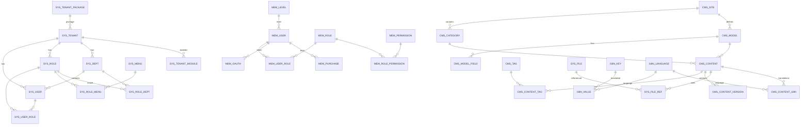

# 05 · 数据库设计

> 数据库：**MySQL 5.7/8.0、PostgreSQL 12~16、达梦 DM8、人大金仓 KingbaseES V8** 同一套领域模型。字符集统一 UTF-8（MySQL `utf8mb4`），排序规则按厂商默认，不依赖库级差异。
> 所有表主键为应用侧雪花 ID；时间由应用填充；金额 `decimal(18,2)`；布尔用 `smallint` 0/1；枚举用 `char` / `varchar` + 字典。方言差异只允许出现在 `DatabaseDialect` 与厂商迁移脚本，详见 [14-multi-database.md](14-multi-database.md)。

---

## 1. 设计规范

| 项 | 规范 |
|---|---|
| 表名 | 小写下划线，域前缀：`sys_` / `mem_` / `cms_` / `wf_` / `saas_` / `i18n_` / `gen_` / `sys_file_` |
| 主键 | `{表名}_id`，`bigint`，**应用侧雪花 ID**；不使用自增 / 序列 / UUID |
| 租户 | 业务表必带 `tenant_id bigint not null default 0`；平台表可为 0 |
| 审计 | `create_by`、`create_time`、`update_by`、`update_time`，由应用填充 |
| 软删 | `del_flag char(1) default '0'`，0 正常 / 1 删除；唯一索引需考虑软删 |
| 状态 | `status char(1) default '0'`，0 正常 / 1 停用（按域定义字典） |
| 排序 | `sort int default 0`，越小越前 |
| 备注 | `remark varchar(500)` |
| 外键 | **不建物理外键**，应用层保证；便于分库、归档、租户迁移 |
| JSON | 逻辑类型 `json`，物理按厂商映射；高频查询字段抽独立列 / 生成列 |
| 布尔 | `smallint` 0/1，不用 `tinyint(1)` / `boolean` |
| 索引 | 租户字段放联合索引最左；区分度低的字段不单独建索引 |
| 大字段 | 正文、富文本放 `text` / `longtext` / `clob`（按厂商），避免主表膨胀 |
| 时间 | 应用统一 `Asia/Shanghai`，存 `datetime` / `timestamp`，不依赖库默认时区 |
| 金额 | `decimal(18,2)`，禁止 float / double |
| 密码 | BCrypt / Argon2 哈希，禁止可逆加密 |
| 方言 | 禁止 `AUTO_INCREMENT`、`find_in_set`、`ON DUPLICATE KEY`、`date_format` 等，统一走 Dialect |

### 1.1 公共字段模板

```sql
tenant_id    bigint       not null default 0  comment '租户ID，0=平台',
create_by    bigint       default null        comment '创建人',
create_time  datetime     not null            comment '创建时间，应用填充',
update_by    bigint       default null        comment '更新人',
update_time  datetime     default null        comment '更新时间，应用填充',
del_flag     char(1)      not null default '0' comment '0正常 1删除',
remark       varchar(500) default null        comment '备注'
```

> 不使用 `default current_timestamp` 与 `on update current_timestamp`；由 MyBatis-Plus `MetaObjectHandler` 统一填充，保证跨库一致。

---

## 2. 分域表清单

### 2.1 系统基座 `sys_`

| 表 | 说明 | 租户 |
|---|---|---|
| `sys_tenant` | 租户 | 否（平台表） |
| `sys_tenant_package` | 租户套餐 | 否 |
| `sys_package_menu` | 套餐菜单 | 否 |
| `sys_tenant_module` | 租户模块覆盖 | 是 |
| `sys_tenant_domain` | 租户域名 | 是 |
| `sys_user` | 后台用户 | 是 |
| `sys_role` | 后台角色 | 是 |
| `sys_menu` | 菜单 / 按钮 | 是（平台菜单 0） |
| `sys_user_role` | 用户角色 | 是 |
| `sys_role_menu` | 角色菜单 | 是 |
| `sys_dept` | 部门 | 是 |
| `sys_dept_closure` | 部门闭包表（子树 / 祖先查询） | 是 |
| `sys_post` | 岗位 | 是 |
| `sys_user_post` | 用户岗位 | 是 |
| `sys_role_dept` | 角色数据范围 | 是 |
| `sys_config` | 参数配置 | 是（平台默认 0） |
| `sys_dict_type` | 字典类型 | 是 |
| `sys_dict_data` | 字典数据 | 是 |
| `sys_notice` | 公告 | 是 |
| `sys_notice_read` | 公告已读 | 是 |
| `sys_login_log` | 登录日志 | 是 |
| `sys_oper_log` | 操作日志 | 是 |
| `sys_error_log` | 异常日志 | 是 |
| `sys_audit_log` | 审计日志 | 是 |
| `sys_job` | 定时任务 | 是 |
| `sys_job_log` | 任务日志 | 是 |
| `sys_message_template` | 消息模板 | 是 |
| `sys_message_channel` | 消息渠道 | 是 |
| `sys_message_log` | 消息发送记录 | 是 |
| `sys_datasource` | 数据源 | 否 |
| `sys_db_backup` | 备份记录 | 否 |
| `sys_area` | 行政区划 | 否 |
| `sys_sensitive_word` | 敏感词 | 是 |
| `sys_client` | 开放平台应用 | 是 |

### 2.2 文件 `sys_file_`

| 表 | 说明 |
|---|---|
| `sys_file` | 文件主表（原图 / 衍生图 / 附件） |
| `sys_file_name_log` | 文件改名历史（原名 / 现名 / 操作人） |
| `sys_file_group` | 文件分组 |
| `sys_file_ref` | 文件引用关系 |
| `sys_storage_config` | 存储配置 |
| `sys_watermark_config` | 水印策略 |

### 2.3 代码生成 `gen_`

| 表 | 说明 |
|---|---|
| `gen_table` | 生成表配置 |
| `gen_table_column` | 字段配置 |
| `gen_template` | 模板 |
| `gen_history` | 生成记录 |

### 2.4 CMS `cms_`

| 表 | 说明 |
|---|---|
| `cms_site` | 站点 |
| `cms_site_domain` | 站点域名 |
| `cms_category` | 栏目 |
| `cms_category_closure` | 栏目闭包表（子树 / 祖先查询） |
| `cms_model` | 内容模型 |
| `cms_model_field` | 模型字段 |
| `cms_content` | 内容主表 |
| `cms_content_ext` | 内容扩展（可选物理表） |
| `cms_content_version` | 内容版本 |
| `cms_content_tag` | 内容标签 |
| `cms_tag` | 标签 |
| `cms_tag_group` | 标签组 |
| `cms_page` | 单页 |
| `cms_block` | 区块 / 碎片 |
| `cms_nav` | 导航 |
| `cms_ad` | 广告位 |
| `cms_link` | 友情链接 |
| `cms_topic` | 专题 |
| `cms_comment` | 评论 |
| `cms_comment_report` | 举报 |
| `cms_search_log` | 搜索日志 |
| `cms_static_task` | 静态化任务 |
| `cms_content_relation` | 相关内容 |

### 2.5 会员 `mem_`

| 表 | 说明 |
|---|---|
| `mem_user` | 会员 |
| `mem_level` | 等级 |
| `mem_role` | 会员角色 |
| `mem_permission` | 会员权限 / 会员中心菜单 |
| `mem_user_role` | 会员角色 |
| `mem_role_permission` | 角色权限 |
| `mem_oauth` | 第三方绑定 |
| `mem_login_log` | 登录日志 |
| `mem_points_log` | 积分 / 成长值明细 |
| `mem_sign_log` | 签到 |
| `mem_favorite` | 收藏 |
| `mem_like` | 点赞 |
| `mem_comment` | 评论（可与 cms_comment 合并，建议独立） |
| `mem_history` | 浏览历史 |
| `mem_message` | 站内信 |
| `mem_realname` | 实名认证 |
| `mem_purchase` | 内容购买 |
| `mem_password_reset` | 找回密码令牌 |

### 2.6 工作流 `wf_` + Flowable `ACT_`

| 表 | 说明 |
|---|---|
| `wf_form` | 动态表单 |
| `wf_form_field` | 表单字段 |
| `wf_form_version` | 表单版本 |
| `wf_business` | 业务与流程实例绑定 |
| `wf_task_ext` | 任务扩展（加签、转办、意见） |
| `wf_cc` | 抄送 |
| `wf_delegate` | 委托规则 |
| `wf_urge` | 催办记录 |
| `wf_template` | 审批单模板 |
| `ACT_*` | Flowable 自带表（可独立 schema） |

### 2.7 SaaS `saas_`

| 表 | 说明 |
|---|---|
| `saas_usage` | 用量计量 |
| `saas_quota` | 配额定义 |
| `saas_order` | 订阅订单（预留） |
| `saas_invoice` | 发票（预留） |
| `saas_ticket` | 工单 |
| `saas_tenant_health` | 租户健康度 |

### 2.8 多语言 `i18n_`

| 表 | 说明 | 租户 |
|---|---|---|
| `i18n_language` | 平台语言定义 | 否 |
| `i18n_tenant_language` | 租户启用语言 / 默认语言 | 是 |
| `i18n_namespace` | 命名空间 | 否 |
| `i18n_key` | 翻译键 / 默认值 | 否 |
| `i18n_value` | 翻译值（平台 0 + 租户覆盖） | 是 |
| `i18n_pack` | 语言包版本 / 校验和 | 是 |
| `i18n_glossary` | 术语表 | 否 |
| `i18n_missing_log` | 缺失翻译记录 | 是 |
| `cms_content_i18n` | CMS 内容翻译 | 是 |
| `cms_category_i18n` | 栏目翻译 | 是 |
| `cms_site_i18n` | 站点名称 / SEO 翻译 | 是 |
| `cms_block_i18n` | 区块 / 导航 / 广告文案翻译 | 是 |

> i18n 表由 `lx.module.i18n.enabled` 控制迁移；关闭时系统按默认语言运行，表不创建。

---

## 3. 核心 ER 图



---

## 4. 核心 DDL

> 以下为 **MySQL 语法示意**，仅用于说明字段关系与索引；正式落地由 `db/schema` 统一模型生成四套脚本（MySQL / PostgreSQL / 达梦 / 金仓）。
> 示例保留 MySQL 的 `ENGINE`、`COMMENT` 等写法；主键与时间已按规范改为应用侧生成，**不使用自增、库级默认时间与触发器**。

### 4.1 租户与套餐

```sql
CREATE TABLE sys_tenant (
  tenant_id       bigint       NOT NULL COMMENT '租户ID',
  tenant_code     varchar(64)  NOT NULL COMMENT '租户编码，登录用',
  tenant_name     varchar(128) NOT NULL COMMENT '租户名称',
  package_id      bigint       DEFAULT NULL COMMENT '套餐ID',
  isolation_mode  char(1)      NOT NULL DEFAULT '1' COMMENT '1共享表 2独立schema 3独立库',
  contact_name    varchar(64)  DEFAULT NULL,
  contact_phone   varchar(32)  DEFAULT NULL,
  domain          varchar(128) DEFAULT NULL COMMENT '主域名',
  expire_time     datetime     DEFAULT NULL,
  status          char(1)      NOT NULL DEFAULT '0' COMMENT '0正常 1停用 2过期',
  init_status     char(1)      NOT NULL DEFAULT '0' COMMENT '0未初始化 1初始化中 2完成 3失败',
  quota_json      json         DEFAULT NULL COMMENT '配额覆盖',
  config_json     json         DEFAULT NULL COMMENT '品牌等配置',
  create_time     datetime     NOT NULL,
  update_time     datetime     DEFAULT NULL,
  PRIMARY KEY (tenant_id),
  UNIQUE KEY uk_tenant_code (tenant_code)
) ENGINE=InnoDB DEFAULT CHARSET=utf8mb4 COMMENT='租户';

CREATE TABLE sys_tenant_package (
  package_id    bigint       NOT NULL,
  package_name  varchar(128) NOT NULL,
  module_codes  json         DEFAULT NULL COMMENT '["cms","member","workflow"]',
  quota_json    json         DEFAULT NULL COMMENT '{"user":50,"storageGb":20}',
  price         decimal(18,2) NOT NULL DEFAULT 0.00,
  status        char(1)      NOT NULL DEFAULT '0',
  create_time   datetime     NOT NULL,
  update_time   datetime     DEFAULT NULL,
  PRIMARY KEY (package_id)
) ENGINE=InnoDB DEFAULT CHARSET=utf8mb4 COMMENT='租户套餐';

CREATE TABLE sys_tenant_module (
  id           bigint      NOT NULL,
  tenant_id    bigint      NOT NULL,
  module_code  varchar(32) NOT NULL,
  enabled      smallint  NOT NULL DEFAULT 1,
  config_json  json        DEFAULT NULL,
  expire_time  datetime    DEFAULT NULL,
  create_time  datetime    NOT NULL,
  update_time  datetime    DEFAULT NULL,
  PRIMARY KEY (id),
  UNIQUE KEY uk_tenant_module (tenant_id, module_code)
) ENGINE=InnoDB DEFAULT CHARSET=utf8mb4 COMMENT='租户模块开关';
```

### 4.2 后台用户 / 角色 / 菜单

```sql
CREATE TABLE sys_user (
  user_id         bigint       NOT NULL,
  tenant_id       bigint       NOT NULL DEFAULT 0,
  dept_id         bigint       DEFAULT NULL,
  username        varchar(64)  NOT NULL COMMENT '登录名',
  nickname        varchar(64)  NOT NULL,
  user_type       char(2)      NOT NULL DEFAULT '02' COMMENT '00平台 01租户管理员 02子用户',
  password        varchar(100) NOT NULL COMMENT 'BCrypt',
  mobile          varchar(20)  DEFAULT NULL,
  email           varchar(100) DEFAULT NULL,
  avatar          varchar(500) DEFAULT NULL,
  gender          char(1)      NOT NULL DEFAULT '0',
  status          char(1)      NOT NULL DEFAULT '0' COMMENT '0正常 1停用 2锁定',
  login_ip        varchar(64)  DEFAULT NULL,
  login_date      datetime     DEFAULT NULL,
  pwd_update_time datetime     DEFAULT NULL,
  mfa_secret      varchar(128) DEFAULT NULL,
  create_by       bigint       DEFAULT NULL,
  create_time     datetime     NOT NULL,
  update_by       bigint       DEFAULT NULL,
  update_time     datetime     DEFAULT NULL,
  del_flag        char(1)      NOT NULL DEFAULT '0',
  remark          varchar(500) DEFAULT NULL,
  PRIMARY KEY (user_id),
  UNIQUE KEY uk_user_username (tenant_id, username),
  KEY idx_user_dept (tenant_id, dept_id),
  KEY idx_user_mobile (tenant_id, mobile)
) ENGINE=InnoDB DEFAULT CHARSET=utf8mb4 COMMENT='后台用户';

CREATE TABLE sys_role (
  role_id      bigint       NOT NULL,
  tenant_id    bigint       NOT NULL DEFAULT 0,
  role_name    varchar(64)  NOT NULL,
  role_key     varchar(64)  NOT NULL COMMENT '权限字符',
  role_sort    int          NOT NULL DEFAULT 0,
  data_scope   char(1)      NOT NULL DEFAULT '1' COMMENT '1全部 2自定义 3本部门 4本部门及以下 5仅本人 6租户全部',
  menu_check_strictly smallint NOT NULL DEFAULT 1,
  dept_check_strictly smallint NOT NULL DEFAULT 1,
  status       char(1)      NOT NULL DEFAULT '0',
  create_time  datetime     NOT NULL,
  update_time  datetime     DEFAULT NULL,
  del_flag     char(1)      NOT NULL DEFAULT '0',
  remark       varchar(500) DEFAULT NULL,
  PRIMARY KEY (role_id),
  UNIQUE KEY uk_role_key (tenant_id, role_key)
) ENGINE=InnoDB DEFAULT CHARSET=utf8mb4 COMMENT='后台角色';

CREATE TABLE sys_menu (
  menu_id     bigint       NOT NULL,
  tenant_id   bigint       NOT NULL DEFAULT 0 COMMENT '0=平台菜单',
  menu_name   varchar(64)  NOT NULL,
  i18n_key    varchar(255) DEFAULT NULL COMMENT '菜单名翻译键',
  parent_id   bigint       NOT NULL DEFAULT 0,
  order_num   int          NOT NULL DEFAULT 0,
  path        varchar(200) DEFAULT NULL,
  component   varchar(255) DEFAULT NULL,
  query       varchar(255) DEFAULT NULL,
  is_frame    smallint   NOT NULL DEFAULT 0,
  is_cache    smallint   NOT NULL DEFAULT 1,
  menu_type   char(1)      NOT NULL COMMENT 'M目录 C菜单 F按钮 L外链 I内嵌',
  visible     char(1)      NOT NULL DEFAULT '0',
  status      char(1)      NOT NULL DEFAULT '0',
  perms       varchar(128) DEFAULT NULL,
  icon        varchar(100) DEFAULT NULL,
  module_code varchar(32)  NOT NULL DEFAULT 'system',
  create_time datetime     NOT NULL,
  update_time datetime     DEFAULT NULL,
  PRIMARY KEY (menu_id),
  KEY idx_menu_parent (parent_id),
  KEY idx_menu_module (module_code)
) ENGINE=InnoDB DEFAULT CHARSET=utf8mb4 COMMENT='后台菜单';

CREATE TABLE sys_user_role (
  user_id bigint NOT NULL,
  role_id bigint NOT NULL,
  PRIMARY KEY (user_id, role_id),
  KEY idx_ur_role (role_id)
) ENGINE=InnoDB DEFAULT CHARSET=utf8mb4 COMMENT='用户角色';

CREATE TABLE sys_role_menu (
  role_id bigint NOT NULL,
  menu_id bigint NOT NULL,
  PRIMARY KEY (role_id, menu_id),
  KEY idx_rm_menu (menu_id)
) ENGINE=InnoDB DEFAULT CHARSET=utf8mb4 COMMENT='角色菜单';

CREATE TABLE sys_dept (
  dept_id     bigint       NOT NULL,
  tenant_id   bigint       NOT NULL DEFAULT 0,
  parent_id   bigint       NOT NULL DEFAULT 0,
  ancestors   varchar(500) NOT NULL DEFAULT '0' COMMENT '逗号分隔祖级',
  dept_name   varchar(64)  NOT NULL,
  order_num   int          NOT NULL DEFAULT 0,
  leader      varchar(64)  DEFAULT NULL,
  phone       varchar(20)  DEFAULT NULL,
  email       varchar(100) DEFAULT NULL,
  status      char(1)      NOT NULL DEFAULT '0',
  create_time datetime     NOT NULL,
  update_time datetime     DEFAULT NULL,
  del_flag    char(1)      NOT NULL DEFAULT '0',
  PRIMARY KEY (dept_id),
  KEY idx_dept_parent (tenant_id, parent_id)
) ENGINE=InnoDB DEFAULT CHARSET=utf8mb4 COMMENT='部门';

CREATE TABLE sys_dept_closure (
  ancestor_id   bigint NOT NULL,
  descendant_id bigint NOT NULL,
  depth         int    NOT NULL,
  tenant_id     bigint NOT NULL DEFAULT 0,
  PRIMARY KEY (ancestor_id, descendant_id),
  KEY idx_dept_closure_desc (tenant_id, descendant_id)
) ENGINE=InnoDB DEFAULT CHARSET=utf8mb4 COMMENT='部门闭包表';

CREATE TABLE sys_role_dept (
  role_id bigint NOT NULL,
  dept_id bigint NOT NULL,
  PRIMARY KEY (role_id, dept_id)
) ENGINE=InnoDB DEFAULT CHARSET=utf8mb4 COMMENT='角色数据范围';
```

> `ancestors` 仅用于展示与兼容；查子树 / 祖先统一走 `sys_dept_closure`，避免 `find_in_set`。栏目树同理使用 `cms_category_closure`。

### 4.3 参数配置

```sql
CREATE TABLE sys_config (
  config_id          bigint       NOT NULL,
  tenant_id          bigint       NOT NULL DEFAULT 0 COMMENT '0=平台默认',
  config_group       varchar(32)  NOT NULL DEFAULT 'system' COMMENT 'login/upload/cms/member/workflow/saas',
  config_name        varchar(128) NOT NULL,
  config_key         varchar(128) NOT NULL,
  config_value       text,
  config_type        char(1)      NOT NULL DEFAULT 'N' COMMENT 'N字符串 Y开关 J JSON',
  is_builtin         smallint   NOT NULL DEFAULT 0,
  is_encrypted       smallint   NOT NULL DEFAULT 0,
  is_tenant_override smallint   NOT NULL DEFAULT 0 COMMENT '是否允许租户覆盖',
  remark             varchar(500) DEFAULT NULL,
  create_time        datetime     NOT NULL,
  update_time        datetime     DEFAULT NULL,
  PRIMARY KEY (config_id),
  UNIQUE KEY uk_config (tenant_id, config_key)
) ENGINE=InnoDB DEFAULT CHARSET=utf8mb4 COMMENT='参数配置';
```

> **v1.0 实际表**：`sys_config` 还没有 `tenant_id / config_group / is_builtin` 等规划列，
> 用 `config_type`（`Y` 内置 / `N` 普通）表达内置保护；V9 另加
> `control_type`（`text / number / switch / select`）与 `config_options`（`值:显示名` / `最小值:最大值` / `开值:关值`），
> 前端按控件类型渲染，后端负责值校验。租户覆盖与加密列随 SaaS 模块再开。

**参数示例：**

| config_key | 默认 | 说明 |
|---|---|---|
| `sys.account.captchaEnabled` | `true` | 后台登录是否启用验证码 |
| `sys.account.captchaType` | `math` | `char` / `math` / `slider` |
| `sys.account.loginFailLock` | `5` | 失败次数 |
| `sys.account.loginFailLockMinutes` | `15` | 锁定时长 |
| `sys.account.passwordMinLength` | `8` | 密码最小长度 |
| `sys.account.passwordExpireDays` | `90` | 密码有效期，0 不限 |
| `sys.account.mfaEnabled` | `false` | 是否强制 MFA |
| `sys.account.registerEnabled` | `false` | 后台是否开放注册 |
| `sys.member.registerEnabled` | `true` | 会员注册开关 |
| `sys.member.loginCaptchaEnabled` | `true` | 会员登录验证码 |
| `sys.member.registerNeedAudit` | `false` | 注册是否审核 |
| `sys.upload.maxSizeMb` | `20` | 单文件上限 |
| `sys.upload.allowedExt` | `jpg,jpeg,png,gif,webp,pdf,docx,xlsx,pptx,zip,mp4` | 允许扩展名 |
| `sys.image.cropEnabled` | `true` | 是否允许裁剪 |
| `sys.image.watermarkEnabled` | `false` | 是否默认加水印 |
| `sys.image.watermarkScene` | `cms_content` | 水印场景 |
| `sys.cms.auditEnabled` | `false` | 内容是否默认走审核 |
| `sys.cms.staticEnabled` | `false` | 是否开启静态化 |
| `sys.cms.searchEngine` | `mysql` | `mysql` / `es` |
| `sys.workflow.enabled` | `false` | 工作流业务开关（与 yml 双开关） |
| `sys.saas.tenantRegisterEnabled` | `false` | 租户自助注册 |
| `sys.log.keepDays` | `180` | 日志保留天数 |

### 4.4 文件

```sql
CREATE TABLE sys_file (
  file_id        bigint       NOT NULL,
  tenant_id      bigint       NOT NULL DEFAULT 0,
  group_id       bigint       DEFAULT NULL,
  storage        varchar(32)  NOT NULL DEFAULT 'local' COMMENT 'local/minio/oss/cos/s3',
  bucket         varchar(128) DEFAULT NULL,
  path           varchar(500) NOT NULL COMMENT '对象存储路径',
  url            varchar(1000) NOT NULL COMMENT '访问地址',
  original_name  varchar(255) NOT NULL COMMENT '上传原始名，不可改',
  display_name   varchar(255) DEFAULT NULL COMMENT '当前展示名，可改；空则回退 original_name',
  file_name      varchar(255) NOT NULL COMMENT '存储名 UUID，不可改',
  ext            varchar(32)  DEFAULT NULL,
  mime           varchar(128) DEFAULT NULL,
  size           bigint       NOT NULL DEFAULT 0,
  hash           char(64)     DEFAULT NULL COMMENT 'SHA-256',
  width          int          DEFAULT NULL,
  height         int          DEFAULT NULL,
  duration       int          DEFAULT NULL COMMENT '视频秒数',
  thumb_path     varchar(500) DEFAULT NULL COMMENT '缩略图路径',
  biz_type       varchar(64)  DEFAULT NULL COMMENT '业务场景',
  remark         varchar(500) DEFAULT NULL COMMENT '人可读描述',
  ref_count      int          NOT NULL DEFAULT 0,
  derived_from   bigint       DEFAULT NULL COMMENT '衍生自哪个文件',
  watermark      smallint   NOT NULL DEFAULT 0,
  status         char(1)      NOT NULL DEFAULT '0' COMMENT '0正常 1禁用 2回收站',
  uploader_id    bigint       DEFAULT NULL,
  uploader_type  varchar(16)  DEFAULT NULL COMMENT 'admin/member',
  create_time    datetime     NOT NULL,
  del_flag       char(1)      NOT NULL DEFAULT '0',
  PRIMARY KEY (file_id),
  KEY idx_file_hash (tenant_id, hash),
  KEY idx_file_biz (tenant_id, biz_type, create_time),
  KEY idx_file_group (tenant_id, group_id)
) ENGINE=InnoDB DEFAULT CHARSET=utf8mb4 COMMENT='文件';

CREATE TABLE sys_file_ref (
  ref_id     bigint      NOT NULL,
  tenant_id  bigint      NOT NULL DEFAULT 0,
  file_id    bigint      NOT NULL,
  biz_type   varchar(64) NOT NULL COMMENT 'cms_content/member_avatar/...',
  biz_id     bigint      NOT NULL,
  field      varchar(64) DEFAULT NULL,
  create_time datetime    NOT NULL,
  PRIMARY KEY (ref_id),
  UNIQUE KEY uk_file_ref (file_id, biz_type, biz_id, field),
  KEY idx_ref_biz (tenant_id, biz_type, biz_id)
) ENGINE=InnoDB DEFAULT CHARSET=utf8mb4 COMMENT='文件引用';

CREATE TABLE sys_file_name_log (
  id            bigint       NOT NULL,
  tenant_id     bigint       NOT NULL DEFAULT 0,
  file_id       bigint       NOT NULL,
  old_name      varchar(255) NOT NULL,
  new_name      varchar(255) NOT NULL,
  operator_id   bigint       DEFAULT NULL,
  operator_name varchar(64)  DEFAULT NULL,
  create_time   datetime(3)  NOT NULL,
  PRIMARY KEY (id),
  KEY idx_file_name_log (tenant_id, file_id, create_time)
) ENGINE=InnoDB DEFAULT CHARSET=utf8mb4 COMMENT='文件改名历史';

CREATE TABLE sys_watermark_config (
  id          bigint      NOT NULL,
  tenant_id   bigint      NOT NULL DEFAULT 0,
  scene       varchar(64) NOT NULL COMMENT 'cms_content/member_avatar/...',
  enabled     smallint  NOT NULL DEFAULT 1,
  type        varchar(16) NOT NULL DEFAULT 'text' COMMENT 'text/image',
  config_json json        NOT NULL COMMENT '位置/透明度/字号/颜色/旋转/平铺/图片fileId',
  create_time datetime    NOT NULL,
  update_time datetime    DEFAULT NULL,
  PRIMARY KEY (id),
  UNIQUE KEY uk_watermark (tenant_id, scene)
) ENGINE=InnoDB DEFAULT CHARSET=utf8mb4 COMMENT='水印策略';
```

### 4.5 会员

```sql
CREATE TABLE mem_user (
  member_id        bigint       NOT NULL,
  tenant_id        bigint       NOT NULL DEFAULT 0,
  username         varchar(64)  NOT NULL,
  nickname         varchar(64)  NOT NULL,
  mobile           varchar(20)  DEFAULT NULL,
  email            varchar(100) DEFAULT NULL,
  password         varchar(100) DEFAULT NULL COMMENT 'BCrypt，第三方登录可为空',
  avatar           varchar(500) DEFAULT NULL,
  gender           char(1)      NOT NULL DEFAULT '0',
  birthday         date         DEFAULT NULL,
  level_id         bigint       DEFAULT NULL,
  points           int          NOT NULL DEFAULT 0,
  growth           int          NOT NULL DEFAULT 0,
  status           char(1)      NOT NULL DEFAULT '0' COMMENT '0正常 1停用 2锁定 3注销中',
  register_source  varchar(32)  DEFAULT NULL COMMENT 'web/h5/miniapp/app',
  register_ip      varchar(64)  DEFAULT NULL,
  last_login_ip    varchar(64)  DEFAULT NULL,
  last_login_time  datetime     DEFAULT NULL,
  realname_status  char(1)      NOT NULL DEFAULT '0',
  create_time      datetime     NOT NULL,
  update_time      datetime     DEFAULT NULL,
  del_flag         char(1)      NOT NULL DEFAULT '0',
  PRIMARY KEY (member_id),
  UNIQUE KEY uk_mem_username (tenant_id, username),
  UNIQUE KEY uk_mem_mobile (tenant_id, mobile),
  UNIQUE KEY uk_mem_email (tenant_id, email),
  KEY idx_mem_level (tenant_id, level_id),
  KEY idx_mem_status (tenant_id, status)
) ENGINE=InnoDB DEFAULT CHARSET=utf8mb4 COMMENT='会员';

CREATE TABLE mem_level (
  level_id    bigint       NOT NULL,
  tenant_id   bigint       NOT NULL DEFAULT 0,
  level_name  varchar(64)  NOT NULL,
  level_code  varchar(64)  NOT NULL,
  icon        varchar(500) DEFAULT NULL,
  min_growth  int          NOT NULL DEFAULT 0,
  max_growth  int          DEFAULT NULL,
  benefits_json json       DEFAULT NULL COMMENT '权益配置',
  sort        int          NOT NULL DEFAULT 0,
  status      char(1)      NOT NULL DEFAULT '0',
  PRIMARY KEY (level_id),
  UNIQUE KEY uk_level_code (tenant_id, level_code)
) ENGINE=InnoDB DEFAULT CHARSET=utf8mb4 COMMENT='会员等级';

CREATE TABLE mem_role (
  role_id    bigint       NOT NULL,
  tenant_id  bigint       NOT NULL DEFAULT 0,
  role_name  varchar(64)  NOT NULL,
  role_key   varchar(64)  NOT NULL,
  status     char(1)      NOT NULL DEFAULT '0',
  remark     varchar(500) DEFAULT NULL,
  PRIMARY KEY (role_id),
  UNIQUE KEY uk_mem_role_key (tenant_id, role_key)
) ENGINE=InnoDB DEFAULT CHARSET=utf8mb4 COMMENT='会员角色';

CREATE TABLE mem_permission (
  perm_id     bigint       NOT NULL,
  tenant_id   bigint       NOT NULL DEFAULT 0,
  parent_id   bigint       NOT NULL DEFAULT 0,
  perm_name   varchar(64)  NOT NULL,
  perm_code   varchar(128) NOT NULL,
  perm_type   varchar(16)  NOT NULL DEFAULT 'api' COMMENT 'api/feature/content/menu',
  path        varchar(200) DEFAULT NULL,
  icon        varchar(100) DEFAULT NULL,
  sort        int          NOT NULL DEFAULT 0,
  status      char(1)      NOT NULL DEFAULT '0',
  module_code varchar(32)  NOT NULL DEFAULT 'member',
  PRIMARY KEY (perm_id),
  UNIQUE KEY uk_perm_code (tenant_id, perm_code)
) ENGINE=InnoDB DEFAULT CHARSET=utf8mb4 COMMENT='会员权限';

CREATE TABLE mem_user_role (
  member_id bigint NOT NULL,
  role_id   bigint NOT NULL,
  PRIMARY KEY (member_id, role_id)
) ENGINE=InnoDB DEFAULT CHARSET=utf8mb4 COMMENT='会员角色关联';

CREATE TABLE mem_role_permission (
  role_id bigint NOT NULL,
  perm_id bigint NOT NULL,
  PRIMARY KEY (role_id, perm_id)
) ENGINE=InnoDB DEFAULT CHARSET=utf8mb4 COMMENT='会员角色权限';

CREATE TABLE mem_oauth (
  id         bigint       NOT NULL,
  tenant_id  bigint       NOT NULL DEFAULT 0,
  member_id  bigint       NOT NULL,
  platform   varchar(32)  NOT NULL COMMENT 'wechat/qq/apple/alipay',
  open_id    varchar(128) NOT NULL,
  union_id   varchar(128) DEFAULT NULL,
  nickname   varchar(64)  DEFAULT NULL,
  avatar     varchar(500) DEFAULT NULL,
  bind_time  datetime     NOT NULL,
  PRIMARY KEY (id),
  UNIQUE KEY uk_oauth (tenant_id, platform, open_id),
  KEY idx_oauth_member (member_id)
) ENGINE=InnoDB DEFAULT CHARSET=utf8mb4 COMMENT='会员第三方绑定';
```

### 4.6 CMS

```sql
CREATE TABLE cms_category (
  category_id     bigint       NOT NULL,
  tenant_id       bigint       NOT NULL DEFAULT 0,
  site_id         bigint       NOT NULL,
  parent_id       bigint       NOT NULL DEFAULT 0,
  ancestors       varchar(500) NOT NULL DEFAULT '0',
  category_name   varchar(128) NOT NULL,
  category_code   varchar(64)  DEFAULT NULL,
  category_type   varchar(16)  NOT NULL DEFAULT 'list' COMMENT 'list/page/link/outside',
  model_id        bigint       DEFAULT NULL,
  path            varchar(200) DEFAULT NULL COMMENT 'URL 路径',
  url             varchar(500) DEFAULT NULL COMMENT '外链',
  template_list   varchar(200) DEFAULT NULL,
  template_detail varchar(200) DEFAULT NULL,
  seo_title       varchar(255) DEFAULT NULL,
  seo_keywords    varchar(255) DEFAULT NULL,
  seo_description varchar(500) DEFAULT NULL,
  access_type     tinyint      NOT NULL DEFAULT 0 COMMENT '0公开 1登录 2VIP 3等级 4付费 5密码',
  access_config   json         DEFAULT NULL,
  is_nav          smallint   NOT NULL DEFAULT 1,
  is_show         smallint   NOT NULL DEFAULT 1,
  sort            int          NOT NULL DEFAULT 0,
  status          char(1)      NOT NULL DEFAULT '0',
  create_time     datetime     NOT NULL,
  update_time     datetime     DEFAULT NULL,
  del_flag        char(1)      NOT NULL DEFAULT '0',
  PRIMARY KEY (category_id),
  KEY idx_cat_site (tenant_id, site_id, parent_id),
  UNIQUE KEY uk_cat_path (tenant_id, site_id, path)
) ENGINE=InnoDB DEFAULT CHARSET=utf8mb4 COMMENT='CMS栏目';

CREATE TABLE cms_model (
  model_id     bigint       NOT NULL,
  tenant_id    bigint       NOT NULL DEFAULT 0,
  site_id      bigint       NOT NULL,
  model_name   varchar(64)  NOT NULL,
  model_code   varchar(64)  NOT NULL,
  table_name   varchar(128) DEFAULT NULL COMMENT '物理扩展表名',
  storage_type varchar(16)  NOT NULL DEFAULT 'json' COMMENT 'json/table',
  icon         varchar(100) DEFAULT NULL,
  sort         int          NOT NULL DEFAULT 0,
  status       char(1)      NOT NULL DEFAULT '0',
  create_time  datetime     NOT NULL,
  PRIMARY KEY (model_id),
  UNIQUE KEY uk_model_code (tenant_id, site_id, model_code)
) ENGINE=InnoDB DEFAULT CHARSET=utf8mb4 COMMENT='CMS模型';

CREATE TABLE cms_model_field (
  field_id       bigint       NOT NULL,
  model_id       bigint       NOT NULL,
  field_name     varchar(64)  NOT NULL,
  field_code     varchar(64)  NOT NULL,
  field_type     varchar(32)  NOT NULL COMMENT 'text/textarea/richtext/image/file/select/...',
  storage_type   varchar(16)  NOT NULL DEFAULT 'json' COMMENT 'json/column/table',
  is_required    smallint   NOT NULL DEFAULT 0,
  is_list        smallint   NOT NULL DEFAULT 0,
  is_search      smallint   NOT NULL DEFAULT 0,
  is_detail      smallint   NOT NULL DEFAULT 1,
  default_value  varchar(500) DEFAULT NULL,
  options_json   json         DEFAULT NULL COMMENT '选项/关联模型/字典',
  validation_json json        DEFAULT NULL COMMENT '校验规则',
  sort           int          NOT NULL DEFAULT 0,
  status         char(1)      NOT NULL DEFAULT '0',
  PRIMARY KEY (field_id),
  UNIQUE KEY uk_model_field (model_id, field_code)
) ENGINE=InnoDB DEFAULT CHARSET=utf8mb4 COMMENT='CMS模型字段';

CREATE TABLE cms_content (
  content_id      bigint       NOT NULL,
  tenant_id       bigint       NOT NULL DEFAULT 0,
  site_id         bigint       NOT NULL,
  category_id     bigint       NOT NULL,
  model_id        bigint       NOT NULL,
  title           varchar(255) NOT NULL,
  subtitle        varchar(255) DEFAULT NULL,
  slug            varchar(200) DEFAULT NULL,
  cover_file_id   bigint       DEFAULT NULL,
  summary         varchar(1000) DEFAULT NULL,
  author          varchar(64)  DEFAULT NULL,
  source          varchar(128) DEFAULT NULL,
  status          varchar(20)  NOT NULL DEFAULT 'draft' COMMENT 'draft/pending/approved/published/rejected/offline/archived',
  publish_time    datetime     DEFAULT NULL,
  offline_time    datetime     DEFAULT NULL,
  is_top          smallint   NOT NULL DEFAULT 0,
  is_recommend    smallint   NOT NULL DEFAULT 0,
  is_hot          smallint   NOT NULL DEFAULT 0,
  is_slide        smallint   NOT NULL DEFAULT 0,
  access_type     tinyint      NOT NULL DEFAULT 0,
  access_config   json         DEFAULT NULL,
  seo_title       varchar(255) DEFAULT NULL,
  seo_keywords    varchar(255) DEFAULT NULL,
  seo_description varchar(500) DEFAULT NULL,
  template        varchar(200) DEFAULT NULL,
  ext_json        json         DEFAULT NULL COMMENT '模型扩展字段',
  version         int          NOT NULL DEFAULT 1,
  views           bigint       NOT NULL DEFAULT 0,
  likes           bigint       NOT NULL DEFAULT 0,
  favorites       bigint       NOT NULL DEFAULT 0,
  comments        bigint       NOT NULL DEFAULT 0,
  sort            int          NOT NULL DEFAULT 0,
  create_by       bigint       DEFAULT NULL,
  create_time     datetime     NOT NULL,
  update_by       bigint       DEFAULT NULL,
  update_time     datetime     DEFAULT NULL,
  del_flag        char(1)      NOT NULL DEFAULT '0',
  PRIMARY KEY (content_id),
  KEY idx_content_cat (tenant_id, site_id, category_id, status, publish_time),
  KEY idx_content_time (tenant_id, site_id, status, publish_time),
  KEY idx_content_slug (tenant_id, site_id, slug),
  KEY idx_content_top (tenant_id, site_id, is_top, sort)
) ENGINE=InnoDB DEFAULT CHARSET=utf8mb4 COMMENT='CMS内容';

CREATE TABLE cms_content_version (
  version_id   bigint       NOT NULL,
  content_id   bigint       NOT NULL,
  version      int          NOT NULL,
  title        varchar(255) NOT NULL,
  ext_json     json         DEFAULT NULL,
  snapshot_json json        DEFAULT NULL COMMENT '完整快照',
  change_note  varchar(500) DEFAULT NULL,
  create_by    bigint       DEFAULT NULL,
  create_time  datetime     NOT NULL,
  PRIMARY KEY (version_id),
  UNIQUE KEY uk_content_version (content_id, version)
) ENGINE=InnoDB DEFAULT CHARSET=utf8mb4 COMMENT='CMS内容版本';

CREATE TABLE cms_tag (
  tag_id      bigint       NOT NULL,
  tenant_id   bigint       NOT NULL DEFAULT 0,
  site_id     bigint       NOT NULL,
  group_id    bigint       DEFAULT NULL,
  tag_name    varchar(64)  NOT NULL,
  slug        varchar(128) DEFAULT NULL,
  seo_title   varchar(255) DEFAULT NULL,
  heat        bigint       NOT NULL DEFAULT 0,
  create_time datetime     NOT NULL,
  PRIMARY KEY (tag_id),
  UNIQUE KEY uk_tag (tenant_id, site_id, tag_name)
) ENGINE=InnoDB DEFAULT CHARSET=utf8mb4 COMMENT='CMS标签';

CREATE TABLE cms_content_tag (
  content_id bigint NOT NULL,
  tag_id     bigint NOT NULL,
  PRIMARY KEY (content_id, tag_id),
  KEY idx_ct_tag (tag_id)
) ENGINE=InnoDB DEFAULT CHARSET=utf8mb4 COMMENT='内容标签关联';
```

### 4.7 工作流扩展

```sql
CREATE TABLE wf_business (
  id            bigint       NOT NULL,
  tenant_id     bigint       NOT NULL DEFAULT 0,
  business_type varchar(64)  NOT NULL COMMENT 'cms_content/leave/...',
  business_id   bigint       NOT NULL,
  process_key   varchar(128) NOT NULL,
  process_instance_id varchar(64) DEFAULT NULL,
  status        varchar(20)  NOT NULL DEFAULT 'running' COMMENT 'running/approved/rejected/canceled',
  create_by     bigint       DEFAULT NULL,
  create_time   datetime     NOT NULL,
  update_time   datetime     DEFAULT NULL,
  PRIMARY KEY (id),
  UNIQUE KEY uk_business (tenant_id, business_type, business_id),
  KEY idx_wf_instance (process_instance_id)
) ENGINE=InnoDB DEFAULT CHARSET=utf8mb4 COMMENT='业务与流程实例绑定';

CREATE TABLE wf_task_ext (
  id          bigint       NOT NULL,
  tenant_id   bigint       NOT NULL DEFAULT 0,
  task_id     varchar(64)  NOT NULL,
  process_instance_id varchar(64) NOT NULL,
  action      varchar(32)  NOT NULL COMMENT 'approve/reject/addSign/transfer/delegate',
  operator_id bigint       NOT NULL,
  target_id   bigint       DEFAULT NULL COMMENT '加签/转办目标',
  comment     varchar(1000) DEFAULT NULL,
  create_time datetime     NOT NULL,
  PRIMARY KEY (id),
  KEY idx_task (task_id)
) ENGINE=InnoDB DEFAULT CHARSET=utf8mb4 COMMENT='任务扩展';
```

### 4.8 SaaS 用量

```sql
CREATE TABLE saas_usage (
  id          bigint       NOT NULL,
  tenant_id   bigint       NOT NULL,
  metric      varchar(64)  NOT NULL COMMENT 'user/storage/api/workflow',
  value       bigint       NOT NULL DEFAULT 0,
  period      varchar(16)  NOT NULL COMMENT '2026-11 / 2026-11-10',
  create_time datetime     NOT NULL,
  PRIMARY KEY (id),
  UNIQUE KEY uk_usage (tenant_id, metric, period)
) ENGINE=InnoDB DEFAULT CHARSET=utf8mb4 COMMENT='租户用量';
```

### 4.9 多语言

```sql
CREATE TABLE i18n_language (
  language_id   bigint       NOT NULL,
  language_code varchar(16)  NOT NULL COMMENT 'BCP 47，如 zh-CN',
  language_name varchar(64)  NOT NULL,
  native_name   varchar(64)  NOT NULL,
  locale        varchar(32)  NOT NULL,
  direction     varchar(8)   NOT NULL DEFAULT 'ltr',
  is_default    smallint     NOT NULL DEFAULT 0,
  status        char(1)      NOT NULL DEFAULT '0',
  sort          int          NOT NULL DEFAULT 0,
  create_time   datetime     NOT NULL,
  update_time   datetime     DEFAULT NULL,
  PRIMARY KEY (language_id),
  UNIQUE KEY uk_i18n_language_code (language_code)
);

CREATE TABLE i18n_key (
  key_id        bigint        NOT NULL,
  namespace     varchar(64)   NOT NULL,
  key_code      varchar(255)  NOT NULL,
  default_value varchar(2000) DEFAULT NULL,
  module_code   varchar(64)   DEFAULT NULL,
  status        char(1)       NOT NULL DEFAULT '0',
  remark        varchar(500)  DEFAULT NULL,
  create_time   datetime      NOT NULL,
  update_time   datetime      DEFAULT NULL,
  PRIMARY KEY (key_id),
  UNIQUE KEY uk_i18n_key (namespace, key_code)
);

CREATE TABLE i18n_value (
  value_id      bigint       NOT NULL,
  key_id        bigint       NOT NULL,
  tenant_id     bigint       NOT NULL DEFAULT 0,
  language_code varchar(16)  NOT NULL,
  value_text    text,
  review_status char(1)      NOT NULL DEFAULT '0',
  version       int          NOT NULL DEFAULT 1,
  translated_by bigint       DEFAULT NULL,
  translated_at datetime     DEFAULT NULL,
  create_time   datetime     NOT NULL,
  update_time   datetime     DEFAULT NULL,
  PRIMARY KEY (value_id),
  UNIQUE KEY uk_i18n_value (key_id, tenant_id, language_code),
  KEY idx_i18n_value_lang (tenant_id, language_code)
);

CREATE TABLE i18n_pack (
  pack_id       bigint       NOT NULL,
  tenant_id     bigint       NOT NULL DEFAULT 0,
  language_code varchar(16)  NOT NULL,
  namespace     varchar(64)  NOT NULL,
  version       int          NOT NULL,
  checksum      varchar(64)  DEFAULT NULL,
  status        char(1)      NOT NULL DEFAULT '0',
  published_by  bigint       DEFAULT NULL,
  published_at  datetime     DEFAULT NULL,
  PRIMARY KEY (pack_id),
  UNIQUE KEY uk_i18n_pack (tenant_id, language_code, namespace, version)
);

CREATE TABLE cms_content_i18n (
  content_i18n_id  bigint       NOT NULL,
  content_id       bigint       NOT NULL,
  language_code    varchar(16)  NOT NULL,
  title            varchar(255) DEFAULT NULL,
  subtitle         varchar(255) DEFAULT NULL,
  slug             varchar(255) DEFAULT NULL,
  summary          varchar(1000) DEFAULT NULL,
  content_html     text,
  seo_title        varchar(255) DEFAULT NULL,
  seo_keywords     varchar(255) DEFAULT NULL,
  seo_description  varchar(500) DEFAULT NULL,
  ext_json         text,
  translate_status char(1)      NOT NULL DEFAULT '0',
  translated_from  varchar(16)  DEFAULT NULL,
  version          int          NOT NULL DEFAULT 1,
  create_time      datetime     NOT NULL,
  update_time      datetime     DEFAULT NULL,
  PRIMARY KEY (content_i18n_id),
  UNIQUE KEY uk_cms_content_i18n (content_id, language_code),
  KEY idx_cms_content_i18n_slug (language_code, slug)
);
```

> 上述为逻辑结构；`text` 在 MySQL 映射 `longtext`、PostgreSQL 映射 `text`、达梦映射 `clob`，由 Dialect 决定。

---

## 5. 多租户字段策略

> 首发单租户：`tenant_id` 仍然**全量表存在**，值固定为 `0`。这不是“提前过度设计”，而是后期开启 SaaS 的最低成本路径——没有它，后期要全表加列 + 全 SQL 改条件 + 全缓存改 Key。

| 表类型 | 是否加 `tenant_id` | 说明 |
|---|---|---|
| 平台表（租户、套餐、菜单模板） | 否 / 固定 0 | 平台运营维护；`saas` 模块关闭时不创建 |
| 业务表（用户、角色、内容、会员） | 是 | 自动注入，联合索引最左；单租户写 0 |
| 日志表 | 是 | 便于租户审计与归档 |
| 全局字典 | 否 | 平台统一 |
| Flowable `ACT_*` | 使用 Flowable 自带 `TENANT_ID_` | 不重复加列 |
| 文件表 | 是 | 路径也带租户前缀（单租户为 `0/`） |

**唯一索引规则：** 所有业务唯一键必须包含 `tenant_id`，例如 `uk_user_username (tenant_id, username)`、`uk_content_slug (tenant_id, site_id, slug)`。

**软删与唯一键：** 逻辑删除后如需复用用户名 / slug，在删除时将值改写为 `原值_del_{id}`，或增加 `deleted_at` 参与唯一索引。二选一，全项目统一。

---

## 6. 索引与查询

| 场景 | 索引 |
|---|---|
| 后台用户列表 | `(tenant_id, dept_id, status)` |
| 登录 | `(tenant_id, username)`、`(tenant_id, mobile)` |
| 角色菜单 | `(role_id, menu_id)` 主键 |
| 内容列表 | `(tenant_id, site_id, category_id, status, publish_time)` |
| 内容详情 | 主键 + `(tenant_id, site_id, slug)` |
| 标签聚合 | `cms_content_tag(tag_id)` |
| 评论列表 | `(tenant_id, content_id, status, create_time)` |
| 会员收藏 | `(member_id, create_time)` |
| 文件引用 | `(file_id, biz_type, biz_id)` 唯一 |
| 日志查询 | `(tenant_id, create_time)`，按月分区可选 |

**慢查询治理：**

- 列表默认分页，禁止无上限导出；导出走异步任务。
- 大表统计走汇总表 / 缓存，不实时 `count(*)`。
- 正文搜索走 `cms_search` 或 ES，不用 `like '%xxx%'` 扫全表。
- 多租户查询必须命中 `tenant_id` 最左索引。

---

## 7. Flyway 管理

```text
db/migration/
├─ mysql/
│  ├─ system/V1.0.0__system_schema.sql
│  ├─ file/V1.0.0__file_schema.sql
│  ├─ cms/V1.0.0__cms_schema.sql
│  ├─ member/V1.0.0__member_schema.sql
│  ├─ workflow/V1.0.0__workflow_schema.sql
│  ├─ saas/V1.0.0__saas_schema.sql
│  └─ i18n/V1.0.0__i18n_schema.sql
├─ postgresql/                # 同版本号、同模块目录
├─ dm/                        # 达梦
└─ kingbase/                  # 人大金仓
```

- 同一版本号在各厂商目录保持一致，便于对账；每个厂商独立 `flyway_{vendor}_history` 表。
- 启动时按 `lx.db.vendor` + 启用模块计算 `locations`，只迁移当前厂商与启用模块。
- 脚本由 `db/schema/*.yaml` 统一生成，禁止手写四套后各改各的。
- 生产禁止 `clean`；迁移脚本只前进，不修改历史脚本。
- 大表变更走“影子表 + 双写 + 切读 + 删旧表”，不直接 `alter` 锁表。
- 每次发布前在预发库演练，记录执行耗时；国产库在客户同版本环境验收。
- 多实例启动用分布式锁保证迁移只跑一次。

---

## 8. 初始化数据

| 数据 | 说明 |
|---|---|
| 平台管理员 | `admin` / 初始密码，首次登录强制改密 |
| 平台角色 | 超级管理员、运营、客服（只读） |
| 平台菜单 | 系统管理、文件、CMS、会员、工作流、SaaS、开放平台 |
| 默认套餐 | 基础版、专业版、旗舰版 |
| 默认字典 | 状态、性别、内容状态、审批结果、消息类型 |
| 默认参数 | 见 4.3 |
| 默认会员等级 | 注册会员、VIP1、VIP2 |
| 默认 CMS 模型 | 文章、图集、单页 |
| 默认栏目 | 首页、新闻、关于我们 |
| 默认水印策略 | 关闭，场景预置 |
| 默认语言 | `zh-CN` 默认，`en-US` 预置未启用 |
| 默认翻译键 | 登录、校验、错误码、通用按钮 |

初始化脚本分两份：

- `V1.0.0__init_platform.sql`：平台必备。
- `V1.0.0__init_demo.sql`：演示数据，生产不执行（`spring.flyway.locations` 不包含 demo）。

---

## 9. 备份、归档、合规

| 项 | 策略 |
|---|---|
| 全量备份 | 每日凌晨，保留 30 天 |
| binlog / WAL | 保留 7 天，支持 PITR |
| 对象存储 | 版本化 + 跨区域复制（可选） |
| 日志归档 | 180 天后转冷存储 / 删除 |
| 内容版本 | 保留最近 20 个版本，历史归档 |
| 工作流历史 | 按年归档，Flowable 历史级别可调 |
| 租户删除 | 冷静期 30 天，到期物理删除并出证明 |
| 个人信息 | 注销后匿名化，保留必要审计字段 |
| 导出 | 脱敏 + 水印 + 审计 + 有效期 |

---

## 10. 多数据库兼容

> 完整方案见 [14-multi-database.md](14-multi-database.md)。这里只列与表设计直接相关的约束。

| 问题 | 约束 |
|---|---|
| 主键 | 应用侧雪花 ID，禁用 `AUTO_INCREMENT` / `SERIAL` |
| 时间 | 应用填充，禁用 `CURRENT_TIMESTAMP` / `ON UPDATE` / 触发器 |
| 布尔 | `smallint` 0/1，不用 `tinyint(1)` / `boolean` |
| 枚举 | `char` / `varchar` + 字典，不用 `enum` / `set` |
| JSON | 逻辑 `json`，物理按厂商映射；不支持原生 JSON 的库存 `text` / `clob` |
| 树结构 | 闭包表（`*_closure`）优先；递归 CTE 仅用于 MySQL 8 / PG / 新版本达梦 |
| 字符串拼接 | 用 `coalesce` / Dialect，不用 `ifnull` / `group_concat` / `date_format` |
| 分页 | MyBatis-Plus 分页，显式 `DbType`；不手写 `limit` / `rownum` |
| 标识符 | 小写下划线，不加引号；避免 PG 大小写折叠问题 |
| 全文检索 | 统一走 ES 或应用层，不依赖各库全文语法 |
| 大小写 | 字符串比较按需 `lower()`；不假设 MySQL 默认不敏感 |
| 时区 | 应用统一 `Asia/Shanghai`；连接串显式时区，不依赖库默认 |

**MySQL 5.7 注意：**

- 支持 JSON、生成列、`utf8mb4`；不支持窗口函数、CTE、`json_table`。
- 统计 SQL 不用窗口函数；需要时应用层聚合。
- 生成列索引可用于 JSON 高频字段，但该 DDL 只进 MySQL 厂商脚本，不放进统一模型。

**达梦 / 金仓注意：**

- `text` → `clob`，`json` 可能退化为 `clob`，应用层 Jackson 解析。
- 驱动版本必须与数据库版本匹配，连接池 `validationQuery` 用 `select 1`（达梦可用 `select 1 from dual`）。
- 分页、标识符引用、`nulls last` 等由 Dialect 处理。
- 信创环境需在目标 CPU（鲲鹏 / 飞腾）与操作系统（麒麟 / 统信）上做性能基线。
