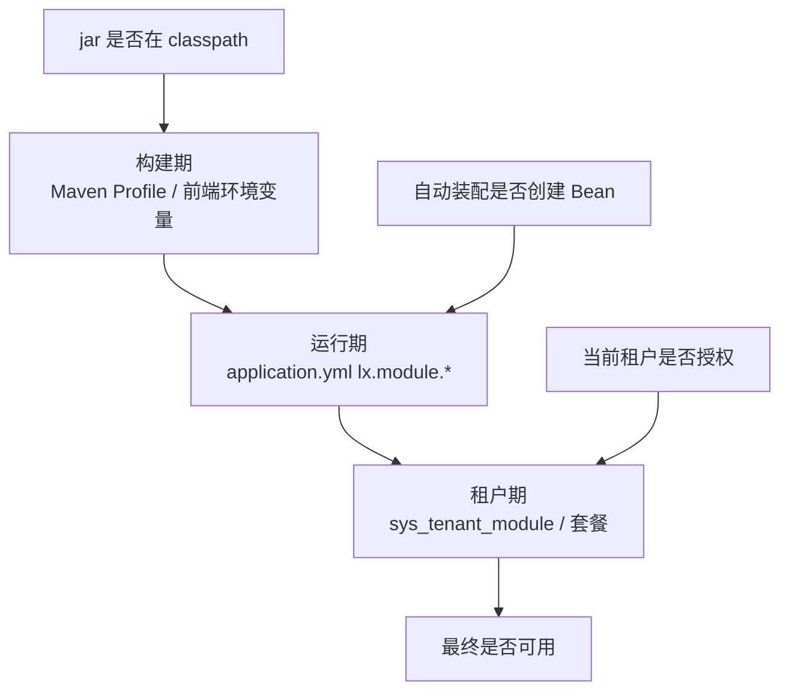

# 06 · 模块化与“即插即用”

> 目标：CMS、会员、工作流、SaaS 等模块可以**构建期裁剪、运行期关闭、租户期授权**；关闭后不是“隐藏菜单”，而是 Bean、接口、迁移、任务、前端路由都不加载。

---

## 1. 三层开关模型



| 层级 | 控制者 | 粒度 | 典型配置 | 关闭效果 |
|---|---|---|---|---|
| 构建期 | 实施 / 运维 | 整个交付包 | `-Pall-modules` / `-Plite`；`VITE_MODULE_CMS=false` | jar 不存在，类不加载，前端代码可裁剪 |
| 运行期 | 平台管理员 | 整个实例 | `lx.module.cms.enabled=false` | 自动装配不生效，接口 404，迁移跳过，任务不注册 |
| 租户期 | 平台 / 租户管理员 | 单个租户 | `sys_tenant_module.enabled=0` | Bean 仍在（其他租户要用），当前租户接口 403、菜单不返回、任务跳过 |

**求交规则：**

```text
可用 = 构建期存在 AND 运行期启用 AND (未开启 SaaS OR 租户已授权)
```

> 不要用数据库配置去控制 Bean 是否创建。数据库配置是运行期的，Bean 创建是启动期的；两者混用会导致“配置改了但没生效”。

---

## 2. 工程与 Maven Profile

### 2.1 模块划分

| 模块 | 类型 | 默认打包 | 说明 |
|---|---|---|---|
| `lx-common-*` | 基础库 | 必含 | 无业务 |
| `lx-framework` | 基础库 | 必含 | 自动装配、全局配置 |
| `lx-system` | 业务 | 必含 | 认证、用户、角色、菜单、字典、参数、日志 |
| `lx-i18n` | 业务 | 必含（可关） | 语言、翻译键、语言包、内容翻译 |
| `lx-file` | 业务 | 必含 | 文件、图片 |
| `lx-job` | 业务 | 必含 | 定时任务 |
| `lx-message` | 业务 | 必含 | 消息 |
| `lx-generator` | 工具 | 开发期 | 生产可裁剪 |
| `lx-cms` | 业务 | 可选 | 内容 |
| `lx-member` | 业务 | 可选 | 会员 |
| `lx-workflow` | 业务 | 可选 | 工作流 |
| `lx-saas` | 业务 | 可选 | 多租户，首发不打包 |
| `lx-open` | 业务 | 后期 | 开放平台 |

**首发默认：单租户。**

> **v1.0 实际打包：** 只装 `lx-system` / `lx-file` / `lx-demo`（契约验证，生产可去）。`lx-cms` / `lx-member` / `lx-workflow` / `lx-saas` / `lx-open` 均不打进 v1.0，后续按 `20-cms-embed-plan.md` 以模块嵌入。

- `lx-saas` 不打进首发包，`lx.module.saas.enabled=false`，不建 `sys_tenant` / 套餐表，不加载租户管理接口与菜单。
- 但 `tenant_id` 字段与 `TenantContext` **从第一天就存在**：所有业务表带 `tenant_id default 0`，请求链路写入 `TenantContext(0)`，缓存 Key 带 `0`，异步与 MQ 传播 `0`。
- 租户插件先注册但“空实现”（不拼条件）；打开 SaaS 后替换为真实解析与强制条件。
- 这样后期加租户只改基础设施 + 加 `saas` 模块，**不改业务表、不改业务 SQL、不改业务 Service**。

### 2.2 `lx-boot/pom.xml` 示例

```xml
<profiles>
  <!-- 全量：开发、SaaS 版本 -->
  <profile>
    <id>all-modules</id>
    <dependencies>
      <dependency>
        <groupId>com.lingxiao</groupId>
        <artifactId>lx-module-cms</artifactId>
        <version>${project.version}</version>
      </dependency>
      <dependency>
        <groupId>com.lingxiao</groupId>
        <artifactId>lx-module-member</artifactId>
        <version>${project.version}</version>
      </dependency>
      <dependency>
        <groupId>com.lingxiao</groupId>
        <artifactId>lx-module-workflow</artifactId>
        <version>${project.version}</version>
      </dependency>
      <dependency>
        <groupId>com.lingxiao</groupId>
        <artifactId>lx-module-saas</artifactId>
        <version>${project.version}</version>
      </dependency>
    </dependencies>
  </profile>

  <!-- 精简：只交付后台基座 -->
  <profile>
    <id>lite</id>
    <dependencies>
      <!-- 只保留 system / file / job / message -->
    </dependencies>
  </profile>
</profiles>
```

构建命令：

```bash
# 全量
mvn -Pall-modules clean package -DskipTests

# 精简
mvn -Plite clean package -DskipTests

# 全量 + JDK17 验证
mvn -Pall-modules -Dmaven.compiler.release=8 clean verify
```

> 可选模块的 jar 不在 classpath 时，`@ConditionalOnClass` 会自动跳过；因此同一套自动装配代码可以同时服务全量包和精简包。

---

## 3. 自动装配

### 3.1 模块自动配置

```java
package com.lingxiao.cms.config;

@AutoConfiguration
@ConditionalOnClass(name = "com.lingxiao.cms.CmsModule")
@ConditionalOnProperty(prefix = "lx.module.cms", name = "enabled", havingValue = "true")
@MapperScan("com.lingxiao.cms.mapper")
@Import({CmsServiceConfig.class, CmsWebConfig.class, CmsEventConfig.class})
public class CmsAutoConfiguration {

    @Bean
    @ConditionalOnMissingBean
    public CmsModuleDescriptor cmsModuleDescriptor() {
        return new CmsModuleDescriptor();
    }
}
```

注册文件（Spring Boot 2.7+）：

```text
src/main/resources/META-INF/spring/org.springframework.boot.autoconfigure.AutoConfiguration.imports
com.lingxiao.cms.config.CmsAutoConfiguration
```

### 3.2 控制器条件加载

```java
@RestController
@RequestMapping("/api/admin/cms/content")
@ConditionalOnProperty(prefix = "lx.module.cms", name = "enabled", havingValue = "true")
public class CmsContentAdminController { ... }
```

或者把 Controller 放进 `CmsWebConfig` 的 `@Bean` 方法，避免组件扫描误加载。

### 3.3 任务与监听器

```java
@Component
@ConditionalOnProperty(prefix = "lx.module.cms", name = "enabled", havingValue = "true")
public class CmsPublishJob { ... }
```

```java
@Component
@ConditionalOnProperty(prefix = "lx.module.cms", name = "enabled", havingValue = "true")
public class ContentPublishedListener { ... }
```

**规则：** 所有可选模块的 `@Component`、`@Service`、`@RestController`、`@Scheduled`、`@EventListener`、`@RabbitListener` 都必须有模块条件，或放在条件配置的 `@Bean` 里。仅靠包扫描会把“关闭的模块”重新加载。

---

## 4. 模块契约（SPI）

### 4.1 模块描述符

```java
public interface LxModule {
    String code();
    String name();
    default List<String> dependsOn() { return Collections.emptyList(); }
    default List<String> migrationLocations() { return Collections.emptyList(); }
    default void validate(ModuleContext context) { }
}
```

```java
public class CmsModuleDescriptor implements LxModule {
    @Override public String code() { return "cms"; }
    @Override public String name() { return "内容管理"; }
    @Override public List<String> dependsOn() { return Arrays.asList("system", "file"); }
    @Override public List<String> migrationLocations() {
        return Collections.singletonList("classpath:db/migration/cms");
    }
}
```

### 4.2 可插拔扩展点

| SPI | 默认实现 | 可替换 |
|---|---|---|
| `StorageProvider` | 本地 / MinIO | OSS、COS、S3、私有云 |
| `ImageProcessor` | Thumbnailator | libvips、云图片处理 |
| `CaptchaProvider` | 图形 / 算术 | 滑块、行为、极验 |
| `SmsProvider` | 阿里云 / 腾讯云 | 其他通道 |
| `MailProvider` | SMTP | 企业邮、SendGrid |
| `WorkflowEngine` | Flowable 6.8 | Camunda、自研 |
| `SearchProvider` | MySQL | Elasticsearch、OpenSearch |
| `EditorProvider` | WangEditor | TinyMCE、CKEditor、Markdown |
| `OAuthProvider` | 微信 / QQ / Apple | 其他平台 |
| `PaymentProvider` | 预留 | 微信、支付宝、Stripe |
| `ContentRenderer` | API 渲染 | 静态化模板 |
| `TenantProvisioner` | 共享表 | 独立 Schema / 独立库 |
| `DatabaseDialect` | MySQL / PG / DM / 金仓 | 其他国产库 |
| `TranslationProvider` | 预留 / 人工 | 机器翻译、翻译平台 |

> SPI 的价值：把“可能换掉的基础设施”隔离在接口后面，业务模块不直接依赖具体实现。**不要为每个 Service 都造 SPI**，只隔离真正会换的。

---

## 5. 模块注册表

```java
@Component
public class ModuleRegistry {

    private final Map<String, LxModule> modules;
    private final ModuleProperties properties;
    private final TenantModuleService tenantModuleService;

    public ModuleRegistry(List<LxModule> modules,
                          ModuleProperties properties,
                          TenantModuleService tenantModuleService) {
        this.modules = modules.stream()
                .collect(Collectors.toMap(LxModule::code, Function.identity()));
        this.properties = properties;
        this.tenantModuleService = tenantModuleService;
    }

    /** 运行期是否启用（全局） */
    public boolean isEnabled(String code) {
        return properties.getModules().getOrDefault(code, new ModuleSwitch()).isEnabled();
    }

    /** 当前租户是否可用 */
    public boolean isEnabledForCurrentTenant(String code) {
        if (!isEnabled(code)) {
            return false;
        }
        if (!properties.getSaas().isEnabled()) {
            return true;
        }
        Long tenantId = TenantContextHolder.getTenantId();
        return tenantModuleService.isEnabled(tenantId, code);
    }

    public Collection<LxModule> modules() {
        return modules.values();
    }

    public Set<String> enabledModules() {
        return modules.keySet().stream()
                .filter(this::isEnabled)
                .collect(Collectors.toSet());
    }
}
```

`ModuleProperties` 绑定：

```yaml
lx:
  module:
    i18n:
      enabled: true
    cms:
      enabled: false
    member:
      enabled: false
    workflow:
      enabled: false
    saas:
      enabled: false           # 首发单租户；后期开启即多租户
    generator:
      enabled: true
    open:
      enabled: false
  db:
    vendor: mysql          # mysql / postgresql / dm / kingbase / opengauss
  i18n:
    default-lang: zh-CN
    fallback-lang: zh-CN
    cache-ttl: 1h
```

---

## 6. 数据迁移（Flyway）

### 6.1 独立 history 表

每个模块独立 Flyway 实例，避免版本号互相阻塞：

```java
@Configuration
public class ModuleMigrationConfig {

    @Bean
    public ModuleMigrationRunner moduleMigrationRunner(
            DataSource dataSource, ModuleRegistry registry) {
        return new ModuleMigrationRunner(dataSource, registry);
    }
}

public class ModuleMigrationRunner implements InitializingBean {

    private final DataSource dataSource;
    private final ModuleRegistry registry;

    @Override
    public void afterPropertiesSet() {
        for (LxModule module : registry.modules()) {
            if (!registry.isEnabled(module.code())) {
                continue;
            }
            Flyway flyway = Flyway.configure()
                    .dataSource(dataSource)
                    .locations(module.migrationLocations().toArray(new String[0]))
                    .table("flyway_" + module.code() + "_history")
                    .baselineOnMigrate(true)
                    .validateOnMigrate(true)
                    .load();
            flyway.migrate();
        }
    }
}
```

> 同时设置 `spring.flyway.enabled=false`，关闭 Boot 默认 Flyway，避免重复执行。

### 6.2 迁移规范

- 每个模块目录独立，版本号从 `V1.0.0` 开始。
- 只允许新增脚本，不修改已执行脚本。
- 生产迁移前备份 + 预发演练。
- 大表变更走“加列 → 双写 → 回填 → 切读 → 删旧列”。
- 租户独立库初始化时，按启用模块执行对应脚本。

---

## 7. 前端模块注册

### 7.1 后台（Vue3）

```ts
// src/modules/types.ts
export interface LxModule {
  code: string
  name: string
  routes?: RouteRecordRaw[]
  setup?: () => void
}

// src/modules/index.ts
import { cmsModule } from './cms'
import { memberModule } from './member'
import { workflowModule } from './workflow'
import { saasModule } from './saas'

const registry: Record<string, LxModule> = {
  cms: cmsModule,
  member: memberModule,
  workflow: workflowModule,
  saas: saasModule,
}

export function registerModules(enabled: string[]) {
  enabled.forEach((code) => {
    const mod = registry[code]
    if (mod) {
      mod.routes?.forEach((r) => router.addRoute(r))
      mod.setup?.()
    }
  })
}
```

- 构建期：`VITE_MODULE_CMS=false` 时 Vite 直接 tree-shake 掉对应入口。
- 运行期：登录后 `/api/admin/auth/info` 返回 `enabledModules`，只注册交集。
- 后端菜单是最终权威；前端注册表只负责“代码是否打包”和“路由组件映射”。
- 关闭模块后，即使后端误下发菜单，前端也找不到组件，不会白屏。
- `i18n` 不是路由模块：关闭时前端只加载内置默认语言包，不请求 `/api/admin/i18n/**`；开启时按命名空间懒加载并跟随 `enabledModules` 裁剪。

### 7.2 uni-app

```json
{
  "pages": [
    { "path": "pages/index/index", "style": { "navigationBarTitleText": "首页" } }
  ],
  "subPackages": [
    {
      "root": "pages/cms",
      "pages": [
        { "path": "list/index", "style": { "navigationBarTitleText": "列表" } },
        { "path": "detail/index", "style": { "navigationBarTitleText": "详情" } }
      ]
    },
    {
      "root": "pages/member",
      "pages": [
        { "path": "login/index", "style": { "navigationBarTitleText": "登录" } },
        { "path": "center/index", "style": { "navigationBarTitleText": "我的" } }
      ]
    }
  ]
}
```

- 会员模块关闭：不打包 `pages/member` 分包，TabBar 不显示“我的”。
- CMS 关闭：不打包 `pages/cms`，首页改为纯静态 / 跳转。
- 自定义 TabBar 读取 `enabledModules`，不要写死 4 个 tab。
- 平台差异用条件编译：

```js
// #ifdef MP-WEIXIN
wx.login()
// #endif
// #ifdef H5
// H5 逻辑
// #endif
```

### 7.3 门户（Nuxt3）

```ts
// nuxt.config.ts
export default defineNuxtConfig({
  runtimeConfig: {
    public: {
      modules: {
        cms: process.env.NUXT_PUBLIC_MODULE_CMS !== 'false',
        member: process.env.NUXT_PUBLIC_MODULE_MEMBER !== 'false',
      },
    },
  },
})
```

- 构建期决定是否生成 CMS / 会员路由。
- 运行期通过 `/api/portal/config/modules` 二次校验。
- 会员关闭时，登录、注册、个人中心路由返回 404，不渲染入口。

---

## 8. 关闭后的行为（验收清单）

| 检查项 | 构建期关闭 | 运行期关闭 | 租户期关闭 |
|---|---|---|---|
| jar 在 classpath | ❌ | ✅ | ✅ |
| 自动配置类 | ❌ | ❌ | ✅ |
| Service / Mapper Bean | ❌ | ❌ | ✅ |
| Controller / 接口 | ❌ 404 | ❌ 404 | ✅ 403 |
| Flyway 迁移 | ❌ | ❌ | ✅（表保留） |
| 菜单下发 | ❌ | ❌ | ❌ |
| 前端路由 | ❌ | ❌ | ❌ |
| 定时任务 | ❌ | ❌ | 跳过该租户 |
| MQ 监听 | ❌ | ❌ | 跳过该租户 |
| 已有数据 | 保留 | 保留 | 保留 |
| 缓存 Key | 不生成 | 不生成 | 不生成 |
| 日志 | 无 | 无 | 记录拒绝原因 |
| i18n 接口 | ❌ 404 | ❌ 404 | 按默认语言运行 |
| 租户表 | ❌ 不建 | ❌ 不建 | 表保留 |
| 租户上下文 | 默认 0 | 默认 0 | 真实租户 |

**关键：关闭不等于删数据。** 重新开启后数据必须完整可用。

**首发单租户回归（每个版本必跑）：**

- [ ] 关闭 `saas` 后启动：无 `sys_tenant*` 表、无租户接口、无租户菜单。
- [ ] 业务写入的 `tenant_id` 全为 `0`。
- [ ] 打开 `saas` 后：租户表迁移成功，存量数据 `tenant_id=0` 可用，新租户数据隔离。
- [ ] 关闭再打开 `saas`：数据不丢，租户配置可恢复。

---

## 9. 模块依赖矩阵

| 模块 | 依赖 | 被谁依赖 | 关闭影响 |
|---|---|---|---|
| `system` | 无 | 所有 | 不可关闭 |
| `i18n` | system | cms、member、message、open | 系统按默认语言运行，语言切换与内容翻译不可用 |
| `file` | system | cms、member | 图片/附件不可用，CMS 封面上传降级 |
| `message` | system | member、workflow、saas | 通知降级为站内信 / 日志 |
| `job` | system | cms、saas | 定时发布、租户任务不可用 |
| `cms` | system、file | member（内容）、workflow（审核） | 门户无内容，会员只剩账户能力 |
| `member` | system、file | cms（评论/投稿） | 前台匿名浏览，互动关闭 |
| `workflow` | system | cms、member | 内容审核退化为人工开关 |
| `saas` | system | open | 单租户运行，`tenant_id=0`，无租户表 / 接口 |
| `open` | system、saas | 无 | 开放接口关闭 |

**启动校验：** 若 `cms` 启用但 `file` 关闭，启动直接失败并给出明确提示，不要带病运行。

---

## 10. 配置项分层

### 10.1 `application.yml`（启动期）

```yaml
lx:
  module:
    cms:
      enabled: true
    member:
      enabled: true
    workflow:
      enabled: false
    saas:
      enabled: false
  tenant:
    enabled: false
    default-isolation: shared
  security:
    admin:
      token-name: lx-admin-token
      timeout: 12h
      active-timeout: 30m
    member:
      token-name: lx-member-token
      timeout: 7d
      active-timeout: 2h
  upload:
    storage: minio
    max-size: 20MB
```

### 10.2 `sys_config`（运行期业务开关）

| 分组 | 示例 |
|---|---|
| 登录 | 验证码开关、验证码类型、失败锁定、MFA、密码策略 |
| 注册 | 会员注册开关、审核、邮箱验证、邀请码 |
| 上传 | 大小、扩展名、存储、水印、裁剪 |
| CMS | 审核开关、静态化、搜索引擎、评论审核 |
| 会员 | 登录验证码、等级规则、积分规则 |
| 工作流 | 是否启用、默认审批人、超时提醒 |
| SaaS | 自助注册、默认隔离模式、配额 |
| 多语言 | 默认语言、启用语言、缺失回退、机器翻译开关 |
| 数据库 | 厂商、连接池、迁移开关、慢 SQL 阈值 |
| 日志 | 保留天数、脱敏规则 |

### 10.3 覆盖优先级

```text
租户配置（sys_config.tenant_id=T）
  > 平台配置（sys_config.tenant_id=0）
  > application.yml 默认值
```

- 只有 `is_tenant_override=1` 的参数允许租户覆盖。
- 敏感参数（AK/SK、短信密钥）不返回前端，只返回“已配置”。
- 修改后清 `lx:config:{tenantId}:{key}` 缓存，并广播刷新事件。

---

## 11. 测试策略

| 测试 | 目的 |
|---|---|
| `lite` 启动测试 | 只含基座时能启动，无 CMS / 会员 / 工作流 Bean |
| `all` 启动测试 | 全模块能启动，Flyway 全量执行 |
| 关闭态接口测试 | 关闭模块的 URL 返回 404，不泄露实现 |
| 租户关闭测试 | 租户 B 关闭 CMS，租户 A 仍可用 |
| 依赖校验测试 | `cms` 开、`file` 关时启动失败并提示 |
| ArchUnit | 模块间不直接依赖 Mapper；common 不依赖 Servlet |
| 前端构建测试 | `VITE_MODULE_CMS=false` 产物不含 CMS chunk |
| 契约测试 | 关闭模块后 OpenAPI 不出现对应接口 |
| i18n 关闭测试 | 关闭 i18n 后无 i18n 表、无语言接口、按默认语言启动 |
| 多库测试 | 同一套集成测试在 MySQL / PG / 达梦 / 金仓执行 |

---

## 12. 常见坑

1. **只加 `@ConditionalOnProperty` 到 Controller，忘了 `@Service` / `@MapperScan`。** 结果 Bean 仍加载，启动报错或后台任务仍在跑。
2. **Flyway 版本号冲突。** 多模块共用一张 history 表，`V1.0.0` 重名。必须独立 history 或全局唯一版本。
3. **前端菜单隐藏了，但路由还在。** 用户手动输入 URL 仍能进页面。必须同时不注册路由。
4. **租户关闭只隐藏菜单，接口仍可调。** 必须在 Service / 拦截器层校验 `isEnabledForCurrentTenant`。
5. **关闭模块后定时任务仍在执行。** `@Scheduled` 不受菜单影响，必须加条件或改为动态任务。
6. **模块间直接注入 Mapper。** 短期方便，长期无法拆分。只允许依赖 `*-api` 接口或领域事件。
7. **数据库配置控制 Bean。** 改了配置重启才生效，且多租户场景无法差异化。Bean 开关只放 yml。
8. **构建期裁剪后，自动装配文件仍引用不存在的类。** 用 `@ConditionalOnClass` 保护，或按 Profile 生成 imports 文件。
9. **i18n 模块关闭了，代码还在查语言包。** `MessageSource` 要有资源包兜底，不能强依赖数据库；前端要有内置默认语言包。
10. **语言包发布只清了本机缓存。** 多实例必须广播，否则部分节点一直返回旧文案。
11. **业务 SQL 写了 MySQL 方言。** `find_in_set`、`ON DUPLICATE KEY`、`limit` 在 PG / 达梦直接报错，必须走 Dialect 或应用层。
