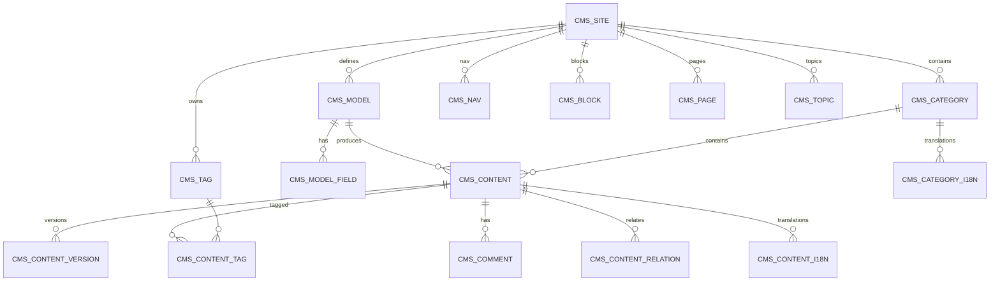
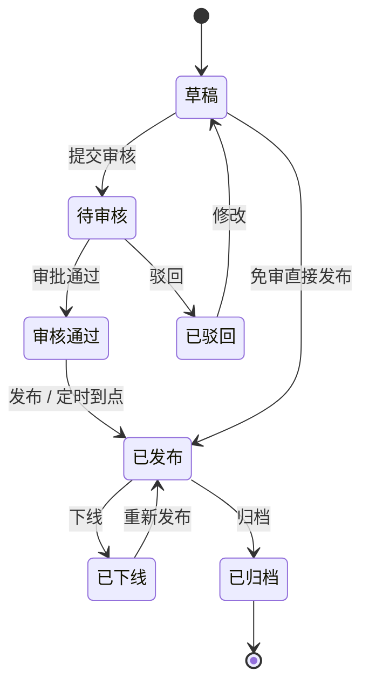
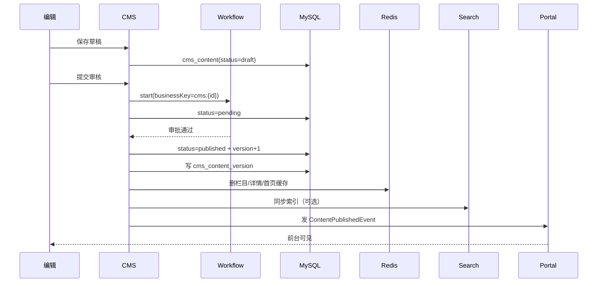

# 07 · CMS 设计

> 定位：**Headless API 为主、静态化模板为可选**的内容中台。后台负责生产与审核，PC / H5 / 小程序 / 第三方通过 API 消费；高流量或低配私有化场景可开启静态化。

---

## 1. 能力边界

| 能力 | 首期 | 说明 |
|---|---|---|
| 多站点 | ✅ | 一套后台多个站点，按域名 / 目录区分 |
| 栏目树 | ✅ | 无限层级、绑定模型、栏目权限 |
| 动态模型 | ✅ | 20+ 字段类型、JSON 扩展、可选物理表 |
| 内容生产 | ✅ | 草稿、审核、发布、下线、版本、定时 |
| 标签 / 专题 / 区块 | ✅ | 聚合与运营位 |
| 评论互动 | ✅ | 审核、敏感词、点赞、举报 |
| 编辑器 | ✅ | WangEditor 默认，图片裁剪 / 水印 |
| 搜索 | ✅ | MySQL 起步，ES 可选 |
| 静态化 | 可选 | 模板标签 + 生成 HTML |
| 多语言 | 可选 | 内容翻译、语言站点、hreflang，由 I18N 模块提供 |
| 内容付费 | 预留 | 与会员、支付中心结合 |

---

## 2. 领域模型



### 2.1 站点 `cms_site`

| 字段 | 说明 |
|---|---|
| `site_id` / `tenant_id` | 站点与租户 |
| `site_code` / `site_name` | 唯一编码、名称 |
| `domain` / `domain_alias` | 主域名、别名 |
| `theme` | 主题包 |
| `logo` / `favicon` | 品牌 |
| `seo_title` / `seo_keywords` / `seo_description` | 默认 TDK |
| `watermark_scene` | 默认水印策略 |
| `member_policy` | 是否强制登录、评论权限 |
| `static_enabled` | 是否开启静态化 |
| `status` | 正常 / 停用 |

### 2.2 栏目 `cms_category`

- 树形结构：`parent_id` + `ancestors`（展示用）+ `cms_category_closure` 闭包表；查子树走闭包表，不用 `find_in_set`。
- `category_type`：`list` 列表、`page` 单页、`link` 内链、`outside` 外链。
- `model_id`：一个栏目绑定一个模型；内容继承栏目的模型。
- `path`：URL 路径，站点内唯一。
- `template_list` / `template_detail`：静态化模式使用；Headless 模式可忽略。
- `access_type` / `access_config`：栏目级访问控制，内容可覆盖。
- `is_nav` / `is_show` / `sort`：导航与展示。
- `status`：启用 / 停用；停用栏目下的内容不对外。

### 2.3 模型 `cms_model` + 字段 `cms_model_field`

**字段类型：**

```text
text          单行文本
textarea      多行文本
richtext      富文本
markdown      Markdown
number        数字
decimal       小数
date          日期
datetime      日期时间
select        下拉单选
radio         单选
checkbox      多选
switch        开关
image         单图
images        多图
file          单文件
files         多文件
video         视频
relation      关联内容
area          地区
color         颜色
json          自定义 JSON
```

**字段配置：**

- `is_required` / `default_value` / `validation_json`（长度、正则、范围）。
- `is_list` / `is_search` / `is_detail` / `sort`：列表、搜索、详情展示。
- `options_json`：选项、字典编码、关联模型、上传场景。
- `storage_type`：`json` / `column` / `table`。

### 2.4 内容 `cms_content`

公共字段（所有模型共享）：

```text
title / subtitle / slug / summary / cover_file_id
category_id / model_id / site_id / tenant_id
author / source / status / publish_time / offline_time
is_top / is_recommend / is_hot / is_slide / sort
access_type / access_config
seo_title / seo_keywords / seo_description
template / version / views / likes / favorites / comments
ext_json
```

模型字段放 `ext_json`，高频检索字段抽生成列或同步到索引表。

### 2.5 内容翻译 `cms_content_i18n`

- 同一内容的不同语言版本用 `content_id` 关联，主表保留默认语言与公共字段。
- 翻译表存 `language_code`、`title`、`subtitle`、`slug`、`summary`、`content_html`、SEO、`ext_json`。
- `translate_status`：`none` / `machine` / `translated` / `reviewed` / `published`。
- 栏目、站点、导航、区块、广告同样用 `cms_category_i18n` / `cms_site_i18n` / `cms_block_i18n`。
- 各语言可独立发布 / 下线；默认语言未发布时，其他语言默认不可发布。
- slug 在“语言 + 站点”内唯一；允许不同语言使用不同 slug。
- 内容更新后，其他语言标记“需同步”，不自动覆盖人工译文。
- 翻译可接工作流：提交 → 翻译 → 审校 → 发布；机器翻译必须人工审校后才能标记 `reviewed`。
- 前台回退：请求语言 → 站点默认语言 → 平台默认语言 → 404；回退时返回 `X-Lang-Fallback: true`。

---

## 3. 存储方案：JSON、EAV、动态表怎么选

| 方案 | 优点 | 缺点 | 适用 |
|---|---|---|---|
| JSON 扩展字段 | 改字段零 DDL、开发快、模型灵活 | 复杂查询 / 索引弱、数据校验靠应用 | **默认**，中小内容量 |
| EAV（字段-值表） | 字段无限、可按字段查 | 查询 Join 多、写入放大、排序分页难 | 不推荐 |
| 动态物理表 | 查询性能最好、索引自由 | 每次建模要 DDL、跨模型聚合难 | 大字段量、强查询 |
| **混合（推荐）** | 公共字段走主表，扩展走 JSON，高频字段生成列 / 扩展表 | 实现复杂度中等 | 绝大多数场景 |

### 3.1 推荐落地

```text
cms_content（公共字段 + ext_json）
  ├─ 高频检索字段：MySQL 生成列 + 索引
  ├─ 超大模型：cms_content_ext_{model_code} 物理表
  └─ 全文检索：cms_search_index / Elasticsearch
```

生成列示例：

```sql
ALTER TABLE cms_content
  ADD COLUMN author_idx varchar(64)
    GENERATED ALWAYS AS (json_unquote(json_extract(ext_json, '$.author'))) STORED,
  ADD KEY idx_content_author (tenant_id, site_id, author_idx);
```

### 3.2 模型切换成本

- JSON → 物理表：提供“模型存储迁移”工具，按字段映射建表、回填、双写、切读。
- 物理表 → JSON：反向导出，低频操作。
- 字段删除：先隐藏，观察一段时间再清理 JSON Key / 列。

---

## 4. 内容状态机



**规则：**

- 只有 `published` 的内容对外可见。
- `publish_time > now()` 为定时发布，由任务扫描。
- `offline_time` 到点自动下线。
- 每次发布生成 `cms_content_version` 快照，支持回滚。
- 审核中修改内容：锁版本或生成新版本，避免审批的是旧稿。
- 下线不删除评论 / 统计，重新发布后保留。

---

## 5. 发布链路



**事件：**

- `ContentPublishedEvent`：清缓存、同步搜索、刷新 CDN、推送订阅。
- `ContentOfflineEvent`：清缓存、删索引、404。
- `ContentUpdatedEvent`：更新索引、清详情缓存。
- 事件消费幂等，失败重试，记录死信。

---

## 6. 编辑器设计

### 6.1 适配器

```java
public interface EditorProvider {
    String code();                       // wangEditor / tinymce / markdown
    EditorConfig config();               // 工具栏、上传地址、限制
    String sanitize(String html);        // 服务端消毒
}
```

- 默认 `wangEditor`，后台可按站点 / 租户切换。
- Markdown 模式用于技术内容，渲染时同样消毒。
- 源码模式仅对受信角色开放。

> **v1.0 口径：** 用 **WangEditor 5**（MIT、Vue3、中文文档），通过 `EditorProvider` 隔离；Tiptap 作为后续结构化 / 协同备选。图片插入用 `src="/api/portal/file/{fileId}?size=medium"` + `data-file-id`，**URL 自带 `fileId`**，编辑器即使丢自定义属性也能反解。粘贴 / 拖拽自动上传，拒绝 base64；远程抓取默认关闭。详见 [17-v1-plan.md](17-v1-plan.md) 3.4.2 / 3.4.3。

### 6.2 图片链路

```text
编辑器选择图片
  → 文件中心上传（返回 fileId / url / thumb）
  → 可选裁剪（x/y/w/h/rotate）
  → 可选水印（按场景策略）
  → 插入 
  → 保存时提取 fileId，写 sys_file_ref
```

- 粘贴图片自动上传。
- 远程图片抓取走服务端代理，做 SSRF 白名单、大小限制、超时。
- 图片懒加载、`srcset`、WebP。
- 删除内容时解引用，不物理删除文件。

### 6.3 安全

- 服务端 HTML 消毒（Jsoup / OWASP Sanitizer），白名单标签与属性。
- 禁止 `script`、`iframe`（白名单域名除外）、`on*` 事件。
- 链接加 `rel="noopener noreferrer"`，外链可加 `nofollow`。
- 富文本中的 `file://`、`javascript:` 协议拒绝。
- 正文渲染不做字符串拼接，避免二次 XSS。

---

## 7. Headless API 与静态化

### 7.1 Headless（默认）

```text
PC 门户（Nuxt3 SSR）
  → /api/portal/cms/site/{code}
  → /api/portal/cms/categories?siteId=
  → /api/portal/cms/contents?categoryId=&page=
  → /api/portal/cms/content/{id}
  → /api/portal/cms/search?q=
```

优点：多端复用、SEO 可控、前后端分离、易缓存。
缺点：需要 Node SSR 服务；首屏依赖 API。

### 7.2 静态化（可选）

- 模板引擎：FreeMarker / Thymeleaf。
- 模板标签：

```html
{cms:contentList categoryId="1" limit="10" orderBy="publishTime desc"}
  <a href="{$item.url}">{$item.title}</a>
{/cms:contentList}

{cms:categoryList parentId="0"}
  <a href="{$item.url}">{$item.categoryName}</a>
{/cms:categoryList}
```

- 发布后生成：首页、栏目页、详情页、标签页、专题页。
- 输出到本地目录 / 对象存储 / CDN。
- 支持全量、增量、按栏目、按内容生成。
- 静态化失败不阻塞发布，进入重试队列。

**建议：** 首期只做 Headless；静态化在 P6 作为“高流量 / 低配私有化”开关，不默认开启。

### 7.3 URL 规则

```text
/{lang}/{category.path}/                  栏目页
/{lang}/{category.path}/{contentId}.html  详情页（ID）
/{lang}/{category.path}/{slug}.html       详情页（slug）
/{lang}/tag/{tagSlug}/                    标签页
/{lang}/topic/{topicCode}/                专题页
/{lang}/search?q=                         搜索
```

- 默认语言可不带 `{lang}` 前缀（`prefix_except_default`），其他语言必须带。
- 同一内容各语言 URL 互相对应，输出 `hreflang` 与 `x-default`。
- 规则可配置，站点级唯一。
- 修改规则生成 301，保留旧 URL 映射。
- 404 返回自定义页面，不返回堆栈。

### 7.4 SEO

- SSR 输出 TDK、canonical、OG、JSON-LD。
- `sitemap.xml` 分页生成，自动提交搜索引擎。
- `robots.txt` 按环境配置。
- 列表分页 `rel=prev/next`。
- 付费 / 会员内容不进入 sitemap，未授权不输出全文。
- 图片 `alt`、结构化面包屑。
- 多语言输出 `hreflang`（含 `x-default`）、语言化 canonical、按语言分组的 sitemap。
- 回退内容 canonical 指向默认语言版本，避免重复收录。

---

## 8. 多站点与多租户

| 层级 | 关系 | 说明 |
|---|---|---|
| 租户 | 1:N 站点 | 一个租户可有多个站点 |
| 站点 | 1:N 栏目 | 栏目树站点内独立 |
| 站点 | 1:N 模型 | 模型可站点级复用 |
| 站点 | 1:N 内容 | 内容归属站点 |
| 租户 | 1:N 会员 | 会员租户级，不跨站点 |
| 站点 | 1:N 域名 | 主域名 + 别名 |
| 站点 | 1:N 语言 | 站点启用语言、默认语言、语言前缀 |
| 内容 | 1:N 翻译 | `cms_content_i18n`，按语言独立发布 |

- 门户按域名解析租户 + 站点：`sys_tenant_domain` / `cms_site_domain`。
- 内容默认不跨站点共享；需要共享时用“内容同步 / 引用”功能。
- 会员在租户内共享，站点可配置“是否共享登录态”。
- 文件路径带 `tenantId/siteId`，避免串站。

---

## 9. 缓存与搜索

### 9.1 缓存

| 对象 | Key | TTL | 失效 |
|---|---|---|---|
| 站点配置 | `lx:cms:site:{siteId}:{lang}` | 30m | 站点保存 |
| 栏目树 | `lx:cms:cat:{siteId}:{lang}` | 10m | 栏目变更 |
| 内容详情 | `lx:cms:content:{id}:{lang}:{version}` | 30m | 发布 / 下线 |
| 内容列表 ID | `lx:cms:list:{siteId}:{catId}:{lang}:{page}:{size}` | 1~3m | 发布事件 |
| 首页聚合 | `lx:cms:home:{siteId}:{lang}` | 1~5m | 发布事件 |
| 标签云 | `lx:cms:tags:{siteId}:{lang}` | 10m | 标签变更 |

### 9.2 搜索

- 起步：MySQL `like` + 标题 / 摘要 / 标签，限制范围与分页。
- 进阶：Elasticsearch / OpenSearch，内容发布同步索引。
- 索引字段：标题、摘要、正文纯文本、标签、栏目、作者、发布时间、权限级别。
- 权限过滤：未授权内容不返回，或只返回摘要。
- 热词、搜索日志、搜索建议。

---

## 10. 接口清单

### 10.1 后台 `/api/admin/cms`

| 方法 | 路径 | 说明 |
|---|---|---|
| GET/POST/PUT/DELETE | `/site` | 站点 CRUD |
| GET/POST/PUT/DELETE | `/category` | 栏目 CRUD |
| GET | `/category/tree` | 栏目树 |
| GET/POST/PUT/DELETE | `/model` | 模型 CRUD |
| GET/POST/PUT/DELETE | `/model/{id}/field` | 字段 CRUD |
| GET/POST/PUT/DELETE | `/content` | 内容 CRUD |
| POST | `/content/{id}/submit` | 提交审核 |
| POST | `/content/{id}/publish` | 发布 |
| POST | `/content/{id}/offline` | 下线 |
| GET | `/content/{id}/versions` | 版本列表 |
| GET | `/content/{id}/translations` | 翻译列表 |
| POST | `/content/{id}/translation` | 新建 / 更新翻译 |
| POST | `/content/{id}/translation/{lang}/publish` | 发布某语言 |
| POST | `/content/{id}/translation/{lang}/machine` | 机器翻译 |
| POST | `/content/{id}/rollback/{version}` | 回滚 |
| GET/POST/PUT/DELETE | `/tag` | 标签 |
| GET/PUT | `/comment` | 评论审核 |
| GET/POST/PUT/DELETE | `/block` | 区块 |
| GET/POST/PUT/DELETE | `/nav` | 导航 |
| GET/POST/PUT/DELETE | `/topic` | 专题 |
| POST | `/static/generate` | 静态化 |

### 10.2 门户 `/api/portal/cms`

> 所有 GET 接口支持 `?lang=` 与 `Accept-Language` / `X-Lang`；响应带 `Content-Language`，回退时带 `X-Lang-Fallback: true`。

| 方法 | 路径 | 说明 |
|---|---|---|
| GET | `/site/{code}` | 站点信息 |
| GET | `/categories` | 栏目树 |
| GET | `/contents` | 内容列表（分页 / 筛选） |
| GET | `/content/{id}` | 内容详情（权限截断） |
| GET | `/content/slug/{slug}` | 按 slug |
| GET | `/tags` / `/tags/{slug}/contents` | 标签 |
| GET | `/topics` / `/topics/{code}` | 专题 |
| GET | `/search` | 搜索 |
| GET | `/content/{id}/translations` | 可用语言版本 |
| GET/POST | `/comments` | 评论 |
| POST | `/comments/{id}/like` | 点赞 |

### 10.3 App `/api/app/cms`

与门户类似，增加：

- 首页聚合 `/home`（轮播 + 推荐 + 最新）。
- 频道分页 `/channel/{id}`。
- 设备 / 版本 / 渠道参数。
- 分享签名。

---

## 11. 性能与安全

| 风险 | 对策 |
|---|---|
| 栏目树频繁查库 | 缓存 + 变更失效 |
| 内容列表深分页 | 游标 / 限制最大页 / 索引覆盖 |
| JSON 字段搜索慢 | 生成列索引 / 搜索表 / ES |
| 首页聚合慢 | 缓存 + 预计算 + 静态化 |
| 图片拖慢首屏 | 缩略图 + WebP + 懒加载 + CDN |
| 正文 XSS | 服务端消毒 + CSP |
| 付费内容泄露 | 服务端截断 + 不返回全文 + 禁止缓存 |
| 评论刷屏 | 验证码 + 频控 + 敏感词 + 审核 |
| 远程图片 SSRF | 域名白名单 + 内网 IP 拒绝 + 超时 |
| 采集 | 水印 + 频控 + 正文混淆（可选） |

---

## 12. 交付里程碑

| 阶段 | 内容 |
|---|---|
| P2-M1 | 站点、栏目、模型、字段、内容 CRUD |
| P2-M2 | 发布 / 下线 / 版本 / 定时、PC 门户列表与详情 |
| P2-M3 | 标签、专题、区块、导航、评论、搜索 |
| P2-M4 | 编辑器图片链路、SEO、sitemap、缓存 |
| P4 | 工作流审核集成 |
| P2.5 | 内容翻译、语言站点、hreflang、多语言 sitemap |
| P6 | 静态化、ES、内容迁移工具、租户自定义语言 |
