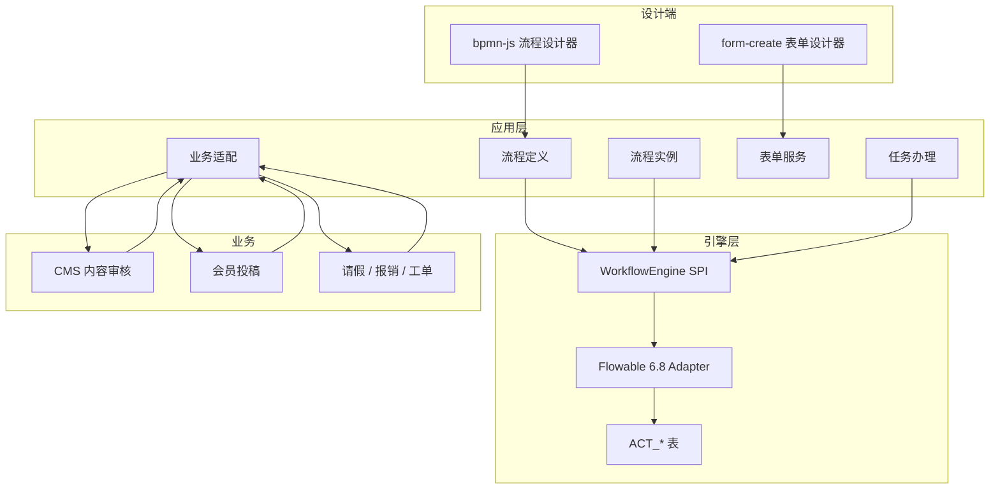
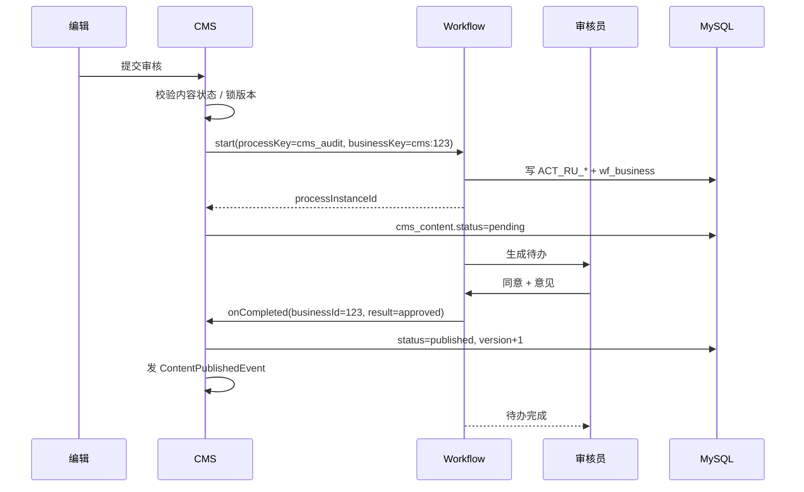

# 08 · 工作流设计

> 选型：**Flowable 6.8.0 内嵌**（JDK 8 兼容），通过 `WorkflowEngine` SPI 隔离引擎。Boot 3 / JDK 17 线可切换 Flowable 7。
> 目标：覆盖 80% 审批场景（串行、并行、会签、或签、条件、加签、转办、委托、退回、撤回），复杂 BPMN 后置。

---

## 1. 为什么是 Flowable 6.8

| 候选 | JDK 8 | BPMN | 生态 | 结论 |
|---|---|---|---|---|
| Flowable 6.8 | ✅ | ✅ | 国内案例多、文档全 | **选它** |
| Flowable 7 | ❌（JDK 17） | ✅ | 新 | Boot3 线再用 |
| Camunda 7 | ✅ | ✅ | 强，但商业许可需注意 | 备选 |
| Activiti 7 | 部分 | ✅ | 社区活跃度下降 | 不选 |
| 自研 | ✅ | 有限 | 可控但成本高 | 不首发 |

**封装原则：**

- 业务代码只依赖 `WorkflowEngine` 接口，不直接注入 `RuntimeService` / `TaskService`。
- 流程定义、任务、变量、历史的查询统一走 `WorkflowQueryService`。
- 未来换引擎只改 `FlowableEngineAdapter`，不动业务。

```java
public interface WorkflowEngine {
    String start(StartProcessCmd cmd);
    void complete(CompleteTaskCmd cmd);
    void reject(RejectTaskCmd cmd);
    void transfer(TransferTaskCmd cmd);
    void addSign(AddSignCmd cmd);
    void withdraw(String processInstanceId, Long operatorId);
    Page<TaskVO> pageTodo(TaskQuery query);
    Page<TaskVO> pageDone(TaskQuery query);
    Page<InstanceVO> pageMine(TaskQuery query);
    DiagramVO diagram(String processInstanceId);
}
```

---

## 2. 架构



---

## 3. 能力矩阵

| 能力 | 优先级 | 说明 |
|---|---|---|
| 流程分类 | P1 | 分组、排序、可见范围 |
| BPMN 设计 | P0 | 开始 / 结束 / 用户任务 / 服务任务 / 网关 / 子流程 |
| 表单绑定 | P0 | 业务表单 / 动态表单 |
| 发起流程 | P0 | 选择流程、填表、保存草稿、提交 |
| 待办 / 已办 / 我发起 | P0 | 分页、筛选、批量 |
| 同意 / 驳回 | P0 | 意见、附件、驳回节点 |
| 撤回 | P1 | 下一节点未处理 |
| 加签 / 转办 / 委托 | P1 | 前加签、后加签、长期委托 |
| 会签 / 或签 | P1 | 比例、全部、任一 |
| 条件分支 | P1 | 表达式、默认分支 |
| 抄送 | P1 | 已读 / 未读 |
| 催办 / 超时 | P1 | 站内信 / 短信 / 邮件 |
| 流程图追踪 | P1 | 高亮当前与历史 |
| 流程版本 | P1 | 新旧实例隔离 |
| 代理规则 | P2 | 时间段、流程范围 |
| 移动审批 | P1 | uni-app |
| 打印 / 导出 | P2 | 审批单 PDF |
| 流程监控 | P1 | 实例、耗时、积压 |

---

## 4. 审批模式

| 模式 | 场景 | 实现 |
|---|---|---|
| 串行 | 一级一级审批 | 顺序用户任务 |
| 并行 | 多部门同时审 | 并行网关 + 多任务 |
| 会签 | 全部 / 比例通过 | 多实例 `completionCondition` |
| 或签 | 任一人通过即可 | 多实例 + 任一完成 |
| 条件 | 金额 / 类型走不同分支 | 排他网关 + 表达式 |
| 加签 | 审批中临时加人 | 前加签 / 后加签任务 |
| 转办 | 把任务交给别人 | 改 assignee + 记录 |
| 委托 | 一段时间内代审 | 委托规则 + 任务分配监听 |
| 退回 | 回到上一节点 / 指定节点 | 跳转 + 状态重置 |
| 撤回 | 发起人收回 | 删除后续任务 / 跳回 |
| 催办 | 提醒当前处理人 | 消息 + 记录 |
| 抄送 | 知会 | 抄送表 + 消息 |

**驳回策略（三选一，流程级配置）：**

1. 驳回到发起人：流程结束，业务状态改为驳回。
2. 驳回到上一节点：上一节点重新审批。
3. 驳回到指定节点：需权限与原因。

> 驳回必须写 `wf_task_ext`，保留原任务、意见、操作人，不能物理删除历史。

---

## 5. 表单引擎

### 5.1 两种表单

| 类型 | 适用 | 存储 |
|---|---|---|
| 业务表单 | 结构稳定、强校验、与业务表强绑定 | 业务表 + 流程变量 |
| 动态表单 | 流程自定义、低代码、变化频繁 | `wf_form` + `wf_form_field` + JSON |

### 5.2 动态表单 Schema

```json
{
  "fields": [
    {
      "key": "amount",
      "label": "金额",
      "type": "number",
      "required": true,
      "min": 0,
      "max": 100000,
      "permissions": { "apply": "edit", "manager": "read", "finance": "edit" }
    },
    {
      "key": "reason",
      "label": "事由",
      "type": "textarea",
      "required": true,
      "maxLength": 500
    }
  ],
  "rules": [
    { "if": "amount > 5000", "then": "require(managerApproval)" }
  ]
}
```

- 字段权限：按节点 / 角色控制可编辑、只读、隐藏。
- 联动：条件显示、必填、赋值。
- 校验：前端 + 后端双校验，后端为准。
- 版本：表单发布后生成版本，历史实例按旧版本渲染。

### 5.3 业务表单适配

```java
public interface BusinessFormHandler {
    String businessType();
    Object load(String businessId);
    void save(String businessId, Object formData);
    void onStarted(String businessId, String processInstanceId);
    void onCompleted(String businessId, String result, String comment);
    void onCanceled(String businessId, String reason);
}
```

- `businessType`：`cms_content`、`member_contribute`、`leave`、`ticket`。
- 业务模块实现 Handler，工作流模块只负责调用。
- 完成回调必须幂等（`wf_business.status` 判重）。

---

## 6. 数据模型

### 6.1 Flowable 自带表

```text
ACT_RE_*       流程定义 / 部署
ACT_RU_*       运行时实例 / 任务 / 变量
ACT_HI_*       历史实例 / 任务 / 变量 / 意见
ACT_GE_*       通用属性 / 字节数组
ACT_ID_*       用户 / 组（可不用，接 sys_*）
```

建议：

- Flowable 使用独立数据源 / schema（可选），避免与业务表混在一起。
- `ACT_ID_*` 不使用，用户 / 组通过 `IdentityService` 适配 `sys_user` / `sys_role`。
- 历史级别 `audit`（默认），需要精简时改 `activity`。

### 6.2 业务扩展表

| 表 | 说明 |
|---|---|
| `wf_form` | 表单定义 |
| `wf_form_field` | 表单字段 |
| `wf_form_version` | 表单版本 |
| `wf_business` | 业务与流程实例绑定 |
| `wf_task_ext` | 加签 / 转办 / 意见 / 操作记录 |
| `wf_cc` | 抄送 |
| `wf_delegate` | 委托规则 |
| `wf_urge` | 催办 |
| `wf_template` | 审批单打印模板 |

`wf_business`：

```sql
CREATE TABLE wf_business (
  id                  bigint      NOT NULL AUTO_INCREMENT,
  tenant_id           bigint      NOT NULL DEFAULT 0,
  business_type       varchar(64) NOT NULL,
  business_id         bigint      NOT NULL,
  process_key         varchar(128) NOT NULL,
  process_instance_id varchar(64) DEFAULT NULL,
  status              varchar(20) NOT NULL DEFAULT 'running',
  create_by           bigint      DEFAULT NULL,
  create_time         datetime    NOT NULL DEFAULT CURRENT_TIMESTAMP,
  update_time         datetime    DEFAULT NULL ON UPDATE CURRENT_TIMESTAMP,
  PRIMARY KEY (id),
  UNIQUE KEY uk_business (tenant_id, business_type, business_id),
  KEY idx_instance (process_instance_id)
) ENGINE=InnoDB DEFAULT CHARSET=utf8mb4;
```

---

## 7. 与业务集成（以 CMS 审核为例）



**关键点：**

- `businessKey` 用 `{type}:{id}`，可反查。
- 业务状态由业务模块维护，工作流不直接改 `cms_content`。
- 回调失败进入重试，不能出现“流程通过、内容没发布”。
- 审核中内容被修改：版本号校验，审批旧版本时提示“内容已变更，请重新审核”。

---

## 8. 移动端审批

- uni-app 分包 `pages/workflow`。
- 待办列表、详情、审批、附件、流程图。
- 消息推送：站内信 + 订阅消息 / App Push。
- 离线草稿：本地缓存意见，联网提交。
- 权限：与后台同一套 `sys_*` 权限码，移动端登录仍走 `lx-admin-token`（后台用户），不是会员 Token。

> 注意：移动审批是“后台用户”的能力，不要错误地用 `mem_user` 登录。若客户要求“会员也能提交某些流程”，单独设计“会员工单”入口，映射到会员域。

---

## 9. 权限

| 场景 | 控制 |
|---|---|
| 谁能发起 | 流程定义绑定角色 / 部门 / 用户 |
| 谁能审批 | 节点候选人 / 候选组 / 表达式 |
| 谁能查看 | 发起人、处理人、抄送人、流程管理员 |
| 谁能终止 | 流程管理员 + 审计 |
| 谁能设计 | `workflow:model:*` 权限 |
| 租户隔离 | Flowable `TENANT_ID_` + 业务 `tenant_id` |

- 候选人支持：用户、角色、部门、岗位、发起人上级、表单字段指定人。
- 审批人解析失败要有兜底（流程管理员），不能卡死。
- 代登录 / 代审批必须审计。

---

## 10. 运维

| 项 | 策略 |
|---|---|
| 流程部署 | 版本化，旧实例不受影响 |
| 流程迁移 | 提供实例迁移工具，谨慎使用 |
| 历史归档 | 按年归档 `ACT_HI_*`，保留查询入口 |
| 异步执行 | Flowable Async Executor，集群需配置 |
| 定时任务 | 超时提醒、自动审批、催办 |
| 监控 | 实例数、待办积压、平均耗时、失败率 |
| 告警 | 积压阈值、执行器失败、死信 |
| 备份 | 与业务库一起备份，恢复后校验实例状态 |

**表膨胀对策：**

- 历史级别按需调整。
- 定期归档已结束超过 N 个月的实例。
- 大附件不放 `ACT_GE_BYTEARRAY`，放文件中心，流程只存 `fileId`。
- 变量只存必要字段，避免大 JSON。

---

## 11. 风险与对策

| 风险 | 对策 |
|---|---|
| 业务绑定引擎 API | SPI 封装，业务只依赖接口 |
| 审批人解析失败 | 兜底管理员 + 告警 |
| 驳回 / 撤回状态错乱 | 状态机 + 操作日志 + 幂等 |
| 流程版本不兼容 | 实例按启动时版本执行，不强制升级 |
| 历史表过大 | 归档 + 精简历史级别 |
| 移动端与 PC 不一致 | 同一套 API + 同一套权限 |
| 多租户串流程 | `TENANT_ID_` + 业务上下文双重校验 |
| 表单字段变更 | 表单版本 + 历史快照 |

---

## 12. 交付节奏

| 阶段 | 内容 |
|---|---|
| P4-M1 | 流程定义、BPMN 设计器、发起、待办、同意 / 驳回 |
| P4-M2 | 会签 / 或签、条件分支、撤回、转办、加签 |
| P4-M3 | 动态表单、业务集成、CMS 审核 |
| P4-M4 | 移动审批、催办、流程图、监控 |
| P6 | 委托、代理、打印、实例迁移、历史归档 |

---

## 13. 第一刀施工方案（2026-11-28 定稿，可开工）

目标：**先把「发起 → 待办 → 同意 / 驳回 → 完结」这条闭环跑通**，且模块可关、关闭即不建表不下发菜单。
在线设计器、动态表单、会签 / 条件、CMS 审核接入都留到后面的刀。

### 13.1 范围与不做

| 做 | 不做（后续刀） |
|---|---|
| 流程定义：上传 BPMN XML、部署、列表 / 启停、删除；内置一个两级审批示例 | 在线 BPMN 设计器（bpmn-js） |
| 发起：选流程 + 标题 + 说明 + 指定审批人（示例流程两级） | 动态表单 / 业务表单绑定 |
| 我的待办 / 已办 / 我发起的（含进度时间线） | 会签、或签、条件分支、加签、转办、委托 |
| 同意 / 驳回（带意见）；驳回即终止 | 退回上一节点、驳回后重新提交 |
| 发起人撤回（下一节点未办理前） | 抄送、催办、超时提醒 |
| 模块开关：关闭后接口 404、菜单不下发、引擎不装配 | 移动端（uni-app）、流程图渲染 |

### 13.2 依赖与配置

```xml
<!-- lx-dependencies -->
<flowable.version>6.8.0</flowable.version>
<dependency>
  <groupId>org.flowable</groupId>
  <artifactId>flowable-spring-boot-starter-process</artifactId>
  <version>${flowable.version}</version>
</dependency>
```

```yaml
flowable:
  database-schema-update: true      # ACT_* 由引擎自建，Flyway 只管业务表
  async-executor-activate: false    # 第一刀不用异步任务
  history-level: audit
  idm:
    enabled: false                  # 不用 ACT_ID_*，用户/角色仍走 sys_*
  check-process-definitions: false  # 关闭目录扫描，只认手工部署
lx:
  module:
    modules:
      workflow:
        enabled: false              # 关闭时引擎不装配，ACT_* 不会建
```

- 与 Spring Boot 2.7.18 / JDK 8 官方兼容；固定 6.8.0，不用 7.x（7 要 JDK 17）。
- 共用主数据源与事务管理器，不另开数据源；Flowable 表与业务表同库。
- 首次构建需联网下载依赖（已确认 aliyun / Maven Central 均可访问）。

### 13.3 数据与接口

**业务表（`V46__workflow_schema.sql`，放 `db/migration/workflow/`）**

| 表 | 说明 |
|---|---|
| `wf_category` | 流程分类：`category_key / name / sort / status`，后台列表分组用 |
| `wf_process_def` | 部署缓存：`process_key / name / category_key / version / deployment_id / status / remark` |

- 审批意见直接用 Flowable 的 `ACT_HI_COMMENT`（`TaskService.addComment`），不另建表。
- `wf_business` / `wf_form*` / `wf_cc` / `wf_delegate` **第一刀不建**，等业务接入时再加。
- 迁移 `V46__workflow_schema.sql`、`V47__workflow_menu.sql`（菜单 6000 段 + 权限码 + 超管授权，幂等写法同现有模块）。

**SPI**

```java
public interface WorkflowEngine {
    String start(StartProcessCmd cmd);                       // 返回 processInstanceId
    void complete(String taskId, Long userId, String comment);
    void reject(String taskId, Long userId, String comment);
    void withdraw(String processInstanceId, Long userId);
    PageResult<TaskVO> pageTodo(Long userId, TaskQuery query);
    PageResult<TaskVO> pageDone(Long userId, TaskQuery query);
    PageResult<InstanceVO> pageMine(Long userId, TaskQuery query);
    InstanceDetailVO detail(String processInstanceId);
}
```

第一刀只实现以上方法；`transfer` / `addSign` / `diagram` 等留到后续刀，接口先不写，避免空实现。

**接口（`/api/admin/workflow/**`，权限码 `platform:workflow:*`）**

| 方法 | 路径 | 说明 |
|---|---|---|
| GET | `/process/list` | 流程定义分页（按分类 / 关键字） |
| POST | `/process/import` | 上传 `.bpmn20.xml`，部署并写 `wf_process_def` |
| PUT | `/process/{id}/status` | 启停（停用后不可新发起，已运行实例不受影响） |
| DELETE | `/process/{id}` | 只有没有运行中实例时允许删部署 |
| POST | `/instance/start` | 发起：`processKey + title + remark + approver + approver2` |
| GET | `/instance/mine` | 我发起的（状态 / 当前节点 / 时间线） |
| GET | `/instance/{id}` | 详情：变量、任务历史、意见 |
| PUT | `/instance/{id}/withdraw` | 撤回，仅发起人且下一节点未办理 |
| GET | `/task/todo` | 我的待办 |
| GET | `/task/done` | 我的已办 |
| POST | `/task/{id}/complete` | 同意 + 意见 |
| POST | `/task/{id}/reject` | 驳回 + 意见（终止流程） |

**BPMN 约定（示例 `demo_leave.bpmn20.xml`）**

- 两级 userTask，`flowable:assignee="${approver}"` / `${approver2}`，发起时传变量；
- 流程 key `demo_leave`，名称「示例：两级审批」，模块启用且未部署时自动部署一次；
- 变量 `title` / `remark` / `initiator`（发起人 userId）。

### 13.4 后台页面

| 菜单 | 页面 | 关键交互 |
|---|---|---|
| 工作流 → 流程定义 | `workflow/process/index.vue` | 列表、上传 BPMN、启停、删除；显示版本与部署时间 |
| 工作流 → 我的待办 | `workflow/todo/index.vue` | 列表（标题 / 流程 / 发起人 / 到达时间）、办理弹窗（同意 / 驳回 + 意见） |
| 工作流 → 我发起的 | `workflow/mine/index.vue` | 列表、进度抽屉（时间线：节点 / 办理人 / 意见 / 时间）、撤回 |
| 工作流 → 我的已办 | `workflow/done/index.vue` | 列表 + 意见查看 |

- 审批人选择复用 `/api/admin/system/user/list`，只列启用用户；
- 所有按钮挂 `v-hasPerm`，后端 `@RequiresPermission` 双重校验；
- 中英文案同步（`page.workflow.*` / `menu.workflow*`）。

### 13.5 验收

```text
Flyway            全新库跑到 V47；关闭 workflow 时停在 V45，且无 ACT_* / wf_* 表
模块关闭态        /api/admin/workflow/** 404，菜单不下发，日志无 Flowable 启动
导入 + 发起       demo_leave 部署成功 -> 发起 -> 审批人待办 +1
同意              实例 completed，发起人「我发起的」状态正确，时间线两条
驳回              实例 rejected，发起人可见意见
撤回              下一节点未办理时 canceled；已办理时返回明确错误
越权              非审批人办理 403；非发起人撤回 403；停用流程不可发起
单测              状态机与权限（mock SPI），预计 +8~10 项
构建              mvn -o test 全绿；lx-ui-admin npm run build
```

### 13.6 风险与对策

| 风险 | 对策 |
|---|---|
| 首次构建要下载约 40 个 Flowable jar | 已确认 aliyun / central 可达；`lx-dependencies` 固定 6.8.0 |
| Flowable 自建 ACT_* 与 Flyway 冲突 | 引擎只管 ACT_*（`database-schema-update=true`），Flyway 只管 `wf_*`，互不扫描 |
| 模块关闭后 ACT_* 残留 | 关闭时引擎不装配、不建表；已建的 ACT_* 保留（重新开启数据不丢），文档写明 |
| 历史表增长快 | `history-level=audit`；第二刀加归档任务 |
| 驳回语义被误解 | 第一刀“驳回即终止”，不自动退回上一节点，按钮文案写明 |
| 审批人写死变量 | 第一刀用 `${approver}`；角色 / 部门审批人放第二刀 |

### 13.7 下一窗口启动提示词

```text
在仓库 E:\java\lingxiao 实现工作流第一刀（无表单审批闭环）。先读 docs/08-workflow.md
§13（方案与验收）、docs/06-modularity.md、AGENTS.md；不要重新设计选型。

开工自检：
1) git log -1 与 git status --porcelain：基线在 1f2afd4 之后、工作区干净；
2) mvn -o -B -ntp test 全绿（340 项 / 56 类）再动手；
3) 先输出方案并等确认：模块坐标与开关键、迁移编号（从 V46 起）、菜单与权限码、
   页面路由、SPI 方法签名；确认后写代码。

范围（只做这些）：
- 新模块 lx-modules/lx-module-workflow，开关 lx.module.modules.workflow.enabled，默认关闭；
- 依赖 flowable-spring-boot-starter-process 6.8.0（版本放 lx-dependencies），
  flowable 配置按 §13.2：idm 关闭、异步执行器关闭、history-level=audit；
- 迁移 V46 建 wf_category / wf_process_def（db/migration/workflow/），
  V47 建菜单 6000 段与 platform:workflow:* 权限（幂等，写法同其它模块）；
- 内置示例 BPMN demo_leave.bpmn20.xml（两级审批，${approver} / ${approver2}），
  模块启用且未部署时自动部署一次；
- 接口按 §13.3；页面按 §13.4（流程定义 / 我的待办 / 我发起的 / 我的已办）；
- 驳回即终止；撤回仅发起人且下一节点未办理；停用流程不可发起。

硬约束：
- 业务代码只依赖 WorkflowEngine 接口，不直接注入 RuntimeService / TaskService；
- 不建 wf_form* / wf_business / wf_cc，不改 CMS 与会员模块；
- 不改历史迁移；菜单与权限 SQL 幂等；文案中英双份；
- 关闭模块时 Bean 不装配、接口 404、菜单不下发、Flyway 跳过 workflow 目录。

交付：代码 + 单测（状态机 / 权限，预计 +8~10 项）+ Flyway 实跑 +
.local/workflow-check.mjs（导入 / 发起 / 同意 / 驳回 / 撤回 / 越权 / 关闭态）+
后台 npm run build + 浏览器走查 + 文档（docs/08 落地小节、docs/13 §12 追加、
docs/21 追加、README 功能与接口）。完成后 git commit（不 push，除非明确要求），
列出验收结果与遗留。
```

### 13.8 落地记录（2026-11-28，已完成）

与上一节方案的差异，都是踩出来才改的：

| 方案 | 实际 | 原因 |
|---|---|---|
| `flowable-spring-boot-starter-process` | `flowable-spring` + 自建 `ProcessEngineFactoryBean` | starter 的自动装配在模块关闭时照样启动引擎并建 `ACT_*`，违背“关闭零副作用”；自建才能整个配置挂在 `lx.module.modules.workflow.enabled` 上 |
| 未提 liquibase | `spring.liquibase.enabled=false` | `flowable-spring` 把 `liquibase-core` 带进 classpath，Boot 会自动装配并找 `db/changelog/db.changelog-master.yaml`，直接启动失败；本项目迁移只走 Flyway |
| “Bean 随开关装配” | 引擎、`FlowableWorkflowEngine`、两个 Service、三个 Controller 全部加 `@ConditionalOnProperty` | 只给 Config 加条件不够：关闭态下适配器仍要注入 `ProcessEngine`，启动即失败 |

实测结果：

```text
mvn -o test                     346 项 / 58 类，0 失败（新增 6 项，2 个测试类）
Flyway                          开发库 V45 → V47；V46 建 wf_category / wf_process_def，V47 建 12 条菜单
ACT_* 表                        30 张；未建 ACT_ID_*（disableIdmEngine）与 ACT_EVT_*（disableEventRegistry）
内置示例                        demo_leave 两级审批，首次启用自动部署 v1，重启不重复部署
workflow-check.mjs              23/23（发起 / 待办 / 同意 / 驳回 / 撤回 / 越权 / 停用 / 搜索）
关闭态（全新库）                 接口 404、菜单 0 条、无 ACT_*/wf_* 表、Flyway 最高 V45
后台构建                        vite build 通过
```

**已知限制**（都在方案里声明过，这里收紧口径）：

- 没有在线设计器：只认上传 BPMN；改流程要重新部署，即新版本，旧实例按启动时版本跑完。
- 没有表单：标题 / 说明 / 审批人由页面收集；业务字段接入要等 `wf_business` 那一刀。
- 驳回即终止，不退回上一节点；撤回要求“没有任何节点办理过”。
- 审批人是写死在 `${approver}` / `${approver2}` 变量里的具体用户，没有角色 / 部门 / 上级解析。
- 前端只做了 `vite build` 与接口级验收，**没有做浏览器点击走查**（本环境无浏览器工具）；
  页面交互（上传、弹窗、抽屉）需人工过一遍。
---

## 14. 第二刀方案：动态表单、会签与条件、CMS 审核接入（2026-11-28 草拟，待确认）

第一刀把「发起 → 待办 → 同意 / 驳回 → 完结」跑通了，但只能填标题、说明和两个审批人。
第二刀要解决“真能拿来办事”的三件事：**表单**、**多人审批与分支**、**业务单据接入**。

### 14.1 切片：拆成三刀，每刀独立可验收

| 刀 | 内容 | 依赖 | 验收标志 |
|---|---|---|---|
| B1 动态表单 | 表单定义 / 版本 / 渲染 / 服务端校验 / 与流程绑定 / 实例快照 | 无 | 发起一个“金额 + 事由 + 附件说明”的流程，必填和范围在后端也拦得住 |
| B2 会签与条件 | 会签（比例通过）、或签（首人通过）、条件分支 | B1（字段即变量） | 同一个流程 3 人会签半数通过；金额 > 5000 走总经理节点 |
| B3 CMS 审核接入 | `wf_business` 绑定、业务回调 SPI、文章“提交审核” | B1 + B2 | 文章提交审核 → 门户不可见 → 同意后上线 / 驳回回草稿 |

**为什么这么切**：B2 的会签人、条件变量都来自表单字段，没有 B1 就只能写死；
B3 的文章审核单需要表单承载“审核意见 + 期望发布时间”，且回调要判重（`wf_business`），
放在最后能复用前两刀的产物，也避免一刀改三个模块。

### 14.2 B1：动态表单

**数据模型（`V48__workflow_form.sql`，`db/migration/workflow/`）**

| 表 | 说明 |
|---|---|
| `wf_form` | 表单定义：`form_key`（唯一）/ `name` / `schema_json` / `version`（已发布版本，0=未发布）/ `status` |
| `wf_form_version` | 发布快照：`(form_id, version)` 唯一，内容只增不改，历史实例按旧版本渲染 |
| `wf_instance_form` | 实例表单快照：`process_instance_id` 唯一 + `form_key` + `form_version` + `data_json` |

- `wf_process_def` 加一列 `form_key`（`ALTER TABLE`，可空）：部署时在导入弹窗里选“绑定表单”。
- 字段不拆表：`schema_json` 就是唯一真源，后台不做按字段的 SQL 查询，拆 `wf_form_field` 只会增加同步成本。

**Schema 契约（只做这些类型）**

```json
{
  "fields": [
    { "key": "amount",   "label": "金额", "type": "number",   "required": true, "min": 0, "max": 100000, "precision": 2 },
    { "key": "reason",   "label": "事由", "type": "textarea", "required": true, "maxLength": 500 },
    { "key": "expectAt", "label": "期望时间", "type": "date" },
    { "key": "urgent",   "label": "是否加急", "type": "switch" },
    { "key": "approvers","label": "会签人", "type": "user", "multiple": true, "required": true }
  ]
}
```

- 类型固定 9 种：`input / textarea / number / select / radio / date / datetime / switch / user`；
  `select / radio` 带 `options:[{label,value}]`。
- **不做**联动规则（`rules`）、字段权限矩阵、附件上传：联动一上就要表达式求值器，收益在第三刀才出现。
- 字段 `key` 直接作为流程变量名——这是 B2 条件分支能工作的前提，文档和页面都写清楚。

**校验**

- 前端按 schema 生成 Element Plus 表单（`required / maxLength / min / max / pattern`），
  统一组件 `WorkflowFormRenderer.vue`，发起页与办理详情共用。
- 后端 `WfFormValidator` 用同一份 schema 再校验一次（必填、类型、范围、选项归属），**以后端为准**。
- `user` 字段只校验非空与数量，不校验“用户是否存在”（工作流模块不依赖 system，边界干净）。

**绑定与发起**

- 导入 BPMN 时选表单；`wf_process_def.form_key` 为空表示无表单（第一刀的 demo_leave 也顺手绑一个示例表单）。
- `GET /api/admin/workflow/instance/form?processKey=x` 返回 `{schema, formKey, formVersion}`。
- `POST /instance/start` 请求体改为 `{processKey, title, remark, formData:{...}}`；
  后端按 schema 校验 → 落 `wf_instance_form` 快照 → 校验值写进流程变量 → 启动实例（一个事务）。

**接口与页面**

| 接口 | 说明 |
|---|---|
| `GET /form/list` `GET /form/{id}` | 表单列表 / 详情（含草稿 schema） |
| `POST /form` `PUT /form/{id}` | 新建 / 编辑草稿（已发布不可改，改就是新版本） |
| `POST /form/{id}/publish` | 发布：`version+1`，写快照，`wf_form.version` 指向最新 |
| `DELETE /form/{id}` | 没有任何流程定义引用、没有实例快照时允许删 |

- 页面：工作流 → 表单管理（列表 + 抽屉编辑器：字段增删、类型、必填、长度 / 范围、选项、上下移动；右侧实时预览）。
  **不做拖拽画布**，也不引 `form-create`：多一个重型依赖，只为省“加号点两下”的功夫，不划算。
- 发起弹窗：选流程 → 拉 schema → 渲染 → 校验 → 提交；待办详情抽屉里只读展示表单值。

### 14.3 B2：会签、或签、条件分支

**变量约定（关键）**

- 表单字段 `key` 原样进流程变量；`user` 多选字段写 `List<String>`（用户 ID），单选写 `String`。
- 会签人字段固定叫 `approvers`，通过比例字段叫 `approveRatio`（0~1，默认 0.5）。
- 审批人姓名用 `assigneeNames` 映射（第一刀已有），会签时把多人的名字一起写进去。

**示例流程（随模块资源打包，启用时未部署则自动部署）**

| key | 名称 | 形态 | 关键片段 |
|---|---|---|---|
| `demo_leave` | 示例：两级审批 | 串行（第一刀保留） | `assignee="${approver}"` / `"${approver2}"` |
| `demo_countersign` | 示例：三人会签 | 多人，比例通过 | `collection="${approvers}" elementVariable="approver"`，`completionCondition="${nrOfCompletedInstances/nrOfInstances >= approveRatio}"` |
| `demo_orsign` | 示例：或签 | 多人，首人通过 | 同上，`completionCondition="${nrOfCompletedInstances >= 1}"` |
| `demo_amount` | 示例：金额分支 | 排他网关 | `${amount > 5000}` → 总经理；默认 → 主管 |

- 或签里一旦有人同意，其余任务由引擎自动删除；有人驳回仍然整单终止（与第一刀语义一致）。
- 条件分支不做可视化规则编辑器：表达式写在 BPMN 里，变量名必须和表单字段对齐。
  **部署时不校验变量名**（做不到可靠静态校验），运行到网关未命中会报错——这条写进页面提示。

**代码改动**

- `StartProcessRequest` 去掉 `approver / approver2 / approverName / approver2Name`，统一走 `formData`；
  审批人由表单的 `user` 字段提供。第一刀未上线，这里直接切，不保留兼容分支。
- `WorkflowEngine.start` 的变量装配从“固定三个”改成“表单校验后的键值对 + 系统键（title / remark / initiator / assigneeNames）”。
- 任务列表的“待办”天然按 assignee 查，会签下每个人各有一条，无需改查询。

### 14.4 B3：CMS 审核接入

**绑定表（`V49__workflow_business.sql`）**

```sql
CREATE TABLE wf_business (
  id                  bigint      NOT NULL,
  business_type       varchar(64) NOT NULL,   -- cms_article
  business_id         bigint      NOT NULL,
  process_instance_id varchar(64) DEFAULT NULL,
  status              varchar(20) NOT NULL,   -- running / approved / rejected / canceled
  create_by / create_time / update_time,
  PRIMARY KEY (id),
  UNIQUE KEY uk_business (business_type, business_id),
  KEY idx_instance (process_instance_id)
);
```

**回调 SPI（工作流模块定义，业务模块实现）**

```java
public interface WorkflowBusinessHandler {
    String businessType();                                  // cms_article
    String titleOf(String businessId);                       // 待办里显示的标题
    void onStarted(String businessId, String processInstanceId);
    void onFinished(String businessId, String result, String comment);  // approved / rejected
    void onCanceled(String businessId, String reason);
}
```

- 工作流模块只依赖接口；CMS 模块加 `lx-module-workflow` 的 `optional` 依赖实现 `CmsArticleAuditHandler`。
- 工作流关闭时 CMS 的 Handler 照常装配但不被调用；`submit-audit` 接口先判开关，直接报“工作流模块未启用”。

**CMS 侧改动**

- 文章状态加 `4 = 审核中`（`char(1)` 不用改表结构）；门户所有查询只认 `1`，审核中天然不可见，**门户不用改**。
- `cms_article` 加 `audit_comment varchar(500)` 与 `audit_time datetime(3)`（`V50__cms_article_audit.sql`）：
  驳回原因要能回看，不能塞 `remark` 覆盖运营备注。
- 新接口 `POST /api/admin/cms/article/{id}/submit-audit`（权限 `platform:cms:article:submit-audit`）：
  仅 `0 草稿` / `2 已下线` 可提交 → 置 `4` → 启动 `cms_article_audit` 流程（`businessKey = cms_article:{id}`）→ 写 `wf_business`。
- 审核通过：`onFinished(approved)` → `status=1`、写 `publishTime`（沿用 `CmsArticleService.publish` 的快照逻辑）；
  驳回：`status=0`、`audit_comment=意见`、`audit_time=now`；撤回：`status=0`。
- 后台文章列表加「提交审核」按钮与「审核中」标签；待办列表的标题从 `wf_business → Handler.titleOf` 取。

**事务与幂等**

- 提交审核、办理任务都在同一个事务里（Flowable 与业务共用 `PlatformTransactionManager`）：
  回调抛异常 → 任务不完成、文章状态不变，不会出现“流程通过但内容没上线”。
- `wf_business.status` 已终态则跳过回调（重复回调 / 重试都安全）；不做 MQ、不做重试队列。

### 14.5 编号与权限占用

| 对象 | 占用 |
|---|---|
| Flyway | V48 表单 / V49 业务绑定 / V50 CMS 审核字段与字典 |
| 菜单 | 6050 表单管理（+ 6051~6055 按钮）、CMS 侧复用 3010 文章 + 新按钮权限 |
| 权限码 | `platform:workflow:form:list|add|edit|publish|remove`、`platform:cms:article:submit-audit` |
| 字典 | `cms_article_status` 增加 `4 = 审核中` |

### 14.6 验收（按刀）

```text
B1  mvn test 新增校验器 / 版本 / 快照用例（约 +10）
    表单发布 version+1、改已发布表单被拒、必填与范围服务端拒绝、实例快照不随表单改版变化
B2  会签 3 人：2 人同意后完成；或签：1 人同意后其余任务消失；金额 6000 走总经理、3000 走主管
    会签中一人驳回：整单 rejected，其余任务清理
B3  文章提交审核 → 门户列表 / 详情 404 或不可见 → 同意后可见、publishTime 正确
    驳回 → 回草稿 + audit_comment 落库；撤回 → 回草稿
    重复回调不重复发布（wf_business 终态判重）
    工作流关闭：submit-audit 报“模块未启用”，菜单不下发
关闭态  全新库跑到 V47，无 wf_form / wf_business，ACT_* 不建
```

### 14.7 风险

| 风险 | 对策 |
|---|---|
| 表单字段名与 BPMN 表达式不一致，运行到网关才炸 | 导入页展示变量清单；示例流程给出对照；错误信息带上变量名 |
| 会签完成条件表达式写错（`nrOfCompletedInstances` 拼错） | 部署时引擎会做表达式语法校验；示例流程作为对照，文档贴出片段 |
| CMS 状态 `4` 漏处理（回收站 / 定时发布 / 版本 / 统计） | V50 里把字典补上；逐个检查 `status` 分支，写进验收清单 |
| 回调与任务同事务，CMS 抛异常导致审批办不掉 | 回调内只做状态更新与快照，不做外部 IO；异常向上抛，让审批人重试 |
| `user` 字段不校验用户存在，可能选到已停用账号 | 前端只列启用用户；后端不查（边界），停用账号的待办仍可见，属可接受 |

### 14.8 需要你确认的 5 件事

1. **表单编辑器形态**：字段列表 + 抽屉（推荐）／纯 JSON 文本／拖拽画布（要引 `form-create`）。
2. **是否直接切掉第一刀的 `approver/approver2` 入参**：推荐切（未上线，不留兼容分支）。
3. **CMS 审核中状态**：新增 `4`（推荐）／复用草稿 + 标记字段。
4. **会签默认通过比例**：0.5（推荐，页面可改）／全票。
5. **驳回是否退回上一节点**：仍不做（推荐，维持“驳回即终止”）。

### 14.9 B1 开工提示词（确认后使用）

```text
在 E:\java\lingxiao 实现工作流第二刀的 B1：动态表单。
先读 docs/08-workflow.md §5、§14（方案与验收）、docs/06-modularity.md、AGENTS.md，
基线在 1a08835 之后、工作区干净，mvn -o test 应为 346 项 / 58 类。

范围：V48 建 wf_form / wf_form_version / wf_instance_form，wf_process_def 加 form_key；
表单 CRUD + 发布（版本快照）；schema 9 种字段；WfFormValidator 服务端校验；
发起改为 formData 并落实例快照；后台「表单管理」页面与发起弹窗渲染；
示例表单绑定到 demo_leave。不做联动规则、字段权限矩阵、附件上传、拖拽画布。

硬约束：不引新前端依赖；表单字段 key 即流程变量名；已发布表单不可改；
发起与校验同一事务；迁移用 INSERT ... SELECT ... WHERE NOT EXISTS，不写 LIMIT；
文案中英双份；单测覆盖校验器与版本快照。
交付：代码 + 单测 + .local/wf-form-check.mjs + 后台构建 + 文档，commit 不 push。
```

### 14.10 B1 落地记录（2026-11-28，已完成）

与 §14.2 的差异，都是实现时才定下来的：

| 方案 | 实际 | 原因 |
|---|---|---|
| `wf_form` 带 `status` 列 | 去掉，用 `version` 判断：0=从未发布 | 两列表达同一件事，容易不一致；发布即生成快照，`version>0` 就是“有线上版本” |
| 发起时存原始 `formData` | 存**校验归一后**的值 | 抽屉里要显示去掉首尾空格、类型正确的值，否则同一份数据两处显示不一致 |
| 服务里取当前登录人 | `operatorId` 由 Controller 传入 | 单测在无 Web 上下文时 `LoginUtil` 抛 `InvalidContextException`；服务层不该依赖 Sa-Token |
| 改已发布表单 = 新版本 | 编辑改草稿、发布才生成快照；表单标识发布后不可改 | 与 CMS 内容的“草稿 / 发布”模型一致，运营不会误改线上 |
| 示例流程绑定表单 | `ensureDemoForm` 先建表单并发布 v1，`ensureDemoProcess` 再部署流程并写 `form_key`；老库启动时补一次 `form_key` | 从第一刀升级上来不能要求用户手动重导入 |

**实测**

```text
mvn -o test          357 项 / 60 类，0 失败（新增 11 项：校验器 6、表单服务 4、发起改造后 3 - 旧 2）
Flyway               V47 → V48；wf_form / wf_form_version / wf_instance_form + wf_process_def.form_key
示例表单             demo_leave_form v1，四字段：approver / approver2 / days / reason
wf-form-check.mjs    23/23（列表 / 详情 / 按流程取表单 / 必填与范围拒绝 / 发起 / 快照 / 版本 / 删除保护 / 定义校验）
workflow-check.mjs   23/23（第一刀回归，入参已改为 formData）
关闭态（wfoff 库）   表单接口 404、无 wf_form 三表、菜单 0 条
后台构建             vite build 通过；check-i18n-keys missing=none（1677 键）
```

**已知限制**

- 没有联动规则与字段权限矩阵；审批节点表单只读，不能“审批人补填字段”。
- `user` 字段只校验非空，不校验用户是否存在 / 是否停用（工作流不依赖 system 模块）。
- 附件字段没做。
- 前端仍只到构建层，未做浏览器点击走查。