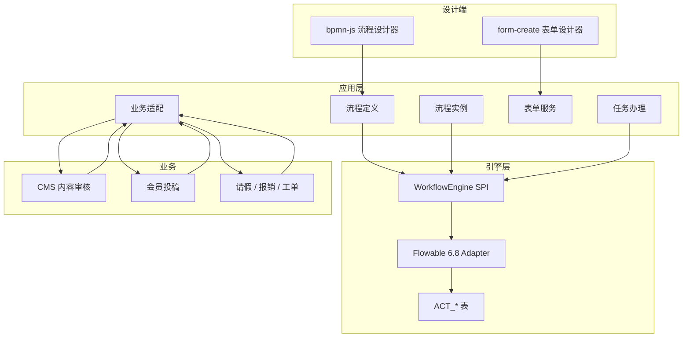
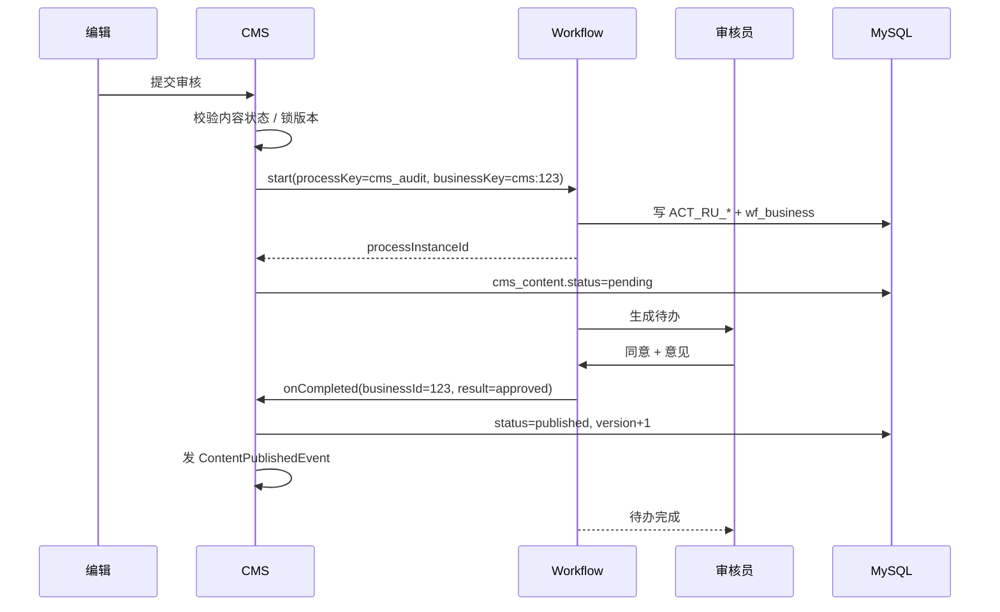

# 08 · 工作流设计

> 选型：**Flowable 6.8.0 内嵌**（JDK 8 兼容），通过 `WorkflowEngine` SPI 隔离引擎。Boot 3 / JDK 17 线可切换 Flowable 7。
> 目标：覆盖 80% 审批场景（串行、并行、会签、或签、条件、加签、转办、委托、退回、撤回），复杂 BPMN 后置。

---

## 1. 为什么是 Flowable 6.8

| 候选 | JDK 8 | BPMN | 生态 | 结论 |
|---|---|---|---|---|
| Flowable 6.8 | ✅ | ✅ | 国内案例多、文档全 | **选它** |
| Flowable 7 | ❌（JDK 17） | ✅ | 新 | Boot3 线再用 |
| Camunda 7 | ✅ | ✅ | 强，但商业许可需注意 | 备选 |
| Activiti 7 | 部分 | ✅ | 社区活跃度下降 | 不选 |
| 自研 | ✅ | 有限 | 可控但成本高 | 不首发 |

**封装原则：**

- 业务代码只依赖 `WorkflowEngine` 接口，不直接注入 `RuntimeService` / `TaskService`。
- 流程定义、任务、变量、历史的查询统一走 `WorkflowQueryService`。
- 未来换引擎只改 `FlowableEngineAdapter`，不动业务。

```java
public interface WorkflowEngine {
    String start(StartProcessCmd cmd);
    void complete(CompleteTaskCmd cmd);
    void reject(RejectTaskCmd cmd);
    void transfer(TransferTaskCmd cmd);
    void addSign(AddSignCmd cmd);
    void withdraw(String processInstanceId, Long operatorId);
    Page<TaskVO> pageTodo(TaskQuery query);
    Page<TaskVO> pageDone(TaskQuery query);
    Page<InstanceVO> pageMine(TaskQuery query);
    DiagramVO diagram(String processInstanceId);
}
```

---

## 2. 架构



---

## 3. 能力矩阵

| 能力 | 优先级 | 说明 |
|---|---|---|
| 流程分类 | P1 | 分组、排序、可见范围 |
| BPMN 设计 | P0 | 开始 / 结束 / 用户任务 / 服务任务 / 网关 / 子流程 |
| 表单绑定 | P0 | 业务表单 / 动态表单 |
| 发起流程 | P0 | 选择流程、填表、保存草稿、提交 |
| 待办 / 已办 / 我发起 | P0 | 分页、筛选、批量 |
| 同意 / 驳回 | P0 | 意见、附件、驳回节点 |
| 撤回 | P1 | 下一节点未处理 |
| 加签 / 转办 / 委托 | P1 | 前加签、后加签、长期委托 |
| 会签 / 或签 | P1 | 比例、全部、任一 |
| 条件分支 | P1 | 表达式、默认分支 |
| 抄送 | P1 | 已读 / 未读 |
| 催办 / 超时 | P1 | 站内信 / 短信 / 邮件 |
| 流程图追踪 | P1 | 高亮当前与历史 |
| 流程版本 | P1 | 新旧实例隔离 |
| 代理规则 | P2 | 时间段、流程范围 |
| 移动审批 | P1 | uni-app |
| 打印 / 导出 | P2 | 审批单 PDF |
| 流程监控 | P1 | 实例、耗时、积压 |

---

## 4. 审批模式

| 模式 | 场景 | 实现 |
|---|---|---|
| 串行 | 一级一级审批 | 顺序用户任务 |
| 并行 | 多部门同时审 | 并行网关 + 多任务 |
| 会签 | 全部 / 比例通过 | 多实例 `completionCondition` |
| 或签 | 任一人通过即可 | 多实例 + 任一完成 |
| 条件 | 金额 / 类型走不同分支 | 排他网关 + 表达式 |
| 加签 | 审批中临时加人 | 前加签 / 后加签任务 |
| 转办 | 把任务交给别人 | 改 assignee + 记录 |
| 委托 | 一段时间内代审 | 委托规则 + 任务分配监听 |
| 退回 | 回到上一节点 / 指定节点 | 跳转 + 状态重置 |
| 撤回 | 发起人收回 | 删除后续任务 / 跳回 |
| 催办 | 提醒当前处理人 | 消息 + 记录 |
| 抄送 | 知会 | 抄送表 + 消息 |

**驳回策略（三选一，流程级配置）：**

1. 驳回到发起人：流程结束，业务状态改为驳回。
2. 驳回到上一节点：上一节点重新审批。
3. 驳回到指定节点：需权限与原因。

> 驳回必须写 `wf_task_ext`，保留原任务、意见、操作人，不能物理删除历史。

---

## 5. 表单引擎

### 5.1 两种表单

| 类型 | 适用 | 存储 |
|---|---|---|
| 业务表单 | 结构稳定、强校验、与业务表强绑定 | 业务表 + 流程变量 |
| 动态表单 | 流程自定义、低代码、变化频繁 | `wf_form` + `wf_form_field` + JSON |

### 5.2 动态表单 Schema

```json
{
  "fields": [
    {
      "key": "amount",
      "label": "金额",
      "type": "number",
      "required": true,
      "min": 0,
      "max": 100000,
      "permissions": { "apply": "edit", "manager": "read", "finance": "edit" }
    },
    {
      "key": "reason",
      "label": "事由",
      "type": "textarea",
      "required": true,
      "maxLength": 500
    }
  ],
  "rules": [
    { "if": "amount > 5000", "then": "require(managerApproval)" }
  ]
}
```

- 字段权限：按节点 / 角色控制可编辑、只读、隐藏。
- 联动：条件显示、必填、赋值。
- 校验：前端 + 后端双校验，后端为准。
- 版本：表单发布后生成版本，历史实例按旧版本渲染。

### 5.3 业务表单适配

```java
public interface BusinessFormHandler {
    String businessType();
    Object load(String businessId);
    void save(String businessId, Object formData);
    void onStarted(String businessId, String processInstanceId);
    void onCompleted(String businessId, String result, String comment);
    void onCanceled(String businessId, String reason);
}
```

- `businessType`：`cms_content`、`member_contribute`、`leave`、`ticket`。
- 业务模块实现 Handler，工作流模块只负责调用。
- 完成回调必须幂等（`wf_business.status` 判重）。

---

## 6. 数据模型

### 6.1 Flowable 自带表

```text
ACT_RE_*       流程定义 / 部署
ACT_RU_*       运行时实例 / 任务 / 变量
ACT_HI_*       历史实例 / 任务 / 变量 / 意见
ACT_GE_*       通用属性 / 字节数组
ACT_ID_*       用户 / 组（可不用，接 sys_*）
```

建议：

- Flowable 使用独立数据源 / schema（可选），避免与业务表混在一起。
- `ACT_ID_*` 不使用，用户 / 组通过 `IdentityService` 适配 `sys_user` / `sys_role`。
- 历史级别 `audit`（默认），需要精简时改 `activity`。

### 6.2 业务扩展表

| 表 | 说明 |
|---|---|
| `wf_form` | 表单定义 |
| `wf_form_field` | 表单字段 |
| `wf_form_version` | 表单版本 |
| `wf_business` | 业务与流程实例绑定 |
| `wf_task_ext` | 加签 / 转办 / 意见 / 操作记录 |
| `wf_cc` | 抄送 |
| `wf_delegate` | 委托规则 |
| `wf_urge` | 催办 |
| `wf_template` | 审批单打印模板 |

`wf_business`：

```sql
CREATE TABLE wf_business (
  id                  bigint      NOT NULL AUTO_INCREMENT,
  tenant_id           bigint      NOT NULL DEFAULT 0,
  business_type       varchar(64) NOT NULL,
  business_id         bigint      NOT NULL,
  process_key         varchar(128) NOT NULL,
  process_instance_id varchar(64) DEFAULT NULL,
  status              varchar(20) NOT NULL DEFAULT 'running',
  create_by           bigint      DEFAULT NULL,
  create_time         datetime    NOT NULL DEFAULT CURRENT_TIMESTAMP,
  update_time         datetime    DEFAULT NULL ON UPDATE CURRENT_TIMESTAMP,
  PRIMARY KEY (id),
  UNIQUE KEY uk_business (tenant_id, business_type, business_id),
  KEY idx_instance (process_instance_id)
) ENGINE=InnoDB DEFAULT CHARSET=utf8mb4;
```

---

## 7. 与业务集成（以 CMS 审核为例）



**关键点：**

- `businessKey` 用 `{type}:{id}`，可反查。
- 业务状态由业务模块维护，工作流不直接改 `cms_content`。
- 回调失败进入重试，不能出现“流程通过、内容没发布”。
- 审核中内容被修改：版本号校验，审批旧版本时提示“内容已变更，请重新审核”。

---

## 8. 移动端审批

- uni-app 分包 `pages/workflow`。
- 待办列表、详情、审批、附件、流程图。
- 消息推送：站内信 + 订阅消息 / App Push。
- 离线草稿：本地缓存意见，联网提交。
- 权限：与后台同一套 `sys_*` 权限码，移动端登录仍走 `lx-admin-token`（后台用户），不是会员 Token。

> 注意：移动审批是“后台用户”的能力，不要错误地用 `mem_user` 登录。若客户要求“会员也能提交某些流程”，单独设计“会员工单”入口，映射到会员域。

---

## 9. 权限

| 场景 | 控制 |
|---|---|
| 谁能发起 | 流程定义绑定角色 / 部门 / 用户 |
| 谁能审批 | 节点候选人 / 候选组 / 表达式 |
| 谁能查看 | 发起人、处理人、抄送人、流程管理员 |
| 谁能终止 | 流程管理员 + 审计 |
| 谁能设计 | `workflow:model:*` 权限 |
| 租户隔离 | Flowable `TENANT_ID_` + 业务 `tenant_id` |

- 候选人支持：用户、角色、部门、岗位、发起人上级、表单字段指定人。
- 审批人解析失败要有兜底（流程管理员），不能卡死。
- 代登录 / 代审批必须审计。

---

## 10. 运维

| 项 | 策略 |
|---|---|
| 流程部署 | 版本化，旧实例不受影响 |
| 流程迁移 | 提供实例迁移工具，谨慎使用 |
| 历史归档 | 按年归档 `ACT_HI_*`，保留查询入口 |
| 异步执行 | Flowable Async Executor，集群需配置 |
| 定时任务 | 超时提醒、自动审批、催办 |
| 监控 | 实例数、待办积压、平均耗时、失败率 |
| 告警 | 积压阈值、执行器失败、死信 |
| 备份 | 与业务库一起备份，恢复后校验实例状态 |

**表膨胀对策：**

- 历史级别按需调整。
- 定期归档已结束超过 N 个月的实例。
- 大附件不放 `ACT_GE_BYTEARRAY`，放文件中心，流程只存 `fileId`。
- 变量只存必要字段，避免大 JSON。

---

## 11. 风险与对策

| 风险 | 对策 |
|---|---|
| 业务绑定引擎 API | SPI 封装，业务只依赖接口 |
| 审批人解析失败 | 兜底管理员 + 告警 |
| 驳回 / 撤回状态错乱 | 状态机 + 操作日志 + 幂等 |
| 流程版本不兼容 | 实例按启动时版本执行，不强制升级 |
| 历史表过大 | 归档 + 精简历史级别 |
| 移动端与 PC 不一致 | 同一套 API + 同一套权限 |
| 多租户串流程 | `TENANT_ID_` + 业务上下文双重校验 |
| 表单字段变更 | 表单版本 + 历史快照 |

---

## 12. 交付节奏

| 阶段 | 内容 |
|---|---|
| P4-M1 | 流程定义、BPMN 设计器、发起、待办、同意 / 驳回 |
| P4-M2 | 会签 / 或签、条件分支、撤回、转办、加签 |
| P4-M3 | 动态表单、业务集成、CMS 审核 |
| P4-M4 | 移动审批、催办、流程图、监控 |
| P6 | 委托、代理、打印、实例迁移、历史归档 |
