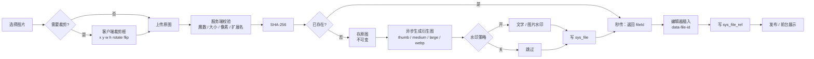
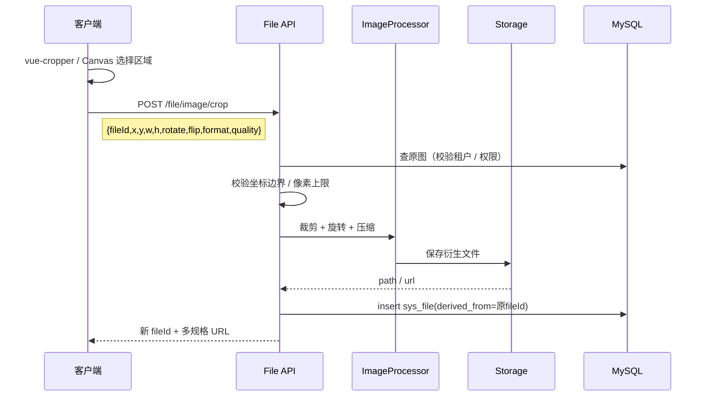

# 09 · 图片上传、裁剪、水印与引用

> 原则：**原图不可变，处理生成衍生文件；内容引用 `fileId`，不引用裸 URL；删除前检查引用。**
> 目标：后台编辑器、会员头像、CMS 封面、移动端上传共用一条图片管线，裁剪 / 水印可配置、可回溯、可替换。

---

## 0. v1.0 范围（先做这些）

| 做 | 不做（后置） |
|---|---|
| 本地存储、普通上传、扩展名 / MIME / 魔数 / 可解码校验 | 分片上传、客户端直传、远程抓取 |
| SHA-256 秒传、`fileId` 引用、引用计数 | CDN、防盗链、私有桶签名 |
| 缩略图（320）、中图（1280）、超 2560 限宽 | large / WebP 多规格、异步队列 |
| EXIF 方向纠正、剥离 EXIF / GPS | 素材库高级标签、AI 打标、OCR |
| 简单裁剪（`vue-cropper` + 服务端最终处理） | 复杂滤镜、批量处理、图片编辑器 |
| 可选文字 / 图片水印（默认关，只加衍生图） | 水印模板管理、按租户策略 |
| 文件库：网格预览、搜索、筛选、改名、改名历史 | 版本回滚、回收站审批流 |

> v1.0 同步处理，限制 **10MB / 50MP**；超过限制直接拒绝，避免 2C/4G 单机被一张图打满。

---

## 1. 总体链路



---

## 2. 存储抽象

```java
public interface StorageProvider {
    String code();                                   // local / minio / oss / cos / s3
    StoredObject put(InputStream in, String path, String contentType, long size);
    InputStream get(String path);
    void delete(String path);
    String signedUrl(String path, Duration ttl);
    boolean exists(String path);
}
```

| 实现 | 场景 | 说明 |
|---|---|---|
| Local | **首发默认** / 开发 / 单机 | 落本地目录，Nginx 静态服务；单机最省事 |
| MinIO | 多实例 / 私有化 / 测试 | S3 协议，易部署；**首发不强制搭建**，需要时 Docker 一条命令起 |
| 阿里云 OSS | 公有云 | CDN、图片处理、签名 |
| 腾讯云 COS | 公有云 | 同上 |
| AWS S3 | 海外 | 标准 S3 |
| 自定义 | 客户对象存储 | 实现 SPI 即可 |

> **选择建议：** MVP 单机 + 本地磁盘起步；一旦要上多实例、容器或需要统一备份 / CDN，再切 MinIO 或云 OSS。切换只改 `sys.upload.storage` 与配置，不改业务代码。开发环境可用 `docker run -p 9000:9000 -p 9001:9001 minio/minio server /data --console-address ":9001"` 一条命令起 MinIO。

**路径规范：**

```text
{tenantId}/{bizType}/{yyyy}/{MM}/{uuid}.{ext}
例如：1001/cms_content/2026/11/9f3c2a7e.jpg
```

- 不保留用户原始文件名作为路径，避免路径穿越、中文、特殊字符。
- 原文件名存 `original_name`，展示用。
- 租户隔离靠路径前缀 + 私有桶策略，双重保险。

---

## 3. 上传模式

| 模式 | 适用 | 说明 |
|---|---|---|
| 普通上传 | 图片、文档、小文件 | multipart，服务端中转 |
| 分片上传 | 大文件、视频 | init / chunk / complete，支持断点 |
| 秒传 | 重复文件 | SHA-256 命中直接返回 |
| 直传签名 | 大文件、云端 | 服务端签名，客户端直传对象存储 |
| 远程抓取 | 编辑器粘贴外链 | 服务端代理下载，SSRF 防护 |

### 3.1 校验清单

- 扩展名白名单 + MIME 白名单 + **魔数校验**（三者都过）。
- 单文件大小、单次数量、租户总配额。
- 图片像素上限（如 50MP），防止解压炸弹。
- 图片实际可解码（`ImageIO` / libvips）。
- SVG 默认拒绝，或做严格消毒（去 script、foreignObject、事件属性）。
- 文件名、路径、Content-Type 规范化。
- 病毒扫描钩子（可选，ClamAV）。
- 上传频率限制（用户 / IP / 租户）。

### 3.2 去重与秒传

```text
hash = SHA-256(fileBytes)
查 sys_file(tenant_id, hash, status=0)
  → 命中：ref_count++，返回已有 fileId
  → 未命中：落盘 + 入库
```

- 去重按租户隔离，避免跨租户探测文件是否存在。
- 秒传也要写引用关系，删除时按引用计数判断。
- 物理文件可共享，逻辑记录独立（同一租户内）。

---

## 4. 图片处理能力

| 能力 | 参数 | 说明 |
|---|---|---|
| 缩放 | `width` / `height` / `mode` | 等比、裁剪填充、拉伸 |
| 裁剪 | `x` / `y` / `w` / `h` | 基于原图坐标 |
| 旋转 | `rotate` 0/90/180/270 | 先旋转再裁剪 |
| 翻转 | `flipH` / `flipV` | 水平 / 垂直 |
| 压缩 | `quality` 1~100 | JPEG / WebP |
| 格式 | `format` jpg/png/webp/avif | 默认 WebP（兼容性允许时） |
| 圆角 | `radius` | 头像、卡片 |
| 模糊 | `blur` | 敏感信息、背景 |
| 水印 | 文字 / 图片 | 见下一节 |
| EXIF | 自动清理 | 去除 GPS、设备信息 |
| 多规格 | thumb/medium/large | 上传后异步生成 |

### 4.1 裁剪：客户端预览 + 服务端最终处理



**规则：**

- 裁剪**不改原图**，生成新 `sys_file`，`derived_from` 指向原图。
- 坐标以原图像素为准，服务端二次校验，防止越界 / 负值。
- 旋转先于裁剪；翻转与旋转顺序固定，文档写清。
- 输出格式默认与原图一致；透明图不强转 JPEG。
- 裁剪结果可缓存，参数哈希作为 Key。
- 编辑器里“裁剪”默认插入新图；也可选择“替换当前引用”（生成新版本）。

### 4.2 水印

**文字水印配置：**

```json
{
  "type": "text",
  "text": "{siteName}",
  "font": "Microsoft YaHei",
  "size": 28,
  "color": "#FFFFFF",
  "opacity": 0.35,
  "position": "bottom-right",
  "marginX": 24,
  "marginY": 24,
  "rotate": -30,
  "tile": false,
  "tileGap": 120,
  "shadow": true
}
```

**图片水印配置：**

```json
{
  "type": "image",
  "fileId": 123456,
  "scale": 0.18,
  "opacity": 0.5,
  "position": "bottom-right",
  "marginX": 24,
  "marginY": 24,
  "rotate": 0,
  "tile": false
}
```

**九宫格位置：**

```text
top-left      top-center      top-right
center-left   center          center-right
bottom-left   bottom-center   bottom-right
tile          平铺（忽略 position）
```

**变量：**

| 变量 | 说明 |
|---|---|
| `{siteName}` | 站点名称 |
| `{tenantName}` | 租户名称 |
| `{username}` | 上传者 / 会员昵称 |
| `{date}` | 当前日期 |
| `{time}` | 当前时间 |

**策略层级：**

```text
租户级默认 > 站点级 > 场景级（cms_content / member_avatar / certificate）
```

- 场景：`cms_content`、`cms_cover`、`member_avatar`、`admin_avatar`、`certificate`、`watermark_source`。
- 开关：`sys.image.watermarkEnabled`，可按场景覆盖。
- 水印异步生成，不阻塞上传返回；预览接口可实时生成小图。
- 原图永不加水印，衍生图加水印；需要“无水印原图”时走权限 + 签名 URL。

### 4.3 性能

| 方案 | 适用 | 说明 |
|---|---|---|
| Thumbnailator | 默认 / 中小流量 | 纯 Java，JDK 8 兼容，简单 |
| libvips（jvips） | 大流量 / 大图 | JNI，内存占用低，速度快 |
| 云图片处理 | 公有云 | OSS / COS 自带缩放、水印、格式转换 |
| 异步队列 | 所有 | 上传只存原图，衍生图后台生成 |

- 预生成规格：`thumb 200`、`medium 800`、`large 1600`、`original`。
- WebP 质量 80；需要透明时保留 PNG。
- CDN 缓存带版本参数：`?v={fileVersion}`。
- 大图处理限制并发，避免 CPU 打满。

---

## 5. 引用模型

### 5.1 为什么用 `fileId`

- 内容里存 URL，替换图片时要批量改正文，容易漏。
- 存 `fileId`，渲染时统一解析 URL；替换文件后所有引用自动生效。
- 可以统计引用、阻止误删、做版权追溯。

### 5.2 表关系

```text
sys_file          文件主表
sys_file_ref      引用关系（file_id + biz_type + biz_id + field）
sys_file_group    分组
sys_storage_config 存储配置
sys_watermark_config 水印策略
```

### 5.3 编辑器集成

```html

```

- 保存时从 HTML 提取 `data-file-id`，写 `sys_file_ref`。
- 删除 / 替换图片时同步更新引用。
- 渲染时可用 `fileId` 重新解析最新 URL / 规格。
- 富文本消毒保留 `data-file-id`、`alt`、`width`、`height`。

### 5.4 引用计数

```text
上传：ref_count = 0
引用：insert sys_file_ref，ref_count++
解引用：delete sys_file_ref，ref_count--
删除文件：ref_count > 0 拒绝；= 0 进回收站
彻底删除：管理员 + 二次确认 + 审计
```

- 引用计数用事务 / 原子 SQL，避免并发错乱。
- 定期对账任务：重算 `ref_count`，修复漂移。
- 内容删除走事件解引用，失败重试。

### 5.5 替换

```text
POST /api/admin/file/{fileId}/replace
  → 上传新文件
  → 保留 fileId，新增版本记录（或更新 path/url）
  → 清 CDN / 本地缓存
  → 所有引用自动显示新图
```

- 替换保留历史版本，可回滚。
- 替换必须审计：谁、何时、原图、新图。
- 前台缓存按 `fileVersion` 失效。

### 5.6 改名、原名与文件库

**三个名字必须分开，不能混用：**

| 字段 | 是否可变 | 用途 |
|---|---|---|
| `original_name` | **不可变** | 上传时的原始文件名，用于追溯“它原来叫什么” |
| `display_name` | **可变** | 文件库展示名；为空时回退 `original_name` |
| `file_name` / `path` | **不可变** | 存储名（UUID）与路径，改名不影响引用与 URL |

**改名规则：**

- 改名只改 `display_name`，**绝不改 `path` / `file_name` / `original_name`**。
- 每次改名写 `sys_file_name_log`：`file_id / old_name / new_name / operator / create_time`，只追加不修改。
- 详情页展示「原名 / 当前名 / 曾用名」，可展开看完整改名历史。
- 改名必须进操作日志；批量改名也要逐条留痕。

**文件库（v1.0 最小可用）：**

- 默认**网格缩略图**，不是纯文件名列表；一眼能看出是什么图。
- 搜索：`display_name`、`original_name`、`remark`。
- 筛选：类型、大小、上传人、时间、分组、引用状态（已引用 / 未引用）。
- 详情：预览、尺寸、大小、哈希、上传人、引用它的文章、改名历史。
- 上传时预填 `remark`：编辑器带 `bizTitle`（如文章标题），默认「《标题》配图」，解决“文件太多不知道是什么”。
- 删除前检查 `ref_count`；被引用时提示“被 N 篇文章使用”，不物理删除。

---

## 6. 安全

| 风险 | 对策 |
|---|---|
| 伪装文件 | 扩展名 + MIME + 魔数三重校验 |
| 图片炸弹 | 读取尺寸前限制像素，流式解码，超限拒绝 |
| XSS（SVG / HTML） | SVG 消毒或禁用；`Content-Disposition`；`nosniff` |
| 路径穿越 | 服务端生成路径，不使用原始文件名 |
| SSRF（远程抓取） | 域名白名单、禁内网 IP、超时、大小限制 |
| 盗链 | Referer 白名单 + 签名 URL + 私有桶 |
| 越权下载 | 校验租户 + 内容权限，付费内容用短时签名 |
| 病毒 | ClamAV 钩子（可选），隔离区 |
| 隐私 | 清除 EXIF GPS；头像公开范围可配 |
| 审计 | 上传 / 删除 / 替换 / 下载敏感文件留痕 |

**响应头：**

```text
X-Content-Type-Options: nosniff
Content-Security-Policy: default-src 'self'
Content-Disposition: inline; filename="..."
Cache-Control: public, max-age=31536000, immutable   # 带 hash 的静态资源
```

---

## 7. API 清单

### 7.1 后台 `/api/admin/file`

| 方法 | 路径 | 说明 |
|---|---|---|
| POST | `/upload` | 普通上传 |
| POST | `/chunk/init` | 分片初始化 |
| POST | `/chunk` | 上传分片 |
| POST | `/chunk/complete` | 合并 |
| GET | `/chunk/status` | 断点查询 |
| POST | `/presign` | 直传签名 |
| GET | `/list` | 文件列表（原名 / 现名 / 备注 / 类型 / 分组 / 引用状态） |
| GET | `/{fileId}` | 文件详情（含引用与改名历史） |
| PUT | `/{fileId}/rename` | 改名（只改 display_name，写改名历史） |
| GET | `/{fileId}/name-history` | 改名历史 |
| DELETE | `/{fileId}` | 软删除 |
| POST | `/{fileId}/restore` | 恢复 |
| DELETE | `/{fileId}/force` | 彻底删除（管理员） |
| POST | `/{fileId}/replace` | 替换 |
| POST | `/image/crop` | 裁剪 |
| POST | `/image/watermark` | 加水印 |
| GET | `/image/preview` | 水印预览 |
| POST | `/ref` | 新增引用 |
| DELETE | `/ref` | 解除引用 |
| GET/POST/PUT/DELETE | `/group` | 分组 |
| GET/POST/PUT/DELETE | `/storage` | 存储配置 |
| GET/POST/PUT/DELETE | `/watermark` | 水印策略 |

### 7.2 会员 `/api/app/member`

| 方法 | 路径 | 说明 |
|---|---|---|
| POST | `/avatar` | 上传头像（自动裁剪为方形） |
| POST | `/avatar/crop` | 头像裁剪 |
| GET | `/files` | 我的文件（可选） |

### 7.3 上传响应

```json
{
  "code": 200,
  "msg": "success",
  "data": {
    "fileId": 123456,
    "url": "https://cdn.example.com/1001/cms_content/2026/11/9f3c2a7e.jpg",
    "thumbUrl": "https://cdn.example.com/.../9f3c2a7e_thumb.webp",
    "mediumUrl": "https://cdn.example.com/.../9f3c2a7e_medium.webp",
    "width": 1920,
    "height": 1080,
    "size": 348212,
    "mime": "image/jpeg",
    "hash": "9f3c..."
  }
}
```

---

## 8. 配置项

| Key | 默认 | 说明 |
|---|---|---|
| `sys.upload.storage` | `minio` | 默认存储 |
| `sys.upload.maxSizeMb` | `20` | 单文件上限 |
| `sys.upload.allowedExt` | `jpg,png,...` | 扩展名白名单 |
| `sys.upload.imageMaxPixels` | `50000000` | 像素上限 |
| `sys.upload.chunkSizeMb` | `5` | 分片大小 |
| `sys.image.cropEnabled` | `true` | 是否允许裁剪 |
| `sys.image.watermarkEnabled` | `false` | 默认水印开关 |
| `sys.image.watermarkScene` | `cms_content` | 默认场景 |
| `sys.image.watermarkText` | `{siteName}` | 默认文字 |
| `sys.image.watermarkPosition` | `bottom-right` | 默认位置 |
| `sys.image.watermarkOpacity` | `0.35` | 默认透明度 |
| `sys.image.webpEnabled` | `true` | 是否生成 WebP |
| `sys.file.signedUrlMinutes` | `30` | 私有文件签名有效期 |
| `sys.file.hotlinkEnabled` | `false` | 是否开启防盗链 |
| `sys.file.hotlinkWhitelist` | `example.com` | 允许的域名 |

---

## 9. 验收用例

| 用例 | 预期 |
|---|---|
| 上传 20MB 图片 | 拒绝，提示大小限制 |
| 上传伪装成 jpg 的 exe | 拒绝，魔数校验失败 |
| 上传 10000x10000 图片 | 拒绝或安全降采样，不 OOM |
| 同一图片重复上传 | 秒传，返回同一 fileId，ref_count 增加 |
| 裁剪越界 | 拒绝，提示坐标非法 |
| 裁剪后原图 | 原图不变，衍生文件 `derived_from` 正确 |
| 开启水印 | 衍生图有水印，原图无水印 |
| 内容引用图片 | `sys_file_ref` 有记录 |
| 删除被引用图片 | 拒绝，提示先解除引用 |
| 替换图片 | 内容页显示新图，历史版本可回滚 |
| 未授权访问私有图 | 403 / 签名过期 |
| 跨租户访问 fileId | 404，不泄露存在性 |
| 会员头像裁剪 | 输出方形，尺寸符合配置 |

---

## 10. 交付节奏

| 阶段 | 内容 |
|---|---|
| P1 | 存储抽象、普通上传、校验、缩略图、文件列表 |
| P5-M1 | 裁剪、水印、多规格、WebP、素材库 |
| P5-M2 | 引用计数、替换、回收站、防盗链、签名 URL |
| P5-M3 | 分片、断点续传、直传、配额、对账任务 |
| P6 | 租户级策略、CDN 刷新、libvips 可选 |
