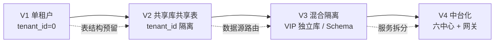
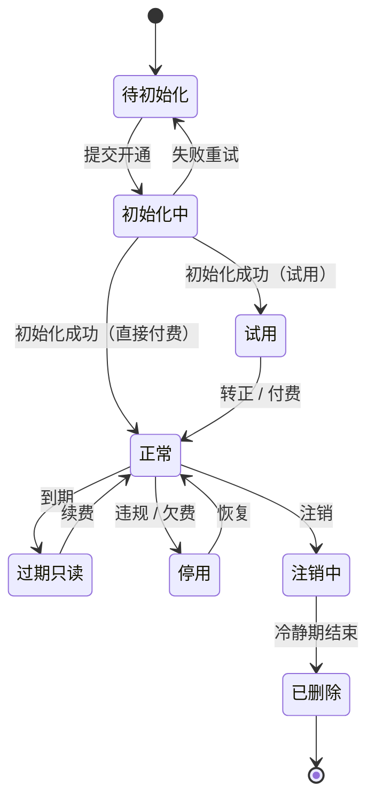
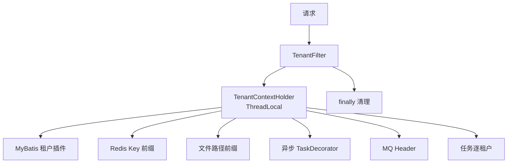
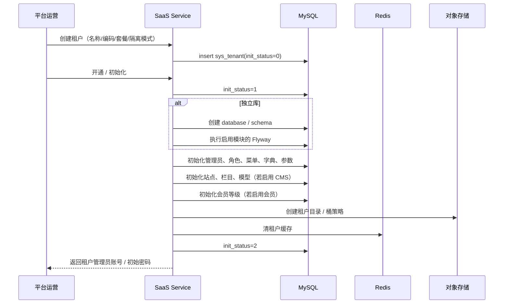
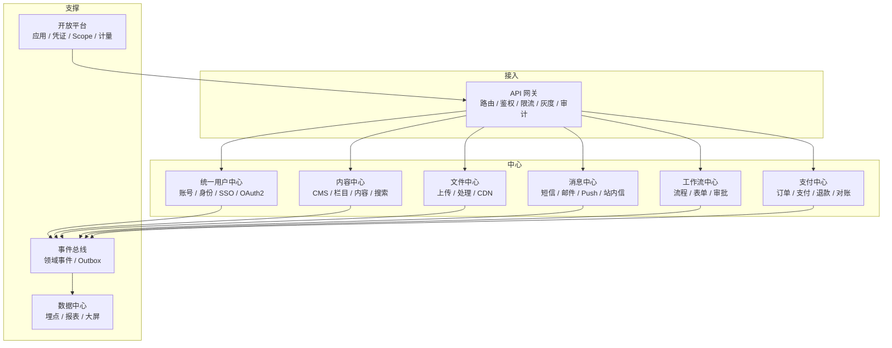

# 10 · SaaS 多租户与中台演进

> 路线：**单租户 → 多租户（共享表）→ 多租户（独立库）→ 中台化**。
> 原则：首发不为 SaaS 过度设计，但所有业务表预留 `tenant_id`、所有查询走租户上下文、所有缓存 / 文件 / 任务带租户前缀。

---

## 1. 演进路线



| 阶段 | 触发条件 | 关键动作 |
|---|---|---|
| 单租户 | 首发 | 表带 `tenant_id` 默认 0，上下文恒为 0 |
| 共享表 | 有 2~50 个租户 | 开启 SaaS 模块，租户 / 套餐 / 模块授权 |
| 混合隔离 | 大客户要求独立库 / 合规 | 数据源路由、租户迁移工具 |
| 中台化 | 多产品线、多团队、独立发布 | 拆服务中心、API 网关、事件总线 |

### 1.1 首发单租户（已拍板）

- 首发**不打包 `lx-saas`**，`lx.module.saas.enabled=false`，不创建租户 / 套餐表，不加载租户接口与菜单。
- 业务表仍带 `tenant_id bigint not null default 0`；`TenantContext` 恒为 `0`；缓存、文件路径、异步、MQ 都带 `0`。
- 租户插件先接好但不拼条件；后续打开 SaaS 时替换为真实解析，**业务 Service / Mapper 不改**。

### 1.2 后期开启的改造清单

| # | 动作 | 改动位置 | 是否改业务代码 |
|---|---|---|---|
| 1 | 打包 `lx-saas`，`lx.module.saas.enabled=true` | 构建 / yml | 否 |
| 2 | 执行租户表 Flyway | `db/migration/*/saas` | 否 |
| 3 | 打开 `TenantFilter` 真实解析（域名 / 登录租户码） | 基础设施 | 否 |
| 4 | 打开 MyBatis-Plus 租户插件条件 | 基础设施 | 否 |
| 5 | 打开租户管理 / 套餐 / 子后台菜单 | 菜单 SQL | 否 |
| 6 | 存量数据刷 `tenant_id=0` 或指定租户 | 数据脚本 | 否 |
| 7 | 加租户越权、隔离、配额测试 | 测试 | 否 |

**结论：** 只要首发守住“表有 `tenant_id`、上下文常驻、插件预留”，后期就是**加模块 + 开开关**，不是重构。

**风险边界：** 如果首发表没有 `tenant_id`、SQL 手写、缓存 Key 不带租户，后期需要全表 + 全 SQL + 全缓存改造，成本接近重做；这是 P0 门禁必须检查的项。

---

## 2. 租户模型

### 2.1 核心表

```text
sys_tenant            租户
sys_tenant_package    套餐（模块、菜单、配额、价格）
sys_package_menu      套餐菜单
sys_tenant_module     租户级模块覆盖
sys_tenant_domain     租户域名
sys_user              后台用户（tenant_id）
sys_role              后台角色（tenant_id）
mem_user              会员（tenant_id）
cms_site              站点（tenant_id）
```

### 2.2 租户生命周期



---

## 3. 隔离模式

| 模式 | 数据 | 成本 | 隔离 | 适用 |
|---|---|---|---|---|
| 共享库共享表 | 所有租户一张表，`tenant_id` 区分 | 最低 | 逻辑隔离 | 默认，中小租户 |
| 共享库独立 Schema | 每租户一个 Schema / Database | 中 | 较强 | 中大型、数据敏感 |
| 独立库 | 每租户独立实例 | 最高 | 最强 | 大客户、合规、私有化 |

### 3.1 推荐策略

```text
默认：共享表
VIP / 合规客户：独立库
迁移：共享表 → 独立库，提供工具与校验
```

### 3.2 数据源路由

```java
public interface TenantDataSourceRouter {
    DataSource route(Long tenantId);
}

// 共享表：返回主数据源
// 独立库：按 tenantId 查 sys_tenant_datasource，返回对应 DataSource
```

- 独立库租户的 `sys_tenant.isolation_mode=3`，配置 `datasource_key`。
- 请求进入时先解析租户，再路由数据源。
- 跨租户查询（平台运营）走主库 + 显式忽略租户插件，必须审计。
- 事务内不允许切换租户；异步任务按租户分批。

---

## 4. 租户上下文

### 4.1 解析来源

| 入口 | 解析方式 |
|---|---|
| 后台登录 | 登录表单 `tenantCode`，或域名 |
| 后台已登录 | Token 会话中的 `tenantId` |
| 门户 PC | 域名 → `sys_tenant_domain` |
| H5 / App | 会员 Token 中的 `tenantId`；未登录用域名 / 渠道 |
| 开放平台 | AppKey 绑定的租户 |
| 定时任务 | 遍历租户，逐个设置上下文 |
| MQ | 消息 Header 带 `tenantId` |

### 4.2 传播



```java
public final class TenantContextHolder {
    private static final ThreadLocal<Long> TENANT = new ThreadLocal<>();

    public static void set(Long tenantId) { TENANT.set(tenantId); }
    public static Long getTenantId() { return TENANT.get() == null ? 0L : TENANT.get(); }
    public static void clear() { TENANT.remove(); }
}
```

**必须传播的场景：**

- `@Async` 线程池：`TaskDecorator` 复制上下文。
- `CompletableFuture`：显式包装。
- MQ 生产 / 消费：Header + 消费端设置。
- 定时任务：按租户循环，每次 set / clear。
- 缓存 Key：`t:{tenantId}:...`。
- 文件路径：`{tenantId}/...`。
- 日志 MDC：`tenantId`、`traceId`。

### 4.3 MyBatis 租户插件

```java
@Bean
public MybatisPlusInterceptor mybatisPlusInterceptor() {
    MybatisPlusInterceptor interceptor = new MybatisPlusInterceptor();
    TenantLineInnerInterceptor tenant = new TenantLineInnerInterceptor();
    tenant.setTenantLineHandler(new TenantLineHandler() {
        @Override public Expression getTenantId() {
            return new LongValue(TenantContextHolder.getTenantId());
        }
        @Override public boolean ignoreTable(String tableName) {
            return TenantTableIgnore.IGNORE.contains(tableName);
        }
    });
    interceptor.addInnerInterceptor(tenant);
    interceptor.addInnerInterceptor(new PaginationInnerInterceptor(DbType.MYSQL));
    return interceptor;
}
```

忽略表：`sys_tenant`、`sys_tenant_package`、`sys_package_menu`、`sys_menu`（平台菜单）、`sys_dict_*`（全局）、`gen_*`、`ACT_*`（用 Flowable 自带租户）。

### 4.4 跨租户防护

- 业务代码禁止接收前端传入的 `tenantId` 作为查询条件。
- 平台运营需要跨租户时，用专用 Service + `@CrossTenant` 注解 + 审计。
- 跨租户 ID 查询返回 404。
- 定时任务、导出、报表、MQ 消费全部走上下文。
- 自动化测试：A 租户 Token 遍历 B 租户资源。

---

## 5. 子后台与功能配置

### 5.1 角色关系

```text
平台运营（tenant_id=0）
  ├─ 创建租户
  ├─ 选套餐（模块 + 菜单 + 配额）
  ├─ 租户级覆盖（sys_tenant_module）
  └─ 代登录（审计）

租户管理员（tenant_id=T，user_type=01）
  ├─ 建子用户（user_type=02）
  ├─ 建租户角色
  ├─ 在套餐范围内分配菜单
  └─ 覆盖白名单配置

租户子用户（tenant_id=T，user_type=02）
  └─ 角色权限 ∩ 套餐菜单 ∩ 租户模块
```

### 5.2 有效功能计算

```text
effectiveModules = 套餐模块 ∩ 租户模块覆盖 ∩ 运行期启用模块
effectiveMenus   = 角色菜单 ∩ 套餐菜单 ∩ effectiveModules 对应菜单
effectiveLangs   = 租户启用语言 ∩ 套餐语言上限
effectiveConfig  = 租户配置（白名单）> 平台配置 > yml 默认
```

### 5.3 主后台配置子用户功能

| 配置项 | 位置 | 说明 |
|---|---|---|
| 套餐模块 | `sys_tenant_package.module_codes` | 决定租户能用哪些大模块 |
| 套餐菜单 | `sys_package_menu` | 决定租户能勾选哪些菜单 |
| 租户模块覆盖 | `sys_tenant_module` | 单独开 / 关某模块 |
| 租户角色 | `sys_role`（tenant_id=T） | 子用户权限集合 |
| 菜单裁剪 | 服务端校验 | 角色不能超过套餐 |
| 配置覆盖 | `sys_config.is_tenant_override` | 品牌、登录页、水印、注册开关 |
| 配额 | `sys_tenant.quota_json` | 用户数、存储、API、流程实例 |
| 语言 | `i18n_tenant_language` | 租户启用语言、默认语言、语言数量上限 |

**服务端校验：**

```java
// 租户管理员保存角色菜单时
Set<Long> allowed = packageMenuService.allowedMenuIds(tenantId);
if (!allowed.containsAll(req.getMenuIds())) {
    throw new ServiceException("存在套餐外的菜单权限");
}
```

前端禁用只是体验，服务端必须校验。

### 5.4 租户品牌

- Logo、站点名、主题色、登录页背景、备案号。
- 存 `sys_tenant.config_json`，门户 / 后台登录页读取。
- 独立域名时按域名解析租户品牌。
- 邮件 / 短信模板支持租户变量。

---

## 6. 租户开通流程



**幂等与失败处理：**

- 初始化任务异步执行，前端轮询进度。
- 每一步可重试，记录 `init_step`。
- 失败不回滚已建库（成本高），改为“修复后继续”。
- 初始化完成前，租户不可登录（或只允许管理员进初始化页）。
- 初始化脚本按模块启用状态裁剪。

---

## 7. 配额与计量

### 7.1 配额维度

| 维度 | 示例 | 校验点 |
|---|---|---|
| 后台用户数 | 50 | 创建用户 |
| 会员数 | 10000 | 注册 |
| 存储 | 20GB | 上传 |
| 站点数 | 3 | 建站 |
| 内容数 | 50000 | 发布 |
| API 调用 | 100万/月 | 网关 |
| 工作流实例 | 1000/月 | 发起 |
| 并发会话 | 100 | 登录 |

### 7.2 计量

```text
saas_usage(tenant_id, metric, value, period)
  period = 2026-11（月）或 2026-11-10（日）
```

- 上传、发布、API 调用等写用量（异步、批量）。
- 配额检查在 Service 层，超限返回明确错误码。
- 80% / 100% 告警，通知租户管理员与平台运营。
- 账单周期按月，预留订单 / 发票表。

### 7.3 限流

- 租户级 QPS、接口级 QPS、用户级频控。
- Redis 令牌桶 / 滑动窗口。
- 超限返回 429 + `Retry-After`。
- 平台运营可临时提额，记录审计。

---

## 8. 平台运营后台

| 功能 | 说明 |
|---|---|
| 仪表盘 | 租户数、活跃、试用转化、收入、用量 |
| 租户管理 | CRUD、开通、停用、续费、迁移 |
| 套餐管理 | 模块、菜单、配额、价格 |
| 代登录 | 排障，二次确认 + 审计 + 页面提示 |
| 公告 | 平台公告推送租户 |
| 工单 | 租户提单、平台处理 |
| 审计 | 平台操作全留痕 |
| 健康度 | 登录、发布、存储、活跃、工单 |
| 数据合规 | 导出、删除、注销证明 |

**代登录安全：**

- 仅超级管理员 / 指定角色可用。
- 二次验证 + 填写原因。
- 生成短时（如 30 分钟）专用 Token，不暴露租户密码。
- 全程审计：谁、何时、哪个租户、做了什么。
- 租户后台顶部显示“平台代登录”提示条。

---

## 9. 中台蓝图

### 9.1 为什么要中台

当出现以下情况，模块化单体开始吃力：

- 多条产品线复用同一套用户 / 内容 / 文件 / 消息能力。
- 团队超过 3 个，发布节奏互相阻塞。
- 某些能力需要独立扩容（图片、搜索、工作流）。
- 需要对外开放 API、计费、生态。

### 9.2 六中心 + 网关



| 中心 | 职责 | 拆分时机 |
|---|---|---|
| 统一用户 | 账号、身份映射、SSO、OAuth2/OIDC | 多产品线统一登录 |
| 内容 | CMS、栏目、内容、检索 | 内容团队独立发布 |
| 文件 | 上传、处理、CDN、素材 | 图片 / 视频流量大 |
| 消息 | 短信、邮件、Push、站内信 | 多业务共用模板与通道 |
| 工作流 | 流程、表单、审批 | 审批量独立扩容 |
| 支付 | 订单、支付、退款、对账 | 商业化 |
| 数据 | 埋点、报表、大屏 | 数据团队独立 |
| 开放平台 | 应用、凭证、Scope、计量 | 生态合作 |

### 9.3 拆分阈值

| 指标 | 阈值 | 动作 |
|---|---|---|
| 团队规模 | > 30 人 / 3 个产品线 | 按中心拆服务 |
| 租户数 | > 500 | 独立库 + 分片 |
| 峰值 QPS | > 5000 | 读写分离 + 缓存 + 服务拆分 |
| 图片 / 视频流量 | 带宽 / CPU 成为瓶颈 | 文件中心独立 |
| 发布频率 | 每周多次互相阻塞 | 独立发布 |
| 合规 | 数据隔离 / 等保 | 独立部署 |

> 没到阈值不拆。拆早了，分布式事务、链路追踪、运维成本会把团队拖垮。

---

## 10. 共享表 → 独立库迁移

```text
1. 冻结租户写入（只读窗口）
2. 建目标库 + 执行 Flyway
3. 按 tenant_id 导出数据
4. 导入目标库（保留 tenant_id，便于回滚）
5. 校验行数、金额、引用、文件
6. 切换 sys_tenant.isolation_mode=3 + datasource_key
7. 清缓存，灰度验证
8. 观察 7 天，保留源数据只读
9. 清理源数据（谨慎，先备份）
```

- 迁移工具做成后台任务，可暂停 / 续跑。
- 文件不迁移，路径不变；对象存储按租户前缀本来就隔离。
- 迁移后会员、后台用户、Token 全部失效，需重新登录。
- 迁移窗口选低峰，提前通知。

---

## 11. 风险与对策

| 风险 | 对策 |
|---|---|
| 越权访问其他租户 | 上下文强制注入 + 跨租户拦截 + 自动化测试 |
| 异步 / MQ 丢租户 | TaskDecorator + Header + 消费端校验 |
| 缓存串租户 | Key 统一 `t:{tenantId}:` 前缀 |
| 文件串租户 | 路径前缀 + 私有桶 + 签名 URL |
| 套餐菜单被绕过 | 服务端校验，不信任前端 |
| 租户初始化失败 | 分步重试 + 进度 + 修复工具 |
| 独立库运维复杂 | 数据源健康检查 + 监控 + 自动备份 |
| 计费口径争议 | 计量日志可追溯 + 月度对账 |
| 中台拆早 | 按阈值拆，先模块化 |
| 合规删除不彻底 | 注销流程 + 冷静期 + 删除证明 |

---

## 12. 交付节奏

| 阶段 | 内容 |
|---|---|
| P6-M1 | 租户 / 套餐 / 模块授权 / 域名 / 初始化 |
| P6-M2 | 子用户 / 租户角色 / 菜单裁剪 / 配置覆盖 |
| P6-M3 | 隔离模式 / 数据源路由 / 跨租户防护 |
| P6-M4 | 配额 / 计量 / 限流 / 平台仪表盘 |
| P7-M1 | 代登录 / 工单 / 健康度 / 迁移工具 |
| P7-M2 | 开放平台 / 统一用户 / 消息 / 搜索 / 支付 |
| P7-M3 | API 网关 / 事件总线 / 数据中心 |
