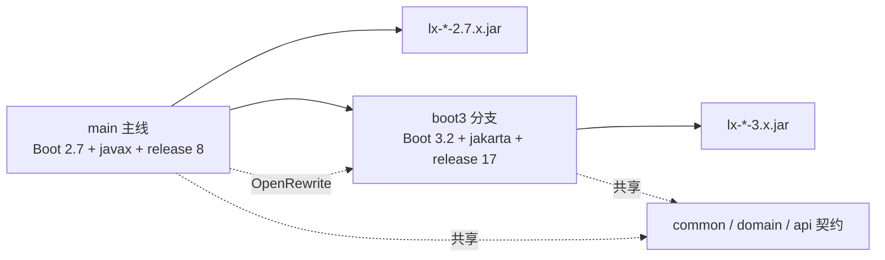

# 11 · JDK 兼容与工程规范

> 目标：**一套主线代码，同一产物在 JDK 8 / 11 / 17 上启动并通过冒烟测试**；JDK 17 + Spring Boot 3 作为第二条构建线，不阻塞主线。

---

## 1. 兼容矩阵

### 1.1 运行矩阵

| 组合 | JDK 8 | JDK 11 | JDK 17 | JDK 21 |
|---|---|---|---|---|
| 主线 Boot 2.7（`release=8`） | ✅ 官方 | ✅ 官方 | ✅ 官方 | — 不承诺 |
| Boot 3 线（`release=17`） | ❌ | ❌ | ✅ | ✅ |
| 前端 Node 构建 | 不涉及 | 不涉及 | 不涉及 | Node 20 LTS |

> 用户要求 8/11/17，主线全部覆盖，CI 矩阵就是这三个版本（见第 5 节）。JDK 21 不作为承诺：Boot 2.7 / Spring 5.3 的官方上限是 17，21 能跑不代表兼容，等 Boot 3 线再纳入。

### 1.2 依赖矩阵

> 下表是**目标矩阵**：`JDK 8` 列为 ✅ 表示 v1.0 已在用，`—` 表示还没进包（说明里标「规划」或「不引入」）。
> v1.0 实际进发布包的 102 个 jar 以 [`22-dependencies.md`](22-dependencies.md) 为准。

| 依赖 | 版本 | JDK 8 | 说明 |
|---|---|---|---|
| Spring Boot | 2.7.18 | ✅ | 最后一个 2.x |
| Spring Framework | 5.3.31 | ✅ | Boot 2.7.18 自带 |
| Sa-Token | 1.37.0 | ✅ | 用 `sa-token-spring-boot-starter` |
| Sa-Token Redis | 1.37.0 | ✅ | `sa-token-redis-jackson`，`lx.redis.enabled=true` 时启用 |
| MyBatis-Plus | 3.5.3.2 | ✅ | `mybatis-plus-boot-starter`；版本以 `lx-dependencies` 为准 |
| 连接池 | HikariCP | ✅ | Boot 默认；**未引入 Druid** |
| Redis 客户端 | Lettuce | ✅ | Boot 默认；**未引入 Redisson** |
| Flyway | 7.15.0 | ✅ | **锁定 7.15.0**：8.5.13 会报 `Unsupported Database: MySQL 5.7`（见 `21` 第 5.5 节），v1.0 先保 MySQL 5.7 |
| MySQL Connector/J | 8.0.33 | ✅ | 兼容 MySQL 5.7 / 8.0 |
| Caffeine | 2.9.3 | ✅ | 验证码 / 本地缓存 |
| Knife4j | 4.4.0 | ✅ | 配 SpringDoc 1.7 |
| SpringDoc | 1.7.0 | ✅ | Boot 2 线 |
| Hutool | 5.8.22 | ✅ | 只用 `hutool-core` / `hutool-captcha` |
| Lombok | 1.18.32 | ✅ | 编译期注解处理，不进运行时包 |
| Thumbnailator | 0.4.8 | ✅ | 图片缩略图 / 中图 |
| Jsoup | 1.17.2 | ✅ | 富文本 XSS 清洗 |
| Velocity | 2.3 | ✅ | 代码生成模板引擎 |
| JUnit | 5.10.x | ✅ | `test` scope，不进包 |
| Maven Compiler Plugin | 3.11.0 | ✅ | 支持 `release` |
| Druid | 1.2.23 | — | **规划**：v1.0 用 HikariCP |
| Redisson | 3.27.2 | — | **规划**：v1.0 用 Lettuce，够用不换 |
| PostgreSQL JDBC | 42.7.x | — | **规划**：v1.0 只验证 MySQL（PG 12~16 目标） |
| 达梦 JDBC | 厂商版本 | — | **规划**：`DmJdbcDriver18.jar`，放私服 / lib |
| 人大金仓 JDBC | 厂商版本 | — | **规划**：`kingbase8`，与数据库版本匹配 |
| Flowable | 6.8.0 | — | **规划**：v1.1+ 工作流；7.x 需 JDK 17 |
| EasyExcel | 3.3.4 | — | **规划**：v1.1 Excel 导入导出 |
| MapStruct | 1.5.5.Final | — | **规划**：v1.0 手写 VO 转换 |
| MinIO SDK | 8.5.10 | — | **规划**：v1.0 只有本地存储 |
| Quartz | 2.3.2 | — | **不引入**：定时任务用 Spring Task + 数据库锁（`17` 决策） |
| Testcontainers | 1.19.x | — | **不引入**：单测不连 MySQL / Redis（见 `26`） |

**锁定策略：**

- 所有版本进 `lx-dependencies` BOM，模块不写版本号。
- 升级依赖必须过三 JDK CI + 回归。
- 禁止使用 `LATEST` / `RELEASE` / 动态版本。
- 每季度做一次依赖漏洞扫描与升级窗口。

---

## 2. 双线策略



### 2.1 主线（首发）

- Spring Boot 2.7.18，`javax.servlet`。
- `maven.compiler.release=8`。
- 同一 jar 跑 JDK 8 / 11 / 17。
- 所有新功能先进主线。

> **“JDK 17 不首发”不等于“不兼容 17”。** 主线产物是 JDK 8 字节码，Boot 2.7 / Spring 5.3 在 8、11、17 上均可运行；首发验收基线定 8/11，17 由 CI 矩阵跑同一套单测（见第 5 节）。客户环境需要 17 时，冒烟通过即可切运行基线，不需要另打一份 jar。

### 2.2 Boot 3 线（P6 后启动）

- Spring Boot 3.2.x，`jakarta.servlet`，最低 JDK 17。
- Flowable 7、SpringDoc 2、Knife4j 4.5、MP `spring-boot3-starter`、Sa-Token `spring-boot3-starter`。
- 独立分支 + 独立版本号，不合入主线。
- 用 OpenRewrite 做机械迁移，人工修剩余 10%。
- 维护成本预估：主线的 10%~15%。

### 2.3 为迁移预留的设计

- `lx-common-core`、`lx-domain`、`lx-api` 不出现 `javax.servlet` / `jakarta.servlet`。
- Servlet 相关代码集中在 `lx-common-web`、`lx-framework`、`controller` 层。
- 不直接使用 `HttpServletRequest` 传参，统一 `RequestContext` 抽象。
- 不把 `javax.validation` 注解散落在 domain；DTO 层使用，迁移时集中替换。
- 文件上传、拦截器、过滤器等 Web 组件隔离在 adapter 包。

---

## 3. 编码约束（JDK 8 基线）

### 3.1 禁用清单

| 禁用 | 原因 | 替代 |
|---|---|---|
| `var` | Java 10 | 显式类型 |
| `record` | Java 16 | 普通类 / Lombok |
| `sealed` | Java 17 | 普通继承 |
| 文本块 `"""` | Java 15 | 字符串拼接 |
| `switch` 表达式 | Java 14 | 传统 switch |
| `instanceof` 模式匹配 | Java 16 | 强转 |
| `List.of` / `Map.of` / `Set.of` | Java 9 | `Arrays.asList` / `Collections` |
| `Optional.isEmpty` | Java 11 | `!isPresent()` |
| `String.isBlank` / `strip` / `repeat` | Java 11 | `trim` / 工具类 |
| `Files.readString` / `writeString` | Java 11 | `Files.readAllBytes` |
| `Stream.toList` | Java 16 | `collect(Collectors.toList())` |
| `takeWhile` / `dropWhile` | Java 9 | 手写 / filter |
| `HttpClient` | Java 11 | OkHttp / Apache HttpClient |
| `ProcessHandle` | Java 9 | 避免 |
| `StackWalker` | Java 9 | 避免 |
| `module-info` | Java 9 | 不做模块化 |
| `sun.misc.*` | 内部 API | 禁止 |
| `javax.xml.bind` | JDK 11 移除 | 显式依赖 JAXB 或避免 |
| `javax.activation` | JDK 11 移除 | 显式依赖 |
| Nashorn | JDK 15 移除 | 不用 JS 引擎 |
| `SecurityManager` | 废弃 | 不用 |
| `finalize` | 废弃 | `Cleaner` / 显式关闭 |
| `Thread.stop` / `suspend` | 危险 | 中断 / 标志位 |

### 3.2 推荐用法

- 时间：`java.time`（JDK 8 已有），禁止 `SimpleDateFormat` 静态共享。
- 集合：`ArrayList` / `HashMap` 显式初始化，避免 `List.of`。
- 字符串：`String.join`、`String.format` 可用。
- 并发：`CompletableFuture`、`ExecutorService`，避免裸 `new Thread`。
- 金额：`BigDecimal`，指定 `RoundingMode`。
- 空值：`Optional` 用于返回值，不用于字段 / 参数。
- 关闭资源：try-with-resources。
- 日志：SLF4J 占位符，禁止字符串拼接；敏感字段脱敏。

### 3.3 编译期拦截

**Animal Sniffer：**

```xml
<plugin>
  <groupId>org.codehaus.mojo</groupId>
  <artifactId>animal-sniffer-maven-plugin</artifactId>
  <version>1.23</version>
  <configuration>
    <signature>
      <groupId>org.codehaus.mojo.signature</groupId>
      <artifactId>java18</artifactId>
      <version>1.0</version>
    </signature>
  </configuration>
  <executions>
    <execution>
      <id>check-java18</id>
      <phase>verify</phase>
      <goals><goal>check</goal></goals>
    </execution>
  </executions>
</plugin>
```

**Forbidden APIs（可选）：**

```xml
<plugin>
  <groupId>de.thetaphi</groupId>
  <artifactId>forbiddenapis</artifactId>
  <version>3.6</version>
  <configuration>
    <signaturesFiles>
      <signaturesFile>${project.basedir}/src/main/resources/forbidden.txt</signaturesFile>
    </signaturesFiles>
  </configuration>
</plugin>
```

`forbidden.txt` 示例：

```text
java.lang.Thread#stop()
java.lang.Thread#suspend()
java.lang.Runtime#exec(java.lang.String)
sun.misc.**
```

**Enforcer：**

```xml
<plugin>
  <groupId>org.apache.maven.plugins</groupId>
  <artifactId>maven-enforcer-plugin</artifactId>
  <executions>
    <execution>
      <id>enforce-java</id>
      <goals><goal>enforce</goal></goals>
      <configuration>
        <rules>
          <requireJavaVersion><version>[1.8,)</version></requireJavaVersion>
          <requireMavenVersion><version>[3.8,)</version></requireMavenVersion>
        </rules>
      </configuration>
    </execution>
  </executions>
</plugin>
```

---

## 4. Maven 配置

### 4.1 编译

```xml
<properties>
  <java.version>8</java.version>
  <maven.compiler.source>8</maven.compiler.source>
  <maven.compiler.target>8</maven.compiler.target>
  <project.build.sourceEncoding>UTF-8</project.build.sourceEncoding>
  <project.reporting.outputEncoding>UTF-8</project.reporting.outputEncoding>
</properties>

<profiles>
  <!-- JDK 9+ 用 release 严格限制 API -->
  <profile>
    <id>jdk9plus</id>
    <activation><jdk>[9,)</jdk></activation>
    <properties>
      <maven.compiler.release>8</maven.compiler.release>
    </properties>
  </profile>
</profiles>
```

> JDK 8 本身不支持 `--release`，所以用 profile 在 9+ 激活。JDK 8 构建时用 source/target 8 + Animal Sniffer 兜底。

### 4.2 多模块

```xml
<modules>
  <module>lx-dependencies</module>
  <module>lx-common</module>
  <module>lx-framework</module>
  <module>lx-modules</module>
  <module>lx-api</module>
  <module>lx-boot</module>
</modules>
```

- 父 POM 只做依赖管理、插件管理、属性。
- 子模块不继承 `spring-boot-starter-parent`，用 `dependencyManagement` 导入 BOM，避免版本漂移。
- `lx-boot` 用 `spring-boot-maven-plugin` 打可执行 jar。
- 可选模块用 Profile，见 [06-modularity.md](06-modularity.md)。

---

## 5. CI 矩阵

**v1.0 已落地**：`.github/workflows/ci.yml`（GitHub Actions）。刻意做成“最小可用”，
只验证**代码能编译、单测能过、前端能打包**，不启 MySQL / Redis，不跑浏览器回归。

```yaml
# .github/workflows/ci.yml（节选，真实配置以此文件为准）
on:
  push:
    branches: [main, master]
  pull_request:
  workflow_dispatch:

jobs:
  backend:
    strategy:
      fail-fast: false
      matrix:
        java: ['8', '11', '17']
    steps:
      - uses: actions/setup-java@v4
        with:
          distribution: temurin
          java-version: ${{ matrix.java }}
          cache: maven
      - run: mvn -B -ntp test
      - run: mvn -B -ntp -DskipTests package
        if: matrix.java == '8'
      - uses: actions/upload-artifact@v4
        if: always()
        with:
          name: surefire-jdk${{ matrix.java }}
          path: '**/target/surefire-reports/**'

  frontend:
    steps:
      - uses: actions/setup-node@v4
        with:
          node-version: '20'
          cache: npm
          cache-dependency-path: lx-ui-admin/package-lock.json
      - run: npm ci
      - run: npm run build
```

**为什么这样设计：**

| 决策 | 原因 |
|---|---|
| `mvn test` 而不是 `verify` | 单测不连库，`verify` 在当前工程里不会多跑任何东西，反而容易让人误以为有集成测试 |
| 只在 JDK 8 打包 | 产物是 JDK 8 字节码，8 上能 `package` 成功即可；11/17 只需证明测试通过 |
| 不跑 `smoke` 启动 | 启动需要 MySQL + Flyway，属于发版前人工回归（`.local/verify-*.ps1`） |
| 不跑 Puppeteer | headless Chrome 在 CI 里成本高，页面断言依赖真实后端与前端 dev server |
| 不发布镜像 / 不推 Release | 发布仍由 `deploy/package.ps1|sh` 人工组装，CI 只做门禁 |
| 矩阵不含 JDK 21 | Boot 2.7 / Spring 5.3 官方上限是 17，21 能跑不代表承诺兼容 |

**当前门禁（已生效）：**

- 后端测试矩阵 JDK 8 / 11 / 17 全绿（当前 112 项 / 23 个类，以 CI 结果为准）。
- JDK 8 上 `package` 成功，产物为 `lx-boot/target/lingxiao.jar`。
- 前端 `npm ci` + `npm run build` 成功（锁文件可复现）。

**尚未纳入 CI（发版前人工执行）：**

- MySQL 集成测试与 Flyway 迁移校验 → `.local/verify-*.ps1`。
- 登录 / 权限 / 数据范围 / 文件 / 任务 / 生成器接口回归 → 同上。
- 页面级 UI 回归（登录、主题、上传、生成器）→ `.local/uitest/*.mjs`。
- 依赖漏洞扫描（OWASP dependency-check / Trivy）→ 计划在 v1.1 引入，先记录在 `docs/22-dependencies.md`。
- 多数据库 nightly（PostgreSQL / 达梦 / 金仓）→ 见 [14-multi-database.md](14-multi-database.md)，v1.0 先 MySQL。

测试范围与编写规范见 [26-testing-ci.md](26-testing-ci.md)。

> **为什么命令里没有 `-Pall-modules`：** 全部模块本来就是默认构建的，工程里没有这个 profile；
> 发布用 `mvn -DskipTests package`，CI 用 `mvn test`，两者共用同一份 POM。

---

## 6. Boot 3 迁移步骤

```text
1. 从 main 拉 boot3 分支
2. OpenRewrite:
   - UpgradeSpringBoot_3_2
   - JavaxToJakarta
   - UpgradePlugins
3. 替换 starter:
   - mybatis-plus-spring-boot3-starter
   - sa-token-spring-boot3-starter
   - springdoc-openapi-starter-webmvc-ui 2.x
   - knife4j-openapi3-jakarta-spring-boot-starter 4.5
4. Flowable 6.8 → 7.x（注意表结构与 API 变化）
5. 编译，修 import / 配置属性 / 弃用 API
6. 跑全量测试 + 冒烟
7. 发布独立版本，不合入 main
```

**重点检查：**

- `javax.servlet` → `jakarta.servlet`。
- `javax.validation` → `jakarta.validation`。
- `javax.annotation` → `jakarta.annotation`。
- Spring Security 5 → 6（如果用了）。
- `WebMvcConfigurer` 方法签名。
- `spring.factories` → `AutoConfiguration.imports`（2.7 已支持）。
- Flowable 7 的 `ACT_*` 表升级脚本。
- Knife4j / SpringDoc 注解包名。
- 第三方 SDK 是否支持 Jakarta。

**不建议：**

- 用 `javax` / `jakarta` 双依赖 hack 同一产物。
- 在业务代码里到处 `if (isBoot3)`。
- 为了 Boot3 放弃 JDK8 主线。

---

## 7. 代码规范

### 7.1 分层

```text
controller  → 参数校验、权限注解、DTO 转换、调用 service
service     → 领域逻辑、事务、事件、权限二次校验
mapper      → SQL / 查询
domain      → Entity / ValueObject / Enum
dto         → Request / Response
convert     → MapStruct
event       → 领域事件
```

- Controller 不写业务，不直接调 Mapper。
- Service 不返回 Entity，返回 DTO / VO。
- Entity 不暴露给前端。
- 跨模块只依赖 `*-api`，不依赖 `*-biz`。

### 7.2 命名

| 类型 | 规范 | 示例 |
|---|---|---|
| Controller | `XxxAdminController` / `XxxPortalController` | `CmsContentAdminController` |
| Service | `XxxService` / `XxxServiceImpl` | `CmsContentService` |
| Mapper | `XxxMapper` | `CmsContentMapper` |
| Request | `XxxSaveReq` / `XxxQueryReq` | `ContentSaveReq` |
| Response | `XxxVO` / `XxxDetailVO` | `ContentListVO` |
| Entity | `Xxx` | `CmsContent` |
| 事件 | `XxxEvent` | `ContentPublishedEvent` |
| 枚举 | `XxxEnum` | `ContentStatusEnum` |

### 7.3 异常与响应

```java
public class ServiceException extends RuntimeException {
    private final int code;
    private final String message;
}

@RestControllerAdvice
public class GlobalExceptionHandler {
    @ExceptionHandler(ServiceException.class)
    public R<Void> handle(ServiceException e) { ... }

    @ExceptionHandler(MethodArgumentNotValidException.class)
    public R<Void> handleValid(MethodArgumentNotValidException e) { ... }
}
```

- 业务异常用 `ServiceException`，不抛 `RuntimeException("...")`。
- 不把堆栈返回前端；日志记录 `traceId`。
- 错误码分段：`10xxx` 通用、`11xxx` 认证、`12xxx` 权限、`20xxx` 系统、`30xxx` CMS、`40xxx` 会员、`50xxx` 工作流、`60xxx` SaaS。

### 7.4 事务

- `@Transactional` 只加在 Service 公共方法。
- 不在事务内调用远程 / 发 MQ / 处理大文件。
- 事务内写 Outbox，提交后投递。
- 注意自调用失效、异常回滚规则。
- 多数据源事务谨慎，优先单库。

### 7.5 日志

```java
log.info("内容发布成功 contentId={} tenantId={} traceId={}",
    contentId, TenantContextHolder.getTenantId(), MDC.get("traceId"));
```

- 禁止 `System.out`。
- 禁止打印密码、Token、身份证、银行卡。
- 大对象只打印 ID。
- 异常打印堆栈，业务异常打印 warn。
- 日志按天滚动，保留 30~180 天。

### 7.6 SQL

- 禁止 `select *`。
- 禁止字符串拼接 SQL。
- 分页必须走 MP 分页插件。
- 批量插入分批（500~1000）。
- 多租户 SQL 必须命中 `tenant_id` 索引。
- 复杂 SQL 写 XML，放 `resources/mapper`，便于审查。

---

## 8. Git 与发布

### 8.1 分支

```text
main              稳定可发布
develop           集成分支（可选）
feature/*         功能
release/*         发布准备
hotfix/*          紧急修复
boot3             第二条构建线
```

### 8.2 提交

```text
feat(cms): 支持内容定时发布
fix(auth): 修复会员 Token 续期失败
docs(api): 补充文件裁剪接口
refactor(file): 抽取存储 SPI
test(workflow): 增加会签用例
chore(deps): 升级 MyBatis-Plus 3.5.7
```

### 8.3 发布检查

- [ ] 版本号、CHANGELOG、jar / 镜像 tag 一致。
- [ ] Flyway 脚本在预发执行通过。
- [ ] 三 JDK 单测通过（CI 或本地）；JDK 8/11 启动冒烟通过。
- [ ] 前端构建产物已上传。
- [ ] 配置项变更已同步运维。
- [ ] 回滚方案明确（jar / 镜像 + 数据库向前兼容）。
- [ ] 监控 / 告警已配置。
- [ ] 发布公告 / 租户通知。

### 8.4 部署：jar 先行，Docker 后置

**首发（单机 / 双机）：**

```text
/data/lingxiao/
├─ app/lingxiao.jar
├─ config/application-prod.yml
├─ logs/
├─ files/                 # 本地文件存储（起步）
└─ deploy/
   ├─ start.sh
   ├─ stop.sh
   └─ lingxiao.service    # systemd
```

```bash
# 启动示例
java -server \
  -Xms1g -Xmx2g \
  -Duser.timezone=Asia/Shanghai \
  -Dfile.encoding=UTF-8 \
  -jar /data/lingxiao/app/lingxiao.jar \
  --spring.profiles.active=prod \
  --spring.config.additional-location=file:/data/lingxiao/config/
```

- Nginx 反代 `/api`，静态资源直接由 Nginx 提供。
- 优雅停机：`server.shutdown=graceful` + systemd `KillSignal=SIGTERM`。
- 日志按天滚动，保留 30 天；`traceId` 贯穿。
- 备份：数据库 + `files/` + `config/`。

**后期（Docker / CI）：**

- `Dockerfile`：分层构建、非 root 用户、`HEALTHCHECK`、JRE 基础镜像。
- `compose.yaml`：app + mysql + redis + minio + nginx，一键起演示环境。
- CI：构建 → 测试 → 打镜像 → 推送 → 部署；tag 与版本号一致。
- K8s：只给多节点客户，HPA + ConfigMap + Secret + PVC（或对象存储）。

> 应用无状态，jar 与容器只是启动方式不同；切换不影响代码与配置结构。

---

## 9. 测试策略

| 层 | 工具 | 覆盖 | v1.0 状态 |
|---|---|---|---|
| 单元测试 | JUnit5 + Mockito + AssertJ | 纯逻辑、安全清洗、参数校验 | **已落地**：112 项 / 23 个类，`mvn test` |
| 集成测试 | Spring Boot Test + Testcontainers | Mapper、事务、Flyway、Redis | 未引入，等需要时再加 |
| 接口测试 | PowerShell 脚本（`Invoke-RestMethod`） | 登录、权限、CRUD、越权 | **已落地**：`.local/verify-*.ps1` |
| 页面回归 | Puppeteer | 登录、主题、上传、生成器 | **已落地**：`.local/uitest/*.mjs` |
| 契约测试 | OpenAPI 校验 | 三端字段一致 | 暂用 SpringDoc 自动生成 + 人工比对 |
| 前端单测 | Vitest | 工具、Store、权限指令 | 未引入，先由浏览器用例覆盖 |
| 性能 | JMeter / k6 | 登录、列表、详情、上传 | v1.1 |
| 安全 | OWASP ZAP / 依赖扫描 | 越权、XSS、SQL 注入、上传 | 部分已做（XSS 清洗、路径穿越、密码策略单测），扫描工具 v1.1 |

**必测用例（v1.0 已覆盖的打 ✅）：**

- ✅ 双账号权限隔离（`verify-permission.ps1`：admin + reader 两个 Token 交叉验证）。
- ✅ 权限码越权（`verify-permission.ps1`，403 = 1003）。
- ✅ 数据范围过滤（`verify-datascope.ps1`）。
- ✅ 模块关闭态启动（`verify-job-module.ps1`：8081 上关 job 模块，接口 404、基座正常）。
- ✅ 密码策略 / 账号锁定 / 登录失败计数（`PasswordPolicyTest` + `verify-login-security.ps1`）。
- ✅ 富文本 XSS 清洗（`HtmlSanitizerTest`）。
- ✅ 文件路径穿越（`LocalStorageServiceTest`）。
- ✅ 生成器命名 / 类型映射 / SQL 转义（`NamingUtilsTest` 等 3 个类）。
- ✅ 任务 cron 与执行器校验（`SysJobServiceTest` + `verify-job.ps1`）。
- ✅ JDK 8 / 11 实跑单测，17 由 CI 矩阵覆盖。
- 租户越权 / 工作流驳回：v1.0 无租户与工作流，随模块一起补。

---

## 10. 安全基线

- 密码 BCrypt（strength 10+），不存明文 / 可逆加密。
- Token 放 Redis，支持吊销；不把敏感信息放 JWT payload。
- 所有写接口 CSRF / 幂等保护（按场景）。
- XSS：输入过滤 + 输出转义 + CSP。
- SQL 注入：预编译，禁止拼接。
- 文件上传：魔数 + 白名单 + 隔离目录 + 禁止执行。
- 越权：对象级校验 + 租户上下文。
- 敏感数据：脱敏展示、加密存储、日志过滤。
- 接口限流：登录、短信、上传、导出。
- 依赖漏洞：CI 扫描 + 季度升级。
- 密钥管理：环境变量 / 密钥管理服务，不进 Git。
- 审计：登录、权限变更、数据导出、代登录、删库。

---

## 11. 多数据库驱动与 CI

### 11.1 驱动与 URL

| 厂商 | 驱动类 | URL 示例 | 校验 SQL |
|---|---|---|---|
| MySQL | `com.mysql.cj.jdbc.Driver` | `jdbc:mysql://host:3306/db?useUnicode=true&characterEncoding=utf8&serverTimezone=Asia/Shanghai` | `select 1` |
| PostgreSQL | `org.postgresql.Driver` | `jdbc:postgresql://host:5432/db?currentSchema=public` | `select 1` |
| 达梦 DM8 | `dm.jdbc.driver.DmDriver` | `jdbc:dm://host:5236/DB` | `select 1 from dual` |
| 人大金仓 | `com.kingbase8.Driver` | `jdbc:kingbase8://host:54321/db?currentSchema=public` | `select 1` |
| openGauss | `org.opengauss.Driver` | `jdbc:opengauss://host:5432/db` | `select 1` |

**注意：**

- 国产库驱动版本必须与数据库版本匹配；驱动放私服或 `lib`，注意 License 与分发权。
- 连接串参数走配置中心 / 环境变量，不硬编码。
- 每个数据源显式绑定 `DatabaseDialect` 与 MyBatis-Plus `DbType`，多数据源下不要依赖自动探测。
- 读写分离只在同厂商内做；跨厂商不做主从。

### 11.2 CI 矩阵

```yaml
test:mysql57:   { image: mysql:5.7 }
test:mysql80:   { image: mysql:8.0 }
test:postgres:  { image: postgres:16 }
test:dm:        { runner: dm8-runner }
test:kingbase:  { runner: kingbase-runner }
```

- PR 阶段至少跑 MySQL 8 + PostgreSQL 16。
- nightly 跑 MySQL 5.7 / 8.0 / PG / 达梦 / 金仓全量。
- 每个库都跑：空库迁移、升级迁移、同一套 Mapper 集成测试、分页 / 排序 / 树查询 / JSON / 租户 / 逻辑删除。
- 国产库无官方镜像时，用厂商测试环境或自建 runner；发版前在客户同版本环境验收。

### 11.3 多语言依赖

- 后端：Spring `MessageSource` + Caffeine + 数据库；不引入重量级 i18n 框架。
- 后台：`vue-i18n` 9.x + Element Plus locale。
- 门户：`@nuxtjs/i18n` 8.x。
- H5：`vue-i18n` 9.x，按分包懒加载。
- 所有语言包走同一套键规范，前后端共享 `i18n_key` 清单。

---

## 12. 常见兼容坑

| 现象 | 原因 | 解决 |
|---|---|---|
| JDK 17 启动 `NoSuchMethodError` | 依赖了 JDK 8 没有的 API | Animal Sniffer + `release=8` |
| `javax.xml.bind` 找不到 | JDK 11 移除 | 显式依赖 JAXB |
| Lombok 编译失败 | 版本太旧 | 升级 1.18.30+ |
| Flowable 启动建表失败 | 数据库方言 / 版本 | 锁 6.8 + MySQL 8 驱动 |
| Knife4j 打不开 | SpringDoc 版本不匹配 | Boot2 用 SpringDoc 1.7 |
| 测试在 JDK 8 过、17 挂 | 反射 / 模块访问限制 | 避免反射内部类，加 `--add-opens` 仅测试 |
| 时间相差 8 小时 | 时区 / 连接串 | 统一 `Asia/Shanghai` |
| 文件上传中文乱码 | 编码 | UTF-8 + `Content-Disposition` 编码 |
| 多租户 SQL 漏加条件 | 插件忽略表配置错 | 启动自检 + 集成测试 |
| 切到 PG 后 `find_in_set` 报错 | 业务 SQL 写了 MySQL 方言 | 改闭包表 / Dialect，禁止方言进 Mapper |
| 达梦 `text` 字段读取异常 | 类型映射 / 驱动版本不匹配 | 用 `clob` 映射 + 对齐驱动版本 |
| 语言包发布后部分节点仍旧文案 | 只清了本机缓存 | Redis 广播 + 版本号 + 短 TTL |
| 前端 SSR 语言闪烁 | 服务端 / 客户端语言不一致 | 服务端注入语言包 + Cookie 统一 |
| Boot3 迁移后 404 | servlet 包名 / 路径 | 检查 `jakarta` 与拦截器注册 |
