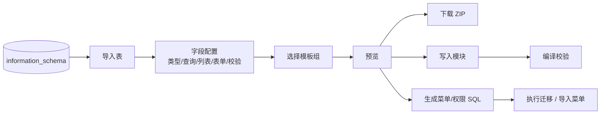

# 12 · 接口规范与代码生成器

> 目标：四组接口（admin / portal / app / open）风格统一、权限清晰、文档可调试；CRUD 代码一键生成，生成物能直接编译、能直接跑。

---

## 1. 接口分层与路径

| 组 | 前缀 | 认证 | 使用方 |
|---|---|---|---|
| 后台 | `/api/admin/**` | `lx-admin-token` | Vue3 管理端、移动审批 |
| 门户 | `/api/portal/**` | `lx-member-token`（可选） | Nuxt3 PC 门户 |
| 移动 | `/api/app/**` | `lx-member-token` + App 签名 | H5 / 小程序 / App |
| 开放 | `/api/open/v1/**` | AppKey + 签名 | 第三方 |
| 回调 | `/api/callback/**` | 渠道验签 | 支付 / 短信 / 微信 |

**语言与区域：**

- 所有接口支持 `X-Lang`（显式指定，优先级高）与 `Accept-Language`（标准协商）。
- 门户 / 开放平台支持 URL 前缀 `/{lang}/...` 与 `?lang=`；后台以用户偏好为准。
- 响应带 `Content-Language`；内容回退时带 `X-Lang-Fallback: true`。
- 错误消息、校验提示、枚举文案按语言返回；`code` 不变，`msg` 变化。
- 时间、数字、货币由前端按 Locale 格式化，后端返回标准时间戳 / 字符串。

**版本策略：**

- 内部接口（admin / portal / app）不强制路径版本，用 Header `X-Api-Version` 做灰度。
- 开放平台强制 `/v1/`，不兼容变更升 `/v2/`。
- 废弃接口保留至少 6 个月，返回 `Deprecation` / `Sunset` Header。

---

## 2. 统一响应

### 2.1 成功

```json
{
  "code": 200,
  "msg": "success",
  "data": {
    "contentId": 123,
    "title": "示例文章"
  },
  "traceId": "9f3c2a7e8b1d4c6f",
  "timestamp": 1762732800000
}
```

### 2.2 分页

```json
{
  "code": 200,
  "msg": "success",
  "data": {
    "rows": [],
    "total": 128,
    "pageNum": 1,
    "pageSize": 10
  },
  "traceId": "9f3c2a7e8b1d4c6f"
}
```

分页体统一用 `PageResult<T>`，外层仍是 `R<T>`：

```java
public class PageResult<T> {
    private List<T> rows;
    private long total;
    private long pageNum;
    private long pageSize;
}
```

### 2.3 失败

```json
{
  "code": 12002,
  "msg": "无权访问该内容",
  "data": null,
  "traceId": "9f3c2a7e8b1d4c6f",
  "timestamp": 1762732800000
}
```

**约定：**

- HTTP 状态码表达传输层语义（200/400/401/403/404/429/500）。
- 业务码表达具体原因；`code=200` 为成功。
- `msg` 面向用户，可国际化；`detail` 仅开发环境返回。
- 所有响应带 `traceId`，便于排障。
- 不返回堆栈、SQL、内部类名。

---

## 3. 错误码分段

| 段 | 领域 | 示例 |
|---|---|---|
| `0` / `200` | 成功 | 200 |
| `10xxx` | 通用 | 10001 参数错误、10002 不支持的操作 |
| `11xxx` | 认证 | 11001 未登录、11002 Token 过期、11003 验证码错误 |
| `12xxx` | 权限 | 12001 无权限、12002 数据越权、12003 租户越权 |
| `13xxx` | 限流 | 13001 请求过于频繁、13002 配额不足 |
| `20xxx` | 系统 | 20001 系统繁忙、20002 配置错误 |
| `30xxx` | CMS | 30001 内容不存在、30002 状态不允许发布 |
| `40xxx` | 会员 | 40001 会员不存在、40002 密码错误、40003 账号锁定 |
| `50xxx` | 工作流 | 50001 流程不存在、50002 任务已处理 |
| `60xxx` | SaaS | 60001 租户停用、60002 套餐不含该功能 |
| `70xxx` | 文件 | 70001 文件过大、70002 类型不支持、70003 引用中不可删 |

**错误码定义方式：**

```java
public enum ErrorCode {
    SUCCESS(200, "error.success"),
    UNAUTHORIZED(11001, "error.auth.unauthorized"),
    FORBIDDEN(12001, "error.auth.forbidden"),
    TENANT_FORBIDDEN(12003, "error.tenant.forbidden"),
    CONTENT_NOT_FOUND(30001, "error.cms.contentNotFound"),
    CONTENT_STATUS_INVALID(30002, "error.cms.contentStatusInvalid");

    private final int code;
    private final String messageKey;
}
```

- 枚举只存 `messageKey`，不存中文 / 英文文案。
- `GlobalExceptionHandler` 按 `LocaleContextHolder` 解析 `messageSource.getMessage(messageKey, args, locale)`。
- 新增错误码必须同时补 `error` 命名空间的翻译键，否则发布检查不通过。
- 开放平台未传语言时用 `en-US` 或平台默认语言。

---

## 4. 认证与签名

### 4.1 后台 / 会员

```http
GET /api/admin/cms/content?pageNum=1&pageSize=10
lx-admin-token: 9f3c2a7e-...
```

```http
GET /api/app/cms/content/123
lx-member-token: 7a1b2c3d-...
X-Device-Id: ...
X-App-Version: 1.2.0
X-Channel: h5
```

### 4.2 开放平台签名

```http
POST /api/open/v1/cms/content
X-App-Key: lx_abc123
X-Timestamp: 1762732800
X-Nonce: 8f3c2a7e
X-Sign: 5d41402abc4b2a76b9719d911017c592...
Content-Type: application/json
```

**签名算法：**

```text
stringToSign =
  HTTP_METHOD + "\n" +
  PATH + "\n" +
  CANONICAL_QUERY + "\n" +
  SHA256(BODY) + "\n" +
  TIMESTAMP + "\n" +
  NONCE

sign = Base64(HMAC-SHA256(stringToSign, appSecret))
```

- 时间戳窗口 ±5 分钟。
- Nonce 缓存 10 分钟，重复拒绝。
- 签名比较用常量时间比较。
- Secret 只在服务端保存，支持轮换。
- 失败返回 401，不泄露具体原因。

### 4.3 幂等

```http
POST /api/admin/cms/content
X-Idempotency-Key: 9f3c2a7e-...
```

- Redis `SETNX idem:{key}`，TTL 24h。
- 首次请求处理并缓存响应；重复请求返回同一响应。
- 只对创建 / 支付 / 发布等写操作生效。
- Key 由客户端生成，服务端校验长度与字符集。

### 4.4 限流

| 场景 | 维度 | 建议 |
|---|---|---|
| 登录 | IP + 账号 | 5 次 / 分钟 |
| 短信 | 手机 + IP | 1 次 / 60 秒，5 次 / 天 |
| 上传 | 用户 + 租户 | 20 次 / 分钟 |
| 搜索 | IP | 30 次 / 分钟 |
| 开放 API | AppKey + 接口 | 按套餐 |
| 导出 | 用户 | 1 次 / 分钟 |

响应头：

```text
X-RateLimit-Limit: 100
X-RateLimit-Remaining: 87
X-RateLimit-Reset: 1762732860
Retry-After: 30
```

---

## 5. 接口文档

### 5.1 分组

```java
@Bean
public GroupedOpenApi adminApi() {
    return GroupedOpenApi.builder()
        .group("01-admin")
        .pathsToMatch("/api/admin/**")
        .build();
}

@Bean
public GroupedOpenApi portalApi() {
    return GroupedOpenApi.builder()
        .group("02-portal")
        .pathsToMatch("/api/portal/**")
        .build();
}

@Bean
public GroupedOpenApi appApi() {
    return GroupedOpenApi.builder()
        .group("03-app")
        .pathsToMatch("/api/app/**")
        .build();
}

@Bean
public GroupedOpenApi openApi() {
    return GroupedOpenApi.builder()
        .group("04-open")
        .pathsToMatch("/api/open/**")
        .build();
}
```

### 5.2 注解规范

```java
@Tag(name = "CMS-内容管理")
@RestController
@RequestMapping("/api/admin/cms/content")
public class CmsContentAdminController {

    @Operation(
        summary = "分页查询内容",
        description = "权限码：cms:content:list"
    )
    @GetMapping
    @SaCheckPermission(value = "cms:content:list", type = "admin")
    public R<PageResult<ContentListVO>> list(ContentQueryReq req) { ... }
}
```

**要求：**

- 每个接口有 `summary`、`description`、权限码。
- 请求 / 响应字段有 `@Schema(description = "...")`。
- 枚举列出可选值。
- 示例值真实可复制。
- 文件上传标注 `multipart/form-data`。
- 错误码在文档中列出。

### 5.3 导出与契约

- 导出 OpenAPI JSON / YAML，供三方对接。
- CI 校验 OpenAPI 变更：字段删除 / 类型变更标记为 breaking。
- 前端用生成的 TypeScript 类型（可选）减少字段不一致。
- 文档地址：`/doc.html`（Knife4j），生产环境可关闭或加权限。

---

## 6. 代码生成器

### 6.1 目标

吸收 RuoYi gen 的“导入表 → 配字段 → 预览 → 下载”，扩展：

- 多端模板：后台 Vue3、uni-app、Portal API。
- 多租户字段自动注入。
- Flyway 脚本生成。
- 菜单 / 权限 SQL 生成。
- 生成到指定模块，直接编译。
- 主子表、树表。
- DTO / VO / MapStruct。
- OpenAPI 注解、权限注解。
- 单元测试骨架。

### 6.2 流程



### 6.3 配置模型

`gen_table`：

```text
table_id, table_name, table_comment, class_name, module_name,
business_name, function_name, function_author, parent_table_id,
tree_code, tree_parent_code, tenant_column, gen_type(0单表/1树表/2主子表),
gen_path, template_group, status
```

`gen_table_column`：

```text
column_id, table_id, column_name, column_comment, column_type,
java_type, java_field, is_pk, is_increment, is_required,
is_insert, is_edit, is_list, is_query, query_type(EQ/NE/GT/LT/LIKE/BETWEEN),
html_type(input/textarea/select/radio/checkbox/datetime/upload/editor),
dict_type, validation, sort
```

### 6.4 模板清单

| 模板 | 产物 |
|---|---|
| `entity.java.vm` | Entity |
| `dto.java.vm` | SaveReq / QueryReq |
| `vo.java.vm` | ListVO / DetailVO |
| `convert.java.vm` | MapStruct Convert |
| `mapper.java.vm` | Mapper 接口 |
| `mapper.xml.vm` | XML（复杂查询） |
| `service.java.vm` | Service 接口 |
| `serviceImpl.java.vm` | Service 实现 |
| `controllerAdmin.java.vm` | 后台 Controller |
| `controllerPortal.java.vm` | 门户 Controller（可选） |
| `api.ts.vm` | 前端 API |
| `types.ts.vm` | 前端类型 |
| `index.vue.vm` | 后台列表 / 表单页 |
| `uniappList.vue.vm` | uni-app 列表 |
| `uniappDetail.vue.vm` | uni-app 详情 |
| `menu.sql.vm` | 菜单 / 按钮 SQL |
| `i18nKey.sql.vm` | 翻译键 SQL（菜单、字段、校验） |
| `i18nMessages.ts.vm` | 前端语言包骨架 |
| `flyway.sql.vm` | 建表 / 变更脚本（按厂商生成） |
| `serviceTest.java.vm` | 单元测试骨架 |

### 6.5 生成物示例（Controller）

```java
@Tag(name = "CMS-内容管理")
@RestController
@RequestMapping("/api/admin/cms/content")
@ConditionalOnProperty(prefix = "lx.module.cms", name = "enabled", havingValue = "true")
public class CmsContentAdminController {

    private final CmsContentService contentService;

    public CmsContentAdminController(CmsContentService contentService) {
        this.contentService = contentService;
    }

    @Operation(summary = "分页查询内容", description = "权限码：cms:content:list")
    @GetMapping
    @SaCheckPermission(value = "cms:content:list", type = "admin")
    public R<PageResult<ContentListVO>> list(ContentQueryReq req) {
        return R.ok(contentService.page(req));
    }

    @Operation(summary = "新增内容", description = "权限码：cms:content:add")
    @PostMapping
    @SaCheckPermission(value = "cms:content:add", type = "admin")
    public R<Long> add(@RequestBody @Valid ContentSaveReq req) {
        return R.ok(contentService.add(req));
    }
}
```

### 6.6 多租户注入

生成器自动：

- Entity 加 `tenantId`。
- Mapper XML 不加 `tenant_id` 条件（由插件注入）。
- 唯一索引提示包含 `tenant_id`。
- 菜单 SQL 带 `module_code`。
- 生成 `i18n_key`（菜单名、字段标签、校验提示、错误码），默认中文值；不生成英文占位。
- 生成前端 `$t('cms.content.title')` 骨架，避免硬编码。
- 测试用例带租户上下文与语言上下文。

### 6.7 菜单 SQL 示例

```sql
-- menu_id / parent_id 由应用侧雪花 ID 生成，以下为占位符，不依赖 LAST_INSERT_ID()
INSERT INTO sys_menu
  (menu_id, menu_name, parent_id, order_num, path, component, menu_type, perms, icon, module_code)
VALUES
  ({menuId}, '内容管理', 2000, 1, 'content', 'cms/content/index', 'C', 'cms:content:list', 'documentation', 'cms');

INSERT INTO sys_menu
  (menu_id, menu_name, parent_id, order_num, path, component, menu_type, perms, icon, module_code)
VALUES
  ({buttonId}, '内容新增', {menuId}, 1, '', '', 'F', 'cms:content:add', '', 'cms');
```

> 生成器输出的是“逻辑 SQL + 占位符”，由迁移工具或应用启动初始化时替换为实际雪花 ID；不要生成 `LAST_INSERT_ID()` 等 MySQL 专属写法。

### 6.8 安全限制

- 只允许生成到 `lx-modules/**` 白名单目录。
- 包名白名单，禁止 `..`、绝对路径、系统目录。
- 覆盖前备份 + 二次确认 + 生成记录。
- 生成物带 `@generated` 注释，提醒后续手改会被覆盖。
- 生产环境关闭生成器（`lx.module.generator.enabled=false`）。
- 生成器权限只给开发 / 架构角色。
- 生成后必须编译 + 跑测试，不能“生成即上线”。

---

## 7. 接口示例

### 7.1 内容列表

```http
GET /api/portal/cms/contents?siteId=1&categoryId=10&pageNum=1&pageSize=10&orderBy=publishTime_desc
```

```json
{
  "code": 200,
  "msg": "success",
  "data": {
    "rows": [
      {
        "contentId": 123,
        "title": "示例文章",
        "summary": "摘要",
        "coverUrl": "https://cdn.example.com/...",
        "categoryId": 10,
        "categoryName": "新闻",
        "author": "张三",
        "publishTime": "2026-11-10 10:00:00",
        "views": 128,
        "accessType": 0,
        "tags": ["标签A", "标签B"]
      }
    ],
    "total": 1,
    "pageNum": 1,
    "pageSize": 10
  },
  "traceId": "9f3c2a7e8b1d4c6f"
}
```

### 7.2 内容详情（权限截断）

```json
{
  "code": 200,
  "msg": "success",
  "data": {
    "contentId": 123,
    "title": "示例文章",
    "accessType": 2,
    "accessGranted": false,
    "summary": "摘要",
    "content": "<p>试读内容...</p>",
    "truncated": true,
    "loginRequired": true,
    "vipRequired": true
  }
}
```

> 未授权时 `content` 只返回试读片段，不返回全文；前端根据 `truncated` 展示登录 / 开通 VIP 引导。

### 7.3 图片裁剪

```http
POST /api/admin/file/image/crop
Content-Type: application/json
lx-admin-token: ...

{
  "fileId": 123456,
  "x": 100,
  "y": 50,
  "width": 800,
  "height": 600,
  "rotate": 0,
  "flipH": false,
  "flipV": false,
  "format": "webp",
  "quality": 85
}
```

```json
{
  "code": 200,
  "msg": "success",
  "data": {
    "fileId": 123457,
    "url": "https://cdn.example.com/.../crop.webp",
    "width": 800,
    "height": 600,
    "derivedFrom": 123456
  }
}
```

### 7.4 多语言语言包

```http
GET /api/portal/i18n/zh-CN/common?v=12
Accept-Language: zh-CN
```

```json
{
  "code": 200,
  "msg": "success",
  "data": {
    "lang": "zh-CN",
    "namespace": "common",
    "version": 12,
    "messages": {
      "button.confirm": "确认",
      "button.cancel": "取消"
    }
  }
}
```

响应头：

```http
ETag: "i18n-zh-CN-common-12"
Content-Language: zh-CN
Cache-Control: public, max-age=300
```

- 版本号参与 URL / ETag，语言包发布后自然失效。
- 只返回已发布版本，不返回草稿。
- 缺失键由服务端按回退链补齐；仍缺失时返回键本身并记录 `i18n_missing_log`。
- 语言包接口不要求登录；会员偏好设置需要 `lx-member-token`。

---

## 8. 前后端协作约定

| 项 | 约定 |
|---|---|
| 字段命名 | JSON 用 `camelCase`，数据库 `snake_case` |
| 时间 | `yyyy-MM-dd HH:mm:ss`，时区 `Asia/Shanghai` |
| ID | 字符串传输，避免 JS 精度丢失（`Long` → `String`） |
| 枚举 | 传值 + 文档列含义；前端用字典渲染 |
| 空值 | 返回 `null`，不返回 `""` 混用 |
| 金额 | 字符串传输，避免浮点误差 |
| 文件 | 返回 `fileId` + `url` + 多规格 |
| 分页 | `pageNum` 从 1 开始，`pageSize` 最大 100 |
| 排序 | `orderBy=field_asc`，白名单校验 |
| 导出 | 异步任务，返回 `taskId`，轮询下载 |
| 语言 | 请求带 `X-Lang` / `Accept-Language`；响应带 `Content-Language` |
| 文案 | 前端 `$t('namespace.key')`；后端 `ErrorCode.messageKey`，禁止硬编码 |
| 语言包 | 按命名空间懒加载，带版本号 / ETag |

---

## 9. 验收清单

- [ ] 四组接口文档可打开、可调试。
- [ ] 每个接口有权限码，越权返回 403。
- [ ] 统一响应、分页、错误码。
- [ ] Token 过期、刷新、踢下线行为一致。
- [ ] 开放平台签名、时间戳、Nonce 校验通过。
- [ ] 幂等键重复请求返回同一结果。
- [ ] 限流返回 429 + `Retry-After`。
- [ ] 代码生成器可生成并编译通过。
- [ ] 生成物包含菜单 SQL、Flyway、权限注解、i18n 键。
- [ ] 生成器无法写出白名单目录。
- [ ] 同一份代码在 MySQL / PostgreSQL 通过接口测试；达梦 / 金仓通过核心流程。
- [ ] 切换 `X-Lang` 后错误消息与语言包返回对应语言，缺翻译按回退链处理。
