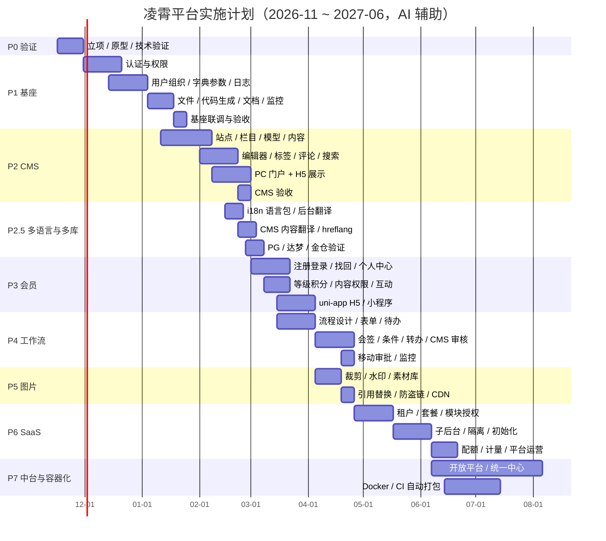

# 13 · 实施路线图、排期与风险

> 基准：2026-11-16 启动，**AI 辅助开发为主（核心 2~3 人 + AI 助手）**，完整版约 6~8 个月。
> **v1.0 只做后台基座（6 周，见 `17-v1-plan.md`）**；含 CMS / 门户的 MVP 约 3~4 个月，CMS / 会员 / 门户按 `20-cms-embed-plan.md` 以模块嵌入。
> 排期按“契约先行 + 代码生成 + 并行 + 阶段门禁”估算，实际以 AI 采用度与评审效率校准。
>
> **状态（2026-11-27 复核）**：实际进度远快于下文排期——P1 基座、P2 CMS、P3 会员主体、
> 门户（首页 / 栏目 / 详情 / 搜索 / SEO / 会员中心）、P2.5 的数据库语言包均已在
> 2026-11-15 ~ 11-26 完成，逐项记录见 **§12**。§1~§3 的周期、甘特图与里程碑日期是
> 2026-11-16 的原始估算，保留备查，**不再作为承诺日期**；当前待办与下一步见 §12.28 / §12.29。

---

## 1. 阶段总览

| 阶段 | 周期 | 目标 | 关键交付 | 门禁 |
|---|---|---|---|---|
| P0 立项与验证 | 2 周 | 技术风险清零 | 双账号 Demo、模块开关 Demo、JDK 矩阵、图片管线 Demo、原型 | 4 个 Demo 通过 |
| P1 后台基座（v1.0） | 6 周 | 可用后台 | 登录 / 验证码 / 用户 / 角色 / 菜单 / 部门 / 岗位 / 字典 / 配置 / 公告 / 日志 / 文件中心 / 监控 / 定时任务 / 代码生成 / 文档 | 权限闭环 + 关闭态启动 + 三 JDK 冒烟 |
| P2 CMS | 6~8 周 | 内容闭环 | 站点 / 栏目 / 模型 / 内容 / 标签 / 编辑器 / 审核 / PC + H5 展示 | 发文 → 发布 → 前台可见 |
| P2.5 多语言与多库 | 3~4 周 | 国际化与信创基线 | 语言包热加载 / 后台与门户翻译 / CMS 内容翻译 / PG + 达梦 + 金仓验证 | 语言切换 + 多库冒烟 |
| P3 会员前台 | 4~6 周 | 会员体系 | 注册 / 登录 / 找回 / 个人中心 / 等级积分 / 评论收藏 / uni-app | 注册 → 登录 → 找回 → 改密 |
| P4 工作流 | 4~6 周 | 审批能力 | 设计器 / 表单 / 待办 / 审批 / 委托 / CMS 审核 | 发起 → 审批 → 状态回写 |
| P5 图片增强 | 2~3 周 | 图片运营 | 裁剪 / 水印 / 素材库 / 引用替换 / CDN | 裁剪水印引用全链路 |
| P6 SaaS | 6~8 周 | 多租户 | 租户 / 套餐 / 模块授权 / 隔离 / 初始化 / 配额 | 两租户数据隔离 |
| P7 中台 | 持续 | 平台化 | 开放平台 / 统一用户 / 消息 / 搜索 / 支付 / 数据 | 按业务触发 |

---

## 2. 甘特图



> 甘特图按“完整版”排；MVP 截止到 P2 验收（约 2027-02 下旬）。P2.5 为跨阶段专项，与 P3 / P4 部分并行；Docker / CI 自动化放在 P7，不影响首发 jar 部署。

---

## 3. 里程碑与验收

| 里程碑 | 时间 | 验收标准 |
|---|---|---|
| M0 技术验证 | 2026-11-27 | 双账号 Demo、模块开关 Demo、JDK 8/11/17 启动、图片裁剪水印 Demo |
| M1 基座可用 | 2027-01-25 | 建角色 → 配菜单 → 建用户 → 登录 → 权限生效 → 越权 403 |
| M2 内容闭环 | 2027-02-26 | 建模型 → 建栏目 → 发文 → 审核 → 发布 → PC/H5 可见 → 下线 |
| M2.5 多语言与多库 | 2027-03-08 | 后台 / 门户切换语言生效；CMS 内容翻译可发布；PG / 达梦 / 金仓核心流程通过 |
| M3 会员闭环 | 2027-03-26 | 注册 → 登录 → 找回 → 改密 → 个人中心 → 评论收藏 |
| M4 审批闭环 | 2027-04-26 | 发起 → 待办 → 同意/驳回 → 状态回写 → 流程图 |
| M5 图片运营 | 2027-04-26 | 上传 → 裁剪 → 水印 → 引用 → 替换 → 前台更新 |
| M6 多租户 | 2027-06-21 | 两租户数据隔离、子用户只看到套餐菜单、配额生效 |
| M7 中台 | 2027-06+ | 开放平台可创建应用、调用受控接口、计量可查 |
| M8 容器化 | 2027-07 | Docker 镜像 + CI 自动打包 + compose 一键启动 |

---

## 4. 团队配置（AI 辅助开发）

| 角色 | 人数 | 职责 |
|---|---|---|
| 架构 / 全栈负责人 | 1 | 架构、权限、模块开关、多租户边界、核心后端、代码评审、技术攻坚 |
| 后端开发 | 1（可 0.5） | 基座、CMS、会员、工作流、SaaS |
| 前端开发 | 1 | Vue3 管理端、Nuxt3 门户、uni-app |
| 产品 / 测试 | 0.5~1 | 需求、原型、验收、越权 / 回归 / 性能 |
| AI 编程助手 | — | 代码生成、模板、单测、文档、SQL 初稿；不替代评审与验收 |

**为什么这样配：**

- AI 对“写代码”加速明显，对“定契约、评审、联调、验收、上线”帮助有限；瓶颈从编码转移到设计与验证。
- 核心 2~3 人必须覆盖“后端 + 前端 + 产品/测试”三条线，否则并行度不够。
- 架构 / 全栈负责人不可省：双账号、模块开关、租户边界一旦做错，后期返工巨大。
- 测试不可完全外包给 AI：越权、租户隔离、内容权限、上传安全必须人工设计用例。

### 4.1 AI 辅助开发约定（必须写进仓库）

1. **契约先行**：表结构、API、权限码、错误码、i18n key 先定，AI 只按契约生成。
2. **生成物必须过门禁**：编译、单测、静态检查、依赖漏洞扫描、Flyway 校验，缺一不可。
3. **人工评审重点**：权限、租户、SQL、文件上传、密钥、支付相关代码逐行看。
4. **禁止改历史迁移**：AI 只能新增 Flyway 脚本，不能改已发布脚本。
5. **规范入库**：`AGENTS.md` / `.ai/` 放编码规范、模板、提示词、示例，保证多人一致。
6. **禁止来源不明代码**：检查 License 与供应链，不直接粘贴未知来源片段。
7. **测试即验收**：核心链路必须有集成测试；AI 生成的测试要人工确认断言有效。
8. **文档同 PR**：接口、错误码、i18n key、表结构变更必须同步文档。
9. **小步提交**：一个 PR 只做一件事，便于回滚与评审。
10. **人工兜底**：AI 不可用时，核心链路仍能由 2~3 人手动推进。

---

## 5. 工作量估算（人月）

| 阶段 | 后端 | 前端 | 测试 / UI / DevOps | 合计 |
|---|---:|---:|---:|---:|
| P0 | 2 | 1 | 0.5 | 3.5 |
| P1 | 8 | 3 | 1.5 | 12.5 |
| P2 | 7 | 4 | 1.5 | 12.5 |
| P2.5 | 3 | 1.5 | 1 | 5.5 |
| P3 | 4 | 3 | 1 | 8 |
| P4 | 5 | 2 | 1 | 8 |
| P5 | 2 | 1 | 0.5 | 3.5 |
| P6 | 6 | 3 | 1.5 | 10.5 |
| P7 | 6 | 3 | 1 | 10 |
| **合计** | **43** | **21.5** | **9.5** | **74** |

> 上表为**传统人月**基准。AI 辅助后：编码类（后端 / 前端）约 ×0.5~0.7，测试 / UI / DevOps 约 ×0.9（评审、联调、验收不会等比压缩）。
> 折算后约 **46~55 人月**；再留 15%~20% buffer，总预算约 **53~66 人月**。若 AI 采用度高、契约稳定，取低值；若需求频繁变更，取高值。

---

## 6. 版本策略

| 版本 | 范围 | 面向 |
|---|---|---|
| v0.1 技术验证 | P0 | 内部 |
| **v1.0 后台基座** | P1（6 周，见 `17`） | 私有化客户 / 种子客户 |
| v1.1 内容平台 | + P2（CMS 模块嵌入） | 内容客户 |
| v1.2 会员版 | + P3（会员模块嵌入） | 内容运营客户 |
| v1.3 门户版 | + 门户 Nuxt3 | 内容客户 |
| v1.4 国际化 / 审批版 | + P2.5 + P4 + P5 | 出海 / 信创 / 企业客户 |
| v2.0 SaaS | + P6 | 平台运营 |
| v3.0 中台 | + P7（Docker / CI） | 生态 / 多产品线 |

---

## 7. 风险登记表

| # | 风险 | 概率 | 影响 | 应对 | 负责人 |
|---|---|---|---|---|---|
| R1 | 范围过大导致延期 | 高 | 高 | MVP 切分、阶段门禁、开关后置 | PM |
| R2 | JDK / Boot3 线维护成本 | 低 | 中 | 主线 8，17 仅 CI 冒烟，Boot3 分支延后 | 架构 |
| R3 | 双账号权限设计缺陷 | 中 | 高 | P0 Demo 验证、越权专项测试 | 架构 |
| R4 | 多租户越权 | 中 | 高 | 上下文强制、跨租户测试、代码评审 | 后端 |
| R5 | Flowable 复杂度 / 表膨胀 | 中 | 中 | 四件套先行、SPI、归档 | 后端 |
| R6 | CMS 动态模型性能 | 中 | 中 | JSON + 生成列、压测、ES 后置 | 后端 |
| R7 | 三端体验不一致 | 中 | 中 | 设计规范、组件库、契约测试 | 前端 |
| R8 | 图片处理 CPU / 存储 | 中 | 中 | 异步、限尺寸、WebP、CDN、配额 | 后端 |
| R9 | 客户需求变更 | 高 | 高 | 变更评审、版本规划、合同边界 | PM |
| R10 | 信创 / 数据库兼容 | 中 | 高 | 提前验证达梦 / 金仓、方言层、多库 CI | 架构 |
| R11 | 安全合规（等保 / 隐私） | 中 | 高 | 脱敏、审计、注销、渗透测试 | 测试 |
| R12 | 关键人员流失 | 低 | 高 | 文档、代码评审、模块负责人制 | PM |
| R13 | 翻译键失控 / 缺翻译 | 中 | 中 | 命名规范、发布检查、覆盖率看板 | 前端 |
| R14 | 多库 DDL 漂移 | 中 | 高 | 统一 schema 生成、CI diff、客户环境验收 | 架构 |
| R15 | AI 生成代码有幻觉 / 越权 / 漏校验 | 高 | 高 | 契约先行、门禁、重点代码人工逐行评审、集成测试 | 架构 |
| R16 | AI 生成代码来源 / License 风险 | 中 | 中 | 依赖与片段来源审查、SCA + License 扫描、SBOM、禁止粘贴不明来源 | 架构 |
| R17 | 单租户转多租户返工 | 中 | 高 | P0 门禁检查 `tenant_id` / `TenantContext` / 缓存 Key；关闭态回归 | 后端 |
| R18 | 人力过少导致评审 / 测试积压 | 高 | 高 | 控制范围、MVP 优先、测试用例模板化、必要时加 1 名测试 | PM |
| R19 | 开源组件供应链 / 停维护 / 许可证变更 | 中 | 高 | 版本锁定、SBOM、许可证台账、关键组件保留替换预案（搜索 / 存储 / 调度 / 工作流） | 架构 |

---

## 8. 阶段门禁

> 以下勾选项是 2026-11-16 的口径，未逐项回填；实际验收记录以 §12 各节为准。
> 其中涉及 `tenant_id` / `TenantContext` 的条目已被 `17` §3.4.1 的决策取代。

### P0 → P1

- [ ] 双账号 Demo：后台 / 会员 Token 互不通用。
- [ ] 模块开关 Demo：关闭 CMS 后接口 404、Bean 不加载。
- [ ] ~~单租户 Demo：`tenant_id` 默认 0、`TenantContext` 常驻、关闭 `saas` 时无租户表 / 接口。~~
      **已作废**：平台后台不引入隔离列与租户上下文，改以“关闭任意可选模块后基座仍能启动”验证（见 §12.7）。
- [ ] JDK 8/11/17 同一 jar 启动。
- [ ] jar 直部署 Demo：`java -jar` + Nginx + MySQL / Redis。
- [ ] 图片上传 → 裁剪 → 水印 Demo。
- [ ] 原型评审通过（后台 + 门户 + H5）。

### P1 → P2

- [ ] 权限闭环：角色 / 菜单 / 用户 / 数据权限。
- [ ] 代码生成器可生成并编译。
- [ ] 文件上传 / 存储配置可用。
- [ ] 三 JDK CI 全绿。
- [ ] 安全基线自查通过。

### P2 → P2.5

- [ ] 内容发布闭环。
- [ ] PC 门户 SEO / 首屏达标。
- [ ] H5 列表 / 详情可用。
- [ ] 内容权限截断验证。

### P2.5 → P3

- [ ] 后台 / 门户 `zh-CN` / `en-US` 切换生效。
- [ ] 语言包发布 5s 内生效，回滚可用。
- [ ] CMS 内容翻译可发布，hreflang 正确。
- [ ] 同一代码在 MySQL / PG 通过集成测试。
- [ ] 达梦 / 金仓核心流程在目标环境通过。

### P3 → P4

- [ ] 注册 / 登录 / 找回 / 改密闭环。
- [ ] 会员 Token 与后台 Token 隔离。
- [ ] 评论 / 收藏 / 个人中心可用。

### P4 → P5

- [ ] 串行 / 会签 / 驳回 / 转办可用。
- [ ] CMS 审核集成。
- [ ] 移动审批可用。

### P5 → P6

- [ ] 裁剪 / 水印 / 引用 / 替换闭环。
- [ ] 防盗链 / 签名 URL 验证。

### P6 → P7

- [ ] 两租户隔离测试通过。
- [ ] 子用户菜单不超过套餐。
- [ ] 配额 / 计量 / 限流生效。
- [ ] 租户初始化可重试。
- [ ] **单租户回归**：关闭 `saas` 后系统正常启动，无租户表 / 接口 / 菜单，业务 `tenant_id=0`。

### P7 → 交付

- [ ] 开放平台应用 / 凭证 / 限流 / 计量可用。
- [ ] Dockerfile + compose + CI 自动打镜像可用。
- [ ] jar 与容器两种方式启动结果一致。
- [ ] 备份 / 回滚 / 监控演练通过。

---

## 9. 上线清单

### 9.1 基础设施（首发 jar）

- [ ] JDK 运行时确认（首发建议 JDK 8 或 11；17 冒烟通过即可）。
- [ ] `lx-boot.jar` + `application-prod.yml` + 启动脚本 / systemd。
- [ ] Nginx 反代 + 静态资源 + TLS + 上传大小限制。
- [ ] 数据库选型与版本锁定（首发 MySQL 8；PG 16 同步 CI；达梦 / 金仓按项目）。
- [ ] MySQL 主从 + 备份（或对应厂商高可用）。
- [ ] Redis 集群 / 哨兵。
- [ ] 本地文件目录（默认）+ 备份；需要时切 MinIO / OSS。
- [ ] 域名 / 备案 / ICP。
- [ ] 邮件 / 短信通道。
- [ ] 日志 / 监控 / 告警。
- [ ] 后期：Dockerfile / compose / 镜像仓库 / CI 自动打包（P7）。

### 9.2 应用

- [ ] 生产配置（数据库、Redis、存储、密钥）。
- [ ] Flyway 迁移执行。
- [ ] 管理员账号 / 初始密码。
- [ ] 模块开关确认（生产关闭 generator 与 saas；首发单租户）。
- [ ] 验证码 / 密码策略 / 登录锁定。
- [ ] 文件大小 / 类型 / 水印策略。
- [ ] 日志级别 / 脱敏。
- [ ] 定时任务 / 消息模板。
- [ ] 默认语言 / 启用语言（首发 `zh-CN`，`en-US` 预留）。
- [ ] 语言包发布 / 回滚验证。
- [ ] 数据库厂商 / 版本 / 驱动确认。
- [ ] JVM 参数（`-Xms/-Xmx`、GC、`-Duser.timezone`、日志路径）。

### 9.3 安全

- [ ] 默认密码全部修改。
- [ ] 数据库 / Redis 不暴露公网。
- [ ] 密钥不进 Git。
- [ ] HTTPS / HSTS / CSP。
- [ ] 越权 / XSS / SQL 注入 / 上传测试。
- [ ] 依赖漏洞扫描。
- [ ] 审计日志开启。
- [ ] 备份恢复演练。

### 9.4 业务

- [ ] 站点 / 栏目 / 模型 / 初始内容。
- [ ] 默认语言内容 + 目标语言翻译。
- [ ] 多语言 sitemap / hreflang / canonical。
- [ ] 会员等级 / 权益。
- [ ] 审批流程 / 表单。
- [ ] 租户 / 套餐（如启用 SaaS）。
- [ ] 门户 SEO / sitemap / robots。
- [ ] 404 / 500 页面。
- [ ] 用户培训 / 操作手册。

### 9.5 发布与回滚

- [ ] 发布窗口 / 公告。
- [ ] 蓝绿 / 滚动策略。
- [ ] 数据库向前兼容。
- [ ] 回滚 jar / 镜像 / 脚本。
- [ ] 发布后冒烟：登录、发文、前台、上传、审批。
- [ ] 监控观察 30 分钟。
- [ ] 值班表 / 应急联系人。

---

## 10. 上线后 30 天

| 周 | 重点 |
|---|---|
| W1 | 稳定性、登录 / 发布 / 上传异常、告警处理 |
| W2 | 性能调优、慢 SQL、缓存命中、图片体积 |
| W3 | 用户反馈、权限 / 流程配置修正、培训 |
| W4 | 复盘、 backlog 排序、下一版本规划 |

---

## 11. 建议的“不要做”清单

- 不要首发微服务。
- 不要重复造轮子：权限、菜单、分页、上传、Excel、工作流引擎、富文本内核、流程设计器全部复用成熟组件。
- 不要引入 GPL / AGPL / SSPL 组件而不做合规评估；调度不用 XXL-Job，搜索不用 Elasticsearch，CMS 内核不用 Halo。
- 不要首发 Docker / K8s 自动化，jar 能上线就先上线。
- 不要首发 SaaS；租户应用**独立立项**，平台后台不带 `tenant_id` / `TenantContext`
  （原“必须保留 `tenant_id` 与 `TenantContext`”的说法已作废，见 `17` §3.4.1）。
- 不要让 AI 生成的代码跳过评审、测试与依赖扫描。
- 不要首发全量静态化集群。
- 不要首发复杂计费 / 支付。
- 不要为每个租户建独立库（除非客户付费）。
- 不要自研工作流引擎 / 富文本内核。
- 不要把所有配置都做成数据库开关。
- 不要在没有越权测试的情况下上线多租户。
- 不要为了 JDK 17 放弃 JDK 8 主线。
- 不要在业务 Mapper 里写 `find_in_set` / `ON DUPLICATE KEY` / `limit`。
- 不要手写四套 DDL 后各改各的，必须由统一 schema 生成。
- 不要把面向用户的文案硬编码在 Java / Vue 里。
- 不要在没有多库 CI 的情况下承诺“兼容国产数据库”。
- 不要在 P1 就把 CMS / 会员 / 工作流全部打开。
- 不要让代码生成器生成“不能编译”的代码。

---

## 12. 待办清单（2026-11-17 记录，逐项推进中）

> 背景：v1.0 基座 + README 双语 + 多语言 L1 已收口（`1a3333b`）。
> 下面各项是**已声明能力与实现之间的缺口**，优先于新版本功能。
> 每项都写了验收标准，开工时按此逐条勾。

### 12.1 P0：权限到按钮（已完成，2026-11-18）

**复核结论**：`v-hasPerm` 并不是没做——13 个页面已有 **46 处**使用（第一次核查按
`v-permission` 搜索所以漏掉了）。2026-11-18 补齐最后 2 个缺口后，覆盖完整。

已覆盖：用户 / 角色 / 菜单 / 部门 / 岗位 / 字典 / 参数 / 公告 / 任务 / 生成器 /
在线用户 / 操作日志 / 登录日志。

| 本次补齐 | 内容 |
|---|---|
| 文件中心 | `FileLibrary.vue` 上传按钮 `platform:file:upload`、改名按钮 `platform:file:rename` |
| 用户启停用 | 行内 `el-switch` 增加 `:disabled="!canEditUser"`（`platform:system:user:edit`），与任务页 `canChangeStatus` 口径一致 |
| 文档 | `lx-modules/lx-module-system/README.md` 删除“前端指令待做”的过期描述 |

**验收结果**（2026-11-18，本地只读角色 `readonly_test`，仅授 M/C 菜单）：

```text
readonly permissions=18，无任何 add/edit/remove/clean/kickout/upload/rename
POST /admin/system/user        → 403 {"code":1003,"msg":"没有权限执行该操作"}
DELETE /admin/system/oper-log/clean → 403 {"code":1003}
GET  /admin/system/user/list   → 200 code=0，dataScope=5 只返回本人 1 行
```

浏览器逐页（只读账号）：14 个页面只剩 `搜索 / 重置 / 刷新 / 详情 / 预览 / 复制链接`；
用户启停用、任务启停用开关均为禁用态。admin 复查：新增 / 编辑 / 删除 / 重置密码 /
上传 / 改名 / 执行一次 / 日志全部可见。`smoke.mjs` 超管回归 22/22，控制台 0 error。

> 验证脚本 `.local/uitest/perm-check.mjs`（建只读角色 → 建账号 → 验证 → 清理）
> 只在本地跑，不入库；测试账号与角色验收后已删除。

**验收**：只读账号 14 个页面看不到写按钮；超管全功能不回归；README 与实际一致。

**参考权限码**（Flyway V4 / V8 / V10 / V11 + 文件、生成器，共 64 个，
按钮级约 40 个，前缀 `platform:`）：

```text
system:user:add|edit|remove|resetPwd|unlock
system:role|menu|dept|post|dict|config|notice:add|edit|remove
monitor:job:add|edit|remove|run|changeStatus|log|log:clean
monitor:operlog:clean  monitor:loginlog:clean  monitor:online:kickout
file:upload  file:rename
tool:gen:import|edit|preview|remove|download
```

### 12.2 P0：数据范围「2 自定义」（已完成，2026-11-19）

**原现状**：`sys_role_dept` 表不存在，保存 `data_scope=2` 直接拒绝，降级为仅本人；
部门 / 角色列表也未按数据范围过滤。

**完成内容**：
- `V15__system_role_dept.sql` 建 `sys_role_dept(role_id, dept_id)`（联合主键 + `dept_id` 索引）；
- 角色保存 / 详情带 `deptIds`（先清后插，`null` = 不修改）；空集合、越权部门、切到 2 却不带部门均拒绝；
- `DataScopeService` 对 2 返回自定义部门集合；多角色按 1 > 4 > 3 > 2 > 5、自定义取并集，空集合收紧为仅本人；
- 用户列表、部门列表 / 树、角色列表 / 下拉补同口径过滤；部门详情 / 写操作也按范围断言；
- 前端角色页仅在「自定义数据」时显示部门树（`check-strictly`，精确集合），详情回显、保存提交 `deptIds`。

| 步骤 | 内容 |
|---|---|
| 1 | Flyway 新增 `sys_role_dept(role_id, dept_id)` + 唯一索引 + 必要外键 / 注释 |
| 2 | `SysRoleService` 保存 / 详情带 `deptIds`（先清后插，`null` = 不修改） |
| 3 | `DataScopeService` 对 `2` 返回自定义部门集合；多角色仍取最大范围 |
| 4 | 用户列表 `applyUserScope` 支持多部门 `IN`；部门列表、角色列表补同口径过滤 |
| 5 | 前端角色页加部门树多选（仅 `data_scope=2` 显示），详情回显 |
| 6 | 单测：自定义范围命中 / 空集合收紧为仅本人 / 超管放行 / 多角色取最大 |

**验收**：选「自定义」并勾 2 个部门后，该角色用户只看到这两个部门及其用户；
清空部门保存被拒绝；单测覆盖上述四种边界。

**验收结果**（2026-11-19，本地）：
- 自定义角色勾 2 个部门后，受限账号用户列表只返回这 2 个部门的 3 个用户；
  部门列表 / 树只剩这 2 个节点；范围外用户 / 部门详情直接 403；
  角色列表不再出现超管与「全部数据」角色。
- 空部门保存返回 `自定义数据范围必须选择至少一个部门`。
- 单测 `DataScopeServiceTest` 6 项 + `SysRoleServiceTest` 2 项；`mvn test` 95 项全通过。
- `smoke.mjs` 22/22、`theme.mjs` 12/12、`vite build` 通过、控制台 0 error。
- 验证脚本 `.local/uitest/role-dept-check.mjs`；测试部门 / 用户 / 角色已全部清理。

### 12.2.1 P0 补充：会话策略（已完成，2026-11-20）

**问题**：在线用户页同一账号出现多行。定位后确认是多次真实登录（`is-concurrent=true`
+ `is-share=false`，旧 Token 要等 12 小时过期）；同时发现删除 / 停用 / 重置密码都没有
注销会话，被删用户会留下“空白账号”。

**完成内容**：
- 新增参数 `sys.account.multiDeviceLogin`（switch，默认 `false`），`V16` 迁移落库；
- 默认单会话：`AuthService.login` 在发 Token 前 `logoutByUserId` 踢掉旧会话；
- 开启参数后恢复多端同时在线，在线列表仍按 Token 一行，可单独强退；
- 删除、停用、管理员重置密码立即注销该账号全部会话；
- 参数每次登录实时读取，改完无需重启（不改 `sa-token.is-concurrent`）。

**验收**：`.local/uitest/session-policy-check.mjs` 18/18——默认连登两次只剩 1 个会话；
开启后两个 Token 都可用；停用 / 重置 / 删除后旧 Token 立即 401。

### 12.3 P1：L2 多语言设计（只写方案，v1.2 再实现）

> 后续：方案已按 §12.27 落地为独立模块 `lx-module-i18n`（v1.4 第二刀）；
> CMS 内容翻译、`/{lang}/` 前缀与 hreflang 仍未做，见 §12.29 待办池第 4 项。

- `docs/15-i18n.md` 定稿：`i18n_language` / `i18n_key` / `i18n_text` 三张表；
- 明确哪些翻译：字典 `label`、参数名 / 说明、菜单名、公告标题 / 正文、CMS 内容；
- 说明 L1 的 `menu_key` / `dict.<type>.<value>` / `config.<config_key>` 如何平滑迁到 L2；
- 给出回退链：`请求语言 → 默认语言 → 数据库原文`，以及缓存策略（Caffeine / Redis）；
- 产出评审结论后再排期，避免先写代码后改表。

### 12.4 P1：发布包演练（✅ 已完成，见 `docs/21` §47）

- `deploy/package.ps1` / `.sh` 打包（jar + 前端 dist + SQL + 脚本）；
- 解压到干净目录，用 `application-prod.yml` + Nginx 跑通登录 / 上传 / 生成器关闭；
- 写部署核对清单（JDK、时区、上传目录权限、Flyway、健康检查、回滚）。

**结果**：`lingxiao-1.0.0-SNAPSHOT.zip` 解压到临时目录，`--spring.profiles.active=prod`
连空白库 `lingxiao_drill`，Flyway V1~V17 全部 applied；登录 / 参数 / 在线用户 / 上传 / 文件列表
全部通过，`/v3/api-docs` 与 `/api/admin/tool/gen/list` 按 prod 设计返回 404。
本机没有 Nginx，用最小 Node 静态服务器 + `/api` 反向代理模拟，浏览器验收 4/4。

### 12.5 P2：零散小活（各 30 分钟内）

- ✅ README / README.en 英文界面截图：12 张（`13-*` ~ `24-*`），README.en 已全部换用；
- ✅ `docs/21-build-log.md` §0 速览已补多语言 / 品牌 / 发布包三行；
- ✅ 清理 `docs/23` §7 中已被本轮实现覆盖的“暂缓”条目；
- ✅ 核对 `docs/22` 前端依赖表与 `package-lock.json`：16 个版本号一致，直接依赖数 10 → 11。

### 12.6 P2：缓存分阶段落地（方案已定，暂不实现）

> 记录于 2026-11-22。**现在不加缓存**：v1.0 单机、低并发，参数 / 字典 / 菜单 / 权限
> 都是实时查库，表上也有索引；此时加缓存只会增加“数据不一致”的排查成本。
> 本节只锁定顺序、触发条件与验收标准，避免以后拍脑袋上 Redis。

**顺序：权限 > 参数 > 字典 > 菜单 > CMS / 门户内容。**

权限排第一，是因为每个带 `@RequiresPermission` 的请求都会走
`StpInterfaceImpl → 用户-角色-菜单三表 join`，频率远高于其它查询。

#### 触发信号（满足任意一条再动手）

| 信号 | 参考阈值 | 说明 |
|---|---|---|
| 权限查询压力 | 权限 SQL 进入慢查询前列，或后台 QPS 稳定 > 50~100 | 最先扛不住的是权限 |
| 数据库 CPU | 持续 > 60% | 先看索引 / 执行计划，再考虑缓存 |
| 连接池 | Hikari `active` 经常接近 `maximum-pool-size`（当前 10） | 请求在等连接，不一定是 SQL 慢 |
| 在线用户 | > 300~500 | 同时意味着会话该切 Redis |
| 实例数 | ≥ 2 | 必须共享缓存 + 失效广播，不能各缓各的 |
| 新模块上线 | CMS / 门户 / 会员前 | 门户读多写少，内容缓存收益最大 |
| 多租户 | SaaS 立项 | 缓存 key 必须带 `tenant_id` |

**不要加的情况**：单机几十个在线用户、没有明确失效路径、写多读少
（日志 / 在线状态 / 失败计数）、想用缓存掩盖缺索引。

#### 阶段 A：现在 ~ v1.1 之前（不做缓存）

- 补慢查询日志 / 接口耗时统计，先确认瓶颈在 DB 还是别处；
- 复核权限查询执行计划；
- 先补模块插拔、菜单过滤等基座缺口。

#### 阶段 B：单机出现压力（只做 Caffeine）

TTL 30~120 秒 + 写后主动失效（cache-aside，删除而不是更新）：

| 缓存 | Key | 失效点 |
|---|---|---|
| 权限码 | `userId` | 改角色、改菜单授权、停用 / 删除用户、角色状态变更 |
| 参数 | `configKey` 或全量 Map | 参数新增 / 修改 / 删除 |
| 字典 | `dictType` | 字典数据增删改 |
| 菜单树 | `userId` | 菜单 / 角色授权变更 |

权限缓存用“版本号”而不是逐个清：`perm:<userId>:<permVersion>`，
改权限时 bump 版本，旧 key 自然过期，不用遍历删除。

#### 阶段 C：多实例 / CMS 门户上线（共享缓存）

- 会话先切 Redis（这是状态外置，不是缓存）；
- 缓存用 Caffeine 近端 + Redis 远端，或直接 Redis；
- 失效用发布 / 订阅广播或统一版本号；
- CMS 内容按“发布 / 下线”主动失效，列表短 TTL 兜底；
- 门户只读缓存，后台写操作负责失效。

#### 加缓存时必须一起定的四件事

1. **失效策略**：写后删缓存（cache-aside），不做“写时更新缓存”；
2. **TTL 兜底**：再好的失效也可能漏，TTL 是最后一道保险；
3. **防击穿**：热点 key 过期只放一个请求回源（single-flight），空值也缓存短 TTL；
4. **可观测**：命中率、条目数、淘汰数要能在监控页看到；当前缓存监控页只覆盖
   验证码 / Redis，加业务缓存时要扩展。

#### 验收标准

```text
权限变更后 1 秒内生效（或明确接受 TTL 窗口）
参数改完立即生效（低频读，直接失效，不等 TTL）
缓存不可用时自动回源，接口不 500
命中率 > 90%，DB 权限查询 QPS 明显下降
缓存 key 数量可控，无无限增长
```

### 12.7 P1：v1.1 CMS 前置 —— 模块插拔最后一公里（✅ 已完成，2026-11-22）

**问题**：`sys_menu.module_code` 有列但 job / generator 挂在 `system` 下；
Flyway `locations` 写死四个目录；前端没调用 `/api/admin/modules`。
CMS 一关闭就会“菜单还在、接口 404、迁移照跑”。

**完成内容**：

- `ModuleProvider` SPI + `ModuleRegistry`：`system` / `file` 永远启用，
  未配置模块按关闭；
- 菜单 / 权限码按模块过滤，空目录剪枝；
- `FlywayConfigurationCustomizer` 按开关拼装迁移目录，
  配 `out-of-order` + `ignore-missing-migrations`；
- `/api/admin/modules` 接入前端：`store/app.js#loadModules` +
  `router/dynamic.js` 二次校验；
- `V18__menu_module_code.sql`：job / generator 菜单改到真实模块。

**验收**：112 项单测；job 关闭后 Flyway 跳过 job 目录、接口 404、
超管菜单与普通角色权限都不含 job、前端 `/tool/job` 落 404；
重新开启后恢复；`smoke.mjs` 22/22、`vite build` 通过。

详见 `docs/20-cms-embed-plan.md` §13、`docs/21-build-log.md` §48。

**下一步**：按 `docs/20` §7 开工 `lx-module-cms`（站点 / 栏目 / 内容 / 标签 /
发布下线 + portal API），前端放 `lx-ui-admin/src/modules/cms`。

### 12.8 P1：v1.1 CMS 第一批 —— 后台内容链路（✅ 已完成，2026-11-22）

**完成内容**：

- 新模块 `lx-modules/lx-module-cms`，启动期开关 `lx.module.modules.cms.enabled`；
- `V20__cms_schema.sql`：站点 / 栏目 / 栏目闭包 / 文章 / 标签 / 文章标签 6 张表；
- `V21__cms_menu.sql`：菜单 3000+ 与 `platform:cms:*` 按钮权限，`module_code='cms'`；
- 后台页面：站点、栏目树（新增根 / 子栏目）、文章（富文本 / 发布 / 下线 / 预览）、标签；
- 文章正文写入与读取双侧 HTML 清洗；栏目闭包全量重建与成环校验；
- 站点 / 栏目 / 标签删除保护；标签不跨站点复用；
- 富文本清洗工具上移 `lx-common-web`，公告与 CMS 共用。

**同步收口**：

- 后台用户头像自助编辑（上传 / 预览 / 移除，只接受 `fileId` 或 `http(s)`）；
- 第三方登录 schema 预留 `V19__system_user_social.sql` + `docs/28`，默认“先绑定后登录”。

**验收**：CMS 后台单测 14 项；当时全仓 126 项 / 26 类，JDK 8 / 11 均通过；
真实接口 34/34；浏览器 13/13；关闭后接口 404 / 菜单与路由消失，重开数据保留；
`vite build`、i18n 键检查通过。门户 API 落地后全仓为 134 项 / 28 类。

详见 `docs/20-cms-embed-plan.md` §14、`docs/21-build-log.md` §49、
`lx-modules/lx-module-cms/README.md`。

**下一步**：门户 API `/api/portal/cms/**`、素材选择器、内容版本 / 定时发布；
随后进入 v1.2 会员体系。

### 12.9 P1：v1.1 CMS 门户 API（✅ 已完成，2026-11-22）

**完成内容**：

- 新增公开只读接口 `/api/portal/cms/**`：站点、栏目导航树、标签、文章分页、详情（ID / slug）、搜索；
- 可见性自己兜：站点启用 + 文章已发布 + 栏目及**所有祖先**启用；停用栏目整棵子树剔除，
  隐藏栏目本身不出导航、可见子栏目上提；
- 独立 `Portal*VO` 字段白名单，不下发后台内部字段；列表不查正文，详情返回前再清洗一次；
- 栏目子树 / 标签筛选、关键字搜索、`pageSize` 上限 50、阅读量单条 UPDATE 自增；
- 接口契约与缓存建议写入 `docs/29-portal-api.md`。

**验收**：门户单测 8 项；全仓 134 项 / 28 类，JDK 8 / 11 均通过；
真实接口 38/38；关闭模块后门户与后台 CMS 接口均 404（5/5），重开恢复。

详见 `docs/20-cms-embed-plan.md` §15、`docs/21-build-log.md` §50、`docs/29-portal-api.md`。

**下一步**：素材选择器（见 §12.10）、内容版本 / 定时发布、v1.3 门户工程；
随后进入 v1.2 会员体系。

### 12.10 P1：v1.1 CMS 素材选择器（✅ 已完成，2026-11-22）

**完成内容**：

- 新增前端通用组件 `MediaPicker.vue`：预览 + 手填地址 + 文件中心图片选择；
- 站点 Logo、栏目封面、文章封面三处替换原纯文本输入；
- 选中写 `fileId`，存量 `http(s)` 外链继续兼容；粘贴 `/api/file/{id}` 自动归一成 `fileId`；
- 文件中心列表新增 `imageOnly=true`，后端按图片扩展名过滤，非图片不占分页；
- 抽公共 `resolveAssetUrl`，顺带修掉用户列表把外链头像误拼成 `/api/file/...` 的问题；
- 权限边界：浏览需 `platform:file:list`，上传需 `platform:file:upload`；
  没有权限时按钮隐藏，字段仍可手填外链。

**验收**：后台编译、`vite build`、i18n 键检查通过；素材接口 16/16；浏览器 6/6；
站点 Logo 经选择器保存后，后台详情与门户接口都返回同一个 `fileId`。

详见 `docs/21-build-log.md` §51、`lx-modules/lx-module-cms/README.md`。

### 12.11 P1：v1.1 CMS 文章回收站（✅ 已完成，2026-11-22）

**完成内容**：

- 新增迁移 `V22__cms_article_recycle.sql`：`cms_article` 增加删除人 / 删除时间快照列与
  `(del_flag, delete_time)` 索引；新增「回收站」菜单 3050 与恢复 / 彻底删除按钮 3051 / 3052，
  默认授权超管；
- 文章删除改为逻辑删除：标签关联保留，记录删除人 ID + 昵称快照；后台列表与门户自动不可见；
- 新增回收站接口：`GET /api/admin/cms/article/recycle/list`（站点 + 关键字）、
  `PUT /{id}/restore`、`DELETE /{id}/purge`，权限码分别 `recycle / restore / purge`；
- 恢复统一回草稿并保留 `publish_time`；恢复前校验站点 / 栏目仍存在、slug 未被占用；
- slug 唯一性与站点 / 栏目删除保护都包含回收站文章，避免“回收中的内容占着坑”；
- 前端新增回收站页面与文章页入口，中英文文案补齐。

**验收**：CMS 单测 29 项；全仓 141 项 / 28 类，JDK 8 / 11 均通过；
真实接口 33/33；浏览器 12/12；`vite build`、i18n 键检查（1039/1039）通过。

详见 `docs/20-cms-embed-plan.md` §16、`docs/21-build-log.md` §52、
`lx-modules/lx-module-cms/README.md`。

### 12.12 P1：v1.1 CMS 文章定时发布（✅ 已完成，2026-11-22）

**完成内容**：

- 新增迁移 `V23__cms_article_schedule.sql`：`cms_article.schedule_time` 与
  `(status, schedule_time)` 索引；新增按钮权限 `platform:cms:article:schedule`（菜单 3053）；
- 文章状态增加 `3 定时待发布`；门户只认 `status='1'`，定时文章天然不可见；
- 新增接口 `PUT /api/admin/cms/article/{id}/schedule` 与 `/schedule/cancel`；
  只允许草稿 / 已下线排期，已发布必须先下线；重复排期视为改时间；
- 新增 `CmsScheduleTask` 固定间隔扫描，用条件 UPDATE 抢占到点文章，
  多实例同时扫描只有一台成功；不依赖 job 模块，CMS 关闭时不注册；
- 到点发布：`publish_time = COALESCE(publish_time, schedule_time)`，发布后清空
  `schedule_time`；手动发布 / 下线 / 回收站恢复都会清空排期；
- 前端文章列表补状态筛选、计划时间列、定时弹窗与取消定时入口，中英文文案补齐。

**验收**：CMS 单测 36 项（文章 19 项）；全仓 **148 项 / 28 类**，JDK 8 / 11 均通过；
真实接口 39/39；浏览器 10/10；i18n 1051/1051；`vite build` 通过。

详见 `docs/20-cms-embed-plan.md` §17、`docs/21-build-log.md` §53、
`lx-modules/lx-module-cms/README.md`。

### 12.13 P1：v1.1 CMS 文章内容版本（✅ 已完成，2026-11-22）

**完成内容**：

- 新增迁移 `V24__cms_article_version.sql`：`cms_article_version` 表、
  `(article_id, version_no)` 唯一键；新增按钮权限 `platform:cms:article:version`
  （菜单 3054）与 `platform:cms:article:rollback`（菜单 3055）；
- 创建 / 编辑 / 发布 / 回滚 / 回收站恢复后自动写内容快照，快照不可变；
- 快照覆盖标题 / slug / 摘要 / 封面 / 正文 / 来源 / 栏目 / 标签 / 状态，
  不覆盖排序 / 备注 / 作者等元数据；
- SHA-256 相邻去重：连续保存相同内容不产生新版本；
- 新增接口 `GET /{id}/versions`、`GET /{id}/versions/{versionId}`、
  `PUT /{id}/versions/{versionId}/rollback`；
- 回滚统一回草稿、保留 `publish_time`、清空 `schedule_time`；回滚前校验版本归属、
  栏目存在且同站点、slug 未被占用；标签缺失时宽松跳过；
- 默认每篇文章保留最近 30 个版本（`lx.cms.version-keep`），彻底删除文章时清空版本；
- 前端文章页新增「历史版本」抽屉、版本详情弹窗与回滚确认，中英文文案补齐。

**验收**：CMS 单测 44 项（文章 27 项）；全仓 **156 项 / 28 类**，JDK 8 / 11 均通过；
真实接口 42/42；浏览器 9/9；i18n 1068/1068；`vite build` 通过。

详见 `docs/20-cms-embed-plan.md` §18、`docs/21-build-log.md` §54、
`lx-modules/lx-module-cms/README.md`。

**下一步**：v1.1 CMS 内容生命周期收口，进入 v1.2 会员体系；
门户工程、模板列表与内容级多语言按 v1.3 计划推进。

### 12.14 P1：v1.2 会员第一刀（✅ 已完成，2026-11-22）

**完成内容**：

- 新增模块 `lx-modules/lx-module-member`，在 `lx-dependencies` / `lx-modules` /
  `lx-boot` 增加依赖，`application.yml` 增加 `lx.module.modules.member.enabled`；
- 新增迁移 `V25__member_schema.sql`：`mem_level`（3 条种子）、`mem_user`、
  `mem_password_reset`；参数 11~18（`mem.*`）；菜单 4000 段与超管授权；
- 新增独立安全域 `StpMemberUtil`（`member` 域）与 `MemberSaTokenConfigure`
  （Token 名 `lx-member-token`、7 天有效期、2 小时不活跃失效、`/api/app/**` 拦截）；
- 会员注册（验证码、协议、默认等级）、登录 / 登出（用户名 / 手机号 / 邮箱）、
  失败计数落库与锁定、找回密码（验证码只存哈希、一次性、过期作废）、
  个人中心（资料 / 头像 / 改密）；
- 后台会员管理：分页搜索、新增、编辑、启停、重置密码、逻辑删除；
  删除后用户名 / 手机号 / 邮箱可重新注册；
- 前端新增 `api/member.js` 与 `views/member/user/index.vue`，菜单与文案中英同步；
- 会员参数全在参数设置页，删除参数回退代码默认值。

**验收**：会员单测 26 项；全仓 **182 项 / 31 类**，JDK 8 / 11 均通过；
真实接口 **46/46**；浏览器 **12/12**；关闭态 **7/7**；`npm run build` 通过；V25 已落库。

详见 `docs/30-member-embed-plan.md`、`docs/20-cms-embed-plan.md` §19、
`lx-modules/lx-module-member/README.md`。

**下一步**：会员等级升级 / 积分规则、评论收藏、第三方登录绑定。

### 12.15 P1：v1.2 会员第二刀 — 安全补口（✅ 已完成，2026-11-22）

**完成内容**：

- 新增迁移 `V26__member_security_hardening.sql`：参数 19~25，覆盖验证码尝试次数与
  注册 / 登录 / 找回 / 重置四类限流；
- `MemberRateLimitService`：内存固定窗口，按动作 + 账号 + IP 双维度计数，
  超限返回 `1006`；IP 阈值自动放宽为账号阈值的 10 倍；
- `MemberCaptchaService`：同一验证码允许输错 N 次（默认 3），达到上限立即作废，
  验证成功同样一次性删除；
- 短信 / 邮件通道 SPI：`MemberSmsSender` / `MemberEmailSender`，
  开发实现只写应用日志，按手机号 / 邮箱路由；
- 注册 / 登录 / 找回 / 重置入口统一先限流，再进入业务校验。

**验收**：会员单测 49 项；全仓 **205 项 / 34 类**，失败 0 错误 0；
`.local/member-check.mjs` **69/69**；JDK 8 / 11 均通过。

详见 `docs/30-member-embed-plan.md` §10、`docs/21-build-log.md` §56。

### 12.16 P1：v1.2 会员渠道配置独立页面（✅ 已完成，2026-11-22）

**完成内容**：

- 新增迁移 `V27__member_channel_config.sql` 与 `mem_channel_config` 表，
  短信 / 邮件各一行；菜单 4020~4022 与 `platform:member:channel:*` 权限码；
- 通道配置从 `application.yml` 迁到数据库，后台运行期修改立即生效，不需要重启；
- 独立页面「会员管理 → 渠道配置」：列表、编辑、测试发送；中英文文案同步；
- `accessSecret` 只写不读，列表与详情不回显；留空表示沿用原值；
- 切 `prod` 前校验真实 `MemberSmsSender` / `MemberEmailSender` Bean，
  缺失返回 `1001`，避免找回密码静默失效；
- 测试发送区分模式：dev 回显验证码并写日志，prod 只返回提交结果；
  通道停用或手机号 / 邮箱格式错误明确报错。

**验收**：会员单测 49 项；全仓 **205 项 / 34 类**；
`member-check.mjs` **69/69**；渠道浏览器验收 **7/7**；
`npm run build`、i18n（zh 1155 / en 1155）通过。

详见 `docs/21-build-log.md` §57、`docs/30-member-embed-plan.md` §10.5。

### 12.17 P1：v1.3 门户第一刀 — Nuxt3 内容页（✅ 已完成，2026-11-22）

**完成内容**：

- 新建 `lx-ui-portal`：Nuxt 3.21.11、SSR、端口 3000、原生 CSS，不引入 UI 框架；
- 首页（hero + 6 卡片 + 栏目入口）、栏目列表（分页 / 面包屑）、
  文章详情（标签 / 来源 / 同栏目推荐）、站内搜索四个页面；
- 同源代理 `server/api/[...path].ts` 把 `/api/**` 转发到
  `NUXT_BACKEND_BASE`，浏览器不直接访问后端，部署只改环境变量；
- 只调用 `/api/portal/cms/**`；`code=1004` 统一转 404，
  其他接口异常转 502 并进错误页；
- SEO：layout `titleTemplate`、页面级 `title / description / keywords /
  canonical / OG`、文章 `NewsArticle` JSON-LD、搜索页 `noindex,follow`；
- 图片兼容数字 `fileId`、`/api/file/{id}` 与 http(s) 外链，
  来源链接只放行 http(s)；正文按后端已清洗 HTML 直接渲染；
- 分页按 `route.fullPath` 作为页面 key，query 变化自动重新取数；
- `favicon.svg`、`robots.txt`、`.env.example` 与工程 README 落地。

**验收**：`nuxt build` 通过；SSR/HTTP **8/8**（首页、栏目、详情、搜索、分页与两类 404）；
浏览器 **25/25**（含移动端 390px 无横向溢出、控制台无脚本错误）；
12 篇已发布文章与 `siteKey=main` 演示站点经真实后台接口播种。

详见 `docs/31-portal-frontend.md`、`docs/29-portal-api.md`、`lx-ui-portal/README.md`。

**下一步**：门户第二刀（会员登录 / 个人中心）→ 已完成，见 §12.18；
后续为收藏 / 点赞、评论、标签页、sitemap / RSS 与缓存策略。

### 12.18 P1：v1.3 门户第二刀 — 会员账号与个人中心（✅ 已完成，2026-11-22）

**完成内容**：

- 新增 `composables/useMemberAuth.ts` 与 `types/member.ts`，会员 Token 存门户
  Cookie `lx-portal-member-token`，请求头 `lx-member-token`，与后台
  `lx-platform-token` 严格分离；
- 登录、注册、找回密码三个页面：验证码按后端 `enabled` 开关渲染，
  注册必须勾选协议，手机号 / 邮箱是否必填由会员设置决定；
- 个人中心：资料展示、改昵称 / 头像 / 性别、修改密码、退出登录；
  手机号 / 邮箱换绑留到后续切片；
- layout 在 SSR 调 `GET /api/app/profile`，首屏直接渲染昵称 / 头像；
  `401 / 1002` 清 Cookie 回匿名态，`1003` 展示「会员功能已关闭」；
- 会员页面统一 `noindex`；已登录访问登录 / 注册页直接跳 `/account`。

**验收**：`npm run build` 通过；注册 / 登录 / 改资料 / 改密 / 找回密码 / 退出全流程
通过；带 Cookie 的 SSR 断言通过；`mem.enabled=false` 显示明确提示；
控制台无错误；`git diff --check` 干净。

详见 `docs/31-portal-frontend.md` §4、`docs/30-member-embed-plan.md` §10.5、
`docs/21-build-log.md` §59。

### 12.19 P1：v1.2 会员收藏与点赞（✅ 已完成，2026-11-22）

**完成内容**：

- 新增迁移 `V29__member_interaction.sql`：`mem_favorite`、`mem_like`，
  只存 `tenant_id / member_id / article_id / create_time`，会员 + 文章唯一键，
  不建跨模块外键、不复制文章标题 / 封面；
- `MemberInteractionService`：文章统计、收藏 / 取消收藏、点赞 / 取消点赞、
  我的收藏分页；写操作幂等，取消即物理删除；
- `MemberInteractionController`：公开统计 `/api/app/public/interactions/**`
  匿名可读，写操作 `/api/app/interactions/**` 必须登录，会员 ID 只从
  `MemberLoginHelper` 读取；
- CMS 门户接口新增 `GET /articles/batch?ids=...` 批量摘要，
  收藏列表一次补齐标题 / 封面，且不累加阅读量；
- 门户文章页新增收藏 / 点赞按钮与计数，个人中心新增「我的收藏」列表与
  取消收藏；未登录点击跳 `/login?redirect=...`，`1002` 同样回登录页。

**验收**：`mvn -q -DskipTests package`、`npm run build` 通过；V29 落库；
`MemberInteractionServiceTest` 6 项通过；`.local/member-interaction-check.mjs`
**20/20**（域隔离、匿名统计、幂等、取消、分页、批量摘要、非法 ID）；
浏览器全流程与带 Cookie 的 SSR 断言通过，控制台无错误。

详见 `docs/30-member-embed-plan.md` §12、`docs/29-portal-api.md` §4.4、
`docs/31-portal-frontend.md` §4.5、`docs/21-build-log.md` §60。

**下一步**：评论 / 消息；会员资料完善（头像上传、手机号 / 邮箱换绑、会话管理）；
标签页、sitemap / RSS 与缓存策略；随后进入工作流 / SaaS 规划。

### 12.20 P1：v1.2 会员评论 + 后台审核（✅ 已完成，2026-11-22）

**完成内容**：

- 新增迁移 `V30__member_comment.sql`：`mem_comment` 只存会员 / 文章 ID、
  纯文本内容与审核字段（待审 / 通过 / 拒绝、审核人 / 时间 / 备注），
  逻辑删除；新增 `mem.comment.enabled`（configId 27）与菜单 4040~4042；
- `MemberCommentService`：发表默认待审核、公开列表只出已通过、后台分页筛选、
  通过 / 拒绝、逻辑删除；文章下线只影响门户可见性，不删评论记录；
- `MemberCommentController`：公开读 `/api/app/public/comments/articles/{articleId}`
  匿名可读，发表 `/api/app/comments/articles/{articleId}` 必须登录；
- `MemberCommentAdminController`：`/api/admin/member/comment/**`
  列表 / 审核 / 删除，权限码 `platform:member:comment:list|audit|remove`；
- `MemberCommentEnabledInterceptor` 读 `mem.comment.enabled`：关闭后门户评论
  读 / 写返回 `1003`，后台审核仍可查看与清理历史评论；
- 后台新增「会员管理 → 评论管理」列表与通过 / 拒绝 / 删除操作；
  「会员设置」新增评论设置分组，开关与其它 `mem.*` 参数一起批量保存；
- 门户文章页新增评论区：匿名可读、登录后可发表、提交后提示待审核；
  评论开关关闭时隐藏评论框并显示明确文案。

**验收**：全仓 `mvn test` **218 项 / 36 类**，0 失败；Flyway V30 成功；
`MemberCommentServiceTest` 7 项通过；`.local/member-comment-check.mjs`
**25/25**（域隔离、审核流程、开关读写、删除与 1004）；`npm run build` 通过；
浏览器完成门户发表 → 后台通过 / 拒绝 / 删除 → 门户可见性 → 设置页开关保存；
带 Cookie 的 SSR **6/6**；控制台无错误。

详见 `docs/30-member-embed-plan.md` §13、`docs/31-portal-frontend.md` §4.6、
`docs/21-build-log.md` §61。

**下一步**：消息通知；会员资料完善（头像上传、手机号 / 邮箱换绑、会话管理）；
标签页、sitemap / RSS 与缓存策略；随后进入工作流 / SaaS 规划。

### 12.21 P1：v1.2 会员第三方登录（✅ 已完成，2026-11-22）

**完成内容**：

- 新增迁移 `V31__member_oauth.sql`：`mem_oauth_provider`（27 个平台种子，
  默认全部停用）、`mem_user_social`、`mem.oauth.enabled / autoRegister /
  portalBaseUrl`（configId 28~30）与菜单 4050/4051；`V32` 补微信小程序种子；
- `MemberOAuthProviderRegistry`：微信开放平台 / 公众号 / 小程序、QQ、微博、
  支付宝、抖音、钉钉、Gitee，以及 GitHub / GitLab / Google / Microsoft /
  Apple / Facebook / X / LinkedIn / Discord / LINE / Kakao / Naver / Amazon /
  Yahoo / Reddit / Slack / Twitch / Spotify；标准平台用一份描述走统一适配器，
  微信 / QQ / 支付宝 / Apple 用独立实现，X 走 PKCE；
- `MemberOAuthService`：授权地址、state 校验、回调换用户信息、一次性 ticket、
  `exchange` 换会员 Token、小程序 `mini-login`、绑定 / 解绑与站内回跳校验；
- 后台「会员管理 → 第三方登录」按国内 / 国外分组管理平台开关与凭据，
  密钥只写不读；「会员设置」新增总开关、自动建号与门户地址；
- 门户登录 / 注册页按可用平台渲染按钮，账号页支持绑定与解绑，
  `/oauth/callback` 用 ticket 换 Token 并写入 Cookie，Token 不出现在 URL；
- 第三方账号只写 `mem_user` / `mem_user_social`，不触碰后台账号与权限，
  会员 Token 与后台 Token 继续物理隔离。

**验收**：全仓 `mvn -o test` **232 项 / 38 类**，0 失败；Flyway V31、V32 成功；
`MemberOAuthStateStoreTest` 4 项 + `MemberOAuthServiceTest` 10 项通过；
`.local/member-oauth-check.mjs` **37/37**；后台与门户 `npm run build` 通过；
浏览器完成后台分组 / 小程序标记 / 配置弹窗、门户按钮、回调错误页、
账号绑定区与总开关关闭后隐藏，控制台无错误。

详见 `docs/30-member-embed-plan.md` §14、`docs/31-portal-frontend.md` §4.7、
`docs/21-build-log.md` §62。

**下一步**：消息通知；会员资料完善（头像上传、手机号 / 邮箱换绑、会话管理）；
第三方平台真实凭据联调；标签页、sitemap / RSS 与缓存策略；随后进入工作流 / SaaS 规划。

### 12.22 P1：v1.2 会员第五刀 — 头像本地化、唯一性与合并（✅ 已完成，2026-11-23）

**完成内容**：

- `V33__member_account_uniqueness.sql`：`mem_user.password_set`、用户名 / 手机号 /
  邮箱生成列 + 唯一键（仅约束未删除行）、`mem_user_social` 联系方式快照、
  `mem_merge_log` 与合并权限 4017；
- 第三方头像下载后转存文件中心（`MemberAvatarLocalizer` + `FileService.uploadBytes`），
  不再直接引用外部地址；
- 同邮箱 / 手机号不静默合并：OAuth 登录按“已绑定 → 已验证联系方式匹配 → 建号”
  分流，匹配时生成一次性 bindTicket，由会员确认后绑定；
- 后台会员列表提供合并预览与执行，旧账号停用、互动 / 绑定迁移、会话失效并写审计。

**验收**：全仓单测 244 项 0 失败；`.local/member-merge-check.mjs` 24/24；
`.local/member-password-set-check.mjs` 10/10；后台与门户构建通过。

### 12.23 P1：v1.2 会员第六刀 — 换绑与密码重置补强（✅ 已完成，2026-11-23）

**完成内容**：

- `V34__member_contact_change.sql`：`mem_contact_change`（只存 BCrypt 哈希）与
  `mem.account.contactCodeExpireMinutes` / `contactRateLimitCount` /
  `contactRateLimitMinutes`（configId 31~33，后台会员设置可调）；
- `POST /api/app/profile/contact/code`、`PUT /api/app/profile/contact`：
  登录态 + 新值验证码换绑手机号 / 邮箱；已设置密码的账号需当前密码；
  唯一性、格式、发码 / 确认双限流、通道失败明确报错与验证码作废；
- 找回密码补图形验证码（scene=`reset`），重置成功后作废旧码、踢掉旧会话，
  `password_set=0` 的第三方建号也能直接设置密码；
- 门户账号页新增“账号安全”手机号 / 邮箱换绑区与“忘记原密码”入口。

**验收**：全仓 `mvn -o test` 257 项 0 失败；`.local/member-contact-check.mjs` 45/45；
`.local/member-contact-ui-check.mjs` 15/15；图形验证码开启时门户实测通过；
后端、门户、后台构建通过。

### 12.24 P1：v1.3 CMS 第三刀 — 内容模型、单页、导航、区块与预览（✅ 已完成，2026-11-24）

**为什么现在做**：文章只有固定字段，后台无法定义内容结构；门户页脚 / 关于我们 /
首页推荐位没有数据来源，模板与静态化也缺前置。

**落地**：

- 迁移 `V35__cms_model_page_nav.sql`：`cms_model` / `cms_model_field` / `cms_content_ext` /
  `cms_page` / `cms_nav` / `cms_nav_item` / `cms_block` / `cms_banner` / `cms_preview_ticket`，
  `cms_category` 增加 `model_id`；播种文章 / 图集 / 单页三个内置模型并回填旧栏目。
- 迁移 `V36__cms_model_menu.sql`：`3056`、`3060~3103` 菜单与按钮权限，`INSERT IGNORE` 幂等。
- 后台：模型 / 字段设计器、单页、导航树、区块、轮播页面；文章与单页按模型渲染动态字段。
- 门户：`/pages/{pageKey}`、`/navs/{navKey}`、`/blocks/{blockKey}`、`/banners` 只读接口；
  布局导航、首页轮播 / 区块、单页与一次性票据预览页。
- 预览：后台生成 10 分钟一次性票据，门户 `/preview/{ticket}` 消费后返回草稿。

**验收**：`mvn -o -q -pl lx-modules/lx-module-cms test` 通过；Flyway `V35` / `V36` 实跑成功；
`.local/cms-model-check.mjs` 全通过；后台与门户 `npm run build` 通过；
后台 / 门户新页面浏览器走查无控制台错误；CMS 关闭时接口 404、菜单不下发。

详见 `docs/20-cms-embed-plan.md` §22；原规划见 §21.4。

### 12.25 P2：v1.4 CMS 第四刀 — 轻量模板与 SEO 收口（✅ 已完成，2026-11-24）

**范围**：

- 站点主题字段 + 栏目 `template` 白名单；
- 模板编码 → Nuxt 组件映射（`list.news` / `detail.gallery` / `page.about`），
  未知编码回退默认版式；
- 后台按模板预览；门户补标签独立页、`sitemap.xml`、`robots.txt`、RSS、404。

**落地**：

- 迁移 `V37__cms_template_theme.sql`：`cms_site.theme`（默认 `default`）、
  `cms_preview_ticket.template`；迁移 `V38__cms_category_preview_menu.sql` 只补按钮
  `platform:cms:category:preview`，无新增菜单。
- 模板编码：主题 `default / magazine / minimal`；列表 `list.*`；详情 `detail.*`；
  单页 `page.*`。白名单集中在 `support/CmsTemplates.java`，保存时校验，未知编码回退默认。
- 文章详情模板由栏目列表模板推导，栏目只存列表模板；门户 `utils/templates.ts` 统一映射组件。
- 后台：站点主题下拉、栏目 / 单页模板下拉、栏目「预览模板」按钮；
  `POST /admin/cms/category/{id}/preview-ticket?template=...` 支持 `targetType=category`。
- 门户：`/tag/{tagKey}` 标签独立页；`sitemap.xml` / `robots.txt` / `rss.xml` 由 Nitro
  服务端聚合公开接口；预览页支持文章 / 单页 / 栏目三类目标并输出 `noindex`。

**验收**：`mvn -o -q -pl lx-modules/lx-module-cms test` 通过；Flyway `V37` / `V38` 实跑成功；
`.local/cms-template-check.mjs` 35/35，`--off` 7/7；后台与门户 `npm run build` 通过；
后台与门户新页面浏览器走查无控制台错误；CMS 关闭时接口 404、菜单不下发。

**已有约束**：模板为仓库内固定组件，不支持在线编辑 HTML；主题只提供内置三套变量；
sitemap 最多 500 篇文章且不含单页；RSS 只出最近 30 篇摘要。

详见 `docs/20-cms-embed-plan.md` §23；原规划见 §21.5。

### 12.26 P2：P6 模板管理与静态化（暂缓，2026-11-23 制定）

传统模板 CMS 能力（CMS-063~065）：模板在线编辑 + 标签 + 静态页生成 + CDN 刷新，
建 `cms_static_task`，默认关闭，只在私有化 / 高流量 / 客户要求伪静态时开启。
不排入 v1.3 / v1.4，等真实场景再开工。详见 `docs/20-cms-embed-plan.md` §21.6。

### 12.27 P2.5：v1.4 多语言第二刀 — 数据库语言包（✅ 已完成，2026-11-26）

**范围**：把后端 `messages*.properties` 搬进数据库并做成可运营的语言包。只做
“语言管理 + 翻译工作台 + 发布 / 回滚 + 门户公开语言包接口”；CMS 内容翻译、
`/{lang}/` 前缀 / hreflang、租户语言包、门户前端接入不在本刀。

**落地**：

- 新模块 `lx-modules/lx-module-i18n`，独立开关 `lx.module.i18n.enabled`；
  关闭时 Bean 不装配、接口 404、菜单不下发、迁移目录不扫描。
- 迁移 `V39__i18n_schema.sql`（5 张表 + zh-CN/en-US 种子）、
  `V40__i18n_menu.sql`（5000 段菜单 / 18 个权限，仅授 role 1）、
  `V41__i18n_seed_messages.sql`（348 键 / 696 值，来自现有 properties）、
  `V42__i18n_value_published.sql`（`published_text` 分离工作副本与线上值）。
- `MessageSource`：DB 已发布值 > 资源包 > 调用方默认值；Caffeine 5 秒缓存，
  发布 / 回滚主动失效。
- 后台页面：语言管理、翻译维护（批量草稿 / CSV 导入导出 / 覆盖率 / 缺失记录）、
  语言包（历史 / 发布 / 回滚）；权限码 `platform:i18n:*`。
- 门户接口：`/api/portal/i18n/languages`、`/version`、`/{lang}/{namespace}`，
  返回已发布值，带 `ETag` 与 `Cache-Control: max-age=5`。
- 回滚是真回滚：按 `i18n_pack.snapshot_json` 恢复 `value_text` / `published_text`，
  同时切换当前版本指针。

**验收**：Flyway V39~V42 实跑成功（全新库一次到 v42，关闭态停在 v38）；
`verify-i18n.mjs` 73/73，`--off` 12/12；模块单测与全量后端测试通过；
`lx-ui-admin npm run build` 通过。

**已知取舍**：首版不建审核表，`review_status` 只表示“工作副本是否已发布”；
语言包缓存单机 Caffeine + 5 秒 TTL，多实例最终一致；命名空间取键前缀，
暂不建 `i18n_namespace`；后台前端语言包仍为文件形式。

详见 `docs/15-i18n.md` §8.2 / §13 / §20.1 与 `docs/23-i18n-plan.md` §10.5。

### 12.28 复核：文档与交付链路缺口（2026-11-27）

**基线**：提交 `705030b`，工作区干净；`mvn -o -B -ntp test` **312 项 / 53 类，0 失败**（JDK 8）；
Flyway `V1~V42`；后台语言包自检 `missing=none`。

**本次已同步的文档**：

| 位置 | 修正 |
|---|---|
| `README.md` / `README.en.md` | 测试数 126 → 312；路线图状态；补 CMS 第三 / 四刀、会员后续刀、多语言模块、门户；目录结构与接口一览 |
| `AGENTS.md`（新增） | 仓库约定：先读什么、开工自检、命令、硬约束、编号段、交付前检查（对应 §4.1 第 5 条） |
| `docs/21` | §0 速览补齐；追加 §63 补记 11-23 ~ 11-26；§62.6 过期遗留回填 |
| `docs/26` | 测试清单 182 项 / 31 类 → 312 项 / 53 类；CI“尚未 git init”过期说明 |
| `docs/20` / `docs/31` / `docs/27` / `deploy/README.md` / `docs/17` | “待开工 / 等 CMS 第三刀 / V1~V18”等过期状态改为现状 |
| 本文 | 头部状态说明；§8 作废的租户门禁；§11 租户口径；§12.3 后续说明 |

**仍未补、需要动代码或环境的缺口**（按影响排序）：

| # | 缺口 | 证据 |
|---|---|---|
| A | ~~门户没有交付链路~~ **已处理（2026-11-27，见 §12.31）** | `package.ps1` / `.sh` 带上门户 `.output`；新增 `portal.sh` / `portal.ps1` 与 `lingxiao-portal.service`；`nginx/lingxiao.conf` 增加门户 server 块 |
| B | ~~生产配置未声明可选模块~~ **已处理** | `deploy/config/application-prod.yml` 显式写出 `cms` / `member` / `i18n` 三个开关（均 `true`，附关闭后的效果说明） |
| C | ~~CI 不覆盖门户~~ **已处理** | `.github/workflows/ci.yml` 增加 `portal` job；`frontend` job 追加 `node scripts/check-i18n-keys.mjs` |
| D | ~~数据库快照停在 V17~~ **已处理** | 用全新空库跑完 V1~V42 重新导出 `deploy/sql/lingxiao-1.4.0.sql`（57 张表 / 42 条迁移 / 157 菜单 / 33 参数 / 348 语言键），旧快照退役 |
| E | ~~版本号未随功能推进~~ **已处理（2026-11-27）** | 根 `pom.xml`、BOM、全部子模块与两个前端 `package.json` 统一升到 `1.4.0-SNAPSHOT`；打包脚本默认版本改为 1.4.0。快照 `lingxiao-1.0.0.sql` 保持原名（它停在 V17） |
| F | ~~尚无开源协议~~ **已处理（2026-11-27）** | 仓库根新增 `LICENSE`（MIT，© 2026 hunterlr）；README 中英、`package.json`、根 `pom.xml` 与 BOM 同步声明 |

> 说明：`.local/*-check.mjs` 验收脚本全部不入库，换机器不可复现。这是有意为之
> （脚本含本机端口与测试账号），不算缺口；需要复现时按 `docs/21` 各节描述重写。

### 12.29 待办池（建议顺序）

排序原则沿用 §12 开头：**先补“已声明能力与实现之间的缺口”，再做新功能**；
每一项都写成能独立验收的切片。

| 顺序 | 切片 | 范围 | 排序理由 | 适合交给谁 |
|---|---|---|---|---|
| 1 | ~~v1.3 门户交付收口~~ | 缺口 A + B + C + D：打包带门户、门户进程脚本与 systemd、Nginx 门户 server、prod 配置显式模块开关、CI 加门户构建与语言包自检、快照刷到 V42 | ✅ **已完成（2026-11-27，见 §12.31）** | — |
| 2 | ~~会员消息通知~~ | 站内信表、评论审核结果通知、门户未读角标 | ✅ **已完成（2026-11-27，见 §12.32）**，顺带修掉 sitemap 502 | — |
| 3 | ~~会员资料收尾~~ | 门户头像上传接文件中心、会员会话管理（在线设备 / 踢下线） | ✅ **已完成（2026-11-27，见 §12.33）** | — |
| 4 | 多语言后半段 | 门户前端接 `/api/portal/i18n/**` → CMS 内容翻译 → `/{lang}/` 前缀 + hreflang + 多语言 sitemap | 方案见 §12.34；**刀 A1（公共页文案）已完成**，A2（会员中心文案）与 B / C 待做 | 先设计后实现 |
| 5 | 工作流 / 多库 / SaaS | P4、P2.5 多库、P6 | 都要先出方案与选型验证（`docs/08` / `14` / `10`），不适合直接写代码 | 强模型设计 |
| — | 缓存策略 | — | §12.6 的触发信号目前都不满足，**不排期** | — |

**待决策**：无。原“版本号策略 / 是否加开源协议”两项已于 2026-11-27 定下
（`1.4.0-SNAPSHOT` + MIT，见 §12.28 的 E / F）。

### 12.30 下一窗口启动提示词（第 1 项：门户交付收口）

> **已执行（2026-11-27）**，结果见 §12.31。下面是当时的原文，保留作提示词模板；
> 做第 2 项（会员消息通知）时按同样结构另写一节，不要复用这一段。

```text
在仓库 E:\java\lingxiao 完成 v1.3 门户交付收口：只补部署与 CI，不做任何新功能。
先读仓库根 AGENTS.md，再读 docs/13-roadmap.md §12.28 / §12.29、deploy/README.md、
deploy/package.ps1、deploy/package.sh、deploy/nginx/lingxiao.conf、
deploy/config/application-prod.yml、.github/workflows/ci.yml、
lx-ui-portal/README.md 的「构建与部署」、lx-ui-portal/nuxt.config.ts。

开工自检：
1) 执行 git log -1 和 git status --porcelain，确认基线在 705030b（含）之后、工作区干净；
   有未提交改动先说明情况，不要覆盖。
2) 执行 mvn -o -B -ntp test，确认 312 项 0 失败后再动手。
3) 先输出方案并等确认，不要直接写文件：包内目录结构、门户进程的启动方式与环境变量、
   Nginx 门户 server 块、prod 配置里各模块开关的取值、CI job 定义、快照生成步骤。
   有疑问先问，不要跳步。

要做的六件事：
1. 打包：package.ps1 与 package.sh 在后台 dist 之外带上门户构建产物 .output
   （需先在 lx-ui-portal 执行 npm run build）；产物缺失时报错并提示先构建，
   与现有“后台 dist 不存在就报错”的做法一致。包内 README 写明门户的启动命令与环境变量
   （NUXT_BACKEND_BASE / NUXT_PUBLIC_SITE_KEY / NUXT_PUBLIC_SITE_URL / 端口）。
2. 进程：deploy/linux 增加 lingxiao-portal.service；deploy/linux 与 deploy/windows 的
   启停脚本要能启停门户进程（并入现有脚本或另起 portal-* 脚本，二选一并说明理由）。
3. Nginx：lingxiao.conf 增加门户 server 块（反代 127.0.0.1:3000；/api/** 交给门户的
   Nitro 代理，与 lx-ui-portal/README.md 的说法一致），现有后台 server 不动。
4. 生产配置：deploy/config/application-prod.yml 显式写出 cms / member / i18n 三个模块开关
   （默认 enabled: true，注释说明各自关闭后的效果），键名与 lx-boot 的 application.yml 一致。
5. CI：ci.yml 增加 portal job（Node 20、npm ci、npm run build，缓存依赖
   lx-ui-portal/package-lock.json）；现有 frontend job 追加 node scripts/check-i18n-keys.mjs。
6. 快照：按 deploy/sql/lingxiao-1.0.0.sql 文件头的“重新生成”步骤，用临时库重新导出一份
   flyway_schema_history 到 V42 的快照，清理日志与测试数据；deploy/README.md 与
   docs/27-github-onboarding.md 里的表数量、迁移条数、“首次启动补执行”的范围同步改对。

硬约束：
- 不改 Java 源码、不改前端页面、不改任何已有 V*.sql、不新增依赖；
- 快照只在临时库上生成，不碰开发库 lingxiao；
- 仓库里不出现真实密码或密钥；
- 文档改动限于 deploy/README.md、docs/27、docs/26 §6、docs/13 §12（追加小节）、
  docs/21（追加小节）。

验收（做完逐项给出实际输出，没验证的写“未实跑”，不要写成已通过）：
- mvn -o -B -ntp test 仍为 312 项 0 失败；
- package.ps1 实跑一次，解压后目录与包内 README 一致；
- 门户按新脚本启动，curl 首页、文章详情、/api/portal/cms/sites/main 均为 200；
- 新 Nginx 配置 nginx -t 通过（本机无 Nginx 时如实注明）；
- 快照导入全新库后启动，flyway_schema_history 到 V42 且无待执行迁移；
- 后台与门户 npm run build 通过，check-i18n-keys 输出 missing=none；
- 最后 git commit（不要 push，除非我明确要求），完成后列出验收结果与遗留。
```

### 12.31 v1.3 门户交付收口（✅ 已完成，2026-11-27）

**为什么先做这一项**：README 已把 v1.3 标为功能完成，但按 `deploy/` 根本部署不出门户——
打包脚本只复制后台 dist，Nginx 示例只有后台一个 server，CI 也不构建门户。
先把“已声明能力”补齐，再谈新功能。

**落地**：

| 层 | 文件 | 说明 |
|---|---|---|
| 打包 | `deploy/package.ps1` / `package.sh` | 增加门户 `.output` → 包内 `portal/`；缺产物时报错并提示先 `npm run build`；同时复制 `lingxiao-portal.service` |
| 进程 | `deploy/linux/portal.sh`、`deploy/windows/portal.ps1` | `start|stop|restart|status`，pid 写 `run/portal.pid`、端口写 `run/portal.port`（`status` 显示真实端口） |
| 进程 | `deploy/linux/lingxiao-portal.service` | systemd 单元：`WorkingDirectory=/opt/lingxiao/portal`，`PORT` / `NUXT_BACKEND_BASE` / `NUXT_PUBLIC_*` 走环境变量 |
| Nginx | `deploy/nginx/lingxiao.conf` | 新增 `lingxiao_portal` upstream 与 `www.example.com` server（全站反代 3000，不设 `root`） |
| 配置 | `deploy/config/application-prod.yml` | 显式声明 `cms` / `member` / `i18n` 三个开关，并注明关闭后的效果 |
| CI | `.github/workflows/ci.yml` | 新增 `portal` job（Node 20 + `npm ci` + `npm run build`）；`frontend` job 追加语言包自检 |
| 快照 | `deploy/sql/lingxiao-1.4.0.sql` | 全新空库跑完 V1~V42 后导出：57 张表 / 42 条迁移 / 157 菜单 / 33 参数 / 348 语言键；旧 `lingxiao-1.0.0.sql` 退役 |
| 文档 | `deploy/README.md`、`docs/27`、`docs/26` §6、`lx-ui-portal/README.md`、README 中英 | 交付物、门户部署、环境变量、快照数字、CI 说明同步 |

**验收（本机实跑，2026-11-27）**：

```text
打包          bash deploy/package.sh 1.4.0-check   → 62 MB 目录 / 50 MB tar.gz
包内结构      portal/server/index.mjs ✔  web/index.html ✔  bin 10 个脚本 ✔  2 个 service ✔
门户启动      PORT=3100 NUXT_BACKEND_BASE=http://127.0.0.1:8090 ./bin/portal.sh start
              status 输出 "pid 1752, port 3100"（端口来自 run/portal.port）
路由          / 200、/category/news 200、/article/{id} 200、/sitemap.xml 200、/robots.txt 200
              /api/portal/cms/sites/main 200（Nitro 代理到后端成功）
SSR 内容      首页 37 KB，含站点名与栏目名；文章页含正文；sitemap 有 3 条 <loc>
快照          导入全新库：57 张表、42 条迁移、157 菜单、33 参数、348 语言键，0 报错
后端          mvn -o test 312 项 0 失败；全新库启动 Flyway 一次跑到 v42
```

**未实跑（如实记录）**：`nginx -t`（本机没有 Nginx）、`lingxiao-portal.service`（本机没有
systemd）、Windows 的 `portal.ps1`（沙箱里 `Start-Process` 起 Node 受权限限制，只做了语法与
分支走查）。三项都按现有 `lingxiao.service` / `start.ps1` 的写法对齐，风险低但需在目标机复核。

**顺带发现**：

| 现象 | 说明 |
|---|---|
| 门户未配置站点时 `sitemap.xml` / `rss.xml` 返回 502 | `Nitro` 路由直接抛错。建议改成“没有站点就输出空 `urlset` 并返回 200”，避免爬虫把整站判为故障；排进 §12.29 第 2 项一起做 |
| `portal.sh` 的 pid 是 MSYS 包装进程号 | 只影响 Windows 下用 `.sh` 调试；生产 Linux 上 `$!` 就是 node 进程，Windows 请用 `portal.ps1` |

**下一步**：§12.29 第 2 项「会员消息通知」（站内信 + 评论审核结果通知 + 门户未读角标），
顺带修上面的 sitemap 502。

### 12.32 会员站内消息 + 门户 sitemap 收口（✅ 已完成，2026-11-27）

**为什么做这一项**：评论审核完没人通知作者，用户只能反复回文章页看；
门户页头也没有任何“有新消息”的入口。这是 §12.20 / §12.21 连续两次写进“下一步”
却一直顺延的缺口。

**落地**：

| 层 | 文件 | 说明 |
|---|---|---|
| 迁移 | `V43__member_message.sql` | `mem_message`（`read_flag` 未读 / 已读，`biz_type + biz_id` 关联文章）；`mem.message.enabled`（config 34）；菜单 4060~4062 |
| 服务 | `MemberMessageService` | 我的消息分页、未读数、单条 / 全部已读、后台列表与群发、逻辑删除、审核通知 |
| 触发 | `MemberCommentService#audit` | 审核状态变化时给评论作者写站内信；重复审核不重复通知 |
| 开关 | `MemberMessageEnabledInterceptor` | `mem.message.enabled=false` 时 `/api/app/messages/**` 返回 1003，后台不受影响 |
| 会员接口 | `MemberMessageController` | `/api/app/messages`、`/unread-count`、`/{id}/read`、`/read-all` |
| 后台接口 | `MemberMessageAdminController` | `/api/admin/member/message/list|send|{id}` |
| 后台页面 | `views/member/message/index.vue` | 列表 + 按会员远程搜索群发 + 删除；中英文案齐 |
| 门户 | `layouts/default.vue`、`pages/messages.vue`、`useMemberAuth` | 页头角标（SSR 首屏就有）、`/messages` 列表页、标记已读 / 全部已读 |
| 修复 | `server/utils/cms-feed.ts`、`sitemap.xml.ts`、`rss.xml.ts` | 内容不可见（1004）转 404；站点未建时输出空 `urlset` / 空频道并返回 200，不再 502 |

**验收（本机实跑）**：

```text
mvn -o test                      324 项 / 54 类，0 失败（新增 12 项消息测试）
Flyway                           开发库 V42 → V43，42 之后的迁移正常补执行
member-message-check.mjs         23/23（注册 → 评论 → 审核 → 通知 → 已读 → 群发 → 删除 → 越权）
member-message-ui-check.mjs      9/9（页头角标数字、/messages 正文、匿名 302 回登录）
开关关闭态                      /api/app/messages 返回 1003「消息中心已关闭…」
sitemap / rss                    无站点时 200 + 空订阅源（不再 502）
后台 / 门户构建                  vite build、nuxt build 均通过；check-i18n-keys missing=none
```

**已知限制**：站内信只发站内，不推短信 / 邮件；正文单语言；表只增不删，
量大时用 job 模块按 `create_time` 清理。详见 `docs/30` §17.5。

**下一步**：§12.29 第 3 项「会员资料收尾」（门户头像上传接文件中心、会员会话管理），
或先做第 4 项多语言后半段（需要先定内容翻译模型）。

### 12.33 会员资料收尾：头像上传 + 登录设备（✅ 已完成，2026-11-27）

**为什么做**：门户个人中心的头像只能手填地址或文件 ID，没有上传入口；
会员也看不到自己在哪些设备上登录过，`docs/31` §9 一直挂着这两条。

**落地**：

| 层 | 文件 | 说明 |
|---|---|---|
| 服务 | `MemberAvatarService` | 图片进文件中心（`biz_type=member`），会员表只存 `fileId`；非图片、空文件、文件模块关闭都有明确错误 |
| 接口 | `POST /api/app/profile/avatar` | multipart，字段名 `file`；返回最新资料 |
| 服务 | `MemberSessionService` / `MemberSessionStore` | 会话枚举、踢单台、踢其它；Sa-Token 静态调用收在 Store 里，Service 可单测 |
| 接口 | `GET /api/app/profile/sessions`、`DELETE /{sessionId}`、`DELETE /sessions/others` | 只下发 `SHA-256(Token)` 前 16 位做句柄，不下发原始 Token |
| 门户 | `pages/account.vue` + `useMemberAuth` | 「上传图片」按钮；「登录设备」面板：设备名 / IP / 登录时间 / 当前设备标记 / 退出 |
| 公共 | `StpMemberUtil` | 补 4 个会员域包装方法（Token 列表、剩余有效期、按 Token 取 Session、踢单 Token） |
| 公共 | `MemberLoginHelper` | Token-Session 补 `loginTime`，供设备列表展示 |

**验收（本机实跑）**：

```text
mvn -o test                       331 项 / 55 类，0 失败（新增 7 项会话测试）
member-profile-check.mjs          17/17
门户构建                          nuxt build 通过；/account SSR 含「登录设备」「上传图片」
```

脚本覆盖：多端登录 → 会话列表 → 句柄不是 Token → 不能踢当前设备 → 踢另一台后旧 Token 失效 →
「退出其他设备」→ 头像上传回填 `fileId` 且公开访问 200 → 非图片被拒 → 匿名被拒。

**已知限制**：不做头像裁剪、不回收旧头像文件（文件中心无引用计数）；
会话列表不含“最后活跃时间”（Sa-Token 不逐请求记录）。详见 `docs/30` §18.4。

### 12.34 多语言后半段方案（2026-11-27 制定，未实装）

**现状**：`lx-module-i18n` 已经把后端文案搬进数据库，并给了门户只读接口
`/api/portal/i18n/{lang}/{namespace}`（见 `docs/15` §20.1）。但**门户前端文案仍是
硬编码中文**，CMS 内容也没有多语言，URL 不带语言前缀——所以“门户能切语言”这件事还没发生。

**为什么先出方案**：这一刀横跨门户全部页面、CMS 数据模型与 SEO，直接开写会边写边改表。
按下面的顺序拆三刀，每刀都能独立验收。

#### 12.34.1 三刀拆分

| 刀 | 范围 | 关键动作 | 前置 |
|---|---|---|---|
| A 门户文案键化（前端） | 门户所有界面文案走语言包，页头加语言切换 | 把文案收进 `zh-CN` / `en-US` 两份键表；SSR 读 Cookie `lx-portal-lang`，`Accept-Language` 兜底；缺键回退中文并记日志；加一条“模板里不许有硬编码中文”的检查脚本（白名单：示例内容、品牌名） | i18n 模块已可用（现状满足） |
| B CMS 内容翻译 | 文章 / 单页可维护多语言版本，逐语言发布 | 新表 `cms_content_i18n`（`owner_type` / `owner_id` / `lang` / `title` / `summary` / `content` / `seo_*` / `status`，唯一键三者）；后台“翻译”页；门户接口接受 `?lang=`，缺翻译回退默认语言并标记 `translated=false` | 刀 A（语言标识统一） |
| C URL 前缀与 SEO | `/{lang}/` 路由、hreflang、分语言 sitemap | 默认语言不带前缀（`/` = zh-CN，`/en/` = 英文）；切换语言保留当前路径；`hreflang` 含 `x-default`；`sitemap.xml` 出索引，`sitemap-{lang}.xml` 分语言；canonical 指当前语言 | 刀 B（内容能按语言出） |

#### 12.34.2 必须先定的三件事

| 决策 | 建议 | 影响 |
|---|---|---|
| 默认语言带不带 URL 前缀 | **不带**（`/` 中文，`/en/` 英文） | 已有链接与搜索引擎收录不变；切换语言时要处理 301 与 canonical |
| 语言代码用 `en` 还是 `en-US` | URL 用 `en`，内部映射 `en-US`（与 `i18n_language.locale` 对齐） | 避免 URL 里出现大小写与连字符；映射表放 i18n 模块 |
| 内容翻译要不要机翻草稿 | **第一版不要**，只做人工翻译；机翻留到有术语表之后 | 机翻直接进草稿会污染审核与 SEO 质量判断 |

#### 12.34.3 刀 A 的落点与验收（推荐先做）

- 门户新增 `composables/usePortalI18n.ts`：按 `lang` 拉 `/api/portal/i18n/{lang}/portal`，
  失败回退内置 `zh-CN`；`useState('portal-lang')` 保存当前语言。
- 页头加语言切换（中文 / English），写 Cookie + 刷新当前路径；SSR 首屏就是目标语言。
- 文案键命名：`portal.common.*` / `portal.home.*` / `portal.article.*` / `portal.search.*` /
  `portal.account.*` / `portal.message.*`；值写进 i18n 模块的语言包（后台可改）。
- 检查脚本 `scripts/check-portal-i18n.mjs`：扫 `pages/`、`layouts/`、`components/` 里的中文
  字面量，白名单放行 `docs` 示例、品牌名、`aria-label` 例外；有漏网即失败。
- 验收：`nuxt build` 通过；`/` 与 `/en` 两种语言首屏文案正确；切换语言后当前页不丢；
  缺键时回退中文且控制台无 `undefined`；脚本退出码 0。

#### 12.34.4 刀 B / 刀 C 的数据与接口草案

- 表：`cms_content_i18n(content_id, tenant_id, owner_type, owner_id, lang, title, summary,
  content, seo_title, seo_keywords, seo_description, status, update_time)`，
  唯一键 `(owner_type, owner_id, lang)`，索引 `(lang, status)`。
- 后台接口：`GET/PUT /api/admin/cms/article/{id}/i18n/{lang}`、
  `POST .../i18n/{lang}/publish`（逐语言发布）；权限码沿用 `platform:cms:article:*`。
- 门户接口：`/api/portal/cms/articles?...&lang=en`，返回 `translated` 标记；
  缺翻译回退默认语言，**不返回 404**（避免外链突然失效）。
- 缓存：门户响应 `Vary: X-Lang` 或按 `lang` 分 key；刀 C 再做 sitemap 分文件。

#### 12.34.5 不建议现在做的

- 不做服务端模板引擎与静态化（`docs/20` §21.6 仍是 P6，等客户场景）。
- 不做 RTL（阿拉伯语）与日期 / 货币格式化：等真有该语言客户再上，`docs/15` §18 已列风险。
- 不在刀 A 顺带改 CMS 数据模型：两刀混在一起，出问题难定位。

### 12.35 刀 A1：门户公共页文案双语（✅ 已完成，2026-11-27）

**为什么先切 A1**：公共页是 SEO 与访客第一眼看到的部分；会员中心（`account.vue` 一个文件
就有 140+ 条文案）单独作为 A2，避免一刀改 300 条文案后无法定位问题。

**落地**：

| 层 | 文件 | 说明 |
|---|---|---|
| 语言包 | `i18n/zh-CN.ts` / `i18n/en-US.ts` | 109 个键，覆盖公共页与页头页脚 |
| 组合式 | `composables/usePortalI18n.ts` | Cookie `lx-portal-lang`、`t()`、`loadPack()`、`setLang()`；后台已发布值优先，内置文案兜底 |
| 页头 | `layouts/default.vue` | 中文 / English 切换；`<html lang>` 与 `og:locale` 跟随 |
| 公共页 | 首页 / 栏目 / 文章 / 搜索 / 标签 / 单页 / 预览 / 404 | 全部文案走 `t()`，含 aria-label 与空状态 |
| 组件 | `ArticleCard` / `EmptyState` / `PortalPager` / 6 个模板组件 | 阅读数、分页、图集、未发布等统一取键 |
| 守卫 | `scripts/check-portal-i18n.mjs` | 中英键集合一致、`t()` 键必须存在、模板无硬编码中文（注释 / CSS / 品牌名除外）；CI 的 `portal` job 构建前执行 |

**验收（本机 SSR 实测）**：

```text
node scripts/check-portal-i18n.mjs      通过（zh=109 en=109，跳过 7 个 A2 文件）
nuxt build                              通过
首页 / 栏目 / 文章 / 搜索              zh 与 en-US 各取一次，关键文案命中：
  最新发布 vs Latest、阅读全文 vs Read more、共 N 篇文章 vs N articles、
  收藏 vs Save、评论 vs Comments、站内搜索 vs Site search
<html lang>                             zh-CN / en-US 正确
页头切换按钮                            两种语言页面都渲染 lang-button
```

**A2 已完成**（§12.36）：会员中心文案同样双语，脚本 `PENDING` 已清空。

**下一步**：刀 B（CMS 内容翻译）→ 刀 C（URL 前缀与 SEO）。

### 12.36 刀 A2：会员中心文案双语（✅ 已完成，2026-11-27）

**范围**：登录 / 注册 / 找回密码 / 个人中心 / 消息中心 / 第三方回调，
以及第三方登录按钮与 11 个 OAuth 错误码。

**落地**：

| 层 | 文件 | 说明 |
|---|---|---|
| 语言包 | `i18n/zh-CN.ts` / `en-US.ts` | 从 109 键扩到 **366 键**，中英一致 |
| 组合式 | `useMemberAuth` | OAuth 错误码改为键映射（`auth.oauth.*`），新增 `oauthErrorText()`；`t()` 复用门户语言 |
| 页面 | `login` / `register` / `forgot-password` / `account` / `messages` / `oauth/callback` | 文案全部键化；`account.vue` 用“只换文本节点”的方式改造，保留标签结构 |
| 组件 | `MemberOAuthButtons` | 分割线与失败提示走键 |
| 守卫 | `scripts/check-portal-i18n.mjs` | `PENDING` 清空，27 个文件全部纳入检查 |

**验收（本机 SSR 实测，脚本 `.local/a2/verify-ssr.mjs`）**：

```text
node scripts/check-portal-i18n.mjs   通过（zh=366 en=366，0 待改造文件）
nuxt build                           通过
/login /register /forgot-password    zh 与 en-US 关键文案正确；英文页无中文残留
/account（带会员 Cookie）            zh「基本资料 / 登录设备」、en「Profile / Signed-in devices」
/messages（带会员 Cookie）           zh「我的消息」、en「My messages」
<html lang>                          zh-CN / en-US 正确
verify-ssr.mjs                       15/15
```

**踩坑**：模板替换若把整段标签当 oldText，会把 `<label>` / `<option>` / `<a>` 一起吞掉；
`account.vue` 出现过一次，用 `git checkout` 还原后改成“只替换文本节点 + 属性值”的方式重做。
这条已写进 `docs/21` §69.5，后续改造要照这个来。

**下一步**：刀 B（CMS 内容翻译，`docs/13` §12.34.4）→ 刀 C（URL 前缀与 SEO）。
