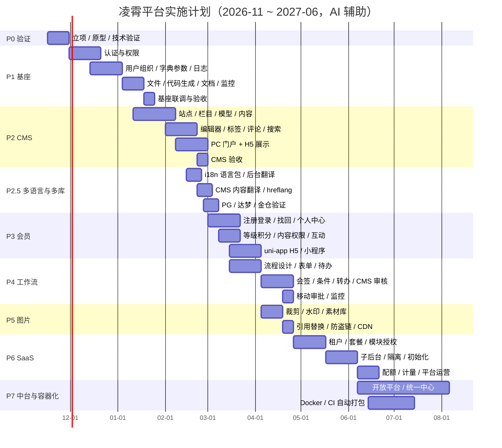

# 13 · 实施路线图、排期与风险

> 基准：2026-11-16 启动，**AI 辅助开发为主（核心 2~3 人 + AI 助手）**，完整版约 6~8 个月。
> **v1.0 只做后台基座（6 周，见 `17-v1-plan.md`）**；含 CMS / 门户的 MVP 约 3~4 个月，CMS / 会员 / 门户按 `20-cms-embed-plan.md` 以模块嵌入。
> 排期按“契约先行 + 代码生成 + 并行 + 阶段门禁”估算，实际以 AI 采用度与评审效率校准。

---

## 1. 阶段总览

| 阶段 | 周期 | 目标 | 关键交付 | 门禁 |
|---|---|---|---|---|
| P0 立项与验证 | 2 周 | 技术风险清零 | 双账号 Demo、模块开关 Demo、JDK 矩阵、图片管线 Demo、原型 | 4 个 Demo 通过 |
| P1 后台基座（v1.0） | 6 周 | 可用后台 | 登录 / 验证码 / 用户 / 角色 / 菜单 / 部门 / 岗位 / 字典 / 配置 / 公告 / 日志 / 文件中心 / 监控 / 定时任务 / 代码生成 / 文档 | 权限闭环 + 关闭态启动 + 三 JDK 冒烟 |
| P2 CMS | 6~8 周 | 内容闭环 | 站点 / 栏目 / 模型 / 内容 / 标签 / 编辑器 / 审核 / PC + H5 展示 | 发文 → 发布 → 前台可见 |
| P2.5 多语言与多库 | 3~4 周 | 国际化与信创基线 | 语言包热加载 / 后台与门户翻译 / CMS 内容翻译 / PG + 达梦 + 金仓验证 | 语言切换 + 多库冒烟 |
| P3 会员前台 | 4~6 周 | 会员体系 | 注册 / 登录 / 找回 / 个人中心 / 等级积分 / 评论收藏 / uni-app | 注册 → 登录 → 找回 → 改密 |
| P4 工作流 | 4~6 周 | 审批能力 | 设计器 / 表单 / 待办 / 审批 / 委托 / CMS 审核 | 发起 → 审批 → 状态回写 |
| P5 图片增强 | 2~3 周 | 图片运营 | 裁剪 / 水印 / 素材库 / 引用替换 / CDN | 裁剪水印引用全链路 |
| P6 SaaS | 6~8 周 | 多租户 | 租户 / 套餐 / 模块授权 / 隔离 / 初始化 / 配额 | 两租户数据隔离 |
| P7 中台 | 持续 | 平台化 | 开放平台 / 统一用户 / 消息 / 搜索 / 支付 / 数据 | 按业务触发 |

---

## 2. 甘特图



> 甘特图按“完整版”排；MVP 截止到 P2 验收（约 2027-02 下旬）。P2.5 为跨阶段专项，与 P3 / P4 部分并行；Docker / CI 自动化放在 P7，不影响首发 jar 部署。

---

## 3. 里程碑与验收

| 里程碑 | 时间 | 验收标准 |
|---|---|---|
| M0 技术验证 | 2026-11-27 | 双账号 Demo、模块开关 Demo、JDK 8/11/17 启动、图片裁剪水印 Demo |
| M1 基座可用 | 2027-01-25 | 建角色 → 配菜单 → 建用户 → 登录 → 权限生效 → 越权 403 |
| M2 内容闭环 | 2027-02-26 | 建模型 → 建栏目 → 发文 → 审核 → 发布 → PC/H5 可见 → 下线 |
| M2.5 多语言与多库 | 2027-03-08 | 后台 / 门户切换语言生效；CMS 内容翻译可发布；PG / 达梦 / 金仓核心流程通过 |
| M3 会员闭环 | 2027-03-26 | 注册 → 登录 → 找回 → 改密 → 个人中心 → 评论收藏 |
| M4 审批闭环 | 2027-04-26 | 发起 → 待办 → 同意/驳回 → 状态回写 → 流程图 |
| M5 图片运营 | 2027-04-26 | 上传 → 裁剪 → 水印 → 引用 → 替换 → 前台更新 |
| M6 多租户 | 2027-06-21 | 两租户数据隔离、子用户只看到套餐菜单、配额生效 |
| M7 中台 | 2027-06+ | 开放平台可创建应用、调用受控接口、计量可查 |
| M8 容器化 | 2027-07 | Docker 镜像 + CI 自动打包 + compose 一键启动 |

---

## 4. 团队配置（AI 辅助开发）

| 角色 | 人数 | 职责 |
|---|---|---|
| 架构 / 全栈负责人 | 1 | 架构、权限、模块开关、多租户边界、核心后端、代码评审、技术攻坚 |
| 后端开发 | 1（可 0.5） | 基座、CMS、会员、工作流、SaaS |
| 前端开发 | 1 | Vue3 管理端、Nuxt3 门户、uni-app |
| 产品 / 测试 | 0.5~1 | 需求、原型、验收、越权 / 回归 / 性能 |
| AI 编程助手 | — | 代码生成、模板、单测、文档、SQL 初稿；不替代评审与验收 |

**为什么这样配：**

- AI 对“写代码”加速明显，对“定契约、评审、联调、验收、上线”帮助有限；瓶颈从编码转移到设计与验证。
- 核心 2~3 人必须覆盖“后端 + 前端 + 产品/测试”三条线，否则并行度不够。
- 架构 / 全栈负责人不可省：双账号、模块开关、租户边界一旦做错，后期返工巨大。
- 测试不可完全外包给 AI：越权、租户隔离、内容权限、上传安全必须人工设计用例。

### 4.1 AI 辅助开发约定（必须写进仓库）

1. **契约先行**：表结构、API、权限码、错误码、i18n key 先定，AI 只按契约生成。
2. **生成物必须过门禁**：编译、单测、静态检查、依赖漏洞扫描、Flyway 校验，缺一不可。
3. **人工评审重点**：权限、租户、SQL、文件上传、密钥、支付相关代码逐行看。
4. **禁止改历史迁移**：AI 只能新增 Flyway 脚本，不能改已发布脚本。
5. **规范入库**：`AGENTS.md` / `.ai/` 放编码规范、模板、提示词、示例，保证多人一致。
6. **禁止来源不明代码**：检查 License 与供应链，不直接粘贴未知来源片段。
7. **测试即验收**：核心链路必须有集成测试；AI 生成的测试要人工确认断言有效。
8. **文档同 PR**：接口、错误码、i18n key、表结构变更必须同步文档。
9. **小步提交**：一个 PR 只做一件事，便于回滚与评审。
10. **人工兜底**：AI 不可用时，核心链路仍能由 2~3 人手动推进。

---

## 5. 工作量估算（人月）

| 阶段 | 后端 | 前端 | 测试 / UI / DevOps | 合计 |
|---|---:|---:|---:|---:|
| P0 | 2 | 1 | 0.5 | 3.5 |
| P1 | 8 | 3 | 1.5 | 12.5 |
| P2 | 7 | 4 | 1.5 | 12.5 |
| P2.5 | 3 | 1.5 | 1 | 5.5 |
| P3 | 4 | 3 | 1 | 8 |
| P4 | 5 | 2 | 1 | 8 |
| P5 | 2 | 1 | 0.5 | 3.5 |
| P6 | 6 | 3 | 1.5 | 10.5 |
| P7 | 6 | 3 | 1 | 10 |
| **合计** | **43** | **21.5** | **9.5** | **74** |

> 上表为**传统人月**基准。AI 辅助后：编码类（后端 / 前端）约 ×0.5~0.7，测试 / UI / DevOps 约 ×0.9（评审、联调、验收不会等比压缩）。
> 折算后约 **46~55 人月**；再留 15%~20% buffer，总预算约 **53~66 人月**。若 AI 采用度高、契约稳定，取低值；若需求频繁变更，取高值。

---

## 6. 版本策略

| 版本 | 范围 | 面向 |
|---|---|---|
| v0.1 技术验证 | P0 | 内部 |
| **v1.0 后台基座** | P1（6 周，见 `17`） | 私有化客户 / 种子客户 |
| v1.1 内容平台 | + P2（CMS 模块嵌入） | 内容客户 |
| v1.2 会员版 | + P3（会员模块嵌入） | 内容运营客户 |
| v1.3 门户版 | + 门户 Nuxt3 | 内容客户 |
| v1.4 国际化 / 审批版 | + P2.5 + P4 + P5 | 出海 / 信创 / 企业客户 |
| v2.0 SaaS | + P6 | 平台运营 |
| v3.0 中台 | + P7（Docker / CI） | 生态 / 多产品线 |

---

## 7. 风险登记表

| # | 风险 | 概率 | 影响 | 应对 | 负责人 |
|---|---|---|---|---|---|
| R1 | 范围过大导致延期 | 高 | 高 | MVP 切分、阶段门禁、开关后置 | PM |
| R2 | JDK / Boot3 线维护成本 | 低 | 中 | 主线 8，17 仅 CI 冒烟，Boot3 分支延后 | 架构 |
| R3 | 双账号权限设计缺陷 | 中 | 高 | P0 Demo 验证、越权专项测试 | 架构 |
| R4 | 多租户越权 | 中 | 高 | 上下文强制、跨租户测试、代码评审 | 后端 |
| R5 | Flowable 复杂度 / 表膨胀 | 中 | 中 | 四件套先行、SPI、归档 | 后端 |
| R6 | CMS 动态模型性能 | 中 | 中 | JSON + 生成列、压测、ES 后置 | 后端 |
| R7 | 三端体验不一致 | 中 | 中 | 设计规范、组件库、契约测试 | 前端 |
| R8 | 图片处理 CPU / 存储 | 中 | 中 | 异步、限尺寸、WebP、CDN、配额 | 后端 |
| R9 | 客户需求变更 | 高 | 高 | 变更评审、版本规划、合同边界 | PM |
| R10 | 信创 / 数据库兼容 | 中 | 高 | 提前验证达梦 / 金仓、方言层、多库 CI | 架构 |
| R11 | 安全合规（等保 / 隐私） | 中 | 高 | 脱敏、审计、注销、渗透测试 | 测试 |
| R12 | 关键人员流失 | 低 | 高 | 文档、代码评审、模块负责人制 | PM |
| R13 | 翻译键失控 / 缺翻译 | 中 | 中 | 命名规范、发布检查、覆盖率看板 | 前端 |
| R14 | 多库 DDL 漂移 | 中 | 高 | 统一 schema 生成、CI diff、客户环境验收 | 架构 |
| R15 | AI 生成代码有幻觉 / 越权 / 漏校验 | 高 | 高 | 契约先行、门禁、重点代码人工逐行评审、集成测试 | 架构 |
| R16 | AI 生成代码来源 / License 风险 | 中 | 中 | 依赖与片段来源审查、SCA + License 扫描、SBOM、禁止粘贴不明来源 | 架构 |
| R17 | 单租户转多租户返工 | 中 | 高 | P0 门禁检查 `tenant_id` / `TenantContext` / 缓存 Key；关闭态回归 | 后端 |
| R18 | 人力过少导致评审 / 测试积压 | 高 | 高 | 控制范围、MVP 优先、测试用例模板化、必要时加 1 名测试 | PM |
| R19 | 开源组件供应链 / 停维护 / 许可证变更 | 中 | 高 | 版本锁定、SBOM、许可证台账、关键组件保留替换预案（搜索 / 存储 / 调度 / 工作流） | 架构 |

---

## 8. 阶段门禁

### P0 → P1

- [ ] 双账号 Demo：后台 / 会员 Token 互不通用。
- [ ] 模块开关 Demo：关闭 CMS 后接口 404、Bean 不加载。
- [ ] 单租户 Demo：`tenant_id` 默认 0、`TenantContext` 常驻、关闭 `saas` 时无租户表 / 接口。
- [ ] JDK 8/11/17 同一 jar 启动。
- [ ] jar 直部署 Demo：`java -jar` + Nginx + MySQL / Redis。
- [ ] 图片上传 → 裁剪 → 水印 Demo。
- [ ] 原型评审通过（后台 + 门户 + H5）。

### P1 → P2

- [ ] 权限闭环：角色 / 菜单 / 用户 / 数据权限。
- [ ] 代码生成器可生成并编译。
- [ ] 文件上传 / 存储配置可用。
- [ ] 三 JDK CI 全绿。
- [ ] 安全基线自查通过。

### P2 → P2.5

- [ ] 内容发布闭环。
- [ ] PC 门户 SEO / 首屏达标。
- [ ] H5 列表 / 详情可用。
- [ ] 内容权限截断验证。

### P2.5 → P3

- [ ] 后台 / 门户 `zh-CN` / `en-US` 切换生效。
- [ ] 语言包发布 5s 内生效，回滚可用。
- [ ] CMS 内容翻译可发布，hreflang 正确。
- [ ] 同一代码在 MySQL / PG 通过集成测试。
- [ ] 达梦 / 金仓核心流程在目标环境通过。

### P3 → P4

- [ ] 注册 / 登录 / 找回 / 改密闭环。
- [ ] 会员 Token 与后台 Token 隔离。
- [ ] 评论 / 收藏 / 个人中心可用。

### P4 → P5

- [ ] 串行 / 会签 / 驳回 / 转办可用。
- [ ] CMS 审核集成。
- [ ] 移动审批可用。

### P5 → P6

- [ ] 裁剪 / 水印 / 引用 / 替换闭环。
- [ ] 防盗链 / 签名 URL 验证。

### P6 → P7

- [ ] 两租户隔离测试通过。
- [ ] 子用户菜单不超过套餐。
- [ ] 配额 / 计量 / 限流生效。
- [ ] 租户初始化可重试。
- [ ] **单租户回归**：关闭 `saas` 后系统正常启动，无租户表 / 接口 / 菜单，业务 `tenant_id=0`。

### P7 → 交付

- [ ] 开放平台应用 / 凭证 / 限流 / 计量可用。
- [ ] Dockerfile + compose + CI 自动打镜像可用。
- [ ] jar 与容器两种方式启动结果一致。
- [ ] 备份 / 回滚 / 监控演练通过。

---

## 9. 上线清单

### 9.1 基础设施（首发 jar）

- [ ] JDK 运行时确认（首发建议 JDK 8 或 11；17 冒烟通过即可）。
- [ ] `lx-boot.jar` + `application-prod.yml` + 启动脚本 / systemd。
- [ ] Nginx 反代 + 静态资源 + TLS + 上传大小限制。
- [ ] 数据库选型与版本锁定（首发 MySQL 8；PG 16 同步 CI；达梦 / 金仓按项目）。
- [ ] MySQL 主从 + 备份（或对应厂商高可用）。
- [ ] Redis 集群 / 哨兵。
- [ ] 本地文件目录（默认）+ 备份；需要时切 MinIO / OSS。
- [ ] 域名 / 备案 / ICP。
- [ ] 邮件 / 短信通道。
- [ ] 日志 / 监控 / 告警。
- [ ] 后期：Dockerfile / compose / 镜像仓库 / CI 自动打包（P7）。

### 9.2 应用

- [ ] 生产配置（数据库、Redis、存储、密钥）。
- [ ] Flyway 迁移执行。
- [ ] 管理员账号 / 初始密码。
- [ ] 模块开关确认（生产关闭 generator 与 saas；首发单租户）。
- [ ] 验证码 / 密码策略 / 登录锁定。
- [ ] 文件大小 / 类型 / 水印策略。
- [ ] 日志级别 / 脱敏。
- [ ] 定时任务 / 消息模板。
- [ ] 默认语言 / 启用语言（首发 `zh-CN`，`en-US` 预留）。
- [ ] 语言包发布 / 回滚验证。
- [ ] 数据库厂商 / 版本 / 驱动确认。
- [ ] JVM 参数（`-Xms/-Xmx`、GC、`-Duser.timezone`、日志路径）。

### 9.3 安全

- [ ] 默认密码全部修改。
- [ ] 数据库 / Redis 不暴露公网。
- [ ] 密钥不进 Git。
- [ ] HTTPS / HSTS / CSP。
- [ ] 越权 / XSS / SQL 注入 / 上传测试。
- [ ] 依赖漏洞扫描。
- [ ] 审计日志开启。
- [ ] 备份恢复演练。

### 9.4 业务

- [ ] 站点 / 栏目 / 模型 / 初始内容。
- [ ] 默认语言内容 + 目标语言翻译。
- [ ] 多语言 sitemap / hreflang / canonical。
- [ ] 会员等级 / 权益。
- [ ] 审批流程 / 表单。
- [ ] 租户 / 套餐（如启用 SaaS）。
- [ ] 门户 SEO / sitemap / robots。
- [ ] 404 / 500 页面。
- [ ] 用户培训 / 操作手册。

### 9.5 发布与回滚

- [ ] 发布窗口 / 公告。
- [ ] 蓝绿 / 滚动策略。
- [ ] 数据库向前兼容。
- [ ] 回滚 jar / 镜像 / 脚本。
- [ ] 发布后冒烟：登录、发文、前台、上传、审批。
- [ ] 监控观察 30 分钟。
- [ ] 值班表 / 应急联系人。

---

## 10. 上线后 30 天

| 周 | 重点 |
|---|---|
| W1 | 稳定性、登录 / 发布 / 上传异常、告警处理 |
| W2 | 性能调优、慢 SQL、缓存命中、图片体积 |
| W3 | 用户反馈、权限 / 流程配置修正、培训 |
| W4 | 复盘、 backlog 排序、下一版本规划 |

---

## 11. 建议的“不要做”清单

- 不要首发微服务。
- 不要重复造轮子：权限、菜单、分页、上传、Excel、工作流引擎、富文本内核、流程设计器全部复用成熟组件。
- 不要引入 GPL / AGPL / SSPL 组件而不做合规评估；调度不用 XXL-Job，搜索不用 Elasticsearch，CMS 内核不用 Halo。
- 不要首发 Docker / K8s 自动化，jar 能上线就先上线。
- 不要首发 SaaS；但必须保留 `tenant_id` 与 `TenantContext`。
- 不要让 AI 生成的代码跳过评审、测试与依赖扫描。
- 不要首发全量静态化集群。
- 不要首发复杂计费 / 支付。
- 不要为每个租户建独立库（除非客户付费）。
- 不要自研工作流引擎 / 富文本内核。
- 不要把所有配置都做成数据库开关。
- 不要在没有越权测试的情况下上线多租户。
- 不要为了 JDK 17 放弃 JDK 8 主线。
- 不要在业务 Mapper 里写 `find_in_set` / `ON DUPLICATE KEY` / `limit`。
- 不要手写四套 DDL 后各改各的，必须由统一 schema 生成。
- 不要把面向用户的文案硬编码在 Java / Vue 里。
- 不要在没有多库 CI 的情况下承诺“兼容国产数据库”。
- 不要在 P1 就把 CMS / 会员 / 工作流全部打开。
- 不要让代码生成器生成“不能编译”的代码。

---

## 12. 待办清单（2026-11-17 记录，尚未开工）

> 背景：v1.0 基座 + README 双语 + 多语言 L1 已收口（`1a3333b`）。
> 下面两项是**已声明能力与实现之间的缺口**，优先于新版本功能。
> 每项都写了验收标准，开工时按此逐条勾。

### 12.1 P0：权限到按钮（已完成，2026-11-18）

**复核结论**：`v-hasPerm` 并不是没做——13 个页面已有 **46 处**使用（第一次核查按
`v-permission` 搜索所以漏掉了）。2026-11-18 补齐最后 2 个缺口后，覆盖完整。

已覆盖：用户 / 角色 / 菜单 / 部门 / 岗位 / 字典 / 参数 / 公告 / 任务 / 生成器 /
在线用户 / 操作日志 / 登录日志。

| 本次补齐 | 内容 |
|---|---|
| 文件中心 | `FileLibrary.vue` 上传按钮 `platform:file:upload`、改名按钮 `platform:file:rename` |
| 用户启停用 | 行内 `el-switch` 增加 `:disabled="!canEditUser"`（`platform:system:user:edit`），与任务页 `canChangeStatus` 口径一致 |
| 文档 | `lx-modules/lx-module-system/README.md` 删除“前端指令待做”的过期描述 |

**验收结果**（2026-11-18，本地只读角色 `readonly_test`，仅授 M/C 菜单）：

```text
readonly permissions=18，无任何 add/edit/remove/clean/kickout/upload/rename
POST /admin/system/user        → 403 {"code":1003,"msg":"没有权限执行该操作"}
DELETE /admin/system/oper-log/clean → 403 {"code":1003}
GET  /admin/system/user/list   → 200 code=0，dataScope=5 只返回本人 1 行
```

浏览器逐页（只读账号）：14 个页面只剩 `搜索 / 重置 / 刷新 / 详情 / 预览 / 复制链接`；
用户启停用、任务启停用开关均为禁用态。admin 复查：新增 / 编辑 / 删除 / 重置密码 /
上传 / 改名 / 执行一次 / 日志全部可见。`smoke.mjs` 超管回归 22/22，控制台 0 error。

> 验证脚本 `.local/uitest/perm-check.mjs`（建只读角色 → 建账号 → 验证 → 清理）
> 只在本地跑，不入库；测试账号与角色验收后已删除。

**验收**：只读账号 14 个页面看不到写按钮；超管全功能不回归；README 与实际一致。

**参考权限码**（Flyway V4 / V8 / V10 / V11 + 文件、生成器，共 64 个，
按钮级约 40 个，前缀 `platform:`）：

```text
system:user:add|edit|remove|resetPwd|unlock
system:role|menu|dept|post|dict|config|notice:add|edit|remove
monitor:job:add|edit|remove|run|changeStatus|log|log:clean
monitor:operlog:clean  monitor:loginlog:clean  monitor:online:kickout
file:upload  file:rename
tool:gen:import|edit|preview|remove|download
```

### 12.2 P0：数据范围「2 自定义」

**现状**：`sys_role_dept` 表不存在，保存 `data_scope=2` 直接拒绝，降级为仅本人；
部门 / 角色列表也未按数据范围过滤。`lx-modules/lx-module-system/README.md`
第 8、226、235 行都标着“待补”。

| 步骤 | 内容 |
|---|---|
| 1 | Flyway 新增 `sys_role_dept(role_id, dept_id)` + 唯一索引 + 必要外键 / 注释 |
| 2 | `SysRoleService` 保存 / 详情带 `deptIds`（先清后插，`null` = 不修改） |
| 3 | `DataScopeService` 对 `2` 返回自定义部门集合；多角色仍取最大范围 |
| 4 | 用户列表 `applyUserScope` 支持多部门 `IN`；部门列表、角色列表补同口径过滤 |
| 5 | 前端角色页加部门树多选（仅 `data_scope=2` 显示），详情回显 |
| 6 | 单测：自定义范围命中 / 空集合收紧为仅本人 / 超管放行 / 多角色取最大 |

**验收**：选「自定义」并勾 2 个部门后，该角色用户只看到这两个部门及其用户；
清空部门保存被拒绝；单测覆盖上述四种边界。

### 12.3 P1：L2 多语言设计（只写方案，v1.2 再实现）

- `docs/15-i18n.md` 定稿：`i18n_language` / `i18n_key` / `i18n_text` 三张表；
- 明确哪些翻译：字典 `label`、参数名 / 说明、菜单名、公告标题 / 正文、CMS 内容；
- 说明 L1 的 `menu_key` / `dict.<type>.<value>` / `config.<config_key>` 如何平滑迁到 L2；
- 给出回退链：`请求语言 → 默认语言 → 数据库原文`，以及缓存策略（Caffeine / Redis）；
- 产出评审结论后再排期，避免先写代码后改表。

### 12.4 P1：发布包演练

- `deploy/package.ps1` / `.sh` 打包（jar + 前端 dist + SQL + 脚本）；
- 解压到干净目录，用 `application-prod.yml` + Nginx 跑通登录 / 上传 / 生成器关闭；
- 写部署核对清单（JDK、时区、上传目录权限、Flyway、健康检查、回滚）。

### 12.5 P2：零散小活（各 30 分钟内）

- README / README.en 补 3 张英文界面截图（登录、列表、监控），双语现在只有中文图；
- `docs/21-build-log.md` 目录 / 索引补 §41；
- 清理 `docs/23` §7 中已被本轮实现覆盖的“暂缓”条目；
- 核对 `docs/22` 前端依赖表与 `package-lock.json` 是否仍有偏差。
