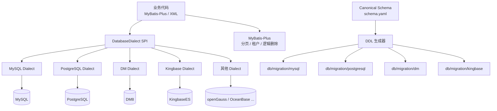

# 14 · 多数据库兼容（MySQL / PostgreSQL / 国产数据库）

> 目标：同一套业务代码与领域模型，可部署在 **MySQL 5.7/8.0、PostgreSQL 12~16、达梦 DM8、人大金仓 KingbaseES V8**，并为神通、瀚高、openGauss/GaussDB、OceanBase 等保留适配位。
>
> 原则：**业务不写数据库方言；DDL 由统一模型生成；差异收敛到 Dialect SPI 与厂商迁移脚本。**

---

## 1. 兼容分级

| 级别 | 数据库 | 承诺 | 验证方式 |
|---|---|---|---|
| L1 完全支持 | MySQL 5.7 / 8.0 | 功能全量、性能基线、CI 每次跑 | Testcontainers + 集成测试 |
| L1 完全支持 | PostgreSQL 12~16 | 功能全量、性能基线、CI 每次跑 | Testcontainers + 集成测试 |
| L2 认证支持 | 达梦 DM8 | 核心功能、信创环境验收 | 厂商环境 / 客户环境 +  nightly |
| L2 认证支持 | 人大金仓 KingbaseES V8（PG 模式） | 核心功能、信创环境验收 | 厂商环境 / 客户环境 + nightly |
| L3 适配支持 | 神通、瀚高、openGauss/GaussDB、OceanBase、TiDB | 按项目适配，不承诺全量 | 项目制验证 |
| 不承诺 | SQL Server、Oracle | 如需，单独评估 | — |

> 国产库版本差异大，必须锁定具体版本（如 DM8 8.1.x、KingbaseES V8R6），并在合同中写明。

---

## 2. 总体架构



**三层隔离：**

1. **ORM 层**：MyBatis-Plus 统一分页、租户、逻辑删除；`DbType` 自动识别。
2. **方言层**：`DatabaseDialect` 提供函数、分页、JSON、Upsert、树查询等差异。
3. **DDL 层**：统一 schema 模型生成各厂商迁移脚本，Flyway 按厂商执行。

---

## 3. 关键设计决策

| 决策 | 结论 | 原因 |
|---|---|---|
| 主键 | **应用侧雪花 ID**（`IdType.ASSIGN_ID`） | 不依赖自增 / 序列，跨库、迁移、分片都稳定 |
| 时间 | 应用侧填充 `create_time/update_time` | 不依赖 `ON UPDATE CURRENT_TIMESTAMP` / 触发器 |
| 布尔 | `smallint` 0/1 | MySQL `tinyint(1)`、PG `boolean`、DM `number(1)` 差异大 |
| JSON | 逻辑类型 JSON，物理按厂商映射 | MySQL `json`、PG `jsonb`、DM/金仓 `clob`/`json` |
| 树结构 | **闭包表 / 递归查询二选一** | 不依赖 MySQL `find_in_set` |
| 全文检索 | 统一走搜索服务（ES）或应用层 | 各库全文语法差异大 |
| 自增 / 序列 | 禁用 | 跨库 DDL 与数据迁移成本高 |
| 存储过程 / 触发器 | 禁用 | 难移植、难调试 |
| 窗口函数 / CTE | 仅 MySQL 8 / PG / DM 新版本使用 | MySQL 5.7 不支持，需降级实现 |
| 标识符 | 小写下划线，不加引号 | PG 会折叠大小写，避免 "User" / user 问题 |

---

## 4. 类型映射

| 逻辑类型 | MySQL | PostgreSQL | 达梦 DM8 | 人大金仓 | 备注 |
|---|---|---|---|---|---|
| BIGINT | `bigint` | `bigint` | `bigint` | `bigint` | 雪花 ID |
| INT | `int` | `integer` | `int` | `integer` | |
| SMALLINT | `smallint` | `smallint` | `smallint` | `smallint` | 布尔 0/1 |
| DECIMAL | `decimal(18,2)` | `numeric(18,2)` | `decimal(18,2)` | `numeric(18,2)` | 金额 |
| VARCHAR | `varchar(n)` | `varchar(n)` | `varchar(n)` | `varchar(n)` | 长度按字符 |
| TEXT | `longtext` | `text` | `clob` | `text` | 正文 |
| DATETIME | `datetime` | `timestamp` | `timestamp` | `timestamp` | 应用填充 |
| DATE | `date` | `date` | `date` | `date` | |
| BOOLEAN | `smallint` | `smallint` | `smallint` | `smallint` | 0/1 |
| JSON | `json` | `jsonb` | `clob` / `json` | `jsonb` / `text` | 能力探测 |
| BLOB | `longblob` | `bytea` | `blob` | `bytea` | 少用，文件走对象存储 |
| CHAR | `char(n)` | `char(n)` | `char(n)` | `char(n)` | 状态位 |

**DDL 生成规则：**

- 不使用 `unsigned`、`zerofill`、`enum`、`set`、`tinyint(1)`。
- 不使用 `AUTO_INCREMENT`；主键由应用生成。
- 不使用 `ON UPDATE CURRENT_TIMESTAMP`；由 `MetaObjectHandler` 填充。
- 注释：MySQL 用列内 `COMMENT`，PG/DM/金仓用 `COMMENT ON COLUMN`。
- 索引：统一 `CREATE INDEX`；不使用 PG 部分索引、MySQL 前缀索引等特性，除非厂商脚本单独处理。
- 字符集：MySQL `utf8mb4`；PG/DM/金仓用数据库默认 UTF-8。
- Schema：PG/金仓 `public`，DM 用用户 Schema，MySQL 用 database；通过配置指定。

---

## 5. 禁止使用的方言特性

| 特性 | 问题 | 替代 |
|---|---|---|
| `AUTO_INCREMENT` / `SERIAL` | 各库语法不同 | 雪花 ID |
| `ON DUPLICATE KEY UPDATE` | MySQL 专属 | 先查后写 / `MERGE` 方言 / 唯一约束 + 重试 |
| `INSERT IGNORE` / `REPLACE INTO` | MySQL 专属 | 唯一约束 + 捕获异常 |
| `LAST_INSERT_ID()` | MySQL 专属 | 应用生成 ID |
| `find_in_set()` | MySQL 专属 | 闭包表 / 递归查询 / 应用层 |
| `group_concat()` | MySQL 专属 | `string_agg` / `listagg` 方言 / 应用层聚合 |
| `date_format()` | MySQL 专属 | `to_char` 方言 / 应用层格式化 |
| `ifnull()` | MySQL 专属 | `coalesce()`（多数库支持） |
| `now()` / `sysdate` | 语法不同 | 应用时间 |
| `limit` / `rownum` | 分页语法不同 | MyBatis-Plus 分页 |
| `json_extract()` | 各库不同 | JSON Dialect / 应用层解析 |
| `match ... against` | MySQL 全文 | ES / 应用层搜索 |
| `unsigned` | MySQL 专属 | 普通整数 + 校验 |
| `tinyint(1)` | 语义不同 | `smallint` |
| `enum` / `set` | MySQL 专属 | `varchar` + 字典 |
| `engine=InnoDB` | MySQL 专属 | 厂商 DDL 脚本处理 |
| 窗口函数 | MySQL 5.7 不支持 | 应用层 / 降级 SQL |
| CTE | MySQL 5.7 不支持 | 临时表 / 应用层 |
| 存储过程 / 触发器 | 难移植 | 应用层 |
| `@变量` | MySQL 会话变量 | 参数化 SQL |

> 代码评审 checklist：出现上述关键字，必须走 Dialect 或厂商脚本，不能散落在业务 Mapper。

---

## 6. Dialect SPI

```java
public interface DatabaseDialect {

    DatabaseVendor vendor();

    /** 分页 SQL 由 MyBatis-Plus 处理，这里只处理特殊场景 */
    String limit(String sql, long offset, long size);

    /** 树查询：find_in_set 替代 */
    String findInSet(String column, String value);

    /** JSON 取值 */
    String jsonExtract(String column, String path);

    /** 日期格式化 */
    String dateFormat(String column, String pattern);

    /** 字符串聚合 */
    String groupConcat(String column, String separator);

    /** Upsert */
    String upsert(String table, List<String> columns, List<String> conflictColumns);

    /** 当前时间（仅特殊场景，优先应用时间） */
    String currentTimestamp();

    /** 标识符引用 */
    String quote(String identifier);

    /** 数据库能力 */
    DbCapabilities capabilities();
}

public class DbCapabilities {
    private boolean json;
    private boolean jsonIndex;
    private boolean fullText;
    private boolean windowFunction;
    private boolean cte;
    private boolean upsert;
    private boolean returning;
}
```

**注册与选择：**

```java
@Component
public class DialectRegistry {
    private final Map<DatabaseVendor, DatabaseDialect> dialects;

    public DatabaseDialect current() {
        return dialects.get(DatabaseVendorHolder.get());
    }
}
```

- 启动时通过 `DatabaseMetaData.getDatabaseProductName()` 识别厂商。
- 支持配置覆盖：`lx.db.vendor=mysql|postgresql|dm|kingbase|opengauss`。
- 识别失败直接启动失败，不允许“猜”。

---

## 7. MyBatis-Plus 配置

```java
@Bean
public MybatisPlusInterceptor mybatisPlusInterceptor(DatabaseDialect dialect) {
    MybatisPlusInterceptor interceptor = new MybatisPlusInterceptor();

    PaginationInnerInterceptor pagination =
        new PaginationInnerInterceptor(dialect.dbType());
    pagination.setMaxLimit(500L);
    interceptor.addInnerInterceptor(pagination);

    interceptor.addInnerInterceptor(new TenantLineInnerInterceptor(...));
    interceptor.addInnerInterceptor(new OptimisticLockerInnerInterceptor());
    interceptor.addInnerInterceptor(new BlockAttackInnerInterceptor());
    return interceptor;
}
```

`DbType` 映射：

| 厂商 | MyBatis-Plus `DbType` |
|---|---|
| MySQL | `MYSQL` |
| PostgreSQL | `POSTGRE_SQL` |
| 达梦 | `DM` |
| 人大金仓 | `KINGBASE_ES` |
| openGauss | `OPENGAUSS` / `GAUSS` |
| OceanBase | `OCEAN_BASE` |
| TiDB | `TIDB` |

**注意：**

- 分页插件必须显式指定 `DbType`，不要依赖自动探测（多数据源下会错）。
- 逻辑删除、乐观锁、租户插件与厂商无关，可复用。
- 多数据源（主从 / 租户独立库）时，每个数据源绑定自己的 `DatabaseDialect`。

---

## 8. DDL 与迁移

### 8.1 统一 Schema 模型

```yaml
# db/schema/cms.yaml
table: cms_content
comment: CMS内容
columns:
  - name: content_id
    type: bigint
    primaryKey: true
    comment: 内容ID
  - name: tenant_id
    type: bigint
    notNull: true
    default: 0
  - name: title
    type: varchar
    length: 255
    notNull: true
  - name: ext_json
    type: json
    nullable: true
  - name: publish_time
    type: datetime
indexes:
  - name: idx_content_cat
    columns: [tenant_id, site_id, category_id, status, publish_time]
```

生成器输出：

```text
db/migration/mysql/cms/V1.0.0__cms_content.sql
db/migration/postgresql/cms/V1.0.0__cms_content.sql
db/migration/dm/cms/V1.0.0__cms_content.sql
db/migration/kingbase/cms/V1.0.0__cms_content.sql
```

### 8.2 Flyway 按厂商执行

```java
String vendor = DatabaseVendorHolder.get().code(); // mysql / postgresql / dm / kingbase
List<String> locations = enabledModules.stream()
    .map(m -> "classpath:db/migration/" + vendor + "/" + m)
    .collect(Collectors.toList());

Flyway.configure()
    .dataSource(dataSource)
    .locations(locations.toArray(new String[0]))
    .table("flyway_" + vendor + "_history")
    .baselineOnMigrate(true)
    .load()
    .migrate();
```

- 每个厂商独立 history 表，互不干扰。
- 同一版本号在各厂商目录中保持一致，便于对账。
- 迁移脚本只前进，不修改历史。
- 生成器 + 人工评审：自动生成后必须 diff 审查，尤其是索引、默认值、注释。

### 8.3 为什么不用纯 Flyway 手写四套

- 30+ 表 × 4 厂商，手写必然漂移。
- 用统一模型生成，保证字段、索引、注释一致。
- 厂商特殊语法（DM 的 `clob`、PG 的 `jsonb`、金仓的 `jsonb`）在模板中处理。
- 如团队更倾向 Liquibase，可用 `dbms` 属性做同样的事；本项目选 Flyway + 生成器，原因是国产库支持更直接、SQL 可控。

---

## 9. 树结构：不要用 `find_in_set`

RuoYi 用 `ancestors` + `find_in_set` 查子树，这在 MySQL 可用，PG/DM 不可移植。

**方案 A：闭包表（推荐，兼容 MySQL 5.7）**

```sql
CREATE TABLE sys_dept_closure (
  ancestor_id   bigint NOT NULL,
  descendant_id bigint NOT NULL,
  depth         int NOT NULL,
  PRIMARY KEY (ancestor_id, descendant_id)
);
```

- 新增部门：插入自身 + 所有祖先关系。
- 移动部门：重算子树闭包。
- 查子树：`where ancestor_id = ?`。
- 查祖先：`where descendant_id = ?`。
- 跨库、索引友好、层级深也稳定。

**方案 B：递归 CTE**

- MySQL 8 / PG / DM 新版本支持；MySQL 5.7 不支持。
- 适合层级浅、查询少的场景。

**结论：** 部门、栏目、评论、菜单等树结构统一用闭包表；`ancestors` 字段仅用于展示 / 兼容。

---

## 10. JSON 字段

| 能力 | MySQL | PostgreSQL | DM8 | Kingbase |
|---|---|---|---|---|
| 原生 JSON | `json` | `jsonb` | 部分版本 `json` / `clob` | `jsonb` / `text` |
| 取值 | `json_extract` | `->` / `->>` | 厂商函数 / 应用层 | `->` / `->>` |
| 索引 | 生成列 + 索引 | GIN / 表达式索引 | 有限 | GIN / 表达式索引 |
| 更新 | `json_set` | `jsonb_set` | 应用层 | `jsonb_set` |

**策略：**

- 逻辑类型 `JSON`，物理映射由 Dialect 决定。
- 不支持原生 JSON 的库，存 `clob/text`，应用层 Jackson 解析。
- 高频查询字段抽生成列 / 独立列；不要依赖 JSON 做复杂查询。
- 全文检索走 ES，不依赖各库 JSON 全文能力。

---

## 11. 分页、排序、大小写

| 问题 | 处理 |
|---|---|
| 分页 | MyBatis-Plus `PaginationInnerInterceptor`，显式 `DbType` |
| 深分页 | 游标 / 延迟关联；限制最大页 |
| 排序 | 字段白名单；NULL 排序显式指定（`nulls last` 方言） |
| 大小写 | 标识符小写下划线；字符串比较统一 `lower()` 或数据库排序规则 |
| `LIKE` 大小写 | MySQL 默认不敏感、PG 敏感；需要时 `lower(column) like lower(?)` |
| 空字符串 vs NULL | 统一用 NULL 表示“无”，避免 Oracle 式空串歧义 |
| 时间时区 | 应用统一 `Asia/Shanghai`，数据库存 `timestamp` / `datetime`，不依赖库默认时区 |

---

## 12. 连接与驱动

| 厂商 | 驱动类 | URL 示例 | 校验 SQL |
|---|---|---|---|
| MySQL 8 | `com.mysql.cj.jdbc.Driver` | `jdbc:mysql://host:3306/db?useUnicode=true&characterEncoding=utf8&serverTimezone=Asia/Shanghai` | `select 1` |
| MySQL 5.7 | `com.mysql.cj.jdbc.Driver` | 同上 | `select 1` |
| PostgreSQL | `org.postgresql.Driver` | `jdbc:postgresql://host:5432/db?currentSchema=public` | `select 1` |
| 达梦 DM8 | `dm.jdbc.driver.DmDriver` | `jdbc:dm://host:5236/DB` | `select 1 from dual` |
| 人大金仓 | `com.kingbase8.Driver` | `jdbc:kingbase8://host:54321/db?currentSchema=public` | `select 1` |
| openGauss | `org.opengauss.Driver` | `jdbc:opengauss://host:5432/db` | `select 1` |

**连接池配置差异：**

- 达梦 / 金仓需要确认 `validationQuery`、`testWhileIdle`、事务隔离级别。
- 国产库驱动版本必须与数据库版本匹配，驱动放 `lib` 或私服，注意 License。
- 连接串参数不要硬编码在代码；走配置中心 / 环境变量。
- 读写分离：主从同厂商；跨厂商不做主从。

---

## 13. 多库 CI

```yaml
# 矩阵示意
test:mysql57:   { image: mysql:5.7 }
test:mysql80:   { image: mysql:8.0 }
test:postgres:  { image: postgres:16 }
test:dm:        { runner: dm8-runner }       # 厂商环境 / 自建 runner
test:kingbase:  { runner: kingbase-runner }  # 厂商环境 / 自建 runner
```

**每个库都跑：**

- Flyway 从空库迁移。
- 从上一版本升级迁移。
- 同一套 Mapper 集成测试。
- 分页、排序、树查询、JSON、租户、逻辑删除。
- 性能基线（关键列表 / 详情 / 写入）。
- 备份恢复演练（至少 nightly）。

**国产库策略：**

- 开发期用 Docker / 虚拟机；没有官方镜像的，用厂商提供的测试环境。
- nightly 跑全量；PR 阶段至少跑 MySQL + PG。
- 发版前在客户同版本环境做验收。

---

## 14. 信创与合规

| 项 | 检查 |
|---|---|
| 操作系统 | 麒麟 / 统信 / 欧拉，JDK 8/11/17 对应版本 |
| CPU | x86 / ARM（鲲鹏 / 飞腾），驱动与 JNI 库要匹配 |
| 数据库 | DM8 / KingbaseES 具体版本、补丁号 |
| 驱动许可 | 厂商授权、是否允许随产品分发 |
| 加密 | 国密 SM2/SM3/SM4（如需要），与现有 BCrypt/AES 并存 |
| 审计 | 数据库审计、应用审计、日志留存 |
| 等保 | 身份鉴别、访问控制、安全审计、数据完整性 |
| 性能 | 国产库在目标硬件上的基线，不能只看 x86 开发机 |
| 迁移 | 从 MySQL 迁移到达梦 / 金仓的工具与校验 |

---

## 15. 风险与对策

| 风险 | 对策 |
|---|---|
| 四套 DDL 漂移 | 统一 schema 模型生成 + CI diff |
| 业务 SQL 夹带方言 | 代码评审 + SQL 静态检查 + 多库集成测试 |
| 国产库版本差异 | 锁定版本、厂商支持、客户环境验收 |
| 驱动 / License 问题 | 提前采购 / 确认分发权 |
| 性能不达标 | 索引、分页、缓存、SQL 重写；国产库单独压测 |
| JSON / 全文能力弱 | 应用层解析 + ES |
| 树查询性能 | 闭包表 + 索引 |
| 迁移数据不一致 | 行数 / 金额 / 引用 / 文件四类校验 |
| 多数据源下 DbType 错 | 每个数据源显式绑定 Dialect |
| 事务隔离差异 | 统一隔离级别，关键场景显式锁 |

---

## 16. 验收清单

- [ ] 同一份代码在 MySQL 5.7 / 8.0 / PG 16 启动并通过集成测试。
- [ ] 达梦 DM8、人大金仓 V8 在客户环境完成核心流程。
- [ ] 空库迁移 + 升级迁移均通过。
- [ ] 分页、排序、树查询、JSON、租户隔离无方言报错。
- [ ] 关键接口性能达到基线。
- [ ] 备份恢复演练成功。
- [ ] 驱动 License 明确。
- [ ] 数据库文档（表、字段、索引、注释）自动生成。
