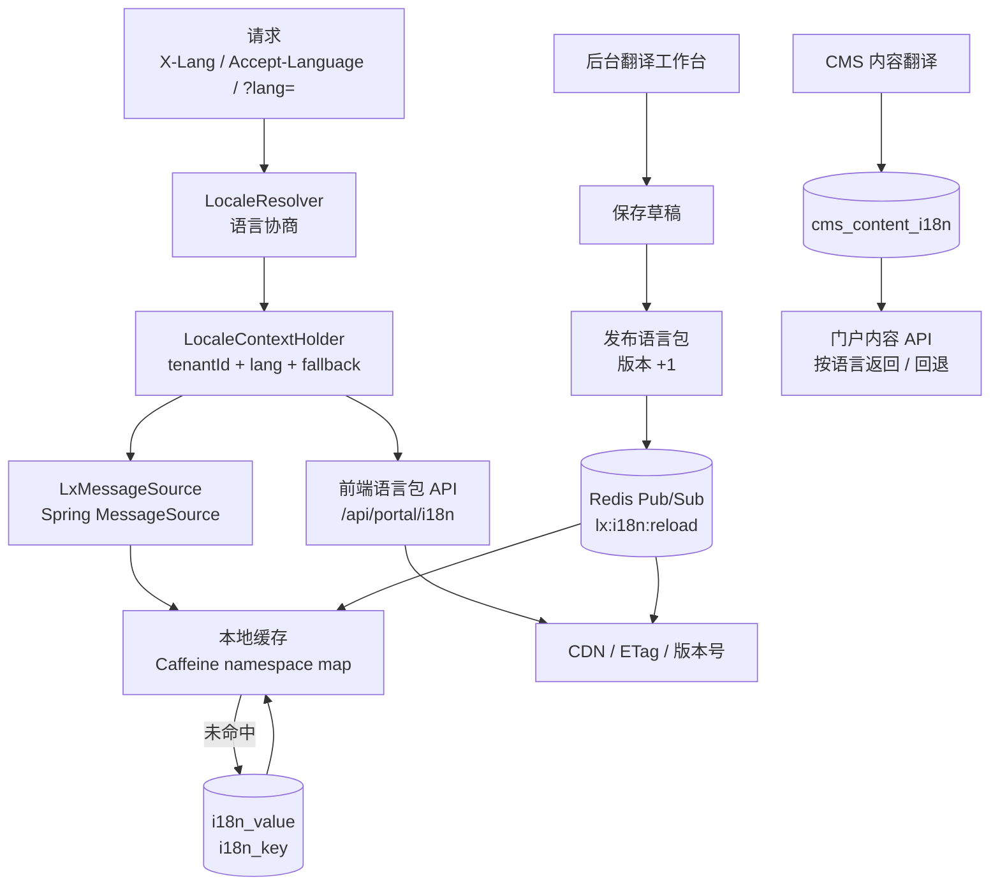
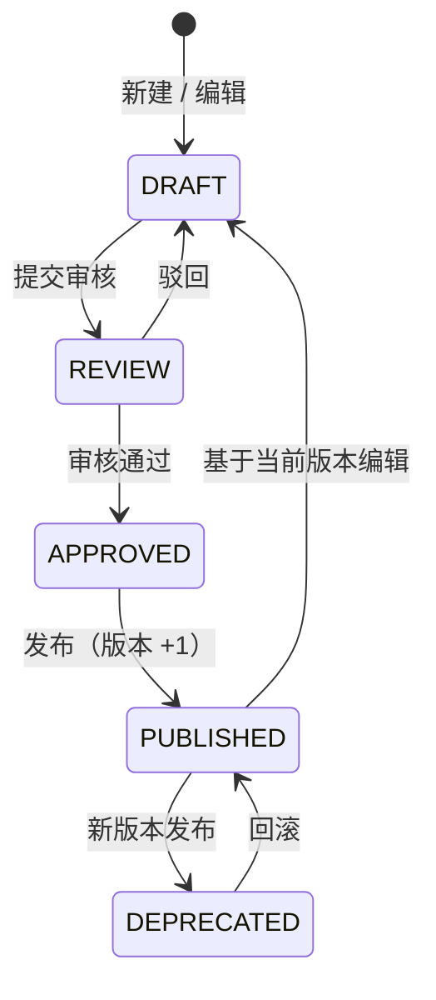

# 15 · 多语言与国际化（热插拔）

> 目标：一套系统同时服务 **简体中文、繁体中文、英语**，并可扩展到日语、韩语、阿拉伯语等；后台文案、校验提示、菜单字典、CMS 内容、门户 UI、消息模板全部可翻译，语言包**发布即生效、无需重启**。
>
> 原则：**文案外置、键值管理、数据库驱动、版本发布、回退兜底、前后端同源。**

---

## 1. 范围与边界

| 层 | 内容 | 是否纳入 | 说明 |
|---|---|---|---|
| 后端提示 | 异常消息、错误码文案、校验提示 | ✅ | `MessageSource` + 数据库 |
| 后台界面 | 菜单、按钮、表单标签、表格列、提示 | ✅ | 前端语言包 + 菜单翻译 |
| 字典 | 字典类型 / 字典数据名称 | ✅ | `i18n_key` 关联 |
| CMS 内容 | 标题、摘要、正文、SEO、栏目、导航、区块 | ✅ | 独立翻译表，按语言发布 |
| 门户 UI | Nuxt3 / uni-app 页面文案 | ✅ | 按命名空间懒加载 |
| 消息模板 | 短信、邮件、站内信、微信模板 | ✅ | 模板按语言版本 |
| 开放平台 | 接口文档、错误消息 | ✅ | `Accept-Language` |
| 日志 | 运维日志 | ❌ | 固定中文 / 英文，避免翻译成本 |
| 数据库 | 表名、字段名、注释 | 部分 | 注释可多语言，标识符不翻译 |
| 用户生成内容 | 评论、投稿 | 可选 | 默认不翻译，按原文展示 |

**非目标：**

- 不做实时同声传译、不做全站机器翻译质量承诺。
- 不翻译代码、SQL、配置键、文件路径。
- 不为每个语言复制一套业务表（内容翻译用扩展表，不做多库多表）。

---

## 2. 总体架构



**关键点：**

1. **语言上下文**在每个请求入口解析，和租户上下文一起传递；异步、定时任务、MQ 必须显式带上语言。
2. **后端文案**不写在 `ErrorCode` 枚举里，枚举只存 `messageKey`，运行时由 `MessageSource` 解析。
3. **前端文案**不硬编码在组件里，统一 `$t('namespace.key')`；语言包由后端下发，版本号做缓存失效。
4. **CMS 内容**与界面文案分开：界面文案是键值，内容是业务数据，翻译表独立、可走审核流。
5. **热加载**靠“版本号 + 本地缓存 + Redis 广播”，不靠重启，也不靠每次请求查库。

---

## 3. 语言与区域

### 3.1 语言编码

统一用 **BCP 47**：

| 语言 | 编码 | 默认 | 备注 |
|---|---|---|---|
| 简体中文 | `zh-CN` | ✅ 平台默认 | 首发 |
| 繁体中文 | `zh-TW` | 可选 | 港澳台 |
| 英语 | `en-US` | 可选 | 国际化 |
| 日语 | `ja-JP` | 可选 | 按项目 |
| 韩语 | `ko-KR` | 可选 | 按项目 |
| 阿拉伯语 | `ar-SA` | 可选 | RTL，需专项适配 |

**规则：**

- 语言编码大小写不敏感，存储统一为 `zh-CN` 形式。
- 不把“语言”和“国家”混为一谈；货币、时区、日期格式用 `Locale` 派生，不另建一套。
- 数据库排序规则与语言无关；不要为每种语言建独立库。

### 3.2 语言能力

| 能力 | 说明 |
|---|---|
| 平台语言 | 平台预置语言，租户只能启用 / 停用，不能删除 |
| 租户语言 | 租户可启用子集，并指定租户默认语言 |
| 站点语言 | CMS 站点可配置语言集合与默认语言 |
| 会员语言 | 会员可设置偏好语言，登录后优先 |
| 游客语言 | 按 `X-Lang` / URL 前缀 / `Accept-Language` 协商 |
| 回退语言 | 每个语言可配置 fallback，默认平台默认语言 |

---

## 4. 数据模型

### 4.1 表清单

| 表 | 说明 | 租户 |
|---|---|---|
| `i18n_language` | 平台语言定义 | 否（平台表） |
| `i18n_tenant_language` | 租户启用语言 / 默认语言 | 是 |
| `i18n_namespace` | 命名空间（common / admin / validation / cms / member / message） | 否 |
| `i18n_key` | 翻译键、默认值、所属模块 | 否 |
| `i18n_value` | 某语言 / 某租户的翻译值 | 是（0=平台） |
| `i18n_pack` | 语言包版本、校验和、发布状态 | 是 |
| `i18n_glossary` | 术语表，保证一致性 | 否 |
| `i18n_missing_log` | 缺失翻译记录、命中次数 | 是 |
| `cms_content_i18n` | CMS 内容翻译 | 是 |
| `cms_category_i18n` | 栏目翻译 | 是 |
| `cms_site_i18n` | 站点名称 / SEO 翻译 | 是 |
| `cms_block_i18n` | 区块 / 导航 / 广告文案翻译 | 是 |

> 表前缀统一 `i18n_`，与 `sys_` / `cms_` 区分；i18n 模块关闭时这些表不迁移。
>
> **v1.4 第二刀已落地**：`i18n_language` / `i18n_key` / `i18n_value` / `i18n_pack` /
> `i18n_missing_log` 五张表（迁移 V39~V42）。`i18n_tenant_language` / `i18n_namespace` /
> `i18n_glossary` 与 `cms_*_i18n` 仍为后续阶段预留；当前命名空间直接取键的第一段。

### 4.2 核心 DDL（逻辑类型，按厂商生成）

```sql
CREATE TABLE i18n_language (
  language_id    bigint       NOT NULL,
  language_code  varchar(16)  NOT NULL,
  language_name  varchar(64)  NOT NULL,
  native_name    varchar(64)  NOT NULL,
  locale         varchar(32)  NOT NULL,
  direction      varchar(8)   NOT NULL DEFAULT 'ltr',
  is_default     smallint     NOT NULL DEFAULT 0,
  status         char(1)      NOT NULL DEFAULT '0',
  sort           int          NOT NULL DEFAULT 0,
  create_time    datetime     NOT NULL,
  update_time    datetime,
  PRIMARY KEY (language_id),
  UNIQUE KEY uk_i18n_language_code (language_code)
);

CREATE TABLE i18n_key (
  key_id         bigint       NOT NULL,
  namespace      varchar(64)  NOT NULL,
  key_code       varchar(255) NOT NULL,
  default_value  varchar(2000),
  module_code    varchar(64),
  status         char(1)      NOT NULL DEFAULT '0',
  remark         varchar(500),
  create_time    datetime     NOT NULL,
  update_time    datetime,
  PRIMARY KEY (key_id),
  UNIQUE KEY uk_i18n_key (namespace, key_code)
);

CREATE TABLE i18n_value (
  value_id       bigint       NOT NULL,
  key_id         bigint       NOT NULL,
  tenant_id      bigint       NOT NULL DEFAULT 0,
  language_code  varchar(16)  NOT NULL,
  value_text     text,                         -- 工作副本：后台编辑 / 保存草稿改这里
  published_text text,                         -- 最近一次发布的译文：MessageSource 只读这里
  review_status  char(1)      NOT NULL DEFAULT '0',  -- 0=有未发布修改 / 1=已发布
  version        int          NOT NULL DEFAULT 1,
  translated_by  bigint,
  translated_at  datetime,
  create_time    datetime     NOT NULL,
  update_time    datetime,
  PRIMARY KEY (value_id),
  UNIQUE KEY uk_i18n_value (key_id, tenant_id, language_code)
);

CREATE TABLE i18n_pack (
  pack_id        bigint       NOT NULL,
  tenant_id      bigint       NOT NULL DEFAULT 0,
  language_code  varchar(16)  NOT NULL,
  namespace      varchar(64)  NOT NULL,
  version        int          NOT NULL,
  checksum       varchar(64),
  status         char(1)      NOT NULL DEFAULT '0',  -- 0=历史 / 1=当前发布
  snapshot_json  longtext,                           -- {keyId: valueText}，回滚用
  published_by   bigint,
  published_at   datetime,
  PRIMARY KEY (pack_id),
  UNIQUE KEY uk_i18n_pack (tenant_id, language_code, namespace, version)
);

CREATE TABLE i18n_missing_log (
  log_id         bigint       NOT NULL,
  tenant_id      bigint       NOT NULL DEFAULT 0,
  language_code  varchar(16)  NOT NULL,
  namespace      varchar(64)  NOT NULL,
  key_code       varchar(255) NOT NULL,
  hit_count      bigint       NOT NULL DEFAULT 1,
  first_seen     datetime     NOT NULL,
  last_seen      datetime     NOT NULL,
  sample_locale  varchar(64),
  PRIMARY KEY (log_id),
  UNIQUE KEY uk_i18n_missing (tenant_id, language_code, namespace, key_code)
);

CREATE TABLE cms_content_i18n (
  content_i18n_id bigint      NOT NULL,
  content_id      bigint      NOT NULL,
  language_code   varchar(16) NOT NULL,
  title           varchar(255),
  subtitle        varchar(255),
  slug            varchar(255),
  summary         varchar(1000),
  content_html    text,
  seo_title       varchar(255),
  seo_keywords    varchar(255),
  seo_description varchar(500),
  ext_json        text,
  translate_status char(1)    NOT NULL DEFAULT '0',
  translated_from varchar(16),
  version         int         NOT NULL DEFAULT 1,
  create_time     datetime    NOT NULL,
  update_time     datetime,
  PRIMARY KEY (content_i18n_id),
  UNIQUE KEY uk_cms_content_i18n (content_id, language_code)
);
```

**说明：**

- 主键全部应用侧雪花 ID；时间由应用填充，不依赖 `current_timestamp` / `on update`。
- `text` / `json` 等类型由 `DatabaseDialect` 映射到 MySQL / PostgreSQL / 达梦 / 金仓。
- 唯一索引包含 `tenant_id` 或业务主键，避免跨租户冲突。
- 翻译值长度上限按业务控制，正文放 `text`，不放大字段到主表。

---

## 5. 翻译键规范

### 5.1 命名

```text
{namespace}.{module}.{feature}.{item}
```

示例：

```text
common.button.confirm
common.button.cancel
validation.required
validation.length.between
system.login.captchaRequired
system.user.status.disabled
cms.content.status.published
cms.content.audit.pending
member.login.passwordError
message.sms.captchaTemplate
```

**规则：**

- 全小写、点分隔、语义化，不用中文做键。
- 一个键只表达一个含义；不要用 `common.yes` 兼作“是 / 确认 / 启用”。
- 带变量的文案用占位符：`system.user.deleteConfirm` = `确认删除用户 {0} 吗？`。
- 复数、性别、选择用 ICU MessageFormat：`{count, plural, one {# 条} other {# 条}}`。
- 前端键与后端键分命名空间，避免同名不同义。
- 键一旦发布不删除、不重命名；废弃用 `status=1` 保留，防止旧版本前端报错。

### 5.2 命名空间

| 命名空间 | 内容 | 加载方 |
|---|---|---|
| `common` | 通用按钮、状态、单位 | 全端 |
| `admin` | 后台菜单、页面、表单 | 后台 |
| `validation` | 校验提示 | 后端 + 前端 |
| `error` | 错误码文案 | 后端 + 前端 |
| `cms` | CMS 后台与门户 | 后台 / 门户 |
| `member` | 会员中心 | 门户 / H5 |
| `message` | 短信 / 邮件 / 站内信 | 后端 |
| `open` | 开放平台 | 开放平台 |

- 前端按路由懒加载命名空间，不一次性拉全量。
- 首屏只加载 `common` + 当前页面命名空间。
- 单个命名空间建议不超过 2000 键；超出拆分。

---

## 6. 语言协商与回退

### 6.1 解析优先级

```text
1. 登录用户 / 会员的偏好语言
2. 请求头 X-Lang（后台切换、调试、API 调用）
3. URL 语言前缀 / 参数 ?lang=
4. 租户默认语言
5. Accept-Language 最佳匹配
6. 平台默认语言
7. 键本身（最后兜底，同时记录缺失）
```

- `X-Lang` 优先级高于 `Accept-Language`，低于用户显式偏好。
- 门户 URL 前缀（`/en/...`）优先级高于浏览器语言，保证分享链接语言稳定。
- 后台切换语言写入用户偏好，不依赖 Cookie 长期保存。
- 游客用 Cookie `lx-lang` 记忆，有效期 180 天。

### 6.2 回退链

```text
租户 + 请求语言
  → 平台 + 请求语言
  → 租户默认语言
  → 平台默认语言
  → i18n_key.default_value
  → key 本身（记录 missing_log）
```

**CMS 内容回退：**

```text
请求语言内容
  → 站点默认语言内容
  → 平台默认语言内容
  → 404 / 不展示
```

- 回退发生时返回 `Content-Language` 与 `X-Lang-Fallback: true`，便于前端提示“当前为默认语言版本”。
- 机器翻译内容标记 `translate_status=machine`，前端可提示“机器翻译”。
- 回退不改变 URL 的 canonical；canonical 指向当前语言版本，缺失时指向默认语言版本。

---

## 7. 后端实现

### 7.1 上下文

```java
public final class LocaleContextHolder {

    private static final ThreadLocal<LocaleContext> HOLDER = new ThreadLocal<>();

    public static void set(LocaleContext context) { HOLDER.set(context); }
    public static LocaleContext get() { return HOLDER.get(); }
    public static String lang() {
        LocaleContext ctx = HOLDER.get();
        return ctx == null ? null : ctx.getLang();
    }
    public static void clear() { HOLDER.remove(); }
}
```

`LocaleContext` 至少包含：

```text
tenantId
lang            请求语言
fallbackLang    回退语言
timeZone        展示时区
source          USER / HEADER / URL / TENANT / ACCEPT_LANGUAGE / DEFAULT
```

- Web 过滤器解析后放入 `LocaleContextHolder`，`finally` 清理，防止线程池串语言。
- 异步线程用 `TaskDecorator` 复制上下文；`@Async`、MQ 消费、定时任务必须显式设置。
- 定时任务按租户默认语言执行，涉及用户消息时按用户偏好逐条渲染。

### 7.2 MessageSource

```java
@Component
public class LxMessageSource extends AbstractMessageSource {

    private final I18nValueService valueService;
    private final I18nPackCache packCache;

    @Override
    protected MessageFormat resolveCode(String code, Locale locale) {
        String pattern = packCache.get(locale, code);
        if (pattern == null) {
            pattern = valueService.findWithFallback(code, locale);
        }
        return pattern == null ? null : new MessageFormat(pattern, locale);
    }
}
```

- 继承 `AbstractMessageSource`，保留 Spring 的 `getMessage` 语义与参数插值。
- 本地缓存用 Caffeine：`key = tenantId:lang:namespace`，值为 `Map<String,String>`。
- 缓存未命中查库；仍没有则回退，不抛异常，避免因缺翻译导致业务失败。
- 启动时预热默认语言 + 已启用语言，减少首请求抖动。
- `MessageSource` 只读；翻译工作台写库后发布版本，再广播刷新。

### 7.3 错误码与校验

```java
public enum ErrorCode {
    SUCCESS(200, "error.success"),
    UNAUTHORIZED(11001, "error.auth.unauthorized"),
    FORBIDDEN(12001, "error.auth.forbidden"),
    CONTENT_NOT_FOUND(30001, "error.cms.contentNotFound");

    private final int code;
    private final String messageKey;
}
```

```java
@RestControllerAdvice
public class GlobalExceptionHandler {

    private final MessageSource messageSource;

    @ExceptionHandler(BizException.class)
    public R<Void> handle(BizException e) {
        String msg = messageSource.getMessage(
                e.getCode().getMessageKey(),
                e.getArgs(),
                LocaleContextHolder.toLocale());
        return R.fail(e.getCode().getCode(), msg);
    }
}
```

- 参数校验用 `{validation.required}` 这类键，不在注解里写中文。
- 业务异常只传 `ErrorCode` + 参数，不拼字符串。
- 日志记录 `messageKey` 与 `lang`，不记录翻译后的长文本，便于检索。
- 开放平台按 `Accept-Language` 返回；未传时用英文或平台默认语言。

### 7.4 数据库读取与缓存

| 缓存 | Key | TTL | 失效 |
|---|---|---|---|
| 已发布译文（按语言整包） | Caffeine `DatabaseTranslationProvider` | 5s | 发布 / 回滚 / 键变更 |

- 首版是单机 Caffeine（`lx.module.i18n.cache-seconds`，默认 5 秒），不依赖 Redis；
  发布 / 回滚后主动 `invalidate`，本实例立即生效，多实例最迟 5 秒。
- 只加载 `published_text` 非空且键启用的行；草稿永远不进 `MessageSource`。
- 不按命名空间拆分缓存：整语言加载一次，门户按前缀过滤，避免 N+1。
- 后续引入 Redis 时再按“语言 + 命名空间 + 版本”分片，Key 规范不变。

---

## 8. 热加载与发布

### 8.1 状态机



### 8.2 发布流程

1. 编辑翻译值，保存为草稿：只改 `i18n_value.value_text` 并置 `review_status=0`，
   `published_text` 不动，所以线上完全不受影响。
2. 审核状态预留：首版不强制走单独的审核表，`review_status` 只表达“工作副本是否已发布”。
3. 发布：写入 `i18n_pack` 新版本，计算 checksum，并把当前工作副本写入
   `snapshot_json`；随后 `published_text = value_text`、`review_status=1`。
4. 清理本实例缓存（Caffeine，5 秒 TTL）；多实例最迟 5 秒读到新版本。
5. 前端下一次请求带 `If-None-Match` / `X-I18n-Version`，版本变化才重新拉取。
6. 回滚：按目标 `i18n_pack.snapshot_json` 恢复 `value_text` 与 `published_text`，
   再把该版本标为当前；不是“只改一个版本号”。

**约束：**

- 发布是原子的：同一语言 + 命名空间一次发布一个版本。
- 草稿隔离由 `published_text` 保证；编辑中的新键在发布前不会出现在门户语言包。
- 发布前做键完整性检查：空值跳过、占位符不匹配直接拒绝、同语言同命名空间版本号递增。
- 发布失败保留旧的 `published_text` 与旧版本，前端不受影响；回滚也按快照恢复译文。

### 8.3 前端缓存

```http
GET /api/portal/i18n/zh-CN/common?v=12
If-None-Match: "i18n-zh-CN-common-12"
```

- 响应带 `ETag`、`Cache-Control: public, max-age=300`。
- 版本号变化后 URL 变化，CDN 自然回源。
- 离线 / 弱网：本地 IndexedDB / Storage 缓存上一版本，失败时降级使用。
- 首屏 SSR 由服务端注入当前语言包，避免客户端二次请求与水合闪烁。

---

## 9. 前端实现

### 9.1 后台（Vue3 + vue-i18n）

```ts
// src/i18n/index.ts
import { createI18n } from 'vue-i18n'
import { loadMessages } from '@/api/i18n'

export const i18n = createI18n({
  legacy: false,
  locale: 'zh-CN',
  fallbackLocale: 'zh-CN',
  messages: {},
})

export async function switchLanguage(lang: string) {
  const messages = await loadMessages(lang, ['common', 'admin'])
  i18n.global.setLocaleMessage(lang, messages)
  i18n.global.locale.value = lang
  document.documentElement.lang = lang
  document.documentElement.dir = lang.startsWith('ar') ? 'rtl' : 'ltr'
}
```

- Element Plus 语言包同步切换：`ElConfigProvider :locale="elLocale"`。
- 菜单名称优先用后端返回的翻译字段；没有时用 `menuName`。
- 表格列、表单标签、校验提示全部走 `$t`。
- 语言切换后刷新当前路由的 `meta.title` 与页面标题。
- 日期、数字、货币用 `Intl.NumberFormat` / `Intl.DateTimeFormat`，不用手写格式。

### 9.2 门户（Nuxt3）

```ts
// nuxt.config.ts
export default defineNuxtConfig({
  modules: ['@nuxtjs/i18n'],
  i18n: {
    locales: [
      { code: 'zh-CN', language: 'zh-CN', file: 'zh-CN.json' },
      { code: 'en-US', language: 'en-US', file: 'en-US.json' },
    ],
    defaultLocale: 'zh-CN',
    strategy: 'prefix_except_default',
    detectBrowserLanguage: {
      useCookie: true,
      cookieKey: 'lx-lang',
      redirectOn: 'root',
    },
  },
})
```

- URL 策略：默认语言无前缀，其他语言 `/{lang}/...`，利于 SEO。
- `useHead` 输出 `lang`、`hreflang`、`canonical`、OG。
- SSR 时从请求头 / Cookie 解析语言，服务端加载对应语言包，避免水合不一致。
- 内容详情按语言请求；回退时页面提示“该内容暂无当前语言版本”。
- sitemap 按语言分组，包含 `x-default`。

### 9.3 H5 / 小程序 / App（uni-app）

```ts
import { createI18n } from 'vue-i18n'

const i18n = createI18n({
  legacy: false,
  locale: uni.getStorageSync('lx-lang') || 'zh-CN',
  fallbackLocale: 'zh-CN',
  messages: {},
})
```

- 语言包按分包 / 页面懒加载，控制首包体积。
- TabBar、导航栏标题、分享文案用 `$t`，切换语言后调用 `uni.setTabBarItem` 更新。
- 小程序不支持动态 `dir=rtl` 的场景，阿拉伯语需单独布局适配。
- 系统语言通过 `uni.getSystemInfoSync().language` 获取，仅作为首次默认值。

---

## 10. CMS 内容翻译

### 10.1 内容组织

- 同一篇内容的不同语言版本用 `content_id` 关联，`cms_content_i18n` 存翻译。
- 主表 `cms_content` 保存默认语言与公共字段（栏目、模型、封面、状态、发布时间）。
- 每种语言可独立设置标题、摘要、正文、slug、SEO、扩展字段。
- 栏目、站点、导航、区块、广告文案同样用 `*_i18n` 表。
- 语言版本可独立发布 / 下线；默认语言未发布时，其他语言不可发布（可配置）。

### 10.2 翻译状态

| 状态 | 含义 | 前台 |
|---|---|---|
| `none` | 未翻译 | 回退默认语言 |
| `machine` | 机器翻译 | 可展示 + 提示 |
| `translated` | 人工翻译 | 展示 |
| `reviewed` | 已审校 | 展示 |
| `published` | 已发布 | 展示 |

- 翻译可走工作流：提交 → 翻译 → 审校 → 发布。
- 机器翻译作为辅助，必须人工审校后才能标记 `reviewed`。
- 内容更新后，其他语言标记“需同步”，不自动覆盖人工翻译。

### 10.3 URL 与 SEO

```text
/zh-CN/news/123.html
/en-US/news/123.html
/zh-TW/news/123.html
```

或子域名：

```text
www.example.com
en.example.com
```

- 同一内容各语言 URL 互相对应，输出 `hreflang`：

```html
<link rel="alternate" hreflang="zh-CN" href="https://www.example.com/zh-CN/news/123.html" />
<link rel="alternate" hreflang="en-US" href="https://www.example.com/en-US/news/123.html" />
<link rel="alternate" hreflang="x-default" href="https://www.example.com/news/123.html" />
```

- `canonical` 指向当前语言版本；回退时指向默认语言版本，避免重复内容。
- sitemap 按语言生成 `sitemap-zh-CN.xml`、`sitemap-en-US.xml`，并在 `sitemap.xml` 中索引。
- slug 在语言内唯一，允许不同语言使用不同 slug。
- 不翻译的页面返回 404 或 302 到默认语言，按站点策略配置。

### 10.4 内容 API

```http
GET /api/portal/cms/content/123?lang=en-US
Accept-Language: en-US
```

响应头：

```http
Content-Language: en-US
X-Lang-Fallback: false
Vary: Accept-Language, X-Lang
```

翻译列表：

```http
GET /api/admin/cms/content/123/translations
```

```json
{
  "contentId": "123",
  "defaultLang": "zh-CN",
  "items": [
    { "lang": "zh-CN", "status": "published", "title": "示例文章" },
    { "lang": "en-US", "status": "reviewed", "title": "Sample Article" }
  ]
}
```

---

## 11. 租户与 SaaS

| 场景 | 策略 |
|---|---|
| 平台语言 | 平台统一维护，租户只能启用 / 停用 |
| 租户默认语言 | `i18n_tenant_language.is_default` |
| 租户自定义翻译 | `i18n_value.tenant_id=T` 覆盖平台值 |
| 租户自定义语言 | 平台允许时，租户可新增语言编码 |
| 套餐限制 | 套餐可限制语言数量、机器翻译字数 |
| 子后台 | 子用户语言偏好独立，不继承主账号 |
| 内容翻译 | 按租户隔离，不跨租户共享译文 |
| 语言包发布 | 平台发布全局包；租户发布自己的覆盖包 |

- 租户关闭某语言后，该语言 URL 返回 404 或跳默认语言。
- 租户默认语言变更后，清 `lx:i18n:*:{tenantId}:*` 缓存。
- 平台语言包升级不覆盖租户自定义译文；只补充缺失键。
- 租户注销时，翻译数据随租户删除策略处理。

---

## 12. 消息模板多语言

- `sys_message_template` 增加 `language_code`，或拆 `sys_message_template_i18n`。
- 模板变量与语言无关，渲染时按收件人语言选择模板。
- 找不到对应语言时回退默认语言，并在发送记录标记 `fallback`。
- 短信长度按语言分别计算（中文 70 字 / 英文 160 字符），避免超长。
- 邮件模板含 HTML，注意 RTL 与字体。
- 站内信存 `template_code + lang + params`，展示时渲染，避免存死文案。

---

## 13. 接口清单

### 13.1 后台 `/api/admin/i18n`

v1.4 已实现（权限码 `platform:i18n:*`）：

| 方法 | 路径 | 说明 |
|---|---|---|
| GET | `/language/list`、`/language/options` | 语言列表 / 启用语言下拉 |
| POST / PUT / DELETE | `/language`、`/language/{id}` | 新增 / 编辑 / 删除语言 |
| PUT | `/language/{id}/status?status=` | 启用 / 停用 |
| GET | `/key/list`、`/value/list` | 翻译键 / 翻译矩阵分页 |
| POST / PUT / DELETE | `/key`、`/key/{id}` | 新增 / 编辑 / 删除翻译键 |
| POST | `/value/batch` | 批量保存草稿（≤500 条） |
| POST | `/import` | 导入 CSV（只写草稿） |
| GET | `/export` | 导出 CSV（可选语言 / 仅缺翻译） |
| GET | `/coverage` | 翻译覆盖率 |
| GET / DELETE | `/missing` | 缺失记录分页 / 清理 |
| GET | `/pack/list`、`/pack/current` | 语言包历史 / 当前版本 |
| POST | `/pack/publish` | 发布（`languageCode` + 可选 `namespace`） |
| POST | `/pack/rollback` | 按 `packId` 回滚 |

预留（未实现）：`/namespace`、`/glossary`、`/translate`（机器翻译）、`/value` 单条编辑接口。

### 13.2 门户 / App `/api/portal/i18n`

| 方法 | 路径 | 说明 |
|---|---|---|
| GET | `/languages` | 可用语言（含默认语言标记） |
| GET | `/{lang}/{namespace}` | 已发布语言包，`ETag` + `Cache-Control: max-age=5` |
| GET | `/version?lang=&namespace=` | 当前发布版本 |

`/{lang}/{namespace}` 只返回 `published_text` 非空且键启用的译文；语言不存在 / 停用返回 `1004`。
`/preference`（会员语言偏好）仍为预留，未实现。

### 13.3 CMS 翻译

| 方法 | 路径 | 说明 |
|---|---|---|
| GET | `/api/admin/cms/content/{id}/translations` | 翻译列表 |
| POST | `/api/admin/cms/content/{id}/translation` | 新建 / 更新翻译 |
| POST | `/api/admin/cms/content/{id}/translation/{lang}/publish` | 发布某语言 |
| POST | `/api/admin/cms/content/{id}/translation/{lang}/machine` | 机器翻译 |
| GET | `/api/portal/cms/content/{id}?lang=` | 按语言取内容 |

---

## 14. 导入导出

### 14.1 格式

支持：

- Excel：`namespace | key | zh-CN | en-US | ... | remark`。
- JSON：按命名空间嵌套。
- Properties：兼容传统 Java 资源包。
- XLIFF 1.2 / 2.0：对接专业翻译平台（可选）。

### 14.2 规则

- 导入前校验键是否存在、占位符是否一致、语言是否启用。
- 默认“只新增 / 更新草稿”，不直接发布。
- 导入结果返回成功 / 跳过 / 失败明细，可下载错误报告。
- 导出按语言 + 命名空间，支持“仅缺失”“仅未审校”。
- 大文件异步导出，返回 `taskId`。

---

## 15. 机器翻译（可选）

| 项 | 说明 |
|---|---|
| Provider | 阿里云、腾讯云、DeepL、Google、自建模型 |
| 触发 | 手动单条 / 批量 / 内容保存后自动 |
| 限额 | 按租户套餐、按字符数 |
| 缓存 | 相同源文本 + 目标语言命中翻译记忆，不重复调用 |
| 审校 | 机器翻译标记 `machine`，人工审校后升级 |
| 术语 | 术语表优先于机器翻译 |
| 隐私 | 敏感内容不送第三方；可配置禁用 |

- 机器翻译失败不阻塞保存，标记失败原因，可重试。
- 不把机器翻译结果直接发布到正式环境，除非租户显式允许。
- 记录调用量，纳入 SaaS 计量。

---

## 16. 性能与容量

| 指标 | 目标 |
|---|---|
| 语言包读取 | 本地缓存命中 < 1ms；未命中查库 < 20ms |
| 语言包体积 | 单命名空间 < 200KB（gzip 后 < 50KB） |
| 首屏语言包 | 只加载 `common` + 当前页，< 30KB |
| 发布生效 | 集群内 < 5s |
| 翻译键规模 | 单租户 < 5 万键；超出分命名空间 / 分模块 |
| CMS 翻译 | 单内容 < 20 语言；列表按语言索引 |

**优化：**

- 语言包按命名空间拆分，不拉全量。
- 使用 ETag / 版本号，避免重复传输。
- 数据库按 `(tenant_id, language_code, namespace)` 建联合索引。
- 缺失翻译记录异步落库，不阻塞请求。
- 大语言包 gzip / brotli 压缩，CDN 缓存。

---

## 17. 测试策略

| 测试 | 目的 |
|---|---|
| 键完整性 | 所有 `$t` / `getMessage` 的键存在 |
| 占位符一致性 | 各语言参数数量、类型一致 |
| 回退链 | 缺翻译时按预期回退，不抛异常 |
| 热加载 | 发布后集群各节点 5s 内生效 |
| 并发隔离 | 多线程请求不同语言不串 |
| 前端水合 | SSR 与客户端语言一致，无闪烁 |
| SEO | hreflang、canonical、sitemap 正确 |
| 内容翻译 | 发布 / 回退 / 下线 / 权限截断 |
| 租户隔离 | A 租户译文不影响 B 租户 |
| 格式化 | 日期、数字、货币、复数、RTL |
| 性能 | 语言包加载与首屏不退化 |
| 安全 | 译文 XSS、HTML 注入、超长文本 |

**静态检查：**

- 前端 ESLint 规则禁止 JSX / 模板中出现中文硬编码（白名单除外）。
- 后端检查 `throw new BizException("中文")`，必须用 `ErrorCode`。
- CI 对比 `i18n_key` 与代码扫描结果，发现未使用键 / 缺失键。

**v1.4 已落地脚本**：

```bash
# 启用态：语言 / 键 / 草稿 / 发布 / 回滚 / CSV / 覆盖率 / X-Lang
node lx-modules/lx-module-i18n/scripts/verify-i18n.mjs

# 关闭态（8081 + 全新库）：接口 404、菜单不下发、V39~V42 不执行
node lx-modules/lx-module-i18n/scripts/verify-i18n.mjs --off
```

单测：`mvn -q -pl lx-modules/lx-module-i18n -am test`，覆盖占位符校验、草稿隔离、
发布快照 / 校验和、回滚恢复、CSV 编解码、MessageSource 优先级。

---

## 18. 风险与对策

| 风险 | 对策 |
|---|---|
| 翻译键膨胀、命名混乱 | 命名规范 + 评审 + 定期清理废弃键 |
| 缺翻译导致线上显示 key | 回退链 + 发布前完整性检查 + 缺失告警 |
| 语言包缓存不一致 | 版本号 + Redis 广播 + 短 TTL 兜底 |
| 前端水合闪烁 | SSR 注入语言包 + 首屏同步加载 |
| 内容翻译与主内容漂移 | 更新标记“需同步”，不自动覆盖人工译文 |
| SEO 重复内容 | canonical + hreflang + 不翻译页面 404 |
| 机器翻译质量 | 人工审校 + 术语表 + 不直接发布 |
| RTL 布局问题 | 独立回归 + 逻辑属性（margin-inline 等） |
| 短信长度超限 | 按语言分别计费 / 截断 |
| 租户自定义语言失控 | 平台白名单 + 套餐限制 |
| 数据库膨胀 | 只存差异译文，公共文案平台级复用 |
| 翻译泄露敏感信息 | 第三方翻译禁用 / 脱敏 / 审计 |

---

## 19. 交付里程碑

| 阶段 | 内容 |
|---|---|
| P1 | `i18n` 模块骨架、语言表、MessageSource、后台语言切换、`common/admin` 语言包 |
| P2 | CMS 后台文案、校验、错误码、菜单 / 字典翻译 |
| P2.5 | 翻译工作台、发布 / 回滚、热加载、CMS 内容翻译、门户 hreflang、租户语言 |
| P3 | 会员中心、消息模板、H5 语言包 |
| P6 | 租户自定义语言、套餐限额、机器翻译计量 |
| P7 | 开放平台多语言文档、翻译记忆、术语库增强 |

---

## 20. 验收清单

- [ ] 后台切换 `zh-CN` / `en-US`，菜单、按钮、表单、提示全部生效。
- [ ] 后端错误码按 `X-Lang` / `Accept-Language` 返回对应语言。
- [ ] 缺少翻译时按回退链展示，不出现裸 key（记录缺失日志）。
- [ ] 发布语言包后，集群节点 5s 内生效，无需重启。
- [ ] 回滚语言包后，线上恢复旧版本。
- [ ] 同一内容可维护多语言，按语言独立发布 / 下线。
- [ ] 门户输出正确 `hreflang`、`canonical`、多语言 sitemap。
- [ ] 租户 A 的语言配置与译文不影响租户 B。
- [ ] 会员语言偏好登录后生效，退出后恢复游客语言。
- [ ] 短信 / 邮件按收件人语言渲染，长度符合通道限制。
- [ ] 日期、数字、货币、复数按 Locale 正确格式化。
- [ ] 阿拉伯语 RTL 页面布局可用（如启用）。
- [ ] 前端构建产物无中文硬编码（白名单除外）。
- [ ] 语言包加载不影响首屏性能指标。
- [x] 关闭 `lx.module.i18n.enabled` 后，系统按默认语言正常运行，无 i18n 表和接口。

### 20.1 v1.4 第二刀验收结果（2026-11-26）

| 项 | 结果 |
|---|---|
| 模块开关关闭 | `/api/admin/i18n/**`、`/api/portal/i18n/**` 404；菜单不下发；全新库无 `i18n_*` 表；Flyway 停在 V38 |
| 语言 / 键 / 译文 | 增删改查、启停、默认语言锁定、有译文不可删；占位符不一致拒绝保存 |
| 草稿隔离 | 保存草稿后门户与 `MessageSource` 仍返回上一次发布值；新键发布前不出现 |
| 发布 / 回滚 | 版本 +1、checksum、`snapshot_json`；回滚后译文与当前版本指针同时恢复 |
| 热加载 | 发布 / 回滚主动清缓存；多实例 TTL 5 秒 |
| 优先级 | 数据库 `published_text` → `messages*.properties` → 调用方默认文案 / key |
| CSV | 导出带 BOM；导入只写草稿；导入后再发布才生效 |
| 验收 | `verify-i18n.mjs` 73/73，`--off` 12/12；Flyway V39~V42 实跑；后台 `npm run build` 通过 |

> 明确不在本刀：CMS 内容翻译、`/{lang}/` URL 前缀与 hreflang、租户语言包、
> 门户前端接入语言包接口；这些留给 P2.5 后半段。
