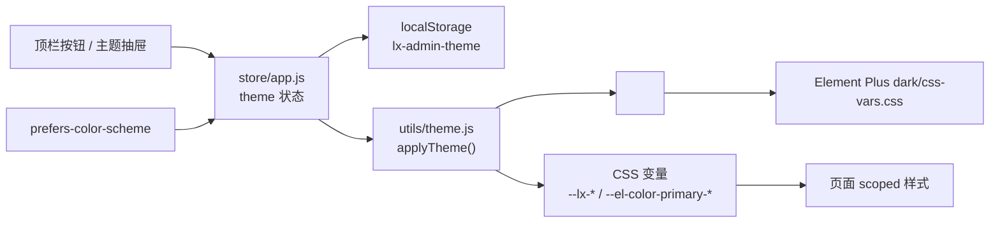

# 24 · 后台主题切换（已实现）

> 范围：`lx-ui-admin` 后台管理端。CMS 门户 / 会员前台主题不在本文。
>
> 状态：**v1.0 已实现并通过 12 项 UI 用例**，无后端改动、无数据库迁移。

---

## 1. 为什么现在做

- 后台是长时间盯着的界面，暗色是刚需，不是“锦上添花”；
- 主色/侧栏风格是客户演示时最容易被问到的“能不能换成我们的品牌色”；
- 这件事越晚做，页面里写死的颜色越多，返工越贵。v1.0 只有 30 处硬编码色，现在收口成本最低。

**不做的事：**

- 不做“每个租户一套 CSS 文件”——租户主题属于 SaaS 阶段；
- 不做在线 CSS 编辑器——维护不了，也容易把界面搞坏；
- 不引入第三方主题库——Element Plus 自带暗色变量已经够用。

---

## 2. 架构



职责边界：

| 层 | 只做什么 |
|---|---|
| `store/app.js` | 持有偏好、持久化、监听系统明暗 |
| `utils/theme.js` | 纯函数：归一化、颜色混合、写 DOM |
| `assets/styles/index.css` | 定义亮/暗两套 CSS 变量 |
| `components/ThemeDrawer.vue` | 交互，不直接操作 DOM |
| 页面组件 | 只用变量，不写死颜色 |

---

## 3. 主题能力

### 3.1 外观模式

| 值 | 行为 |
|---|---|
| `light` | 亮色（默认） |
| `dark` | 暗色 |
| `auto` | 跟随操作系统；系统切换时实时响应，无需刷新 |

实现方式：

- `html.dark` 触发 Element Plus 官方暗色变量；
- `store` 里单独维护 `systemDark`，`auto` 模式下 `matchMedia('(prefers-color-scheme: dark)')` 变化会重新 `applyTheme`；
- `html[data-theme]` 与 `color-scheme` 同步，浏览器原生滚动条/输入框也跟随。

### 3.2 主色

6 个预设 + 任意取色：

| 名称 | 色值 |
|---|---|
| 凌霄蓝（默认） | `#2f6fed` |
| 翡翠绿 | `#0e9f6e` |
| 紫罗兰 | `#7c3aed` |
| 玫瑰红 | `#e11d48` |
| 琥珀橙 | `#f59e0b` |
| 青碧 | `#0ea5e9` |

切换时同时写入：

```
--lx-primary           项目主色
--lx-primary-dark      按下/悬浮深色
--lx-primary-light     渐变亮色
--el-color-primary     Element Plus 主色
--el-color-primary-light-3/5/7/8/9
--el-color-primary-dark-2
```

派生色用 20 行颜色混合算法算，不引 `tinycolor` 之类的运行时依赖
（Element Plus 内部有，但那是它的私有依赖，不暴露给我们）。

### 3.3 侧边栏风格

| 值 | 效果 |
|---|---|
| `dark` | 深蓝黑侧栏（默认，v1.0 原视觉） |
| `light` | 浅色侧栏，自动跟随明暗主题 |

实现：

- `html.lx-sidebar-light` 覆盖 `--lx-sidebar-*` 一组变量；
- 菜单不再用 `background-color` / `text-color` 死属性，改用 Element Plus 的
  `--el-menu-*` 变量；
- 折叠后的浮层被 teleport 到 `body`，在 `index.css` 里全局补了 `.el-menu--popup` 的颜色。

---

## 4. 变量清单

### 4.1 项目变量（`assets/styles/index.css`）

| 变量 | 亮色 | 暗色 | 用途 |
|---|---|---|---|
| `--lx-primary` | `#2f6fed` | 同左（可自定义） | 主色 |
| `--lx-content-bg` | `#f2f4f8` | `#11151d` | 内容区背景 |
| `--lx-card-bg` | `#ffffff` | `#1a1f29` | 卡片/顶栏 |
| `--lx-border` | `#e4e8f0` | `#2b3242` | 边框 |
| `--lx-text` | `#1f2a44` | `#e6e9f2` | 主文字 |
| `--lx-text-secondary` | `#6b7891` | `#98a3b8` | 次文字 |
| `--lx-hover-bg` | `#f1f4f9` | `#232b3a` | 悬浮底 |
| `--lx-fill-bg` | `#f6f8fb` | `#202634` | 浅填充 |
| `--lx-fill-strong` | `#eef1f7` | `#232a38` | code/标签底 |
| `--lx-panel-muted` | `#fbfcfe` | `#1c222d` | 次级面板 |
| `--lx-code-bg` | `#f7f8fa` | `#151a23` | 日志/代码块 |
| `--lx-sidebar-bg` | `#131c31` | `#0c1018` | 侧栏底 |
| `--lx-sidebar-bg-hover` | `#1c2946` | `#1a2333` | 侧栏悬浮 |
| `--lx-sidebar-text` | `#b8c4dc` | `#aab6cc` | 侧栏文字 |
| `--lx-sidebar-text-active` | `#ffffff` | `#ffffff` | 侧栏标题/Logo |
| `--lx-sidebar-active-bg` | 主色渐变 | 同左 | 选中菜单底 |
| `--lx-sidebar-active-text` | `#ffffff` | `#ffffff` | 选中菜单文字 |
| `--lx-sidebar-muted` | 半透明 | 半透明 | 侧栏页脚 |
| `--lx-sidebar-divider` | 白色 6% | 白色 6% | 侧栏分割线 |

### 4.2 页面写样式的三条纪律

1. **颜色只用变量**：`color: var(--lx-text)`，不写 `#333`；
2. **Element Plus 组件优先用它的变量**：`var(--el-border-color)`、`var(--el-color-danger-light-9)`；
3. **新页面必须过暗色检查**：切暗色后不能出现白块、看不清的按钮、白底白字。

---

## 5. 使用入口

| 入口 | 行为 |
|---|---|
| 顶栏月亮/太阳图标 | 亮色 ↔ 暗色一键切换（不动 auto） |
| 顶栏齿轮图标 | 打开主题设置抽屉 |
| 抽屉：外观模式 | 亮色 / 暗色 / 跟随系统 |
| 抽屉：主题色 | 6 个预设 + 取色器 |
| 抽屉：侧边栏 | 深色 / 浅色 |
| 抽屉：恢复默认 | 回到亮色 + 凌霄蓝 + 深色侧栏，并清除 localStorage |

---

## 6. 持久化与优先级

当前：**localStorage > 代码默认值**。

```
localStorage['lx-admin-theme'] = {
  "mode": "light" | "dark" | "auto",
  "primaryColor": "#2f6fed",
  "sidebarStyle": "dark" | "light"
}
```

设计取舍：

- 主题是**个人视觉偏好**，不是全站策略，所以不放 `sys_config`（否则一个人改全站变）；
- localStorage 零成本、即时生效；
- 脏数据/手动改坏时 `normalizeTheme()` 会回退默认，不会白屏。

### 将来做“换设备同步”

需要三小步，不动现有结构：

1. `sys_user` 加一列 `theme_config VARCHAR(512)`（存同一份 JSON）；
2. `PUT /api/admin/auth/profile/theme` 保存，`GET /api/admin/auth/profile` 返回；
3. 登录后优先级改为：**服务端偏好 > localStorage > 默认值**；本地仍保留作为未登录/失败兜底。

不建议现在做：为一个视觉偏好加接口和迁移，收益太低。

---

## 7. 代码位置

| 文件 | 说明 |
|---|---|
| `lx-ui-admin/src/utils/theme.js` | 预设、归一化、颜色混合、`applyTheme`、系统监听 |
| `lx-ui-admin/src/store/app.js` | `theme` 状态、`initTheme`、`setTheme*`、`toggleDark`、`resetTheme` |
| `lx-ui-admin/src/components/ThemeDrawer.vue` | 主题设置抽屉 |
| `lx-ui-admin/src/layout/Navbar.vue` | 快捷切换 + 抽屉入口 |
| `lx-ui-admin/src/layout/index.vue` | 挂载 `ThemeDrawer` |
| `lx-ui-admin/src/layout/Sidebar.vue` | 菜单颜色走变量；浅色侧栏 |
| `lx-ui-admin/src/assets/styles/index.css` | 亮/暗变量、侧栏变量、浮层补色 |
| `lx-ui-admin/src/main.js` | 引入 `theme-chalk/dark/css-vars.css`，挂载前初始化主题 |
| `lx-ui-admin/src/views/login/index.vue` | 登录页也跟随明暗 |

---

## 8. 验收记录（2026-11-15）

脚本：`.local/uitest/theme.mjs`（Puppeteer + 本机 Chrome）

| 用例 | 结果 |
|---|---|
| 管理员登录 | PASS |
| 默认亮色 + 凌霄蓝 + 深色侧栏 | PASS |
| 顶栏一键切暗色并持久化 | PASS |
| 刷新后主题保持 | PASS |
| 打开主题设置抽屉 | PASS |
| 抽屉切换亮色 | PASS |
| 主色同步到项目变量 / Element Plus 变量并持久化 | PASS |
| 侧边栏深浅切换（选中白字、普通 `#6b7891`） | PASS |
| 跟随系统：随系统明暗实时切换 | PASS |
| 恢复默认并清除持久化 | PASS |
| 暗色下导航 / 卡片 / 表格 / 输入框均跟随 | PASS |
| 浏览器控制台无 error | PASS |

**12/12 通过。**
同时回归 `.local/uitest/smoke.mjs`：**22/22 通过**，原有页面/交互无退化。

截图（本地）：`.local/uitest/shots/theme-dark.png`、`theme-light-green.png`、`theme-dark-user.png`。

---

## 9. 已知限制

| 限制 | 说明 |
|---|---|
| 登录页没有主题入口 | 未登录也能读取已保存主题；要换主题需先登录 |
| 偏好不跨设备 | 只存 localStorage，换浏览器/清缓存会回默认 |
| 暗色下部分第三方 iframe | Knife4j `/doc.html` 是独立页面，不跟随后台暗色 |
| 富文本内容 | 编辑器内用户自己写的文字颜色不受主题控制，这是内容而不是 UI |
| 打印 | 未做打印专用样式；暗色下打印可能偏灰，后续需要再加 `@media print` |

---

## 10. 回答“主题切换怎么加”

**一句话：不要写两套 CSS，也不要给每个组件加 `dark` 判断。**
把所有颜色收口成 CSS 变量，亮/暗只覆盖变量；Element Plus 用官方 `html.dark`；
状态放 Pinia，落 localStorage，`applyTheme` 一个函数写 DOM。
这套结构以后加“紧凑模式”“圆角大小”“品牌色”都只是再加一组变量，页面不用改。
