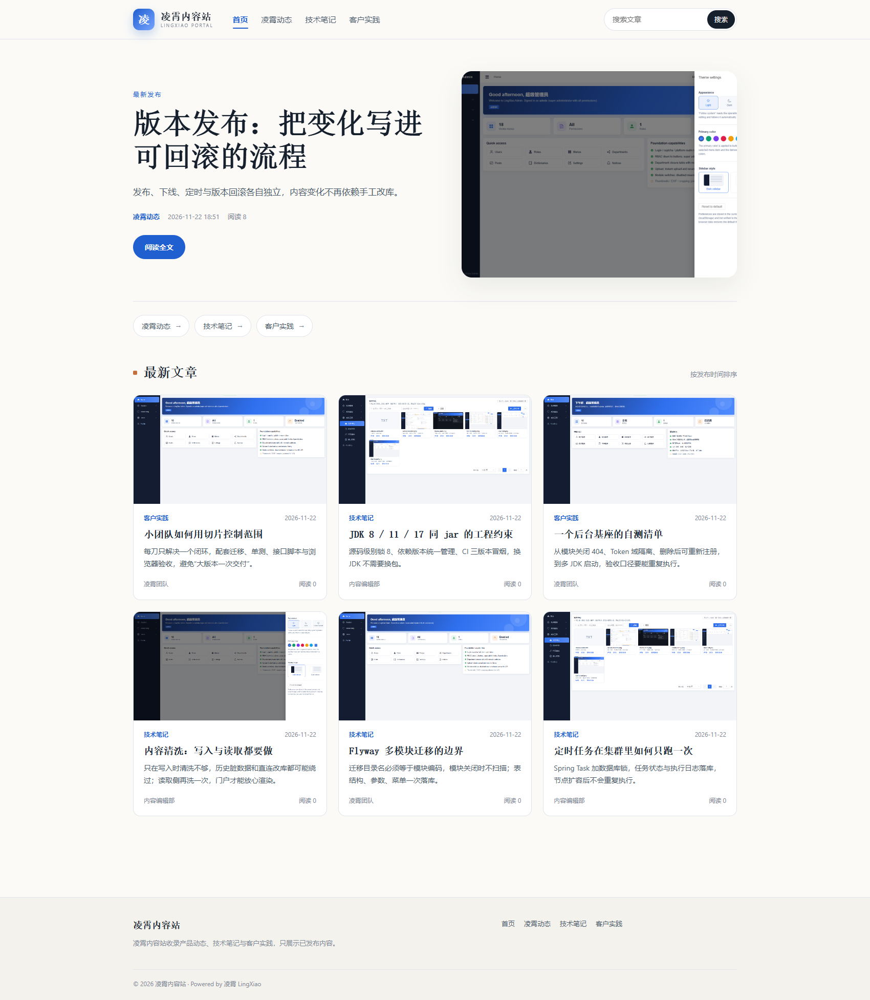
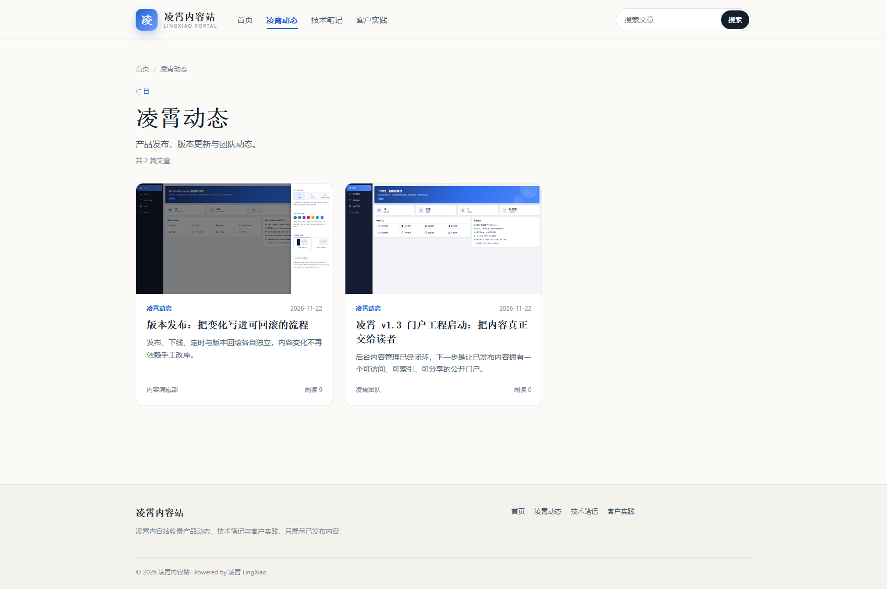
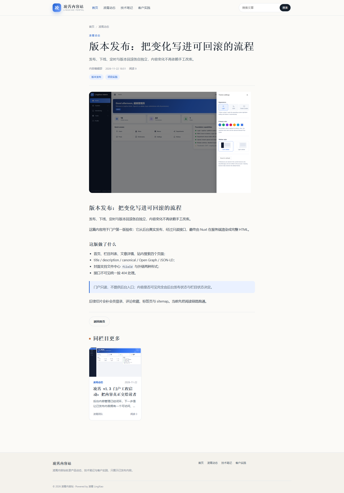
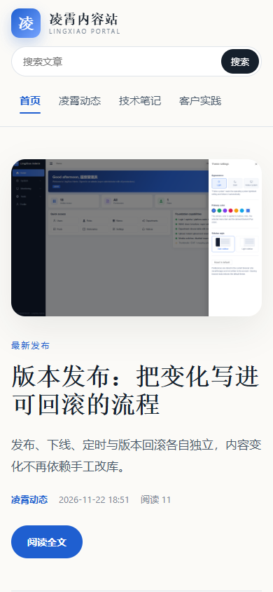

# 31 · 门户前端（v1.3）

> 状态：Nuxt3 门户第一刀（内容阅读）与第二刀（会员）已落地（2026-11-22）。
> 门户只调用 `/api/portal/cms/**` 与会员自助接口 `/api/app/**`，
> 不调用任何 `/api/admin/**` 接口。
> 接口契约见 [`29-portal-api.md`](29-portal-api.md)，工程说明见
> [`lx-ui-portal/README.md`](../lx-ui-portal/README.md)。

---

## 1. 范围

| 本刀做 | 本刀不做 |
|---|---|
| 首页、栏目列表、文章详情、站内搜索 | 评论、收藏、点赞 |
| 会员注册 / 登录 / 退出 / 找回密码 | 手机号 / 邮箱换绑 |
| 个人中心：资料、头像、性别、改密 | 第三方登录、扫码登录 |
| 分页、面包屑、同栏目推荐 | sitemap、RSS |
| `title / description / keywords / canonical / OG / JSON-LD` | 标签独立页 |
| 404 与接口不可用兜底 | 多站点切换、内容级多语言 |
| 同源 `/api/**` 代理 | 全量静态化、CDN、ES 搜索 |
| 纯 CSS 响应式布局 | |

第一刀验证「后台发布 → 门户可见 → 可索引可分享」的完整阅读链路，
第二刀在同一套 Nuxt 工程里接会员自助能力，不引入 UI 框架和额外状态库，
保持依赖面最小。

### 预览

| 首页 | 栏目列表 |
|:---:|:---:|
|  |  |
| **文章详情** | **移动端** |
|  |  |

---

## 2. 工程与启动

| 项 | 选择 |
|---|---|
| 框架 | Nuxt 3.21.11（Vue 3.5 + Nitro 2） |
| 渲染 | SSR |
| 端口 | 3000 |
| 样式 | 原生 CSS + 系统字体，变量集中在 `assets/css/main.css` |
| 数据 | `useAsyncData` + `useRequestFetch`，SSR / 客户端共用相对地址 |
| 代理 | `server/api/[...path].ts` 把 `/api/**` 转发到 `NUXT_BACKEND_BASE` |

```powershell
cd lx-ui-portal
Copy-Item .env.example .env
npm install
npm run dev      # http://127.0.0.1:3000
npm run build
node .output/server/index.mjs
```

站点标识由 `NUXT_PUBLIC_SITE_KEY` 指定（默认 `main`），必须与后台
「CMS → 站点」的 `siteKey` 一致；不一致时接口返回 `1004`，门户按 404 处理。

---

## 3. URL 与页面

| 路径 | 页面 | 数据 |
|---|---|---|
| `/` | 首页 | 站点信息、栏目树、最新 7 篇文章 |
| `/category/{categoryKey}` | 栏目列表 | 栏目树、该栏目（含子栏目）文章分页 |
| `/article/{articleId}` | 文章详情 | 文章详情、同栏目 3 篇推荐、标签 |
| `/search?keyword=` | 站内搜索 | 标题 / 摘要关键字搜索分页 |
| `/login` | 会员登录 | 验证码、登录、失效回调提示 |
| `/register` | 会员注册 | 验证码、注册并自动登录 |
| `/forgot-password` | 找回密码 | 申请验证码 → 重置密码两步 |
| `/account` | 个人中心 | 资料展示、改昵称 / 头像 / 性别、改密、退出 |

- 首页第 1 篇作为 hero，其余 6 篇为卡片；栏目第一层做快捷入口与页头导航。
- 栏目列表和搜索页使用 `definePageMeta({ key: route => route.fullPath })`，
  `page` / `keyword` 变化时按整页 key 重新取数，不手写 watch。
- 文章 ID 必须是纯数字，否则直接 404；详情不可见同样 404。
- 会员页面统一输出 `robots: noindex`；已登录访问 `/login`、`/register` 时直接跳 `/account`。

---

## 4. 会员与会话

```text
浏览器 / SSR
   └─ /api/app/**
        └─ Nitro 同源代理
             └─ NUXT_BACKEND_BASE + 原路径
                  └─ Spring Boot 会员模块（lx-member-token）
```

| 项 | 实现 |
|---|---|
| 调用入口 | `composables/useMemberAuth.ts`，与只读的 `usePortalApi` 分开 |
| 本地 Token | Cookie `lx-portal-member-token`，`SameSite=Lax`、`path=/`、7 天 |
| Token 头 | 请求时写入 `lx-member-token`；Token 名也存 Cookie，兼容后端改名 |
| 登录态头像 | layout 在 SSR 调一次 `GET /api/app/profile`，首屏直接渲染昵称 / 头像 |
| 401 / `1002` | 清 Cookie，页面回到匿名态；首页不因资料取不到而失败 |
| `1003`（会员关闭） | 登录 / 注册页展示「会员功能已关闭」，提交按钮禁用 |
| 验证码 | `GET /api/app/auth/captcha?scene=login`，`scene` 取 `login` / `register` / `reset`；`enabled=false` 时不渲染输入框 |
| 注册 | 必须勾选协议；手机号 / 邮箱是否必填由后台会员设置决定，前端不硬编码 |
| 改密 / 重置 | 成功后后端注销全部会话，门户同步清 Cookie 并回登录页提示 |

- 会员资料只允许修改昵称、头像、性别；手机号、邮箱换绑留到后续切片。
- 性别取值以会员模块为准：`0` 男、`1` 女、`2` 不公开（后台会员管理页面的单选标签
  与值的历史映射不同，门户以接口字段为准）。
- 登录 / 注册响应只带会话摘要，不含手机号、注册时间等完整字段；
  登录成功后主动清 `loaded` 标记，进入个人中心时再取一次 `/api/app/profile`。
- 页头根据 Cookie 显示：匿名 → 登录 / 注册；已登录 → 头像 + 昵称 + 个人中心入口。

---

## 5. 数据与可见性

```text
浏览器 / SSR
   └─ /api/portal/cms/sites/{siteKey}/...
        └─ Nitro server/api/[...path].ts
             └─ NUXT_BACKEND_BASE + 原路径
                  └─ Spring Boot Portal Controller
```

- 门户只使用 `composables/usePortalApi.ts`，统一处理响应外层 `{ code, msg, data }`。
- `code=1004`（站点 / 栏目 / 文章不可见）→ `404`；
  其它业务错误或网络错误 → `502`，由 `error.vue` 展示「页面暂时不可用」。
- `PageResult` 的 `total / pageNum / pageSize` 一律先 `Number()`，避免字符串比较。
- 正文 HTML 已由后端 `HtmlSanitizer` 白名单清洗，门户用 `v-html` 渲染，不再二次解析。
- 封面 / Logo 兼容数字 `fileId`、`/api/file/{id}` 与 `http(s)` 外链；
  其它协议（如 `javascript:`）直接忽略。来源链接只渲染 `http(s)`。
- 文章详情每次请求会让后端 `view_count + 1`，验收脚本不重复预取详情。

---

## 6. SEO

| 页面 | 输出 |
|---|---|
| 全站 | `titleTemplate`（页面标题 · 站点名）、站点 description / keywords、`og:site_name`、`og:locale` |
| 首页 | 站点 `seoTitle`、description、keywords、canonical、`og:url`（不重复拼站点名） |
| 栏目 | 栏目 `seoTitle` / `seoDescription` / `seoKeywords`、canonical、`og:url` |
| 文章 | 标题、摘要、canonical、`og:type=article`、`og:url`、`og:image`、发布时间、作者、`NewsArticle` JSON-LD |
| 搜索 | `robots: noindex,follow`，避免薄内容进索引 |
| 会员与错误页 | `robots: noindex` |

`NUXT_PUBLIC_SITE_URL` 用于 canonical、`og:url` 与相对封面转绝对地址；
部署到正式域名时必须修改，否则分享卡片会指向本机地址。

---

## 7. 验收

### 7.1 SSR / HTTP

前置：后端 `8080`、门户 `3000`，`siteKey=main` 已播种站点与 12 篇已发布文章。

```powershell
npm run build
$env:NUXT_PUBLIC_PAGE_SIZE='4'
node .output/server/index.mjs
node .local\portal-ssr-check.mjs
node .local\portal-ssr-member.mjs   # 带 Cookie 验证登录态 SSR
```

内容页覆盖首页、栏目、子栏目、文章详情、搜索、分页、文章 404、栏目 404，**8/8 通过**。
断言状态码与关键 HTML（hero / 卡片 / 正文 / JSON-LD / `noindex` / 错误页文案）。

会员 SSR 断言：

- 带有效 Cookie 请求 `/`、`/account`，首屏 HTML 含会员昵称，不再出现登录 / 注册链接；
- 带有效 Cookie 请求 `/login`、`/register`，返回 `302` 到 `/account`；
- 无 Cookie 请求 `/account` 返回“需要登录”守卫页。

### 7.2 浏览器

`.local/uitest/portal.mjs`（临时脚本）覆盖内容页 **25 项**：

- 首页 hero、6 张卡片、导航、title / description / canonical、封面加载；
- 首页 → 详情、正文渲染、标签、JSON-LD、`og:type`、canonical、同栏目推荐；
- 栏目标题、面包屑、分页控件、第 2 页渲染；
- 页头搜索 → 结果非空、`noindex`；
- 未发布文章 404 与错误页文案；
- 移动端 390px 无横向溢出；
- 控制台无脚本错误（404 请求本身的资源错误单独放行）。

```text
结果：25 通过 / 0 失败
```

会员流程（浏览器 + 接口）覆盖：

- 注册（勾选协议）→ 直接进入个人中心，页头显示昵称 / 头像，手机号 / 邮箱回填；
- 登录 → 资料页、改昵称 / 头像 / 性别 → 页头昵称同步，刷新后 SSR 仍显示；
- 错误密码提示、图形验证码错误后自动换图、验证码关闭时不渲染输入框；
- 改密 → 旧会话立即失效 → 新密码登录成功；
- 找回密码两步流程（开发通道日志取码）→ 重置成功 → 验证码不可复用；
- 退出登录 → 回首页，页头恢复匿名；未登录访问 `/account` 显示守卫页；
- `mem.enabled=false` → 登录 / 注册页展示「会员功能已关闭」且按钮禁用，恢复后正常；
- 全流程控制台无脚本错误、无失败请求。

### 7.3 构建

```text
nuxt build                     通过
client + server 产物生成        .output/
SSR 首页                       <title> / description / canonical / hero 均存在
```

---

## 8. 踩坑

| 问题 | 处理 |
|---|---|
| Windows 未开开发者模式，Nitro 为多版本依赖建 symlink 报 `EPERM`，启动时缺 `entities` | `nitro.externals.inline: ['entities']`，绕开 symlink |
| 首页 `title` 直接用站点 `seoTitle`，layout 又拼站点名 | 首页不设 `title`，交给 `titleTemplate` 兜底 |
| 后台更新站点 Logo 传 `null` 不会清空（MyBatis-Plus 忽略 null） | 需要清空时传空字符串；门户对空值回退文字标记 |
| 页头搜索按钮被输入框挤掉 | 输入框 `flex: 1 1 120px`，按钮 `flex: 0 0 auto` |
| 搜索页是客户端跳转，`meta robots` 稍晚才写入 DOM | 浏览器验收等待 `.page-title` 与 `meta[name=robots]` |
| 文章 404 会在控制台留下 404 资源错误 | 验收按 URL 放行 `/article/1`，不把预期 404 当脚本错误 |
| 站点数据被 layout 与页面各请求一次 | 统一 `useAsyncData` key：`portal-site` / `portal-categories` |
| 分页后页面不刷新 | `definePageMeta.key = route.fullPath`，query 变化重建页面 |
| 登录后页头仍是「登录 / 注册」 | 登录响应只带摘要；`applySession` 清 `loaded`，进入个人中心再取完整资料 |
| 改密 / 重置后旧 Cookie 又被登录页回跳 | 改密、重置成功后立即 `clearSession()`，再跳登录页 |
| 会员性别 0/1 与后台会员管理页标签映射相反 | 以接口与 `MemberUserService.normalizeSex` 为准：`0` 男、`1` 女、`2` 不公开 |
| 后台 Token 与会员 Token 混用 | 会员接口只读 `lx-member-token`，门户 Cookie 与请求头都沿用该名 |

---

## 9. 遗留与下一刀

| 项 | 说明 |
|---|---|
| 评论 / 收藏 / 点赞 | 依赖会员体系，下一刀 |
| 会员头像上传 | 当前填图片地址或后台文件 ID，未接上传组件 |
| 手机号 / 邮箱换绑 | 需要短信 / 邮件双向验证，暂未开放 |
| 标签独立页 | 当前只在详情展示标签，不跳转 |
| sitemap / RSS | `public/robots.txt` 已预留注释位 |
| 内容级多语言 | 等 `i18n_*` 内容翻译阶段 |
| 缓存 | 当前每次请求查后端；可在 Nitro 或 Nginx 加短 TTL 缓存 |
| 站点切换 | 当前一个部署对应一个 `siteKey`，多站点需按域名解析 |
| 静态化 | 尚未做全量预渲染 / ISR |
